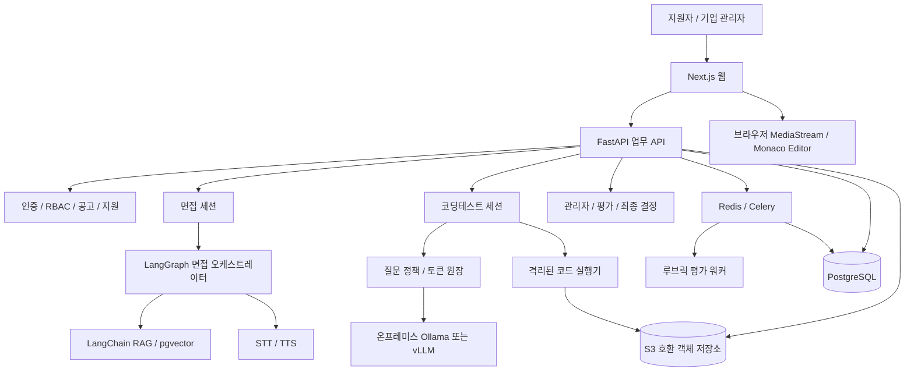
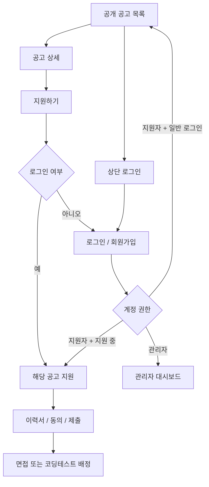
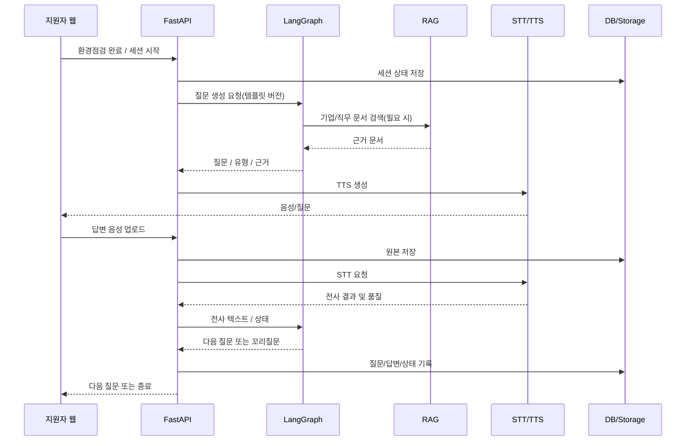
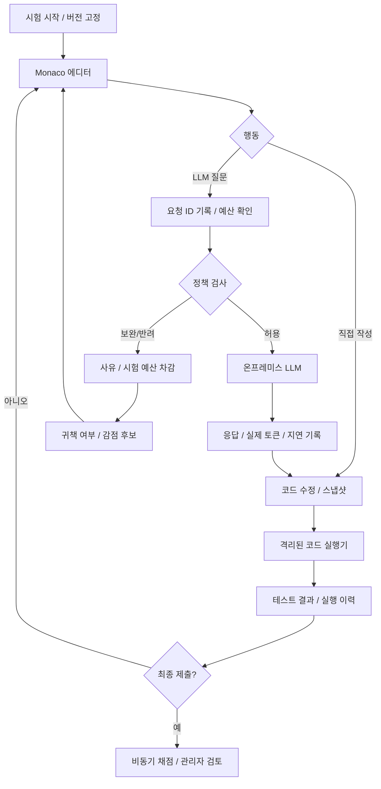

# AI 채용 플랫폼 통합 기술 아키텍처 v0.7

> 기준: AI 면접 기술 문서 v0.3, 페이지 Mermaid v0.4, 코딩테스트 설계 v0.6. 이 문서는 구현 제안이며 미결정 사항은 확정하지 않는다.

## 1. 목표와 원칙
- 공개 채용공고 → 지원 → 이력서 → AI 면접 및 직무별 코딩테스트 → 관리자 검토 → 최종 채용 결정.
- 로그인 경로 유지: 일반 로그인은 기존 공고 탐색으로 복귀, 특정 공고의 지원하기에서 로그인했다면 해당 지원 흐름으로 복귀. `returnTo`는 내부 허용 경로만 사용.
- 기업별 데이터 격리(`organization_id`) 및 RBAC; 관리자 권한은 초대/승인에 의해 부여.
- AI 평가와 사람의 최종 채용 결정을 분리. 평가 기준·질문·시나리오·모델 버전 고정.
- 웹 API, AI 추론, 미디어 처리, 코드 실행을 별도 프로세스/서비스로 격리.

## 2. 전체 구성

## 3. 권장 스택과 역할
| 계층 | 후보 | 역할 |
|---|---|---|
| Web | Next.js 16 / React 19 / TypeScript | 공고, 지원자, 관리자, 면접/코딩테스트 화면 |
| 폼 | React Hook Form + Zod | 브라우저 입력 검증 |
| API | FastAPI + Pydantic 2 | 인증, 업무 로직, 데이터 접근, 세션 상태 |
| DB | PostgreSQL 17 + SQLAlchemy 2 + Alembic | 트랜잭션, 관계형 저장, 스키마 버전 |
| 벡터 | pgvector | 기업 공개문서, 직무 지식, 질문은행 검색 |
| 오케스트레이션 | LangChain 1.x + LangGraph 1.x | 면접 질문 선택, 꼬리질문, 답변 평가 상태 흐름 |
| 비동기 | Redis + Celery | 이력서 처리, 리포트 생성, 알림 |
| 파일 | S3 호환 스토리지 | PDF, 음성, 코드 스냅샷, 리포트 |
| 코드 UI | Monaco Editor | 코딩테스트 에디터 |
| LLM 서빙 | Ollama(MVP) / vLLM(동시성 확대 시 검토) | 온프레미스 코딩 도우미 |
| 코드 실행 | 격리된 컨테이너/마이크로VM | 제출 코드 실행, 공개·비공개 테스트 |
| 관측 | 구조화 로그, 메트릭, 추적 | 오류 분석, 요청 상관관계, 비용/토큰 관측 |

모델·STT·TTS 엔진, 하드웨어, 호환 버전은 부하 테스트 전 확정하지 않는다.

## 4. 페이지 및 로그인 API 흐름

- `POST /auth/login`, `GET /jobs`, `GET /jobs/{id}`, `POST /jobs/{id}/applications`.
- 서버에서 세션/토큰 권한 확인. `returnTo`는 오픈 리다이렉트 방지 검증.
- 관리자 화면의 조직 범위는 UI가 아닌 모든 API/쿼리에서 검사.

## 5. 면접 처리 시퀀스

- 사용자 동작 후 TTS 재생; TTS 종료 후 녹음 시작. `getUserMedia` 스트림 재사용, HTTPS, echoCancellation.
- STT 품질 실패는 재녹음/재전사, 답변의 논리적 모순은 LangGraph 꼬리질문으로 구분.
- 면접 상태: `NOT_STARTED / READY / IN_PROGRESS / INTERRUPTED / SUBMITTED / REPORT_PENDING / REPORT_READY / FAILED`.
- 보고서는 Celery 비동기 생성, 상태 폴링 또는 SSE; 재시도/멱등성 필요.

## 6. RAG 파이프라인
`기업 공개 자료/PDF → 텍스트 추출 → 정제·청킹 → 임베딩 → pgvector → 공고·직무·조직 필터 검색 → LLM 질문/답변 생성 → 근거 및 버전 저장`.
- PDF는 텍스트 추출 우선, 스캔일 때만 OCR.
- 질문은행의 메타데이터·출제횟수·유형은 관계형 테이블에 보존하고 검색용 임베딩만 벡터화.
- RAG가 필요한 기능은 기업 자료 근거 검색과 문서 기반 질문. 로그인/CRUD/무작위 추출/가중치 합산에는 불필요.
- 기업별 문서 접근 권한과 인덱스 버전 통제.

## 7. 코딩테스트 구성 및 순서 (v0.6 규칙 유지)

- AI 사용 자체는 감점하지 않는다. 프롬프트, 응답, 코드 변경, 실행 결과, 스냅샷, 모델/시나리오 버전 기록.
- 오류 함정은 사전 QA된 제한 정보/고정 응답/통제 검색자료로 재현성을 확보. 정답·비공개 테스트는 LLM에 제공하지 않는다.
- 실제 모델 토큰과 시험 토큰 차감을 분리한다. 사전 정책 반려로 추론이 실행되지 않았다면 실제 추론 토큰은 0일 수 있으나 시험 예산은 공지된 정책대로 차감 가능.
- v0.6 반려 감점 초안 유지: 첫 귀책 반려 0점, 두 번째 누적 0.5점, 세 번째 1.5점, 네 번째 2.5점, 다섯 번째 이상 최대 3점. 기존 AI 활용 판단 15점 안에서만 적용. 자동 확정하지 않고 관리자 검토.
- 시스템 오탐/장애는 예산 복원 및 감점 취소. 토큰 원장은 append-only 이벤트.
- 격리 실행기는 네트워크 기본 차단, CPU/메모리/시간/파일 제한, 비특권 사용자, 임시 저장소 정리, 동시 실행 제한.
- 시험 토큰 소진 후에도 코드 편집·실행·제출은 허용.

## 8. 평가 구조
### AI 면접
- 질문 템플릿, 루브릭, 가중치, 모델 및 프롬프트 버전을 세션 시작 시 고정.
- 자기소개1+인성2+자소서2+기업2+직무4+커스텀1=12문항 안과 관리자 10슬롯 안은 **미결정**. 템플릿 기반 가변 슬롯으로 구현.
- 평가 결과: 카테고리 점수, 근거 인용, 신뢰도/검토 필요 표시, 관리자 피드백.
- 시선/감정/음성 특성만으로 부정행위·성격·적합성 확정 금지.
### 코딩테스트 (100점 초안)
- 정확성 40, 코드 품질 20, 검증·디버깅 20, 프롬프트·AI 활용 판단 15, 설명·근거 5.
- LLM 의존도·사용 횟수만으로 감점하지 않음. 반려 감점은 AI 활용 판단 15점 내 최대 3점으로 제한.
- 자동 테스트 결과와 관리자 확정 점수를 분리. 점수 변경 및 근거 감사 기록.

## 9. 주요 데이터 모델
| 도메인 | 테이블 예시 |
|---|---|
| 계정/권한 | `users`, `organizations`, `organization_memberships`, `roles`, `sessions` |
| 채용 | `jobs`, `applications`, `application_events`, `application_documents`, `hiring_decisions` |
| 면접 | `interview_templates`, `template_question_slots`, `interview_sessions`, `interview_questions`, `answer_attempts` |
| 지식/RAG | `knowledge_documents`, `document_chunks`, `question_bank`, `question_embeddings` |
| 평가 | `rubric_versions`, `rubric_weights`, `evaluation_results`, `report_visibility_policies`, `admin_notes` |
| 코딩 | `coding_problems`, `coding_test_sessions`, `code_snapshots`, `code_runs`, `code_submissions`, `coding_assessments` |
| LLM/토큰 | `llm_requests`, `llm_messages`, `token_ledger`, `penalty_reviews`, `scenario_versions` |
| 운영 | `notifications`, `audit_logs`, `background_jobs`, `consents` |

핵심 외래키: `organization_id`, `job_id`, `application_id`, `session_id`; 문제·루브릭·시나리오 버전은 변경 불가 스냅샷으로 참조.

## 10. API 설계 초안
| 그룹 | API 예시 |
|---|---|
| 공고/지원 | `GET /jobs`, `GET /jobs/{id}`, `POST /jobs/{id}/applications`, `GET /me/applications` |
| 문서 | `POST /documents/upload-url`, `POST /documents/{id}/confirm` |
| 면접 | `POST /interviews/{id}/start`, `POST /interviews/{id}/answers`, `GET /interviews/{id}/status` |
| 코딩 | `POST /coding/sessions/{id}/llm-requests`, `POST /coding/sessions/{id}/runs`, `POST /coding/sessions/{id}/submit` |
| 사용량 | `GET /coding/sessions/{id}/token-balance`, `GET /coding/sessions/{id}/events` |
| 관리자 | `POST /admin/jobs`, `GET /admin/applications`, `POST /admin/applications/{id}/decisions` |
| 평가 | `GET /admin/evaluations/{id}`, `POST /admin/penalty-reviews/{id}` |

모든 쓰기 요청에 권한 확인, 입력 검증, 적절한 멱등성 키 및 감사 기록을 적용.

## 11. 비동기 작업과 장애 처리
- Celery: 이력서 파싱/임베딩, 리포트 생성, 이메일 발송, 만료 처리.
- 장시간 작업은 API 요청에서 분리하고 `job_id`, `status`, `attempts`, `error_code`로 추적.
- 면접/코딩 세션 중 네트워크 중단 시 마지막 저장 상태를 조회해 재개; 재개 허용 정책은 관리자 설정/회의 결정 필요.
- LLM 추론 큐와 코드 실행 큐를 분리하고 사용자별 동시성 및 요청량 제한.
- SSE/WebSocket은 스트리밍이 필요한 경로에만 사용. 파일 업로드는 객체 스토리지 서명 URL 권장.

## 12. 보안/개인정보/공정성
- 인증 세션 보안, HTTPS, 서버 측 RBAC, 조직 범위 검증, 비밀번호 Argon2 등 안전한 해시.
- 이력서·음성·대화·코드에 대한 최소 수집, 목적별 고지/동의, 보존기간, 삭제, 접근 로그.
- 평가 결과와 AI 원문 로그의 열람 권한을 분리하고 민감 정보 마스킹.
- LLM 프롬프트 인젝션, 기업 간 검색 누출, 모델에 정답·숨은 테스트 유출 방지.
- 자동 채용 결정 금지. 관리자 검토, 이의제기, 감점 오탐 복구 경로 제공.
- 접근성/대체 응시 경로 마련. 시험 문제·함정 난이도와 루브릭 버전 검증.

## 13. 인프라 분리 및 규모
**MVP 배포 단위:** (1) Next.js (2) FastAPI (3) PostgreSQL+pgvector (4) Redis+Celery (5) 파일 저장 (6) 온프레미스 LLM 서빙 (7) 별도 격리 코드 실행기.
- STT/TTS 및 평가 모델은 외부 API 또는 별도 자체 호스팅 중 비용·보안 요건에 따라 선택.
- 초기 코딩테스트는 Python 1종, 소형/중형 LLM 1종, 사용자당 동시 LLM 요청 1건, 토큰 예산, 실행 동시성 제한.
- 서버 크기/GPU 수는 모델 크기, 양자화, 컨텍스트 길이, 동시 응시자 수, 목표 응답 지연을 확정한 후 부하 테스트로 산정. 임의의 확정 GPU 사양 제시 금지.
- 관측 지표: API p95, LLM 대기·생성 지연, GPU VRAM/사용률, 코드 실행 대기/실패율, 큐 적체, 면접 중단율, 평가 처리시간.

## 14. 단계별 개발
1. **기반:** 공개 공고, 로그인/복귀, 조직 권한, 지원서·이력서, DB/스토리지.
2. **면접 MVP:** 음성·문자 질문, 세션 상태, STT/TTS, 답변 저장, 고정 루브릭, 리포트.
3. **관리자:** 공고/질문/가중치 관리, 지원자 검토, 사람의 최종 채용 결정.
4. **코딩테스트 MVP:** Monaco, 격리 실행, 온프레미스 LLM, 시나리오, 토큰 원장, 반려 및 감점 후보, 평가.
5. **고도화:** 기업 RAG, 꼬리질문, 일정·알림, 통계, 다중 사용자 부하 검증.

## 15. 미결정 사항
- 면접 10문항 대 12문항, 질문 유형별 가변 슬롯 규칙.
- STT/TTS·임베딩·평가 LLM 모델과 외부 API 사용 범위.
- 지원 접수 및 이력서 수정 확정 시점, 재응시/재개 규칙.
- 지원자에게 공개할 평가 결과와 관리자 전용 근거 범위.
- 기업 관리자 초대·승인 프로세스, 보존/삭제 기간.
- 코딩테스트 문제별 토큰 예산, 반려 정책 버전, 실제 운영 전 모의시험 검증.
- 코딩테스트와 면접의 순서 및 직무별 필수 여부.

## 16. 기술적 주의사항
- 단일 FastAPI 프로세스에서 STT, LLM 추론, 코드 실행을 모두 동기 처리하지 않는다.
- `pgvector`는 임베딩 검색, PostgreSQL 일반 테이블은 거래·권한·상태를 담당한다.
- LangGraph는 면접/에이전트 상태 흐름에 사용하고 단순 CRUD에는 도입하지 않는다.
- 서버 측 코드 실행은 웹 컨테이너나 Celery 일반 워커에서 직접 수행하지 않는다.
- v0.6 반려 감점 규칙은 현재 설계 유지 사항이며, 실제 채용 적용 전 시험 공지 및 평가 타당성 검증이 필요하다.
