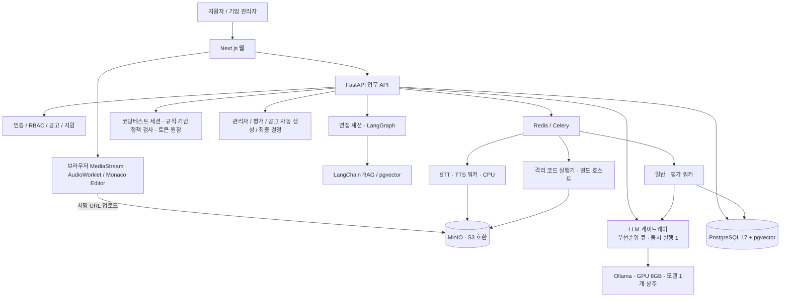
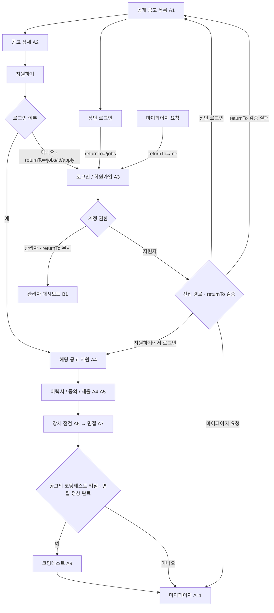
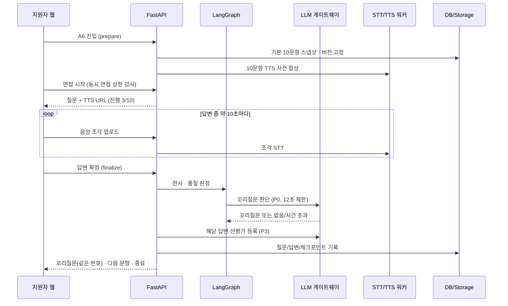
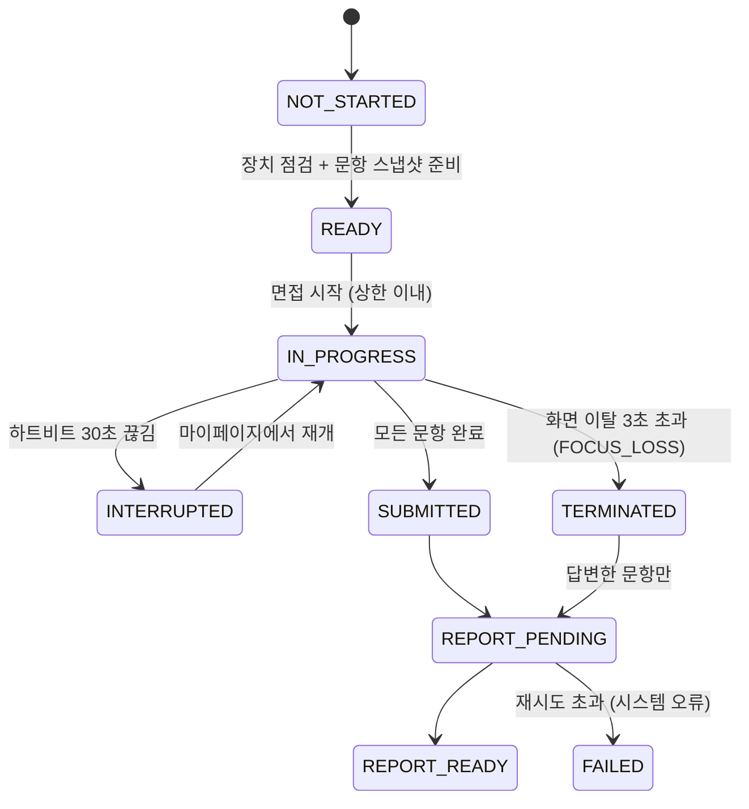
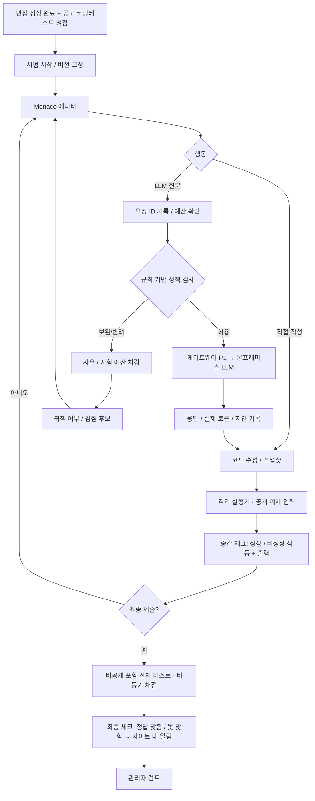

# Huge 통합 기술 아키텍처 — AI 모의면접 채용 플랫폼 v1.0

> **Huge** · 제작 **AIIT** (AI Interview Training) · 수정: 2026-10-26
> 기준: AI 면접 기술 문서 v0.3, 페이지 Mermaid v0.4, 코딩테스트 설계 v0.6, **PRD v1.3, 화면정의서 v1.3, TRD v1.0**.
> v0.7은 "구현 제안 + 미결정 다수" 상태였다. v1.0은 PRD/TRD 작성 과정에서 확정된 결정(D1~D10)을 반영해 **구현 기준 아키텍처**로 올린다. 세부 수치·테이블 컬럼·API 전체 목록은 TRD v1.0이 출처이며, 이 문서는 구조와 원칙을 담는다. 절 번호는 v0.7과 같게 유지해 기존 참조(예: "아키텍처 §13")가 그대로 통한다.

## v0.7 → v1.0 변경 요약
| # | 변경 | 근거 |
|---|---|---|
| 1 | AI(LLM·STT·TTS·임베딩) **전부 온프레미스**. 외부 AI API 사용 안 함 | D1 |
| 2 | LLM 서빙을 **Ollama 1개 모델 + LLM 게이트웨이(우선순위 큐)**로 확정. vLLM은 GPU 확장 시 교체 후보 | D1, TRD 4.4 |
| 3 | 면접 상태에 **`TERMINATED`(화면 이탈 3초 초과)** 추가, 부분 평가 | D2, D9 |
| 4 | 진행 순서 **면접 → 코딩테스트 고정** | D3 |
| 5 | 코딩테스트 결과 **2단계 공개**(응시 중 정상/비정상 작동, 제출 후 정답 맞힘/못 맞힘) | D4 |
| 6 | **동시 면접 상한** + 초과 시 거절 안내 | D5 |
| 7 | 평가 완료 알림은 **사이트 내 알림**, 문항별 선평가로 평가 대기 단축 | D6 |
| 8 | 공고 자동 생성 + **차별 표현 경고(게시 차단 없음)** | D7, CLAUDE.md 추가 요구사항 |
| 9 | 면접 문항 = **기본 10문항**, 꼬리질문은 해당 기본 문항에 포함(최대 4개) | D10 |
| 10 | 관리자 초대/승인 **MVP 비활성화**(운영자 직접 발급) | PRD 4.1 |
| 11 | 로그인 복귀 경로에 **마이페이지 진입·검증 실패 폴백** 추가 | 화면정의서 A3 |
| 12 | 15장 미결정 사항을 **해결됨 / 남은 항목**으로 재분류 | 15장 |

## 1. 목표와 원칙
- 공개 채용공고 → 지원 → 이력서 → AI 면접 → (공고에서 켠 경우) 코딩테스트 → 비동기 평가 → 관리자 검토 → 사람의 최종 채용 결정.
- 로그인 경로 유지: **상단 로그인은 공고 목록(A1)**, 특정 공고의 지원하기에서 로그인했다면 **해당 지원 절차**, 마이페이지 요청이면 **마이페이지(A11)**, 관리자는 **대시보드(B1)**로 보낸다. `returnTo`는 서버가 화이트리스트로 검증하고 최종 `redirectTo`를 계산한다.
- 기업별 데이터 격리(`organization_id`) 및 서버 측 RBAC. 관리자 계정은 **운영자가 CLI로 발급**한다(초대/승인은 후속).
- AI 평가와 사람의 최종 채용 결정을 분리. 질문·루브릭·가중치·모델·프롬프트·시나리오 버전을 세션 시작 시 고정.
- 웹 API, LLM 추론, 음성 처리, 코드 실행을 별도 프로세스/서비스로 격리.
- **모든 AI 처리는 사내에서** 한다. 지원자 음성·답변·코드·채팅이 외부 AI 서비스로 나가지 않는다.
- **느려지면 기능을 줄여서라도 흐름은 멈추지 않는다**(꼬리질문 생략, TTS 대체 등).

## 2. 전체 구성

- 모든 LLM 호출(면접 꼬리질문, 코딩 도우미, 공고 생성, 이력서 추출, 평가)은 **게이트웨이 한 곳**을 거친다. GPU 6GB에는 모델을 1개만 올릴 수 있어서, 누가 먼저 쓸지 한 곳에서 정해야 하기 때문이다.

## 3. 확정 스택과 역할
| 계층 | 기술 (TRD 2.1) | 역할 |
|---|---|---|
| Web | Next.js 16 / React 19 / TypeScript 5 | 공고, 지원자, 관리자, 면접/코딩테스트 화면 |
| 폼 | React Hook Form + Zod | 브라우저 입력 검증 |
| API | Python 3.12 + FastAPI + Pydantic 2 | 인증, 업무 로직, 데이터 접근, 세션 상태 |
| DB | PostgreSQL 17 + SQLAlchemy 2 + Alembic | 트랜잭션, 관계형 저장, 스키마 버전 |
| 벡터 | pgvector | 기업 공개문서, 직무 지식, 질문은행 검색 |
| 오케스트레이션 | LangChain 1.x + LangGraph 1.x | 면접 질문 흐름, 꼬리질문, RAG |
| 비동기 | Redis 7 + Celery 5 (+ Beat) | 이력서 처리, 평가, 알림, 만료 처리 |
| 파일 | MinIO (S3 호환) | PDF, 음성, 코드 스냅샷 |
| 코드 UI | Monaco Editor | 코딩테스트 에디터 |
| LLM 서빙 | **Ollama**(MVP) → GPU 확장 시 vLLM | 모든 LLM 추론 (모델 1종 공유) |
| STT | **faster-whisper (CPU, int8)** | 답변 음성 전사 |
| TTS | 온프레미스 한국어 TTS (CPU) | 질문 음성 합성 |
| 임베딩 | sentence-transformers (CPU) | RAG 벡터화 |
| 코드 실행 | 일회용 Docker 컨테이너 (운영: gVisor) | 제출 코드 실행 |
| 관측 | structlog JSON 로그 + `requestId` 추적 | 오류 분석, 지연·토큰 관측 |

- STT·TTS·임베딩은 **CPU**에서 돌려 GPU를 LLM 전용으로 남긴다.
- 정확한 패치 버전은 설치 시점에 lock 파일로 고정한다(문서에 임의 패치 버전을 적지 않음).
- 남은 선택: LLM 모델 종류, STT 모델 크기, TTS 엔진, 임베딩 모델 → PoC로 정한다(15장).

## 4. 페이지 및 로그인 API 흐름

- `POST /auth/login` 응답에 `role`과 서버가 계산한 `redirectTo`를 넣는다. 클라이언트는 그대로 이동만 한다.
- `returnTo` 허용 경로: `/jobs`, `/jobs/{id}`, `/jobs/{id}/apply`, `/me(/...)`. 외부 URL·역할 불일치(지원자 → `/admin`)는 A1로 대체한다(오픈 리다이렉트 방지).
- 관리자 화면의 조직 범위는 UI가 아닌 모든 API/쿼리에서 검사한다. 다른 조직 데이터는 `404`로 존재 자체를 숨긴다.
- 관리자 계정이 지원자 전용 API를 부르면 `403`.

## 5. 면접 처리 시퀀스

- **기본 문항 10개는 면접 전에 준비**한다(질문은행 SQL 선택, 관리자 입력, 공고 설정 때 미리 만든 RAG 질문). 면접 중 실시간 LLM 호출은 꼬리질문(최대 4회)뿐이다.
- 사용자 동작 후 TTS 재생 → 재생 종료 후 녹음 시작. `getUserMedia` 스트림을 A6~A7에서 재사용하고, HTTPS와 `echoCancellation`을 쓴다. **영상은 저장하지 않는다**(미리보기 전용).
- **분할 전사**: `AudioWorklet`으로 16kHz WAV 조각을 만들어 말하는 동안 미리 전사한다. 제출 후 대기는 마지막 조각 하나 분량으로 줄어든다.
- STT 품질 실패는 재녹음(문항당 최대 2회), 답변의 논리적 모순·모호함은 LangGraph 꼬리질문으로 구분한다.
- 꼬리질문이 12초 안에 안 나오면 건너뛰고 다음 기본 문항으로 간다(면접은 멈추지 않음).
- 동시 면접 상한을 넘으면 시작을 거절하고 "이미 많은 면접자들이 면접 중입니다. 추후 다시 요청해주세요."를 보여준다. 예상 대기 시간은 서버가 계산만 하고 화면에는 표시하지 않는다.
- 서버 TTS가 실패하면 질문 텍스트 + 브라우저 `speechSynthesis`로 대체하고 기록한다.

**면접 상태**

- `TERMINATED`는 지원자 행동으로 인한 종료, `FAILED`는 시스템 오류다. 통계와 재개 판단을 위해 섞지 않는다.
- `TERMINATED` 세션은 재개 불가, 코딩테스트 진입 불가.
- 화면 이탈 감지는 브라우저 기능이라 완벽하지 않다. 부정행위 **확정 장치가 아닌 억제 장치**로 쓰고, 관리자에게 이탈 이벤트 타임라인을 보여주는 데 그친다. 3초 안에 탭을 닫아 우회하는 경우는 "HIDDEN 이후 하트비트 끊김 = TERMINATED"로 분류해 막는다.
- 재개 시 답변 도중 끊긴 문항은 처음부터 다시 출제하고, 확정된 답변은 유지한다.

## 6. RAG 파이프라인
`기업 공개 자료/PDF → 텍스트 추출 → 정제·청킹 → 임베딩(CPU) → pgvector → 공고·직무·조직 필터 검색 → LLM 질문 생성 → 근거 및 버전 저장`.
- **RAG 질문은 관리자가 공고를 설정할 때(B8) 미리 생성**해 질문은행에 넣는다. 면접 중에는 RAG 검색을 하지 않는다(GPU 부담·지연 제거).
- PDF는 텍스트 추출만 한다. 추출 글자 수가 기준 미만이면 스캔본으로 보고 **MVP에서는 OCR 대신 직접 작성 안내**(OCR은 후속, Tesseract kor 검토).
- 질문은행의 메타데이터·출제횟수·유형은 관계형 테이블에 보존하고 검색용 임베딩만 벡터화.
- RAG가 필요한 기능은 기업 자료 근거 검색과 문서 기반 질문. 로그인/CRUD/무작위 추출/가중치 합산에는 불필요.
- 기업별 문서 접근 권한과 인덱스 버전 통제. 임베딩 모델을 바꾸면 재임베딩 + 인덱스 버전 증가.

## 7. 코딩테스트 구성 및 순서 (v0.6 규칙 유지 + D3·D4)

- **순서는 면접 → 코딩테스트로 고정**한다. 공고에 순서 설정 컬럼을 두지 않는다.
- **2단계 공개(D4)**: 응시 중 "실행"은 실행 오류 여부(정상/비정상 작동)와 출력·오류 메시지만 돌려준다. 기대 출력 비교는 하지 않는다. 제출 후 **모든 테스트가 일치**해야 "테스트 정답을 맞히셨습니다", 아니면 "맞히지 못했습니다". 통과 개수는 관리자 전용.
- AI 사용 자체는 감점하지 않는다. 프롬프트, 응답, 코드 변경, 실행 결과, 스냅샷, 모델/시나리오 버전 기록.
- 정책 검사는 **규칙 기반**이다(LLM 분류기 미사용). 반려 판정에 GPU를 쓰지 않고, 반려 시 실제 추론 토큰은 0이 된다.
- 오류 함정은 사전 QA된 고정 응답/통제 컨텍스트로 재현성을 확보. **정답·비공개 테스트는 게이트웨이 DB 계정이 아예 읽을 수 없게** 권한으로 막는다.
- 실제 모델 토큰과 시험 토큰 차감을 분리한다. 토큰 원장은 append-only, `unique(request_id, event_type)`로 중복 차감을 막는다.
- v0.6 반려 감점 초안 유지: 첫 귀책 반려 0점, 두 번째 누적 0.5점, 세 번째 1.5점, 네 번째 2.5점, 다섯 번째 이상 최대 3점. AI 활용 판단 15점 안에서만 적용. 자동 확정하지 않고 관리자 검토.
- 시스템 오탐/장애는 예산 복원(REFUND 행 추가) 및 감점 취소.
- 격리 실행기: 네트워크 차단, CPU/메모리/시간/프로세스 수 제한, 읽기 전용 파일시스템, 비특권 사용자, 일회용 컨테이너, 동시 실행 제한. API 컨테이너에 Docker 소켓을 주지 않는다.
- 남은 시간은 서버 마감 시각 기준. 마감되면 마지막 스냅샷으로 자동 제출.
- 시험 토큰 소진 후에도 코드 편집·실행·제출은 허용.

## 8. 평가 구조
### AI 면접
- 질문 템플릿, 루브릭, 가중치, 모델 및 프롬프트 버전을 세션 시작 시 고정.
- **기본 10문항**(인성 2 + 자소서 2 + 기업 2 + 직무 4, 템플릿 슬롯으로 관리) + **꼬리질문 면접 전체 최대 4개**. 꼬리질문은 자신을 만든 기본 문항에 포함되므로 문항 수는 항상 10개다(진행 표시 "3 / 10").
- 루브릭 4항목: 논리성 / 전달력 / 전문성 / 내용 관련성. 공고별 가중치 합계 100.
- **문항 점수** = 기본 답변과 꼬리 답변의 루브릭 점수를 항목별로 평균 낸 값. **총점** = 기본 10문항 점수의 평균.
- **답하지 않은 기본 문항은 0점**(D9). 꼬리질문에 답하기 전에 강제 종료된 문항은 "답변함"으로 세고 기본 답변만으로 평가(꼬리 미응답 감점 없음). 안내: "강제 종료로 10문항 중 N문항만 평가되었습니다". 관리자에게는 답변 문항 기준 평균도 함께 보여준다.
- **문항별 선평가**: 답변이 확정될 때마다 그 문항을 바로 평가 큐(P3)에 넣는다. 면접이 끝나면 마지막 문항 + 종합 피드백(강점 3·개선점 3)만 남아, 대기열이 비면 약 1~3분, 바쁠 때 약 10분 안에 리포트가 준비된다 [추정].
- 근거 인용이 실제 전사문에 있는지 문자열 대조로 확인하고, 없으면 "검토 필요"로 표시(LLM이 근거를 지어내는 것 방지).
- 시선/감정/음성 특성만으로 부정행위·성격·적합성 확정 금지.

### 코딩테스트 (100점 초안)
- 정확성 40(비공개 테스트 통과율, 기계 계산), 코드 품질 20, 검증·디버깅 20, 프롬프트·AI 활용 판단 15, 설명·근거 5.
- LLM 의존도·사용 횟수만으로 감점하지 않음. 반려 감점은 AI 활용 판단 15점 내 최대 3점으로 제한.
- 자동 점수 초안과 관리자 확정 점수를 분리. 점수 변경 및 근거 감사 기록.

### 공개 범위 (서버가 강제)
| 데이터 | 지원자 | 관리자 |
|---|---|---|
| 면접 항목별 점수·총점, 강점 3 / 개선점 3, 부분 평가 여부 | ✅ | ✅ |
| 면접 근거 인용, 신뢰도, 검토 필요 | ❌ | ✅ |
| 코딩 중간 체크(정상/비정상 작동) · 최종 체크(정답 맞힘/못 맞힘) | ✅ | ✅ |
| 코딩 통과 개수, 세부 5항목 점수, LLM 채팅·반려·감점 후보 | ❌ | ✅ |
| 화면 이탈 이벤트 타임라인 | ❌ | ✅ |
| 최종 합격/불합격/보류 | ✅ (결정 후) | ✅ |
- 지원자용과 관리자용 응답 스키마를 **별도 Pydantic 모델**로 나눈다. 지원자 모델에는 관리자 전용 필드가 아예 없다(null로 비우는 방식 금지). 계약 테스트로 보증한다.

## 9. 주요 데이터 모델
| 도메인 | 테이블 예시 |
|---|---|
| 계정/권한 | `users`, `organizations`, `organization_memberships`, `auth_sessions`, `consents` |
| 채용 | `jobs`(`coding_test_enabled`), `applications`(unique job·user), `application_events`, `resumes`, `hiring_decisions`, `job_generation_logs` |
| 면접 | `interview_templates`, `template_question_slots`, `interview_sessions`(`status`, `end_reason`), `interview_questions`(`is_follow_up`, `parent_question_id`), `answer_attempts`, `answer_segments` |
| 지식/RAG | `knowledge_documents`, `document_chunks`, `question_bank`, `question_embeddings` |
| 평가 | `rubric_versions`, `rubric_weights`, `answer_evaluations`, `evaluation_results`(`is_partial`, `answered_count`, `planned_count`), `evaluation_adjustments`, `admin_notes` |
| 코딩 | `coding_problems`, `coding_test_cases`, `scenario_versions`, `coding_test_sessions`, `editor_events`, `code_snapshots`, `code_runs`(`run_health`), `code_submissions`(`final_result`), `coding_assessments` |
| LLM/토큰 | `llm_requests`, `llm_messages`, `token_ledger`, `penalty_reviews` |
| 운영 | `notifications`(`channel`, `read_at`), `schedules`, `background_jobs`, `audit_logs`, `idempotency_keys` |

- 핵심 외래키: `organization_id`, `job_id`, `application_id`, `session_id`. 문제·루브릭·시나리오·템플릿 버전은 변경 불가 스냅샷으로 참조한다(수정 = 새 버전 행).
- 토큰 원장, 평가 조정, 채용 결정, 감사 로그는 append-only(앱 DB 계정에서 UPDATE/DELETE 권한 회수).
- DB 이름은 snake_case, Python/TypeScript와 API JSON은 camelCase.
- 컬럼 전체 정의는 TRD v1.0 5.3.

## 10. API 설계 개요
| 그룹 | API 예시 |
|---|---|
| 인증 | `POST /auth/login`(→ `redirectTo`), `POST /auth/signup`, `GET /auth/me` |
| 공고/지원 | `GET /jobs`, `GET /jobs/{id}`, `POST /jobs/{id}/applications`, `GET /me/applications` |
| 문서 | `POST /documents/upload-url`, `POST /documents/{id}/confirm`, `PUT /resumes/me` |
| 면접 | `POST /interviews/{id}/prepare`, `/start`, `/answers/{qid}/segments`, `/answers/{qid}/finalize`, `/heartbeat`, `/focus-events`, `/terminate`, `/resume`, `GET /interviews/{id}/current` |
| 코딩 | `POST /coding/sessions/{id}/llm-requests`(SSE), `/runs`, `/submit`, `GET /coding/runs/{runId}` |
| 알림 | `GET /me/notifications`, `POST /me/notifications/{id}/read`, `/read-all` |
| 관리자 | `POST /admin/jobs`, `/admin/job-drafts/generate`(SSE), `/admin/job-drafts/check-terms`, `GET /admin/applications`, `POST /admin/applications/{id}/decisions` |
| 평가 | `GET /me/applications/{id}/evaluation-summary`(지원자용), `GET /admin/evaluations/{id}`(관리자용), `POST /admin/penalty-reviews/{id}` |

- 기본 경로 `/api/v1`. 세션 쿠키(`HttpOnly; Secure; SameSite=Lax`) + 상태 변경 요청에 CSRF 토큰.
- 중복되면 안 되는 쓰기(답변 제출, LLM 질문, 코드 제출, 채용 결정, 공고 게시)는 `Idempotency-Key` 필수.
- 오래 걸리는 작업은 `202 + jobId` 후 폴링 또는 SSE. 오류는 `{error:{code, message, details}}` 형식.
- 전체 목록은 TRD v1.0 6.2.

## 11. 비동기 작업과 장애 처리
- Celery 큐: `default`(이력서 파싱·임베딩·알림·통계), `eval`(면접 선평가·종합 평가·코딩 채점), `stt`, `tts`, `code_runs`(별도 호스트 실행기만 구독). Beat: 하트비트 끊김 점검, 코딩 마감 자동 제출, 알림 조건 점검.
- LLM 게이트웨이 우선순위: **P0 면접 꼬리질문(12초) > P1 코딩 도우미(60초) > P2 공고 생성·이력서 추출(90초) > P3 평가·사전 생성(300초)**. 실행 중인 작업은 끊지 않고 다음 차례만 정한다. 120초 넘게 기다린 작업은 우선순위를 올리고, P0가 대기 중이면 새 P3는 시작하지 않는다.
- 장시간 작업은 `background_jobs`의 `status`, `attempts`, `error_code`로 추적하고, 다시 돌려도 결과가 중복되지 않게(멱등) 만든다.
- 면접 중단: 10초 하트비트, 30초 끊기면 `INTERRUPTED` → 마이페이지에서 재개. 코딩 중단: 마감 시각은 계속 흐름(관리자가 시간 연장으로 보정) [제안].
- Ollama 무응답: P0는 즉시 생략하고 면접 계속, P1은 "AI 도우미 일시 중단, 코딩은 계속 가능" + 토큰 복원.
- 알림: 평가 완료·코딩 채점 완료·최종 결정은 **사이트 내 알림**(60초 폴링, `dedup_key`로 중복 방지). 일정 안내·마감 리마인더는 메일(개발: Mailpit). 메일 발송 실패는 1분 → 5분 → 30분 재시도.
- SSE는 스트리밍이 필요한 경로(코딩 도우미, 공고 생성)에만 쓴다. 파일 업로드는 서명 URL.

## 12. 보안/개인정보/공정성
- HTTPS 전 구간, 서버 측 세션(유휴 2시간·절대 12시간 [제안]), 서버 측 RBAC·조직 범위 검증, 비밀번호 Argon2id, 로그인 실패 제한.
- 이력서·음성·대화·코드 최소 수집, 목적별 고지/동의(문구 해시·버전 저장), 보존기간, 삭제, 원본 열람 감사 로그.
- **D1 효과**: AI 처리가 모두 사내라 "외부 AI 서비스 제공" 동의 조항이 필요 없다.
- MinIO 서버 측 암호화, 비공개 객체는 5분 만료 서명 URL. 업로드는 매직 바이트로 검사.
- LLM 프롬프트 인젝션(사용자 입력을 데이터 구획으로 분리), 기업 간 검색 누출, 정답·비공개 테스트 유출(DB 권한으로 차단) 방지.
- 자동 채용 결정 API를 두지 않는다. 관리자 검토, 이의제기, 감점 오탐 복구 경로 제공.
- 공고 자동 생성 초안은 **규칙 사전 기반 차별 표현 검사**로 밑줄 + 경고를 보여주되 게시는 막지 않는다(사전 버전 관리, 오탐·누락 사례로 갱신).
- 화면 이탈·영상 정보로 부정행위를 확정하지 않는다(영상 미저장).
- 접근성/대체 응시 경로는 후속(장애인 대체 응시 트랙).

## 13. 인프라 분리 및 규모
**MVP 배포 단위:** (1) Next.js (2) FastAPI API (3) LLM 게이트웨이 (4) 일반·평가 워커 (5) STT·TTS 워커(CPU) (6) Celery Beat (7) PostgreSQL+pgvector · Redis · MinIO · Mailpit (8) Ollama(호스트 네이티브, GPU) (9) 별도 호스트 격리 코드 실행기.
- **개발 환경 하드웨어(확정)**: Windows 10 + Docker Desktop(WSL2), GPU **VRAM 6GB 1대**, CPU 8코어·RAM 32GB 권장 [추정]. Celery·gVisor는 Windows에서 직접 못 돌리므로 Docker 안에서 실행하고, Ollama만 Windows 네이티브로 GPU를 쓴다.
- GPU 6GB 예산: 4~8B급 Q4 모델 1개 + 컨텍스트 4,096 + 동시 추론 1건(`OLLAMA_MAX_LOADED_MODELS=1`, `OLLAMA_NUM_PARALLEL=1`, 모델 상주).
- **솔직한 한계**: 이 구성에서 원활한 동시 면접은 **1~2명 수준** [추정]이다. 개발·시연용으로는 충분하지만 실제 서비스 규모는 아니다. 그래서 동시 면접 상한(기본 2 [제안])을 두고 넘으면 거절 안내한다.
- **확장**: 실서비스는 동시 응시자 목표 → 모델 크기·양자화·컨텍스트 → GPU 사양 순으로 부하 테스트를 거쳐 정한다. 교체 지점은 게이트웨이 하나(Ollama → vLLM)라 나머지 구조는 그대로다. STT·실행기 워커는 상태가 없어 수평 확장할 수 있다.
- 초기 코딩테스트는 Python 1종, 사용자당 동시 LLM 요청 1건, 실행기 동시 실행 2 [제안].
- 관측 지표: API p95, LLM 대기·생성 지연(우선순위별 큐 길이), GPU VRAM/사용률, STT 지연, 코드 실행 대기/실패율, 면접 중단율·재개 성공률, 꼬리질문 생략률, TTS 대체 발생률, 평가 처리시간.

## 14. 단계별 개발
1. **기반:** 공개 공고, 로그인/복귀, 조직 권한(운영자 발급 관리자), 지원서·이력서, DB/스토리지, 브랜드 자산(Huge/AIIT).
2. **PoC (1~2주):** 후보 LLM·STT·TTS의 한국어 품질과 6GB/CPU 속도, 동시 면접 1/2/3명 지연 측정 → 모델·상한 확정.
3. **면접 MVP:** 장치 점검, 기본 10문항 사전 준비, TTS/분할 STT, 세션 상태(재개·강제 종료), 꼬리질문, 문항별 선평가, 리포트, 사이트 내 알림.
4. **관리자:** 공고/질문/가중치 관리, **공고 자동 생성 + 차별 표현 경고**, 지원자 검토, 사람의 최종 채용 결정.
5. **코딩테스트 MVP:** Monaco, 격리 실행, 2단계 판정, 게이트웨이 P1 도우미, 시나리오, 토큰 원장, 반려 및 감점 후보, 평가.
6. **고도화:** 기업 RAG 질문 사전 생성, 일정·알림, 통계, 다중 사용자 부하 검증, GPU 확장 시 vLLM 전환.

각 단계는 TRD의 `TR-*` 요구사항별 테스트를 먼저 작성하고(`python -m pytest`, `ruff check .`) 통과시키는 방식으로 진행한다.

## 15. 미결정 사항
### 15.1 v0.7 미결정 사항 처리 결과
| v0.7 항목 | v1.0 처리 | 근거 |
|---|---|---|
| 면접 10문항 대 12문항, 가변 슬롯 규칙 | **해결.** 기본 10문항(2/2/2/4 슬롯) + 꼬리질문 최대 4개, 꼬리는 기본 문항에 포함 | PRD 6.3, D10 |
| STT/TTS·임베딩·평가 LLM과 외부 API 사용 범위 | **범위 해결.** 전부 온프레미스, STT=faster-whisper. 구체 모델만 PoC로 선정 | D1 |
| 지원 접수 및 이력서 수정 확정 시점, 재응시/재개 규칙 | **대부분 해결.** 접수 = 동의 후 지원 API 호출(중복 지원 409), 이력서는 수정 시 새 버전. 재응시 없음, 네트워크 중단만 재개, 화면 이탈 종료는 재개 불가. 재개 기한만 남음 | PRD 6.2·6.3, D2 |
| 지원자 공개 평가 범위 | **해결.** 8장 공개 범위 표 + 응답 스키마 분리 | PRD 6.5·7.2, D4 |
| 관리자 초대·승인, 보존/삭제 기간 | **초대·승인 해결**(MVP 비활성화, 운영자 발급). 보존/삭제 기간은 남음 | PRD 4.1 |
| 문제별 토큰 예산, 반려 정책 버전, 모의시험 검증 | **방향 해결**(반려도 예산 차감, 오탐 복원, 정책 버전 설정값). 구체 수치는 남음 | PRD 9장 |
| 코딩테스트와 면접 순서, 직무별 필수 여부 | **해결.** 면접 → 코딩테스트 고정, 공고별 체크박스로 포함 여부 결정 | D3, CLAUDE.md |

### 15.2 남은 항목 (TRD v1.0 12장과 동일 번호)
| # | 항목 | 현재 기본값 | 결정 방법 |
|---|---|---|---|
| U1 | 온프레미스 LLM 모델 종류 | 한국어+코드 겸용 4~8B Q4 후보 | PoC |
| U2 | STT 모델 크기 | faster-whisper small int8 | PoC |
| U3 | TTS 엔진 | MeloTTS-KR / Piper-KR 후보 | PoC |
| U4 | 임베딩 모델과 벡터 차원 | multilingual-e5-small 후보 | PoC |
| U5 | 반려 차감량·감점 임계값 | 정책 설정값으로만 존재 | 모의시험 |
| U6 | 면접 재개 가능 기한 | 공고 마감까지 | 회의 |
| U7 | 코딩테스트 중단 중 타이머 정지 여부 | 정지하지 않음 + 관리자 연장 | 회의 |
| U8 | 데이터 보존·삭제 기간 | — | 회의 (개인정보 검토) |
| U9 | 운영 SMTP 서비스 | 개발은 Mailpit | 운영 전 |
| U10 | 동시 면접 상한 | 2 | PoC |
| U11 | Huge 정식 SVG 워드마크 | 포스터 추출 임시본 | 디자인 작업 |
| U12 | 예상 대기 시간 화면 표시 | 서버 계산만, 표시 안 함 | 로그로 정확도 확인 후 |

## 16. 기술적 주의사항
- 단일 FastAPI 프로세스에서 STT, LLM 추론, 코드 실행을 동기 처리하지 않는다(API는 접수 → 큐 → 상태 조회).
- **Ollama를 게이트웨이 밖에서 직접 호출하지 않는다.** 여러 곳이 직접 부르면 GPU 순서 관리가 깨져 면접 중인 지원자가 배치 평가 뒤에서 기다리게 된다.
- STT·TTS·임베딩에 GPU를 쓰지 않는다(GPU는 LLM 전용).
- `pgvector`는 임베딩 검색, PostgreSQL 일반 테이블은 거래·권한·상태를 담당한다.
- LangGraph는 면접 상태 흐름에 사용하고(노드마다 PostgreSQL 체크포인트) 단순 CRUD에는 도입하지 않는다.
- 서버 측 코드 실행은 웹 컨테이너나 Celery 일반 워커에서 직접 수행하지 않는다. 실행기는 별도 호스트.
- 동시 면접 상한 검사와 상태 전이는 한 트랜잭션(advisory lock) 안에서 처리한다(동시 클릭으로 상한 초과 방지).
- 화면 이탈 감지는 완벽할 수 없다. 3초 임계값은 이탈 지속시간 로그로 오탐을 측정해 조정한다.
- v0.6 반려 감점 규칙은 현재 설계 유지 사항이며, 실제 채용 적용 전 시험 공지 및 평가 타당성 검증이 필요하다.
