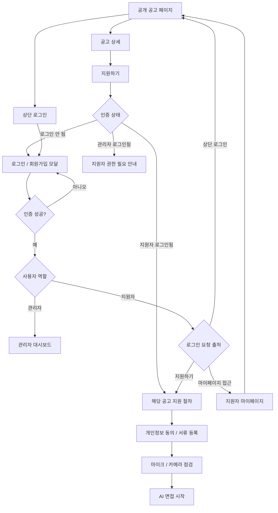
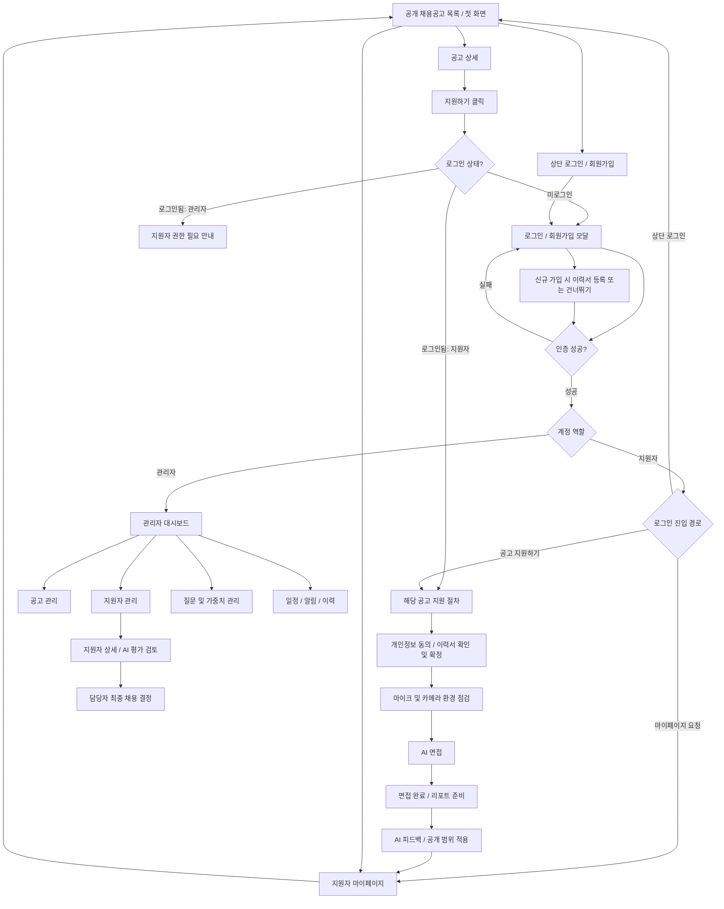
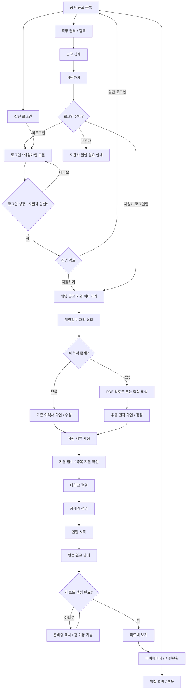
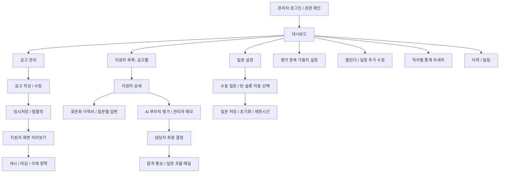
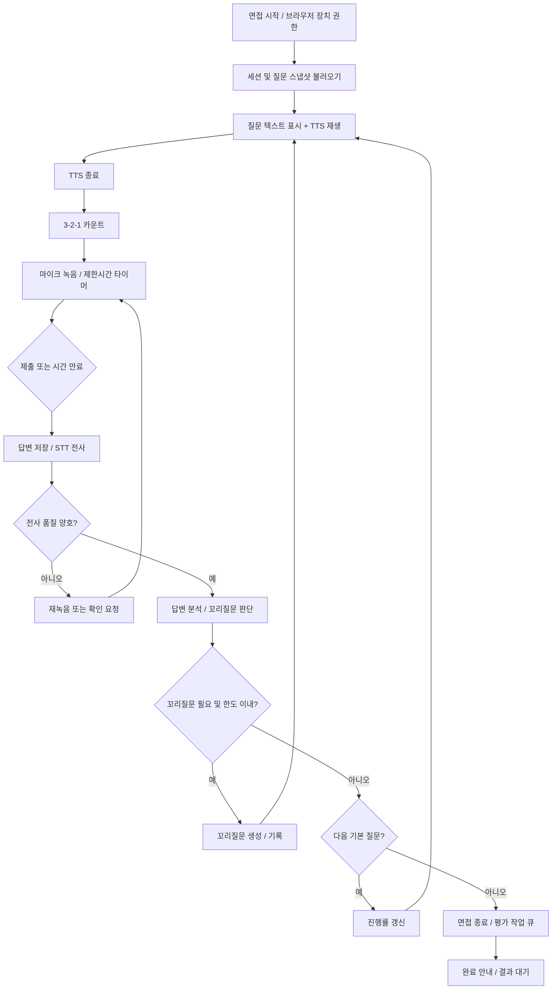
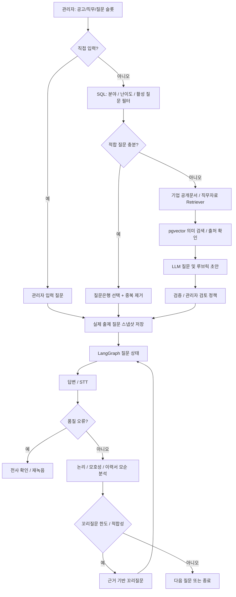
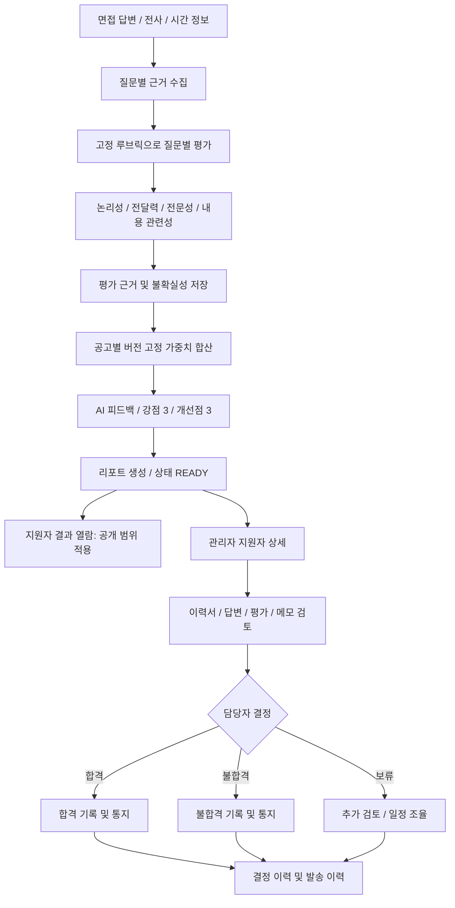
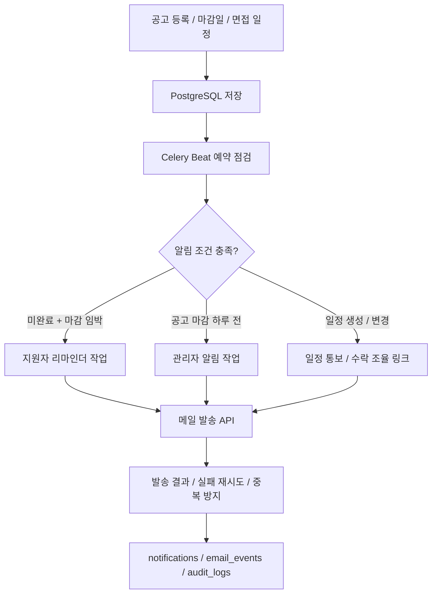

# AI 채용 플랫폼 Mermaid 플로우차트 통합본 v0.4

> 수정: 2026-10-22. 공개 공고 페이지에서 일반 로그인하면 공고 페이지로 복귀하고, 특정 공고 지원 도중 로그인하면 해당 지원 절차로 복귀하도록 반영했다. 관리자 계정은 관리자 대시보드로 이동한다. `returnTo`는 허용된 내부 경로로만 검증하고 지원하려던 `jobId`를 보존한다.

> **표기 주의:** 회의에서 미확정된 질문 수(관리 슬롯 10개 vs 면접 구성 12개), 꼬리질문 상한, UI 배치 등은 최종 확정값으로 간주하지 않는다.

## 01B_로그인_복귀경로

## 01_전체_페이지플로우

## 02_지원자_페이지플로우

## 03_관리자_페이지플로우

## 04_면접_화면_상세플로우

## 05_질문생성_RAG_LangGraph

## 06_평가_리포트_채용결정

## 07_비동기_일정_알림

