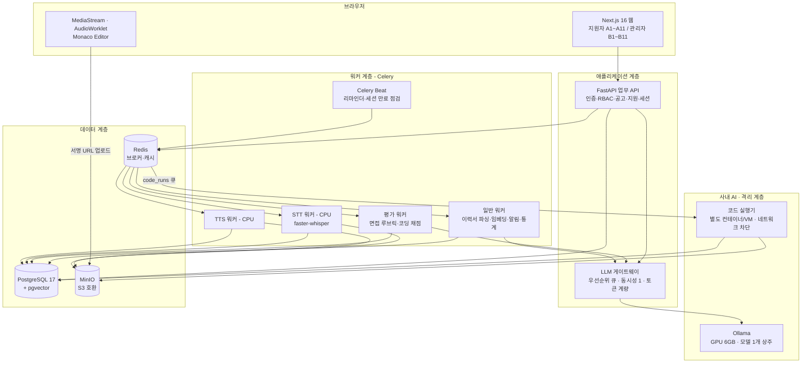
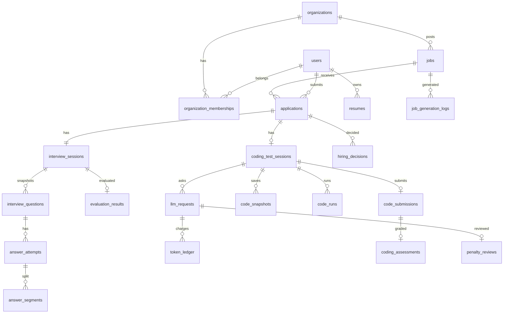
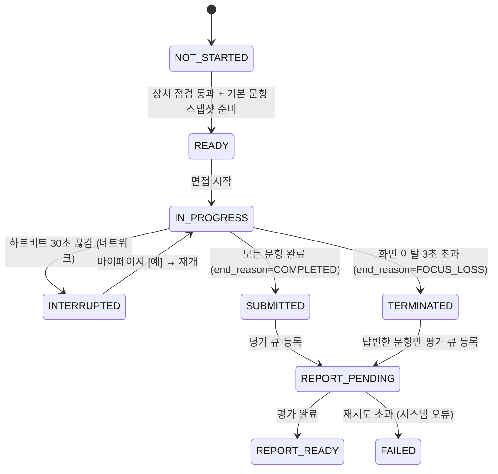
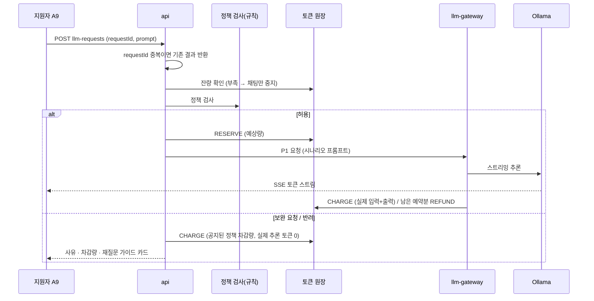
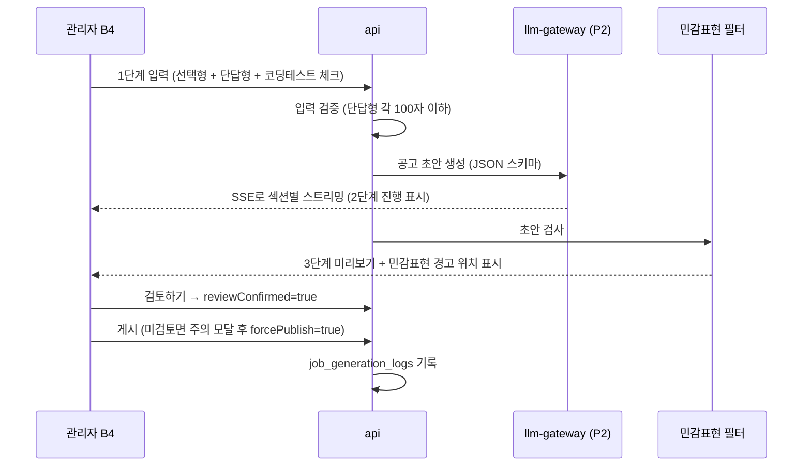

# Huge TRD — AI 모의면접 채용 플랫폼 v1.0

<p>
  
  &nbsp;&nbsp;
  
</p>

> **Huge** · AI가 함께하는 더 나은 채용의 시작 — Good People, Great Teams
> 제작 · **AIIT** (AI Interview Training)
> 작성일: 2026-10-26 · 문서 종류: TRD(Technical Requirements Document, 기술 요구사항 정의서)

> 근거 문서 (우선순위 순)
> 1. PRD v1.3 — `AI채용플랫폼_PRD_v1.3/PRD_AI채용플랫폼_v1.3.md` (기능 요구사항의 확정 출처)
> 2. 화면정의서 v1.3 — `AI채용플랫폼_화면정의서_v1.3/화면정의서_AI채용플랫폼_v1.3.md` (화면·상호작용의 확정 출처)
> 3. 기술 아키텍처 v0.7 — `AI 기술 아키텍처v0.7/AI채용플랫폼_기술아키텍처_v0.7/기술아키텍처_통합설계_v0.7.md`
> 4. 코딩테스트 v0.6 — `AI채용플랫폼_코딩테스트_v0.6/` (플로우 09~13, 설계 및 평가기준)
> 5. Mermaid v0.4 — `AI채용 플랫폼 Mermaid v0.4/` (플로우 01~07)
> 6. 브랜드 자산 — 원본 `AI 채용을 돕는 휴지곽 로봇 Huge.png`, `메인로고.png`, `글씨만 있는 로고.png` / 웹용 가공본 `brand/`

---

## 0. 이 문서를 읽는 방법

PRD가 **"무엇을 만들 것인가"**라면 TRD는 **"그것을 어떤 기술로, 어떤 조건에서, 어디까지 만들 수 있는가"**를 정한다.
각 요구사항은 `TR-영역-번호` 형식의 ID를 가지며, 구현할 때 테스트 케이스 이름과 연결한다(SDD/TDD 원칙, 11장).

| 표기 | 의미 |
|---|---|
| **[확정]** | PRD/화면정의서/이번 의사결정으로 확정된 내용 |
| **[제안]** | TRD 작성자가 기술 판단으로 제안한 기본값. 이견이 없으면 이 값으로 구현 |
| **[미결정]** | 운영 전 PoC/모의시험/회의로 정해야 하는 항목 (12장에 모음) |
| **[추정]** | 실측 전 추정치. PoC로 반드시 측정해서 교체 |

### 0.1 TRD v1.0 작성 시 의사결정 기록 (2026-10-26)

문서 간 모순·공백에 대해 사용자에게 확인하고 정한 내용이다.

| # | 쟁점 | 결정 | 영향 |
|---|---|---|---|
| D1 | 면접 질문생성·평가·공고 자동생성 LLM, STT/TTS의 배치 (PRD 9장 미정) | **전부 온프레미스.** 외부 AI API를 쓰지 않는다 | GPU 6GB 한 대를 모든 LLM 작업이 같이 쓴다 → 우선순위 큐와 동시성 제한 필요(4.4, 9.1) |
| D2 | 화면 이탈 3초 강제 종료 상태값 (화면정의서 A7이 TRD에 위임) | **신규 상태 `TERMINATED` + 답변한 문항만 부분 평가** | 상태 머신·리포트·마이페이지 분기 변경(5.3, 7.3) |
| D3 | 면접/코딩테스트 순서 변경 가능 여부 (PRD 5.1 ↔ 화면정의서 B3/A8) | **"면접 → 코딩테스트"로 고정. PRD 문구 수정** | PRD 5.1 문장 수정 완료. `jobs`에 순서 컬럼을 두지 않는다 |
| D4 | 코딩테스트 공개 결과의 판정 기준 (어느 문서에도 없음) | **2단계로 판정.** 응시 중 중간 체크 = 실행 오류 여부(정상/비정상 작동), 제출 후 최종 체크 = 정답 일치 여부("테스트 정답을 맞히셨습니다 / 맞히지 못했습니다") | 7.5, 7.9. PRD v1.3 §6.4·6.5에 반영 |
| D5 | 동시 면접 상한 초과 시 처리 (추천 R1) | **대기열 없이 거절 안내.** "이미 많은 면접자들이 면접 중입니다. 추후 다시 요청해주세요." 예상 대기 시간은 서버가 계산해 응답에 넣고, 화면 표시는 후속 | TR-AI-23, 화면정의서 v1.3 A6 |
| D6 | 평가 완료 알림 (추천 R2) | **메일이 아닌 사이트 내 알림.** 동시에 평가 지연 원인을 분석해 처리 시간을 줄인다 | 4.5, TR-NOTI-06, 화면정의서 v1.3 C1 |
| D7 | 공고 차별 표현 (추천 R3) | **미리보기에서 밑줄 + 경고. 게시 차단 없음** | TR-GEN-08 |
| D8 | 마스코트 일러스트 (추천 R4) | **이미지 크롭·최적화 후 화면에 사용** | 9장, `brand/` |
| D9 | 강제 종료 면접의 총점 | **안 답한 문항 0점 (확정, 변경 여지 없음).** 지원자에게도 0점 반영 총점 + 안내 문구로 공개(PRD 공개 범위 규칙 그대로) | TR-IV-61, 62 |
| D10 | 면접 문항 수를 세는 단위 (안내 문구 "N문항 중 M문항", 진행 표시) | **기본 10문항 기준.** 꼬리질문은 자신을 만든 기본 문항에 포함한다(면접 전체 최대 4개). 진행 표시 `3/10`, 강제 종료 안내 "10문항 중 N문항". 문항 점수 = 기본·꼬리 답변 루브릭 항목별 평균, 꼬리질문 직전 종료 시 기본 답변만으로 평가(감점 없음) | TR-IV-60, 63, 화면정의서 A7/A11/B6 |

### 0.2 이전 문서에서 이어받은 모순 해결

- 코딩테스트 v0.6의 "코딩테스트 → 면접" 서술은 PRD를 따라 **"면접 → 코딩테스트"**로 대체한다(화면정의서 v1.0부터 유지).
- 기술 아키텍처 v0.7의 "10문항 vs 12문항 미결정"은 PRD v1.2의 **기본 10문항 + 꼬리질문 최대 4개**로 확정한다. 꼬리질문은 해당 기본 문항에 포함하므로 문항 수는 10개다(D10).
- 기술 아키텍처 v0.7의 "관리자 초대/승인"은 PRD 4.1에 따라 **MVP에서 비활성화**한다(운영자 직접 발급).

---

## 1. 기술 개요

### 1.1 시스템의 기술적 목표
1. **엔드투엔드 흐름 완결**: 공개 공고 → 지원 → 이력서 → AI 음성 면접 → (선택) 코딩테스트 → 비동기 평가 → 관리자 심사 → 사람의 최종 결정이 끊기지 않고 이어진다.
2. **AI를 전부 사내에서 운영(D1)**: 지원자 음성·답변·코드·채팅이 외부 AI 서비스로 나가지 않는다.
3. **제한된 GPU(6GB)로도 동작**: 무거운 작업(LLM·STT·TTS·코드 실행)을 웹 요청에서 떼어 큐로 보내고, 실시간 작업이 배치 작업보다 먼저 처리되게 한다. 느려지면 기능을 줄여서라도(꼬리질문 생략 등) 면접 흐름은 멈추지 않게 한다.
4. **재현 가능한 평가**: 질문·루브릭·가중치·모델·프롬프트·시나리오 버전을 세션 시작 시 고정해 같은 조건으로 다시 볼 수 있게 한다.
5. **공개 범위를 서버가 강제**: 지원자용·관리자용 응답 스키마를 나눠서, 관리자 전용 데이터는 지원자 API 응답에 아예 들어가지 않게 한다.

### 1.2 범위
| 포함 (MVP) | 제외 (후속) |
|---|---|
| 지원자 화면 A1~A11, 관리자 화면 B1~B11 | 관리자 초대/승인 (PRD 4.1) |
| 음성 면접 (TTS/STT, 꼬리질문, 재개, 강제 종료) | 장애인 대체 응시 트랙 (화면정의서 A6 각주) |
| 코딩테스트 Python 1종 | 코딩테스트 다중 언어 |
| 공고 자동 생성 | 면접/코딩테스트 순서 변경 (D3) |
| 비동기 평가·알림·통계 | 영상 분석 (시선/감정) — PRD 7.4에 따라 하지 않음 |

---

## 2. 기술 스택

### 2.1 스택 요약

| 계층 | 기술 | 버전 기준 | 역할 |
|---|---|---|---|
| 언어(백엔드) | Python | **3.12.x** [확정, PRD 7.5] | API·워커·AI 파이프라인 |
| 웹 API | FastAPI + Pydantic 2 + Uvicorn | FastAPI ≥0.115 / Pydantic 2.x | 인증, 업무 로직, 세션 상태 |
| ORM/마이그레이션 | SQLAlchemy 2.0 + Alembic | 2.0.x / 1.x | DB 접근, 스키마 버전 관리 |
| DB | PostgreSQL + pgvector | **17** / pgvector 0.8.x | 관계형 데이터 + 임베딩 검색 |
| 큐/캐시 | Redis + Celery (+ Celery Beat) | Redis 7.x / Celery 5.x | 비동기 작업, 예약 알림 |
| AI 오케스트레이션 | LangChain + LangGraph | 1.x / 1.x | 면접 질문 상태 흐름, RAG |
| LLM 서빙 | **Ollama** (온프레미스) | 최신 안정판 | 모든 LLM 추론 (D1) |
| STT | **faster-whisper** (CPU, int8) | 1.x | 답변 음성 전사 |
| TTS | 온프레미스 한국어 TTS (PoC 후보: MeloTTS-KR, Piper-KR) | [미결정] | 질문 음성 합성 |
| 임베딩 | sentence-transformers (CPU) — 후보: multilingual-e5-small / bge-m3 | [미결정] | RAG 문서·질문은행 벡터화 |
| 파일 저장 | S3 호환 스토리지 — **MinIO** (개발/사내) | 최신 안정판 | PDF, 음성, 코드 스냅샷 |
| 코드 실행 | Docker 컨테이너 격리 실행기 (운영: gVisor `runsc`) | Docker 24+ | 제출 코드 실행 |
| 프런트엔드 | Next.js + React + TypeScript | **16 / 19 / 5.x** | 전체 화면 |
| 폼 검증 | React Hook Form + Zod | 7.x / 3.x 이상 | 브라우저 입력 검증 |
| 코드 에디터 | Monaco Editor (`@monaco-editor/react`) | 4.x | 코딩테스트 에디터 |
| 메일(개발) | Mailpit (SMTP 테스트 서버) | 최신 | 알림 메일 확인 |
| 테스트/린트 | pytest, ruff / Vitest, ESLint | pytest 8.x / ruff 최신 | CLAUDE.md 검증 명령 |

> **버전 고정 원칙 [확정]**: 위 표는 "메이저(·마이너) 기준"이다. 실제 설치 시점에 정확한 패치 버전을 `requirements.lock`(pip-tools 또는 uv)과 `package-lock.json`에 고정하고, 고정한 파일을 저장소에 커밋한다. 문서에 임의의 패치 버전을 적어두면 설치 시점에 존재하지 않거나 서로 호환되지 않을 수 있기 때문이다.

### 2.2 백엔드 venv 패키지 목록 (`requirements.in`)

```text
# 웹 API
fastapi>=0.115,<1.0
uvicorn[standard]>=0.32
pydantic>=2.9,<3
pydantic-settings>=2.6
python-multipart>=0.0.12
sse-starlette>=2.1            # LLM 스트리밍(SSE)

# DB
sqlalchemy>=2.0.36,<2.1
alembic>=1.14,<2
psycopg[binary]>=3.2,<4
pgvector>=0.3

# 비동기
celery[redis]>=5.4,<6
redis>=5.2

# AI (전부 온프레미스)
langchain>=1.0,<2
langgraph>=1.0,<2
langchain-ollama>=1.0,<2      # 설치 시점에 LangChain 1.x와 호환되는 버전 확인
faster-whisper>=1.1
sentence-transformers>=3.3

# 파일/문서
boto3>=1.35                   # MinIO(S3 호환) 접근
pypdf>=5.1                    # PDF 텍스트 추출

# 보안
argon2-cffi>=23.1             # 비밀번호 해시
itsdangerous>=2.2             # 일정 수락 링크 서명 토큰

# 관측
structlog>=24.4

# 개발/테스트
pytest>=8.3
pytest-asyncio>=0.24
httpx>=0.27                   # FastAPI 테스트 클라이언트
ruff>=0.8
```

> TTS 패키지는 PoC로 엔진을 정한 뒤 추가한다(12장). 엔진에 따라 PyTorch 같은 큰 의존성이 생길 수 있으므로 **TTS 워커는 별도 venv/컨테이너**로 분리한다.

### 2.3 venv 밖에서 설치해야 하는 프로그램

| 프로그램 | 용도 | 비고 |
|---|---|---|
| Python 3.12 | 백엔드 | **현재 개발 PC에는 Python 3.10.11이 설치되어 있다** → 3.12 별도 설치 후 venv 생성 필요 |
| Docker Desktop (WSL2 백엔드) | PostgreSQL, Redis, MinIO, Mailpit, Celery, 코드 실행기 | Windows에서는 Celery·gVisor를 직접 실행할 수 없으므로 Docker/WSL2로 실행 (10장) |
| Ollama (Windows 네이티브) | LLM 서빙 | Windows에서 GPU를 가장 간단하게 쓰는 방법. API 포트 11434 |
| NVIDIA 드라이버 + CUDA 런타임 | Ollama GPU 가속 | 6GB VRAM |
| Node.js 22 LTS | Next.js 개발 서버 | |
| ffmpeg | 음성 포맷 변환(webm→wav 16kHz) | STT 워커 컨테이너에 포함 |

---

## 3. 시스템 아키텍처

### 3.1 전체 구성도



### 3.2 배포 단위와 책임 [확정: 아키텍처 v0.7 §13 + D1 반영]

| # | 서비스 | 실행 위치 | 핵심 책임 | 하면 안 되는 것 |
|---|---|---|---|---|
| 1 | `web` (Next.js) | Node | 화면 렌더링, 입력 검증(Zod) | 권한 판단 (UI 분기만 함) |
| 2 | `api` (FastAPI) | Docker | 인증, RBAC, 업무 로직, 상태 전이 | STT·LLM·코드 실행을 동기로 처리 (아키텍처 §16) |
| 3 | `llm-gateway` (FastAPI 별도 프로세스) | Docker | Ollama 단일 진입점, 우선순위 큐, 토큰 계량, 시나리오 프롬프트 조립 | 비공개 테스트·정답 테이블 접근 (DB 권한으로 차단, 7.4) |
| 4 | `worker-general`, `worker-eval` | Docker | 파싱·임베딩·평가·알림 | 코드 실행 (아키텍처 §16) |
| 5 | `worker-stt`, `worker-tts` | Docker (CPU) | 음성 전사/합성 | GPU 사용 (GPU는 LLM 전용) |
| 6 | `beat` | Docker | 예약 작업 | |
| 7 | `runner` | **별도 Docker 호스트/VM** | 제출 코드 실행 | 네트워크 접근, Docker 소켓을 api와 공유 |
| 8 | `postgres`, `redis`, `minio`, `mailpit` | Docker | 저장 | |
| 9 | `ollama` | 호스트 네이티브 (GPU) | LLM 추론 | |

### 3.3 왜 이렇게 나누는가 (학습 포인트)
- **API와 무거운 작업 분리**: STT 한 번에 수 초~수십 초가 걸린다. 이걸 API 요청 안에서 처리하면 그동안 그 API 프로세스가 다른 사용자 요청을 못 받는다. 그래서 "API는 접수만 하고 큐에 넣고, 워커가 처리하고, 화면은 상태를 폴링"하는 구조를 쓴다.
- **LLM 게이트웨이를 하나로 모으는 이유**: GPU 6GB에는 모델을 1개만 올릴 수 있다. 여러 곳(면접, 코딩, 평가, 공고 생성)이 Ollama를 직접 부르면 서로 순서를 모른 채 경쟁한다. 게이트웨이 하나가 "지금 누구 차례인지"를 정해야 면접 중인 지원자가 배치 평가 때문에 기다리는 일을 막을 수 있다.
- **코드 실행기를 별도 호스트로 두는 이유**: 지원자가 제출한 코드는 신뢰할 수 없는 코드다. 같은 서버에 두면 탈출 시 DB 비밀번호까지 노출된다.

---

## 4. AI 처리 구조 (전부 온프레미스, D1)

### 4.1 GPU 6GB 예산 [추정]

| 항목 | 메모리 | 비고 |
|---|---|---|
| LLM 7~8B Q4 양자화 또는 4B급 모델 | 약 2.5~5GB | 모델 후보는 PoC로 결정 [미결정] |
| KV 캐시 (컨텍스트 4,096 토큰, 동시 1건) | 약 0.5~1GB | `num_ctx=4096` |
| 여유 | 약 0.5GB | |
| **합계** | **≈ 6GB** | **모델 2개 동시 상주 불가** → 모든 LLM 작업이 모델 1개를 공유 |

- **TR-AI-01 [확정]** Ollama 설정: `OLLAMA_MAX_LOADED_MODELS=1`, `OLLAMA_NUM_PARALLEL=1`, `keep_alive=-1`(모델 상주, 교체 로딩 지연 방지).
- **TR-AI-02 [확정]** 모델은 **1종**만 사용한다. 면접(한국어), 코딩 도우미, 평가, 공고 생성을 같은 모델로 처리하므로 **한국어 + 코드 둘 다 무난한 모델**을 PoC 기준으로 고른다. 모델을 바꿔 끼우면 매번 수 초~수십 초의 로딩 지연이 생기기 때문이다.
- **TR-AI-03 [확정]** STT·TTS·임베딩은 **CPU에서 실행**한다. GPU를 LLM 전용으로 남기기 위해서다.

### 4.2 작업별 예상 지연 [추정 — PoC 실측 필수]

| 작업 | 출력 길이 | 예상 지연(대기 없을 때) | 사용자가 기다리는가 |
|---|---|---|---|
| 꼬리질문 판단·생성 | ~150 토큰 | 5~10초 | **예 (면접 중)** |
| 코딩 도우미 응답 | 300~500 토큰 | 첫 토큰 2~5초, 완료 10~20초 (스트리밍) | 예 (스트리밍으로 체감 완화) |
| 공고 초안 생성 | ~800 토큰 | 25~40초 (스트리밍) | 예 (B4 2단계) |
| 이력서 필드 추출 | ~400 토큰 | 10~20초 | 예 (A4, 폴링) |
| 면접 문항별 선평가 | ~150 토큰 | 문항당 약 5초 (면접 진행 중 처리) | 아니오 (비동기) |
| 면접 종합 피드백 (강점3·개선점3) | ~250 토큰 | 약 8~10초 | 아니오 (면접 종료 후) |
| STT (CPU, small int8) | — | 녹음 길이의 약 0.3~0.5배 | 예 → 분할 전사로 완화 (7.3) |

> **솔직한 한계 [확정]**: 이 구성에서 **동시에 원활하게 면접을 볼 수 있는 인원은 1~2명 수준**이다 [추정]. 개발·시연 환경으로는 충분하지만 실제 서비스 규모는 아니다. PRD 7.1대로 **실무 환경에서는 더 큰 GPU(또는 GPU 여러 대 + vLLM)로 확장**해야 하며, 이 TRD의 큐·게이트웨이 구조는 확장할 때 그대로 유지된다(게이트웨이 뒤의 서빙 엔진만 교체).

### 4.3 GPU 부담을 줄이는 설계 [확정]

| ID | 방법 | 효과 |
|---|---|---|
| TR-AI-10 | **기본 문항 10개는 면접 시작 전에 미리 준비**한다. 질문은행/관리자 입력은 SQL로 바로 고르고, RAG 기반 기업 질문은 **관리자가 공고를 설정할 때(B8)** 미리 생성해 질문은행에 넣는다 | 면접 중 실시간 LLM 호출이 **꼬리질문(최대 4회)으로만** 줄어든다 |
| TR-AI-11 | 자소서 질문 2개는 **지원 접수 직후** 저우선순위 작업으로 생성한다. 면접 시작 시점까지 준비되지 않았으면 질문은행의 일반 자소서 질문으로 대체한다 | 면접 시작이 LLM 대기 때문에 막히지 않음 |
| TR-AI-12 | 기본 문항 10개의 TTS 음성을 **A6(장치 점검) 진입 시 미리 합성**해 MinIO에 캐시한다 | 질문 사이 TTS 대기 제거 |
| TR-AI-13 | 꼬리질문 생성에 **12초 타임아웃** [제안]. 넘기면 꼬리질문을 건너뛰고 다음 기본 질문으로 진행하고 `follow_up_skipped_reason=TIMEOUT`을 기록한다 | GPU가 밀려도 면접이 멈추지 않음 (CLAUDE.md 제한사항 원칙 1: 대체 방법) |
| TR-AI-14 | 코딩테스트 질문 정책 검사는 **규칙 기반**으로 한다(LLM 분류기 미사용) | 반려 판정에 GPU를 쓰지 않음. 아키텍처 §7의 "정책 반려 시 실제 추론 토큰 0"과도 맞음 |
| TR-AI-15 | 면접 평가는 **답변이 확정될 때마다 문항 단위로 미리** 처리한다(4.5). 지원자가 다음 답변을 말하는 동안 GPU가 놀고 있으므로 그 시간을 쓴다 | 면접 종료 후 평가 대기 시간 대폭 단축 (D6) |

### 4.4 LLM 게이트웨이 우선순위 [확정]

| 우선순위 | 작업 | 호출자 | 타임아웃 |
|---|---|---|---|
| P0 | 면접 꼬리질문 | api (면접 세션) | 12초 → 생략 |
| P1 | 코딩 도우미 채팅 | api (코딩 세션, SSE) | 60초 → 실패 처리 + 시험 토큰 복원 |
| P2 | 공고 초안 생성, 이력서 필드 추출 | api (관리자/지원자 대화형) | 90초 → 재시도 안내 |
| P3 | 면접 문항별 선평가·종합 피드백, 자소서 질문 사전 생성, RAG 질문 생성 | worker | 300초 → Celery 재시도 |

- **TR-AI-20** 게이트웨이는 `asyncio.PriorityQueue` + 동시 실행 1개(세마포어)로 구현한다. 실행 중인 작업은 끊지 않고, **다음 차례**를 우선순위로 정한다.
- **TR-AI-21** 낮은 우선순위가 계속 밀리는 것(starvation)을 막기 위해, 대기 120초가 넘은 작업은 한 단계씩 우선순위를 올린다 [제안].
- **TR-AI-22** 모든 호출에 `request_id`, `purpose`, `model_version`, `prompt_version`, `prompt_eval_count`(입력 토큰), `eval_count`(출력 토큰), `queue_wait_ms`, `latency_ms`를 기록한다(Ollama 최종 응답 청크가 토큰 수를 돌려준다).
- **TR-AI-23 [확정, D5]** 동시 면접 세션 상한(개발 환경 기본 2) [제안값]. `IN_PROGRESS` 세션 수가 상한 이상이면 `POST /interviews/{id}/start`가 아래를 반환하고 세션은 `READY`로 남는다. 상한 검사와 상태 전이는 **한 트랜잭션 안에서** 처리한다(PostgreSQL advisory lock). 두 명이 동시에 눌러 상한을 넘는 일을 막기 위해서다.
  ```json
  { "error": { "code": "INTERVIEW_CAPACITY_FULL",
               "message": "이미 많은 면접자들이 면접 중입니다. 추후 다시 요청해주세요.",
               "details": { "estimatedWaitSec": 480 } } }
  ```
  `estimatedWaitSec`은 진행 중 세션들의 남은 문항 수 × 문항당 평균 소요시간 중 최솟값으로 계산한다. **MVP 화면에는 표시하지 않고**(화면정의서 v1.3 A6 예약 영역), 값의 정확도를 로그로 쌓아 후속 버전에서 표시 여부를 정한다.

### 4.5 평가 처리 시간 분석과 단축 (D6)

v1.0 초안의 "면접 종료 → `REPORT_READY` ≤ 30분" 목표가 너무 길다는 지적에 따라 원인을 분석했다.

**30분이 나온 이유** — 실제 계산량 때문이 아니라 **줄 서는 시간** 때문이다.
| 원인 | 설명 | 영향 |
|---|---|---|
| ① GPU 1대를 모두가 공유 | 면접 꼬리질문(P0)·코딩 채팅(P1)·공고 생성(P2)이 평가(P3)보다 먼저 처리된다. 다른 면접이나 코딩테스트가 진행 중이면 평가는 계속 뒤로 밀린다 | **가장 큼.** 바쁜 시간대에는 분 단위로 대기 |
| ② 면접이 끝난 뒤에야 평가 시작 | 답변 최대 14개(기본 10 + 꼬리 4) × 답변당 약 10초 + 종합 피드백 = 2~4분이 종료 시점에 몰려서 시작된다 | 대기열이 비어 있어도 2~4분 |
| ③ 문항마다 긴 프롬프트 반복 | 루브릭 설명·공고 정보가 매 호출마다 다시 들어가 입력 처리 시간이 늘어난다 | 문항당 수 초 |
| ④ 여러 면접이 동시에 끝남 | 평가 작업이 쌓이면 N명 × 2~4분 | 2명이면 최대 8분 |
| (영향 없음) STT | 분할 전사로 면접 중에 이미 끝나 있다(TR-IV-20) | — |

**개선 설계 [확정]**
- **TR-EV-20 문항별 선평가**: 답변이 확정되면(`finalize`) 그 문항의 루브릭 평가를 바로 P3로 등록한다. 지원자가 다음 질문을 듣고 답하는 동안(문항당 1~2분) GPU는 대부분 놀고 있으므로 그 사이에 처리된다. 면접이 끝나면 **마지막 문항 평가 + 종합 피드백 1회만 남는다**.
- **TR-EV-21 짧은 평가 출력**: 문항별 평가 출력은 점수 4개 + 근거 인용 1개 + 신뢰도로 제한한다(약 150 토큰, 약 5초). 이렇게 해야 선평가가 실행 중일 때 같은 GPU를 기다리는 꼬리질문(P0)이 최대 5초만 지연된다.
- **TR-EV-22 프롬프트 고정부 재사용**: 루브릭·공고 정보로 된 고정 앞부분을 모든 문항 평가에 똑같이 두어 Ollama의 프롬프트 캐시가 재사용되게 한다(같은 세션에서 연속 호출 시 입력 처리 시간 감소) [추정 — PoC로 효과 확인].
- **TR-EV-23 꼬리질문 보호**: P0 요청이 대기 중이면 새 P3 작업은 시작하지 않는다(이미 실행 중인 것은 끝까지 수행).

**개선 후 목표 [추정]**: 면접 종료 → `REPORT_READY` **대기열이 비면 약 1~3분, 바쁠 때 약 10분 이내**(TR-PERF-06 갱신). 이보다 더 줄이려면 GPU 증설이 필요하다(현재 하드웨어의 한계).

**리스크**: 선평가가 GPU를 쓰는 동안 다른 지원자의 꼬리질문이 최대 약 5초 늦어질 수 있다 → 꼬리질문 타임아웃(12초) 안이라 생략까지 가는 경우는 드물 것으로 예상하나, PoC에서 꼬리질문 생략률을 측정해 확인한다.

### 4.6 STT / TTS / 임베딩

- **TR-AI-30 STT**: faster-whisper `small`(int8, CPU)를 기본으로 하고, 한국어 정확도가 부족하면 `medium`을 PoC로 비교한다 [미결정]. 전사 결과의 `avg_logprob`, `no_speech_prob`로 **전사 품질 불량**을 판정한다(기준값은 PoC로 정함). 불량이면 화면정의서 A7의 "다시 녹음해주세요"로 연결한다.
- **TR-AI-31 TTS**: 한국어를 지원하는 CPU 실행 가능 엔진을 PoC로 고른다(후보 MeloTTS-KR, Piper-KR) [미결정]. 꼬리질문처럼 실시간 합성이 필요한 문장은 1~2문장이라 CPU로도 수 초 안에 처리할 수 있다 [추정].
- **TR-AI-32 TTS 장애 대체**: 서버 TTS가 실패하면 질문 텍스트를 계속 보여주고 브라우저 내장 `speechSynthesis`로 읽는다. 이 사실을 `tts_fallback=true`로 기록한다(지원자 간 음성 품질 차이를 관리자가 알 수 있게).
- **TR-AI-33 임베딩**: CPU에서 sentence-transformers로 계산한다. 문서 임베딩은 업로드 시 배치로 처리되므로 CPU로 충분하다. 차원은 모델이 정해지면 `vector(N)`으로 고정한다(모델 변경 = 재임베딩 + 인덱스 버전 증가).

---

## 5. 데이터 설계

### 5.1 원칙 [확정]
- 모든 업무 테이블에 `organization_id`(지원자 개인 데이터는 `user_id`)를 둔다. 모든 조회 쿼리는 이 범위 조건을 **리포지토리 계층에서 강제**한다(화면에서 숨기는 것으로 대체 금지, PRD 7.2).
- 출제된 질문, 루브릭, 가중치, 문제, 시나리오, 정책은 **변경 불가 스냅샷(버전 행)**으로 참조한다. 수정하면 새 버전 행을 만든다.
- 토큰 원장, 평가 변경, 채용 결정, 감사 로그는 **append-only**로 둔다. 앱 DB 계정에서 `UPDATE/DELETE` 권한을 회수하고, 트리거로 한 번 더 막는다.
- 대용량 원본(PDF, 음성, 코드 스냅샷, 긴 LLM 응답)은 MinIO에 두고, DB에는 `*_ref`(객체 키)만 저장한다.
- 이름 규칙: **DB 테이블·컬럼은 snake_case**(SQL 관례, 아키텍처 v0.7과 동일), **Python/TypeScript 변수·함수는 camelCase**(CLAUDE.md), **API JSON 필드는 camelCase**. Pydantic `alias_generator`로 변환한다.

### 5.2 ERD (핵심)



### 5.3 주요 테이블 정의

**계정/권한**
| 테이블 | 핵심 컬럼 | 비고 |
|---|---|---|
| `users` | id, email(unique), password_hash(Argon2id), role(`APPLICANT`/`ADMIN`), name, phone, created_at | 관리자는 운영자가 스크립트로 발급 (PRD 4.1) |
| `organizations` | id, name, created_at | |
| `organization_memberships` | user_id, organization_id, role | 관리자↔조직 연결 |
| `auth_sessions` | id(랜덤 256bit), user_id, expires_at, created_at, revoked_at | 서버 측 세션 (8.1) |
| `consents` | id, user_id, application_id, consent_version, notice_text_hash, agreed_at | 화면정의서 A5: 어떤 문구에 동의했는지 추적 |

**채용**
| 테이블 | 핵심 컬럼 | 비고 |
|---|---|---|
| `jobs` | id, organization_id, title, description, requirements, preferred, conditions, status(`DRAFT`/`PUBLISHED`/`CLOSED`), deadline_at, **coding_test_enabled**(boolean, 기본 false), coding_problem_id(nullable), interview_template_id, rubric_version_id, created_by, published_at | D3에 따라 순서 컬럼 없음. 화면정의서 B3 체크박스 = `coding_test_enabled` |
| `applications` | id, job_id, user_id, resume_id, status, submitted_at | **unique(job_id, user_id)** → 중복 지원 방지 (PRD 6.2) |
| `application_events` | id, application_id, event_type, payload, created_at | 상태 변경 이력 (append-only) |
| `resumes` | id, user_id, source(`PDF`/`MANUAL`), pdf_ref, extracted_json, confirmed_json, extract_status, version | 추출 결과와 확정 결과 분리 |
| `hiring_decisions` | id, application_id, decision(`PASS`/`FAIL`/`HOLD`), reason, decided_by, decided_at | append-only, 최신 행이 현재 결정 |
| `job_generation_logs` | id, organization_id, job_id(nullable), inputs_json, draft_json, model_version, prompt_version, review_confirmed, published_without_review, sensitive_term_hits, created_at | PRD 10.2 생성 이력 |

**`applications.status` 값 [확정]**: `SUBMITTED` → `INTERVIEW_IN_PROGRESS` → `INTERVIEW_DONE` → (`coding_test_enabled`이면) `CODING_IN_PROGRESS` → `CODING_DONE` → `UNDER_REVIEW` → `DECIDED`. 화면정의서 A11/B5의 뱃지는 이 값과 각 세션 상태를 조합해 표시한다.

**면접**
| 테이블 | 핵심 컬럼 | 비고 |
|---|---|---|
| `interview_templates` | id, organization_id, job_id, version, follow_up_limit(기본 4), time_limit_sec | B8 설정. 수정 시 새 버전 |
| `template_question_slots` | template_id, category(`PERSONALITY`/`COVER_LETTER`/`COMPANY`/`JOB`), count, source(`MANUAL`/`BANK`/`RAG`) | 기본 2/2/2/4 |
| `question_bank` | id, organization_id(nullable=공용), category, difficulty, text, is_active, times_used, source_document_id | 메타데이터는 관계형 (아키텍처 §6) |
| `question_embeddings` | question_id, embedding vector(N), model_version | |
| `interview_sessions` | id, application_id, template_version, rubric_version_id, model_version, prompt_version, **status**, **end_reason**, current_question_index, follow_up_count, last_heartbeat_at, started_at, ended_at | 아래 상태 머신 |
| `interview_questions` | id, session_id, order_no, category, is_follow_up, parent_question_id, text, tts_audio_ref, source_ref, created_at | **출제 스냅샷** (변경 불가) |
| `answer_attempts` | id, question_id, attempt_no, audio_ref, transcript, stt_avg_logprob, stt_no_speech_prob, quality_ok, duration_ms | 재녹음 시 attempt_no 증가 |
| `answer_segments` | id, attempt_id, seq, audio_ref, transcript, status | 분할 전사 (7.3) |

**면접 상태 머신 [확정: PRD 6.3 + D2]**



- `TERMINATED`(D2)는 **지원자 행동으로 인한 종료**, `FAILED`는 **시스템 오류**다. 둘을 섞지 않아야 통계(PRD 8장 "세션 중단율")와 재개 판단이 정확해진다.
- 평가가 끝나 `REPORT_READY`가 되어도 **`end_reason=FOCUS_LOSS`는 영구 보존**한다. 이 값으로 (1) 마이페이지 재개 모달 대상에서 제외하고(화면정의서 A11), (2) 코딩테스트 진입을 막고(A8), (3) 리포트에 "부분 평가" 표시를 한다.

**평가**
| 테이블 | 핵심 컬럼 | 비고 |
|---|---|---|
| `rubric_versions` | id, organization_id, job_id, version, created_at | |
| `rubric_weights` | rubric_version_id, target(`INTERVIEW`/`CODING`), item, weight | 합계 100 (B9) |
| `evaluation_results` | id, session_id, rubric_version_id, model_version, item_scores_json, total_score, strengths_json(3개), improvements_json(3개), evidence_json, confidence, needs_review, **is_partial**, answered_count, planned_count, created_at | **지원자 공개 필드 / 관리자 전용 필드가 한 행에 있으므로 응답 스키마로 분리 (8.3)** |
| `answer_evaluations` | id, question_id, attempt_id, rubric_version_id, model_version, scores_json, evidence_quote, confidence, created_at | 문항별 선평가 결과 (TR-EV-20). unique(question_id) |
| `evaluation_adjustments` | id, evaluation_id, field, before, after, reason, adjusted_by, created_at | 관리자 점수 조정 이력 (append-only) |
| `admin_notes` | id, application_id, author_id, body, created_at | |

**코딩테스트 (코딩테스트 v0.6 데이터 모델 계승)**
| 테이블 | 핵심 컬럼 | 비고 |
|---|---|---|
| `coding_problems` | id, organization_id, version, title, statement, constraints, language(`python`), time_limit_sec, memory_mb | |
| `coding_test_cases` | id, problem_id, is_public, input_ref, expected_ref | **llm-gateway DB 계정은 이 테이블 SELECT 권한 없음** (7.4) |
| `scenario_versions` | id, problem_id, scenario_type(`NORMAL`/`LIMITED_INFO`/`ERROR_INDUCING`/`AMBIGUOUS`), system_prompt_ref, fixed_responses_json, context_docs_ref, qa_passed_at | 함정 시나리오 (플로우 10) |
| `coding_test_sessions` | id, application_id, problem_version, scenario_version, model_version, question_policy_version, penalty_policy_version, exam_token_budget, exam_token_balance, status, deadline_at, last_heartbeat_at, started_at, submitted_at | |
| `llm_requests` | request_id(클라이언트 생성 UUID, PK), session_id, prompt, policy_version, disposition(`ALLOWED`/`CLARIFY`/`REJECTED`), rejection_code, responsibility(`APPLICANT`/`SYSTEM`/`UNDETERMINED`), created_at | 멱등 키 겸용 |
| `llm_messages` | id, request_id, role, content_ref, response_status, model_version, scenario_version, latency_ms, tokens_estimated(boolean) | |
| `token_ledger` | ledger_id, session_id, request_id, event_type(`RESERVE`/`CHARGE`/`REFUND`/`ADJUST`), exam_tokens_delta, actual_input_tokens, actual_output_tokens, balance_after, created_at | **append-only, unique(request_id, event_type)** → 중복 차감 방지 |
| `penalty_reviews` | id, request_id, rubric_version_id, proposed_penalty, final_penalty, reviewer_id, review_reason, appeal_status | |
| `editor_events` | id, session_id, event_type, diff_ref, source_tag(`TYPED`/`LLM_INSERT`/`PASTE`), created_at | 키 입력 단위 기록 금지 (v0.6) |
| `code_snapshots` | id, session_id, code_ref, reason(`AUTO`/`RUN`/`SUBMIT`), created_at | |
| `code_runs` | id, session_id, snapshot_id, kind(`PUBLIC`/`HIDDEN`), status, exit_code, error_type, **run_health**(`NORMAL`/`ABNORMAL`), stdout_ref, stderr_ref, runtime_ms, memory_kb, passed, created_at | 응시 중 실행 = D4 중간 체크. `passed`는 HIDDEN 실행에만 채움 |
| `code_submissions` | id, session_id, final_snapshot_id, submitted_at, **final_result**(`CORRECT`/`INCORRECT`/`PENDING`), passed_count, total_count | D4 최종 체크 결과 (7.5). passed/total은 관리자 전용 |
| `coding_assessments` | id, submission_id, rubric_version_id, auto_scores_json, final_scores_json, rationale, reviewer_id, confirmed_at | 자동 초안과 관리자 확정 분리 |

**`coding_test_sessions.status` [확정]**: `NOT_STARTED` → `IN_PROGRESS` ⇄ `INTERRUPTED` → `SUBMITTED` → `GRADING` → `GRADED` (`FAILED`는 시스템 오류).

**운영**
| 테이블 | 핵심 컬럼 |
|---|---|
| `notifications` | id, type, **channel(`EMAIL`/`IN_APP`)**, target_user_id, application_id, title, dedup_key(unique), scheduled_for, status, attempts, last_error, **read_at** (D6: 평가 완료는 `IN_APP`만) |
| `schedules` | id, application_id, kind, starts_at, ends_at, status, accept_token_hash |
| `background_jobs` | id, job_type, ref_id, status, attempts, error_code, created_at, updated_at |
| `audit_logs` | id, actor_id, action, target_type, target_id, ip, created_at (append-only) |
| `idempotency_keys` | key, user_id, endpoint, response_status, response_body_hash, created_at (24시간 보관) |
| `knowledge_documents` / `document_chunks` | 기업 공개 문서 / 청크 + embedding vector(N), index_version |

### 5.4 저장소 경로 규칙 (MinIO)

```text
resumes/{userId}/{resumeId}.pdf
interviews/{sessionId}/q{orderNo}/attempt{n}/seg{seq}.wav
interviews/{sessionId}/tts/q{orderNo}.mp3
coding/{sessionId}/snapshots/{snapshotId}.py
coding/{sessionId}/llm/{requestId}.json
brand/…  (공개 버킷, 9.6)
```
- 공개 버킷은 `brand/`만 둔다. 나머지는 전부 비공개이고 **만료 5분짜리 서명 URL**로만 접근한다.

---

## 6. API 요구사항

### 6.1 공통 규격 [확정]
- 기본 경로 `/api/v1`. JSON 필드는 camelCase.
- 인증: `HttpOnly; Secure; SameSite=Lax` 세션 쿠키. 상태를 바꾸는 요청(POST/PUT/PATCH/DELETE)은 `X-CSRF-Token` 헤더를 추가로 요구한다.
- 쓰기 요청 중 **중복 전송되면 안 되는 요청**(답변 제출, LLM 질문, 코드 제출, 채용 결정, 공고 게시)은 `Idempotency-Key` 헤더를 필수로 받는다. 같은 키로 다시 오면 처음 응답을 그대로 돌려준다.
- 오류 형식:
  ```json
  { "error": { "code": "APPLICATION_DUPLICATED", "message": "이미 지원한 공고입니다.", "details": {} } }
  ```
- 오래 걸리는 작업은 `202 Accepted` + `{ "jobId": "...", "status": "PENDING" }`을 반환하고, 클라이언트는 상태 조회 API를 폴링하거나 SSE를 구독한다.
- 목록 API는 `?page=&size=`(size 최대 50) 페이지네이션.

### 6.2 엔드포인트 목록

권한: `PUB` 비로그인 허용, `APP` 지원자 본인, `ADM` 같은 조직 관리자.

**인증 / 공고 / 지원**
| 메서드 | 경로 | 권한 | 설명 | 화면 |
|---|---|---|---|---|
| POST | `/auth/signup` | PUB | 지원자 회원가입 | A3 |
| POST | `/auth/login` | PUB | 로그인. 응답에 `role`, 검증된 `redirectTo` 포함 | A3 |
| POST | `/auth/logout` | APP/ADM | 세션 폐기 | GNB |
| GET | `/auth/me` | APP/ADM | 현재 사용자·역할 | GNB 분기 |
| GET | `/jobs` | PUB | 공개 공고 목록 (`?category=&q=&page=`) | A1 |
| GET | `/jobs/{jobId}` | PUB | 공고 상세 (로그인 시 `alreadyApplied` 포함) | A2 |
| POST | `/jobs/{jobId}/applications` | APP | 지원 접수 (중복 시 409) | A5→A6 |
| GET | `/me/applications` | APP | 내 지원 현황 + 재개 가능 세션 목록 | A11 |
| GET | `/me/applications/{applicationId}/evaluation-summary` | APP | **지원자용 평가 요약** (8.3) | A11 |
| POST | `/consents` | APP | 동의 기록 (버전·문구 해시) | A5 |
| GET | `/me/notifications?unreadOnly=` | APP | 사이트 내 알림 목록 + 읽지 않은 개수 (D6) | C1 |
| POST | `/me/notifications/{notificationId}/read` | APP | 읽음 처리 | C1 |
| POST | `/me/notifications/read-all` | APP | 모두 읽음 | C1 |

**이력서 / 문서**
| 메서드 | 경로 | 권한 | 설명 | 화면 |
|---|---|---|---|---|
| POST | `/documents/upload-url` | APP | PDF 업로드용 서명 URL 발급 (≤10MB, `application/pdf`) | A4 |
| POST | `/documents/{documentId}/confirm` | APP | 업로드 완료 → 추출 작업 등록 (202) | A4 |
| GET | `/resumes/me` | APP | 내 이력서 + 추출 상태 | A4 |
| PUT | `/resumes/me` | APP | 이력서 확정/수정 (새 버전) | A4 |

**면접**
| 메서드 | 경로 | 권한 | 설명 | 화면 |
|---|---|---|---|---|
| POST | `/interviews/{sessionId}/prepare` | APP | 기본 문항 스냅샷 확정 + TTS 사전 합성 등록 | A6 진입 |
| POST | `/interviews/{sessionId}/start` | APP | `READY→IN_PROGRESS` (정원 초과 시 409) | A6→A7 |
| GET | `/interviews/{sessionId}/current` | APP | 현재 질문, TTS URL, 진행률(`3/10`, 꼬리질문이면 `isFollowUp=true`로 같은 번호 유지, D10) | A7 |
| POST | `/interviews/{sessionId}/answers/{questionId}/segments` | APP | 답변 분할 음성 업로드 (7.3) | A7 |
| POST | `/interviews/{sessionId}/answers/{questionId}/finalize` | APP | 답변 확정 → 품질 판정·꼬리질문 판단 (202) | A7 |
| POST | `/interviews/{sessionId}/heartbeat` | APP | 10초 간격 하트비트 | A7 |
| POST | `/interviews/{sessionId}/focus-events` | APP | `HIDDEN`/`VISIBLE` 이벤트 (`sendBeacon`) | A7 |
| POST | `/interviews/{sessionId}/terminate` | APP | 화면 이탈 강제 종료 (`reason=FOCUS_LOSS`) | A7→A8 |
| POST | `/interviews/{sessionId}/resume` | APP | `INTERRUPTED→IN_PROGRESS` | A11 모달 [예] |
| GET | `/interviews/{sessionId}/status` | APP | 상태 + `endReason` + `codingTestAvailable` | A8 |

**코딩테스트**
| 메서드 | 경로 | 권한 | 설명 | 화면 |
|---|---|---|---|---|
| POST | `/coding/sessions/{sessionId}/start` | APP | 버전 고정, 마감시각 확정 | A9 |
| GET | `/coding/sessions/{sessionId}` | APP | 문제, 남은 시간(서버 기준), 마지막 스냅샷 | A9 |
| POST | `/coding/sessions/{sessionId}/snapshots` | APP | 자동 저장 | A9 |
| POST | `/coding/sessions/{sessionId}/llm-requests` | APP | LLM 질문 (SSE 스트리밍 응답, `request_id` 필수) | A9 |
| GET | `/coding/sessions/{sessionId}/token-balance` | APP | 남은 시험 토큰 | A9 |
| POST | `/coding/sessions/{sessionId}/runs` | APP | 공개 예제 입력으로 실행 = 중간 체크 (202) | A9 |
| GET | `/coding/runs/{runId}` | APP | 실행 결과: `runHealth`, `errorType`, `stdout`, `stderr` (정답 일치 필드 없음) | A9 |
| POST | `/coding/sessions/{sessionId}/submit` | APP | 최종 제출 (스냅샷 고정) | A9→A10 |
| GET | `/coding/sessions/{sessionId}/events` | ADM | 이벤트 타임라인 | B6 |

**관리자**
| 메서드 | 경로 | 권한 | 설명 | 화면 |
|---|---|---|---|---|
| GET | `/admin/dashboard/summary` | ADM | 요약 카드 집계 | B1 |
| GET / POST | `/admin/jobs` | ADM | 공고 목록 / 생성 | B2, B3 |
| GET / PUT | `/admin/jobs/{jobId}` | ADM | 공고 조회 / 수정 | B3 |
| POST | `/admin/jobs/{jobId}/publish` | ADM | 게시 (`reviewConfirmed`, `forcePublish` 포함) | B3, B4 |
| POST | `/admin/jobs/{jobId}/close` | ADM | 마감 | B2 |
| POST | `/admin/job-drafts/generate` | ADM | **공고 자동 생성** (SSE 스트리밍, 완료 시 `sensitiveTerms` 포함) | B4 |
| POST | `/admin/job-drafts/check-terms` | ADM | 편집된 초안의 차별 표현 재검사 | B4 |
| GET | `/admin/applications?jobId=&stage=` | ADM | 지원자 목록 | B5 |
| GET | `/admin/applications/{applicationId}` | ADM | 지원자 상세 (이력서·답변·코딩 결과) | B6 |
| GET | `/admin/evaluations/{applicationId}` | ADM | **관리자용 평가 전체** (8.3) | B6 |
| POST | `/admin/evaluations/{evaluationId}/adjustments` | ADM | 점수 조정 (사유 필수) | B6 |
| POST | `/admin/penalty-reviews/{reviewId}` | ADM | 감점 후보 확정/조정 | B6 |
| POST | `/admin/applications/{applicationId}/notes` | ADM | 관리자 메모 | B6 |
| POST | `/admin/applications/{applicationId}/decisions` | ADM | 최종 결정 + 통지 (202) | B7 |
| GET / PUT | `/admin/jobs/{jobId}/interview-template` | ADM | 질문 설정 (새 버전 저장) | B8 |
| GET | `/admin/question-bank?category=&q=` | ADM | 질문은행 검색 | B8 |
| GET / PUT | `/admin/jobs/{jobId}/rubric-weights` | ADM | 가중치 (합계 100 검증) | B9 |
| GET / POST / PUT | `/admin/schedules` | ADM | 일정 | B10 |
| GET | `/admin/notifications` | ADM | 발송 이력 | B10 |
| GET | `/admin/stats?category=&from=&to=` | ADM | 직무별 통계 | B11 |
| GET | `/admin/stats/export.csv` | ADM | CSV 내보내기 | B11 |
| POST | `/admin/knowledge-documents` | ADM | 기업 공개 문서 업로드 → RAG 색인 | B8 |

**공개 링크**
| 메서드 | 경로 | 권한 | 설명 |
|---|---|---|---|
| GET | `/schedules/respond?token=` | PUB(서명 토큰) | 일정 수락/조율 (만료 72시간 [제안]) |

---

## 7. 기능별 기술 요구사항

### 7.1 로그인 및 복귀 경로 (PRD 6.1, 화면정의서 A3, Mermaid 01B)
- **TR-AUTH-01** 비밀번호는 Argon2id로 해시한다. 로그인 실패 5회/10분이면 해당 계정·IP를 10분간 제한한다 [제안].
- **TR-AUTH-02** `returnTo`는 아래 **화이트리스트 정규식**만 허용한다. 맞지 않거나 역할과 맞지 않으면(예: 지원자가 `/admin`) `/jobs`(A1)로 대체한다.
  ```text
  ^/jobs$
  ^/jobs/\d+$
  ^/jobs/\d+/apply$
  ^/me(/[a-z-]+)?$
  ```
  관리자는 `returnTo`와 관계없이 `/admin`(B1)으로 보낸다.
- **TR-AUTH-03** 서버가 로그인 응답에 최종 `redirectTo`를 계산해서 내려준다. 클라이언트가 직접 판단하지 않는다.
- **TR-AUTH-04** 관리자 계정이 지원자 전용 API를 부르면 `403 APPLICANT_ROLE_REQUIRED`를 반환한다(화면정의서 A2 "지원자 권한 필요").
- **TR-AUTH-05** 관리자 발급은 운영자용 CLI(`python -m app.cli createAdmin --org ... --email ...`)로 한다. 웹에 관리자 가입 화면을 두지 않는다.

### 7.2 공고·지원·이력서 (PRD 6.2, 화면정의서 A1/A2/A4/A5)
- **TR-JOB-01** 공고 목록은 Next.js 서버 렌더링(SSR)으로 그린다(검색 노출).
- **TR-JOB-02** 중복 지원은 DB unique 제약으로 막고, 위반 시 `409 APPLICATION_DUPLICATED`를 반환한다(화면 확인만 믿지 않음).
- **TR-RES-01** PDF는 서명 URL로 MinIO에 직접 올린다(API 서버 경유 안 함). 확인 단계에서 크기(≤10MB)와 파일 앞부분(`%PDF-`)을 검사한다.
- **TR-RES-02** 추출 순서: `pypdf` 텍스트 추출 → 추출 글자 수가 기준 미만이면 **스캔본으로 판단** → MVP에서는 OCR 대신 "텍스트를 읽을 수 없는 PDF입니다. 직접 작성해주세요" 안내 [제안]. (OCR은 CPU 부담이 크고 한국어 정확도 검증이 필요해서 후속으로 미룸. 아키텍처 §6의 "스캔일 때만 OCR"은 후속 버전에서 Tesseract(kor)로 검토)
- **TR-RES-03** 텍스트 → 학력/경력/스킬/자기소개 필드 추출은 LLM(P2)에 **JSON 스키마 강제 출력**(Ollama `format` 파라미터)으로 요청한다. 90초 안에 끝나지 않으면 필드를 비운 채 직접 입력하게 한다.
- **TR-RES-04** 동의 기록 시 고지 문구 전체의 SHA-256 해시와 `consent_version`을 함께 저장한다(화면정의서 A5).

### 7.3 AI 모의면접 (PRD 6.3, 화면정의서 A6/A7/A8, Mermaid 04/05)

**① 질문 준비**
- **TR-IV-01** `prepare` 시점에 템플릿 슬롯(기본 2/2/2/4)을 채워 `interview_questions`에 스냅샷으로 저장한다. 채우는 순서: 관리자 직접 입력 → 질문은행(SQL: 분야·난이도·활성, 같은 지원자 중복 제외, 출제 횟수 적은 순) → 사전 생성된 RAG 질문 → (모자라면) 공용 질문은행.
- **TR-IV-02** 스냅샷과 함께 `template_version`, `rubric_version_id`, `model_version`, `prompt_version`을 세션에 고정한다. 이후 관리자가 B8/B9를 바꿔도 진행 중인 세션에는 영향이 없다.

**② 질문 제시 → 녹음 (브라우저)**
- **TR-IV-10** `getUserMedia({ audio: { echoCancellation: true, noiseSuppression: true }, video: true })`. 스트림은 A6에서 얻은 것을 A7까지 **재사용**한다(권한 팝업 재발생 방지). HTTPS 필수.
- **TR-IV-11** 브라우저 자동재생 정책 때문에, A6의 "면접 시작하기" 클릭 시점에 `AudioContext`를 활성화한다. 이후 TTS 재생 → `ended` 이벤트 → 3-2-1 카운트 → 녹음 시작.
- **TR-IV-12** **영상은 저장·업로드하지 않는다** [제안]. 카메라는 화면 미리보기(A6, A7 PIP) 용도로만 쓴다. PRD 7.4가 시선/감정 분석을 금지하고, 화면정의서 B6에도 음성 재생만 있으므로 영상을 저장할 이유가 없다(저장 용량·개인정보 부담 제거).

**③ 분할 전사 — CPU STT 지연을 줄이는 핵심 기법**
- 문제: 60초 답변을 CPU로 한 번에 전사하면 20~30초가 걸린다 [추정]. 지원자가 그만큼 기다린다.
- 해결: **말하는 동안 미리 전사**한다.
- **TR-IV-20** 브라우저는 `AudioWorklet`으로 16kHz mono PCM을 받아 **약 10초 단위 WAV 조각**으로 잘라 업로드한다(`segments` API). (MediaRecorder의 webm 조각은 두 번째 조각부터 헤더가 없어 단독 디코딩이 안 되므로 쓰지 않는다)
- **TR-IV-21** 조각마다 STT 작업을 큐에 넣는다. 지원자가 제출하면 **마지막 조각 하나만 남아 있으므로** 제출 후 대기 시간이 수 초로 줄어든다 [추정].
- **TR-IV-22** 조각 업로드가 실패하면 브라우저 메모리에 보관했다가 재시도한다. 같은 `seq`가 다시 오면 덮어쓰지 않고 멱등 처리한다.

**④ 품질 판정 → 꼬리질문**
- **TR-IV-30** 전체 전사가 비었거나 `no_speech_prob`/`avg_logprob`가 기준을 벗어나면 `quality_ok=false` → A7 "다시 녹음해주세요". 재녹음은 문항당 최대 2회 [제안], 그 뒤에는 현재 전사로 진행하고 `needs_review` 표시.
- **TR-IV-31** 품질이 괜찮으면 LangGraph가 꼬리질문 여부를 판단한다. 조건: `follow_up_count < follow_up_limit(기본 4)` **그리고** LLM이 "논리적 모순/모호/이력서 불일치"를 근거와 함께 반환. 근거 없는 꼬리질문은 버린다.
- **TR-IV-32** 꼬리질문은 P0, 12초 타임아웃(TR-AI-13). 생성되면 TTS(실시간 합성) 후 같은 레이아웃으로 제시한다.
- **TR-IV-33 LangGraph 상태**: `{sessionId, questionQueue, currentQuestion, transcript, followUpCount, followUpLimit, resumeSummary, history}`. 노드: `presentQuestion → awaitAnswer → checkQuality → (retry | analyzeAnswer) → (generateFollowUp | nextQuestion | finish)`. 상태는 **매 노드 종료 시 PostgreSQL에 체크포인트**로 저장해 재개에 쓴다.

**⑤ 네트워크 중단과 재개 (PRD 7.3)**
- **TR-IV-40** 클라이언트는 10초마다 하트비트를 보낸다. Beat 작업이 30초마다 확인해 `IN_PROGRESS`인데 마지막 하트비트가 30초 넘은 세션을 `INTERRUPTED`로 바꾼다.
- **TR-IV-41** 재개하면 **답변 도중 끊긴 문항은 처음부터 다시 출제**한다(부분 녹음은 폐기, `attempt_no` 증가). 이미 확정된 답변은 유지한다.
- **TR-IV-42** `INTERRUPTED` 세션의 재개 가능 기한은 [미결정]. 기본값으로 **공고 마감 시각까지** 재개를 허용한다 [제안].

**⑥ 화면 이탈 강제 종료 (D2, 화면정의서 A7/A8)**
- **TR-IV-50** `visibilitychange`(hidden) 또는 `window blur` 시 3초 타이머를 시작한다. 3초 안에 돌아오면 취소한다.
- **TR-IV-51** 숨김 상태가 되는 즉시 `navigator.sendBeacon('/focus-events', {type:'HIDDEN', at})`을 보낸다. 3초를 넘기면 `terminate`를 호출한다.
- **TR-IV-52 탭 닫기 우회 방지**: 지원자가 3초 안에 탭을 닫으면 `terminate`가 호출되지 않고, 하트비트만 끊겨 `INTERRUPTED`(재개 가능)가 되는 구멍이 생긴다. 그래서 서버는 **`HIDDEN` 이벤트 이후 `VISIBLE` 없이 하트비트가 끊긴 세션은 `INTERRUPTED`가 아닌 `TERMINATED(FOCUS_LOSS)`로 분류**한다. 네트워크 단절은 `HIDDEN` 이벤트가 앞서지 않으므로 구분할 수 있다.
- **TR-IV-53 한계 명시 [확정]**: 포커스 감지는 브라우저 기능이라 **기술적으로 완전히 막을 수는 없다**(개발자 도구로 스크립트를 조작하거나 보조 기기를 쓰는 경우). 부정행위를 "확정"하는 장치가 아니라 **억제 장치**로 취급하고, 관리자 화면에 이탈 이벤트 타임라인을 보여주는 데 그친다(PRD 7.4의 "단정하지 않는다" 원칙과 일치).
- **TR-IV-54** 화면정의서 A7 리스크(알림 확인 같은 짧은 이탈 오탐)를 측정하기 위해 모든 `HIDDEN/VISIBLE` 쌍의 지속시간을 기록한다. 3초 임계값은 이 데이터로 조정한다.

**⑦ 부분 평가 (D2)**
- **TR-IV-60** `TERMINATED` 세션은 **확정된 답변이 있는 문항만** 평가한다. `is_partial=true`, `answered_count`, `planned_count`를 저장한다. 두 값 모두 **기본 문항 기준**이다(`planned_count`=템플릿 기본 문항 수, 기본 10, D10).
- **TR-IV-61** 총점 계산 시 **답하지 않은 기본 문항은 0점**으로 넣는다 [제안]. 답변한 문항만 평균 내면 "2문항만 잘 답하고 나간 지원자"가 높은 점수를 받는 문제가 생기기 때문이다. 관리자 화면에는 "답변 문항 기준 평균"도 함께 보여준다.
- **TR-IV-62** 지원자 공개는 PRD 6.5 규칙 그대로(점수 + 강점/개선점) 적용하고, "강제 종료로 10문항 중 N문항만 평가되었습니다" 문구를 함께 표시한다.
- **TR-IV-63 문항 단위 = 기본 문항 (D10)**: 꼬리질문(`is_follow_up=true`)은 `parent_question_id`가 가리키는 기본 문항에 속한다. 답변별 선평가(TR-EV-20)는 그대로 하고, 문항 점수는 기본 답변과 꼬리 답변의 루브릭 4항목을 각각 평균 내 1개로 만든다 [확정, 2026-10-26]. 기본 답변을 확정했으면 그 문항은 "답변함"으로 세고, 꼬리질문에 답하기 전에 강제 종료되면 기본 답변만으로 평가한다(꼬리 미응답은 감점하지 않음) [확정, 2026-10-26]. 총점 = 기본 문항 점수의 평균(미응답 0점).

### 7.4 코딩테스트 (PRD 6.4, 화면정의서 A9/A10, 코딩테스트 v0.6 플로우 09~13)

**① 진입 조건**
- **TR-CT-01** 서버가 아래를 모두 확인한다: `jobs.coding_test_enabled=true`, 면접 상태가 `SUBMITTED` 이상이며 `end_reason=COMPLETED`(D2: 강제 종료면 진입 불가), 코딩 세션이 `NOT_STARTED/IN_PROGRESS/INTERRUPTED`.
- **TR-CT-02** 시작 시 `problem_version`, `scenario_version`, `model_version`, `question_policy_version`, `penalty_policy_version`, `exam_token_budget`을 세션에 고정한다. 시험 중 정책을 소급 변경하지 않는다(v0.6).

**② 타이머와 자동 저장**
- **TR-CT-10** 남은 시간은 **서버의 `deadline_at` 기준**이다. 클라이언트 타이머는 표시용이다.
- **TR-CT-11** 마감 시각이 지나면 Beat 작업이 마지막 스냅샷으로 **자동 제출**한다.
- **TR-CT-12** 네트워크 중단 중에도 마감 시각은 계속 흐른다 [제안]. (멈추게 하면 일부러 연결을 끊어 시간을 버는 악용이 가능하다. 장애로 인한 손해는 관리자가 시간 연장으로 보정) → [미결정]으로 12장에 등록.
- **TR-CT-13** 편집 이벤트는 2초 디바운스로 diff를 저장하고, 30초마다 또는 실행/제출 시 전체 스냅샷을 저장한다. LLM 응답의 "에디터에 삽입"은 `source_tag=LLM_INSERT`로 구분한다. 키 입력 하나하나는 기록하지 않는다(v0.6).

**③ LLM 질문 처리 (플로우 13)**



- **TR-CT-20 정책 검사(규칙 기반, TR-AI-14)**: 코드·오류 정보 없이 짧은 지시("이거 고쳐줘") → `CLARIFY`; 직전 N개 질문과 거의 같은 무관 질문 반복(정규화 후 유사도) → `REJECTED`; "정답 코드 전부" 요청 → `question_policy_version`의 설정에 따라 허용/제한(요청만으로 감점 금지, v0.6); 그 외 → `ALLOWED`. 규칙 목록은 정책 버전 파일로 관리한다.
- **TR-CT-21 토큰 원장**: 잔액 변경은 세션 행을 `SELECT … FOR UPDATE`로 잠근 뒤 원장 행 추가 + `exam_token_balance` 갱신을 **한 트랜잭션**에서 한다. `unique(request_id, event_type)`로 재시도 시 중복 차감을 막는다.
- **TR-CT-22 스트리밍 취소**: 지원자가 응답 도중 취소하거나 연결이 끊기면 Ollama 최종 토큰 수가 오지 않는다. 이때는 받은 텍스트를 토크나이저로 세어 `tokens_estimated=true`로 기록하고 그만큼만 차감한다.
- **TR-CT-23 오탐/장애 복원**: 시스템 오류, 게이트웨이 타임아웃, 관리자가 오탐으로 판정한 반려는 `REFUND` 이벤트를 **추가**해 복원한다(원래 행은 지우지 않음). 해당 반려는 감점 집계에서 제외한다.
- **TR-CT-24** 잔량이 0이면 채팅 입력만 막고 편집·실행·제출은 허용한다(PRD 6.4).
- **TR-CT-25 반려 차감량**: 구체 수치는 [미결정](PRD 9장). 코드에서는 정책 버전 설정값(`rejectFixedFee`, `rejectChargeInputTokens`)으로만 읽고 하드코딩하지 않는다.

**④ 함정 시나리오와 정답 유출 방지 (플로우 10)**
- **TR-CT-30** 시나리오는 `scenario_versions`의 시스템 프롬프트·고정 응답·통제된 컨텍스트 문서로만 구성한다. 모델이 매번 같은 오류를 내도록 강제하기는 어려우므로, **재현성이 필요한 함정은 고정 응답(`fixed_responses_json`)으로 구현**한다(v0.6).
- **TR-CT-31 [확정, 구조로 강제]** `llm-gateway`가 쓰는 DB 계정에는 `coding_test_cases`, `coding_assessments`, 정답 관련 테이블의 **SELECT 권한을 주지 않는다**. "프롬프트에 넣지 않도록 조심한다"가 아니라 **애초에 읽을 수 없게** 만든다.
- **TR-CT-32** `qa_passed_at`이 비어 있는 시나리오는 세션에 할당할 수 없다.

**⑤ 코드 실행기**
- **TR-CT-40** 실행 1회 = 일회용 컨테이너 1개:
  ```text
  docker run --rm --network none --memory 256m --memory-swap 256m --cpus 0.5
    --pids-limit 64 --read-only --tmpfs /tmp:size=16m,noexec
    --user 65534:65534 --cap-drop ALL --security-opt no-new-privileges
    python:3.12-slim  (운영 환경: --runtime runsc)
  ```
  테스트 케이스 1개당 시간 제한 5초 [제안], 전체 30초.
- **TR-CT-41** 실행기 워커는 별도 호스트에서 `code_runs` 큐만 구독한다. 동시 실행 수 2 [제안]. API 컨테이너에 Docker 소켓을 마운트하지 않는다.
- **TR-CT-42 [D4 반영]** 응시 중 "실행"은 문제에 공개된 예제 입력으로 코드를 돌리고 **실행 오류 여부(`runHealth`)와 프로그램 출력·오류 메시지만** 돌려준다. 기대 출력과의 비교·일치 여부는 응답에 넣지 않는다(정답 판정은 제출 후 최종 체크에서만). 비공개 테스트는 제출 후에만 실행하며 입력·기대값을 클라이언트에 보내지 않는다.

### 7.5 평가 및 리포트 (PRD 6.5, Mermaid 06, 플로우 11)

**면접 평가**
- **TR-EV-01** 답변 확정 시마다 평가 워커(P3)가 그 문항을 루브릭(논리성/전달력/전문성/내용 관련성)으로 미리 채점해 `answer_evaluations`에 저장한다(TR-EV-20). 출력은 JSON 스키마 강제: `{scores:{...}, evidenceQuote, confidence}`.
- **TR-EV-02** 면접 종료(`SUBMITTED`/`TERMINATED`) → `REPORT_PENDING` → 아직 평가되지 않은 문항만 채점 → 공고별 고정 가중치로 합산 → 강점 3개·개선점 3개를 생성(Mermaid 06) → `REPORT_READY` → 사이트 내 알림 생성(TR-NOTI-06).
- **TR-EV-03** `evidenceQuote`가 실제 전사문에 존재하는지 문자열 대조로 검증한다. 없으면 `needs_review=true`(LLM이 근거를 지어내는 것 방지).
- **TR-EV-04** 실패 시 Celery 재시도 3회(지수 백오프). 그래도 실패하면 `FAILED` + 관리자 대시보드 "평가 대기" 카드에 표시. 작업은 `session_id` 기준 멱등이다(두 번 돌아도 결과 1개).

**코딩테스트 평가**
- **TR-EV-10 2단계 판정(D4)**
  | 단계 | 시점 | 판정 기준 | 지원자에게 보이는 문구 |
  |---|---|---|---|
  | 중간 체크 | 응시 중 "실행" | 종료코드 0, 예외 없음, 시간·메모리 제한 이내면 `NORMAL`, 아니면 `ABNORMAL`. **출력의 정답 여부는 보지 않음** | "정상 작동" / "비정상 작동" + 출력·오류 메시지 |
  | 최종 체크 | 제출 후 비동기 채점 | **모든 테스트(공개+비공개)의 출력이 기대값과 일치**하면 `CORRECT`, 하나라도 다르거나 실행 오류가 나면 `INCORRECT` | "테스트 정답을 맞히셨습니다" / "테스트 정답을 맞히지 못했습니다" |
  - 예(중간 체크): `IndexError`·무한루프(시간 초과) → 비정상 작동 / 오답을 출력하지만 오류 없이 끝남 → 정상 작동
  - 출력 비교는 줄 끝 공백과 마지막 개행을 무시하고 비교한다(문제별 특수 비교 규칙은 문제 정의에 둔다) [제안].
  - 통과 개수(`passed_count/total_count`)는 지원자에게 공개하지 않는다. 관리자 전용 정확성 점수(40점)는 통과율로 계산한다.
  - 최종 체크가 끝나면 사이트 내 알림을 생성한다(TR-NOTI-06).
- **TR-EV-11** 자동 점수 초안: 정확성 40(비공개 테스트 통과율) / 코드 품질 20 / 검증·디버깅 20 / 프롬프트·AI 활용 판단 15 / 설명·근거 5. 정확성은 기계적으로 계산하고, 나머지는 LLM 초안 + 관리자 확정이다.
- **TR-EV-12 반려 감점 후보**: 귀책(`APPLICANT`) 반려 횟수로 계산한 값을 **AI 활용 판단 15점 안에서** 감점 후보로 제시한다. 관리자 확정 전에는 최종 점수에 반영하지 않는다.
  ```python
  def penaltyForRejections(count: int) -> float:
      table = [0.0, 0.0, 0.5, 1.5, 2.5]   # 0회, 1회, 2회, 3회, 4회 (누적)
      return table[count] if count < len(table) else 3.0
  ```
- **TR-EV-13** AI 사용 횟수나 토큰 사용량만으로는 감점하지 않는다(v0.6). 이 규칙은 테스트로 보증한다(11장).

### 7.6 관리자 기능 (PRD 6.6, 화면정의서 B1~B11)
- **TR-ADM-01** 모든 `/admin/*` API는 의존성 주입(`Depends(requireAdmin)`)으로 역할을 확인하고, 리포지토리가 `organization_id = currentUser.organizationId` 조건을 **자동으로 붙인다**. 다른 조직 ID로 접근하면 존재 여부도 숨기도록 `404`를 반환한다.
- **TR-ADM-02** B3 코딩테스트 체크박스를 켰는데 `coding_problem_id`가 비어 있으면 게시를 거부한다(`422 CODING_PROBLEM_REQUIRED`).
- **TR-ADM-03** B8/B9 저장은 기존 행을 고치지 않고 **새 버전 행**을 만든다. B9는 서버에서도 합계 100을 검증한다.
- **TR-ADM-04** B7 결정은 `hiring_decisions`에 append하고, 통지 메일은 Celery로 비동기 발송한다. 결정 API가 메일 발송 성공을 기다리지 않는다.
- **TR-ADM-05** B1 요약·B11 통계는 실시간일 필요가 없다. 매시간 집계 테이블(또는 Materialized View)을 갱신한다.

### 7.7 공고 자동 생성 (PRD 10장, 화면정의서 B4, CLAUDE.md 추가 요구사항)



- **TR-GEN-01 입력 스키마**: `jobCategory`(목록 선택), `careerLevel`(`NEW`/`Y1_3`/`Y3_5`/`Y5_PLUS`), `employmentType`(목록 선택), `codingTestRequired`(boolean), `companySituation`(≤100자), `skillKeywords`(최대 10개, 각 ≤20자). 긴 자유 서술을 서버에서도 거부한다(PRD 10.2).
- **TR-GEN-02 출력 스키마**: `{title, description, responsibilities[], requirements[], preferred[], conditions}`. Ollama `format`으로 JSON 스키마를 강제하고, 파싱 실패 시 1회 재시도한다.
- **TR-GEN-03** `codingTestRequired` 값은 초안의 `coding_test_enabled` 기본값으로 그대로 들어간다(PRD 10.2). LLM 출력이 이 값을 바꿀 수 없다(서버가 덮어씀).
- **TR-GEN-04 프롬프트 인젝션 대응**: 단답형 입력은 프롬프트 안에서 "데이터" 구획에 따옴표로 감싸서 넣고, 시스템 지시와 분리한다.
- **TR-GEN-05** 편집 후에는 `review_confirmed`를 **false로 되돌린다** [제안]. (화면정의서 B4가 운영 결정으로 남긴 부분. 검토 후 내용이 바뀌었으면 다시 검토하는 것이 안전하다)
- **TR-GEN-06** 미검토 게시(`forcePublish=true`)는 `published_without_review=true`로 기록하고 PRD 8장 지표(생성 후 수정 비율)에 사용한다.
- **TR-GEN-07** 예상 소요 25~40초 [추정]이므로 반드시 스트리밍으로 보여준다. 90초 안에 끝나지 않으면 "생성이 지연되고 있습니다. 다시 시도해주세요"를 띄우고 입력값은 유지한다.
- **TR-GEN-08 차별 표현 주의 표시 [확정, D7]**
  - 규칙 사전(`sensitive_terms_v{n}.yaml`)으로 초안을 검사한다. 항목: `pattern`(정규식), `category`(연령/성별/혼인/출신 지역/신체 조건/종교 등), `reason`, `suggestion`. LLM을 쓰지 않으므로 GPU 부담이 없다.
  - 생성 API와 재검사 API(`POST /admin/job-drafts/check-terms`)가 `sensitiveTerms: [{field, start, end, category, reason, suggestion}]`를 돌려주고, 화면정의서 v1.3 B4가 해당 위치에 밑줄 + 툴팁을 그린다.
  - **게시를 막지 않는다.** 경고 건수와 게시 시점의 남은 건수를 `job_generation_logs.sensitive_term_hits`에 기록한다.
  - 한계: 사전에 없는 표현은 놓치고(예: "패기 넘치는 사회초년생"), 정상 표현에도 걸릴 수 있다(예: "여성 의류 브랜드 MD"). 그래서 차단이 아니라 경고로만 쓴다. 사전은 버전 관리하고 오탐·누락 사례를 모아 갱신한다.

### 7.8 비동기 일정·알림 (PRD 6.7, Mermaid 07)
- **TR-NOTI-01** Celery Beat가 15분마다 알림 조건(지원 마감 임박 + 미완료 지원자, 공고 마감 하루 전, 일정 생성/변경)을 점검한다.
- **TR-NOTI-02** `notifications.dedup_key`를 `"{type}:{targetId}:{scheduledFor 날짜}"`로 만들고 unique 제약으로 중복 발송을 막는다.
- **TR-NOTI-03** 발송 실패 시 3회 재시도(1분 → 5분 → 30분). 그래도 실패하면 `FAILED`로 남기고 B10 발송 이력에 표시한다.
- **TR-NOTI-04** 일정 수락/조율 링크는 서명 토큰(itsdangerous)으로 만들고 DB에는 해시만 저장한다. 72시간 후 만료 [제안].
- **TR-NOTI-05** 개발 환경은 Mailpit SMTP로 받는다. 운영 SMTP 서비스 선정은 [미결정].
- **TR-NOTI-06 사이트 내 알림 [확정, D6]**: 면접 `REPORT_READY`, 코딩테스트 최종 체크 완료, 최종 결정 등록 시 `notifications(channel=IN_APP)` 행을 만든다. **메일은 보내지 않는다.** dedup_key(`"{type}:{applicationId}"`)로 같은 알림이 두 번 생기지 않게 한다. 클라이언트는 60초 폴링 + 화면 이동 시 조회한다(WebSocket/SSE 미사용 — 몇십 초 늦게 보여도 문제없는 알림이므로 단순한 폴링으로 충분하다).

### 7.9 평가 결과 공개 범위 (PRD 6.5 / 7.2 v1.2 변경, 화면정의서 A11/B6)

**8.3의 "스키마 분리" 요구사항을 기능 관점에서 정리한 표**
| 데이터 | 지원자 (A11) | 관리자 (B6) |
|---|---|---|
| 면접 항목별 점수, 총점 | ✅ (`REPORT_READY` 이후) | ✅ |
| 면접 강점 3 / 개선점 3 | ✅ | ✅ |
| 부분 평가 여부 (`isPartial`) | ✅ (안내 문구) | ✅ |
| 면접 근거 인용 원문, 신뢰도, 검토 필요 | ❌ | ✅ |
| 코딩테스트 중간 체크(정상/비정상 작동 + 출력·오류) | ✅ (응시 중, 본인 실행 결과) | ✅ (실행 이력) |
| 코딩테스트 최종 체크(정답 맞힘/못 맞힘) | ✅ (`GRADED` 이후) | ✅ |
| 코딩테스트 통과 개수, 세부 5항목 점수·근거 | ❌ | ✅ |
| LLM 채팅 로그, 반려 이력, 감점 후보 | ❌ | ✅ |
| 화면 이탈 이벤트 타임라인 | ❌ | ✅ |
| 최종 합격/불합격/보류 | ✅ (결정 후) | ✅ |

---

## 8. 비기능 요구사항

### 8.1 성능 [추정 — 부하 테스트 후 확정]

| ID | 지표 | 목표 (개발 환경, 동시 면접 2명 기준) |
|---|---|---|
| TR-PERF-01 | 일반 API p95 | ≤ 300ms (PRD 7.1) |
| TR-PERF-02 | 답변 제출 → 다음 질문 표시 (꼬리질문 없음) | ≤ 5초 |
| TR-PERF-03 | 답변 제출 → 꼬리질문 표시 | ≤ 15초 (넘으면 생략, TR-AI-13) |
| TR-PERF-04 | 코딩 도우미 첫 토큰 | ≤ 5초 (대기열이 비었을 때) |
| TR-PERF-05 | 코드 실행 결과 (공개 테스트) | ≤ 10초 |
| TR-PERF-06 | 면접 종료 → `REPORT_READY` | 대기열이 비면 ≤ 3분, 바쁠 때 ≤ 10분 (4.5 개선 반영) |
| TR-PERF-07 | 공고 초안 생성 완료 | ≤ 60초 |

### 8.2 보안
- **TR-SEC-01** 전 구간 HTTPS(개발: 로컬 인증서. `getUserMedia`는 localhost 외에는 HTTPS에서만 동작).
- **TR-SEC-02** 세션 쿠키 `HttpOnly; Secure; SameSite=Lax`, 유휴 2시간·절대 12시간 만료 [제안]. 로그아웃/비밀번호 변경 시 서버 세션 폐기.
- **TR-SEC-03** 서버 측 RBAC + 조직 범위 검사를 모든 API에 적용(TR-ADM-01). 화면 숨김만으로 대체하지 않는다.
- **TR-SEC-04** 음성·전사·채팅·코드 객체는 MinIO 서버 측 암호화(SSE)를 켜고, 서명 URL은 5분 만료.
- **TR-SEC-05** 관리자가 지원자 원본(음성·이력서·채팅)을 열람하면 `audit_logs`에 남긴다.
- **TR-SEC-06** 비밀값(DB 비밀번호, 세션 키)은 `.env`(커밋 금지) → 운영은 비밀 관리 도구 사용. `.env.example`만 커밋.
- **TR-SEC-07** 코드 실행기 격리(TR-CT-40), 정답 테이블 접근 차단(TR-CT-31).
- **TR-SEC-08** 업로드 파일은 확장자가 아닌 매직 바이트로 검사하고, PDF를 서버에서 렌더링하지 않는다(추출만).

### 8.3 공개 범위 강제 — 응답 스키마 분리 [확정, PRD 7.2]
- **TR-SEC-10** 지원자용 `ApplicantEvaluationSummary`와 관리자용 `AdminEvaluationDetail`을 **별도 Pydantic 모델**로 정의한다. 지원자 모델에는 관리자 전용 필드가 **아예 없다**(필드를 두고 null로 비우는 방식 금지 — 실수로 채워질 수 있음).
  ```python
  class ApplicantEvaluationSummary(BaseModel):
      interviewStatus: str
      interviewScores: dict[str, float] | None
      interviewTotal: float | None
      strengths: list[str] | None
      improvements: list[str] | None
      isPartial: bool
      codingResult: Literal["CORRECT", "INCORRECT", "PENDING"] | None
      finalDecision: Literal["PASS", "FAIL", "HOLD", "UNDER_REVIEW"]
  ```
- **TR-SEC-11** 계약 테스트: 지원자 API 응답 JSON에 `evidence`, `confidence`, `needsReview`, `codingScores`, `passedCount`, `totalCount`, `rejections` 같은 키가 **절대 나타나지 않음**을 테스트로 보증한다(11장).

### 8.4 안정성
- **TR-REL-01** 면접·코딩 세션 재개(TR-IV-40~42, TR-CT-10~12).
- **TR-REL-02** 멱등성: `Idempotency-Key` + 업무 키 unique 제약 이중 적용.
- **TR-REL-03** 모든 Celery 작업은 `background_jobs`에 `status/attempts/error_code`를 남기고(아키텍처 §11), 재실행해도 결과가 중복되지 않게 작성한다.
- **TR-REL-04** Ollama가 응답하지 않으면 게이트웨이가 헬스체크 실패를 감지해 P0는 즉시 생략(면접 계속), P1은 "AI 도우미 일시 중단, 코딩은 계속 가능" 안내 + 토큰 복원.
- **TR-REL-05** PostgreSQL 매일 `pg_dump` 백업 + MinIO 버킷 복제(운영). 개발은 Docker 볼륨.

### 8.5 확장성
- **TR-SCALE-01** LLM 서빙 교체 지점을 게이트웨이 하나로 제한한다. GPU 증설 시 Ollama → vLLM(OpenAI 호환 API)로 바꾸고 `OLLAMA_NUM_PARALLEL`/동시성 설정만 올린다(PRD 7.5).
- **TR-SCALE-02** STT 워커·실행기 워커는 수평 확장 가능하게(상태 없음) 만든다.
- **TR-SCALE-03** 동시 면접 상한(TR-AI-23)은 설정값이며, 하드웨어 확장 후 부하 테스트 결과로 올린다.

### 8.6 관측
- **TR-OBS-01** structlog JSON 로그, 모든 요청에 `requestId`를 붙여 api → 게이트웨이 → 워커까지 추적한다.
- **TR-OBS-02** 수집 지표(아키텍처 §13): API p95, LLM 대기/생성 시간, 큐 길이(우선순위별), GPU VRAM/사용률(`nvidia-smi`), STT 지연, 코드 실행 대기/실패율, 면접 중단율·재개 성공률, 꼬리질문 생략률(TIMEOUT), TTS 대체 발생률.

### 8.7 개인정보·공정성
- PRD 7.4를 그대로 따른다. 기술적으로는: 목적별 동의 기록(TR-RES-04), 원본 열람 감사(TR-SEC-05), 영상 미저장(TR-IV-12), 포커스 감지를 부정행위 확정에 쓰지 않음(TR-IV-53), 자동 채용 결정 API 없음.
- **D1 덕분에 생기는 이점**: 모든 AI 처리가 사내에서 이뤄지므로 동의서에 "외부 AI 서비스로 제공" 조항이 필요 없다.
- 보존 기간·삭제 주기는 [미결정](아키텍처 §15). 기간이 정해지면 Beat 작업으로 MinIO 객체와 DB 행을 함께 파기한다.

---

## 9. 브랜드 자산 기술 요구사항 (Huge / AIIT)

### 9.1 자산 현황

**원본 (2026-10-26 확인)**
| 파일 | 내용 | 해상도/용량 | 웹 사용 문제 |
|---|---|---|---|
| `AI 채용을 돕는 휴지곽 로봇 Huge.png` | Huge 마스코트 포스터 (워드마크 + 슬로건 + 6단계 아이콘) | 1536×1024, **1.69MB** | 배경이 포함된 포스터라 그대로는 로고로 못 씀. 무거움 |
| `글씨만 있는 로고.png` | AIIT 컬러 워드마크 + "AI Interview Training" | 1774×887, **423KB** | 투명 배경이지만 여백이 크고 무거움 |
| `메인로고.png` | AIIT 흑백 조합 마크 (로봇+유모차 아이콘 + 워드마크) | 1254×1254, **855KB** | 흰 배경(불투명), 무거움, 다크 모드용 반전본 없음 |

**웹용 가공본 (D8, 2026-10-26 생성 — `brand/`)**
| 경로 | 내용 | 용량 (WebP / PNG) |
|---|---|---|
| `logo/huge-wordmark(@2x)` | Huge 워드마크, 투명 배경 (포스터에서 추출한 **임시본**) | 7KB / 3KB (@2x 16KB / 8KB) |
| `logo/huge-wordmark-white(@2x)` | 어두운 배경용 흰 글자 (반짝이는 파랑 유지) | 4KB / 2KB |
| `logo/aiit-wordmark(@2x)` | AIIT 컬러 워드마크, 여백 제거 | 6KB / 4KB |
| `logo/aiit-mark-black`, `aiit-mark-white` | AIIT 조합 마크, 투명 배경 검정 / 흰색 반전 | 56KB / 8~28KB |
| `mascot/01-guide` ~ `06-better-hiring` | 6단계 마스코트 일러스트 (배경 포함 사각) | 4~6KB / 9~13KB |
| `favicon/favicon.ico`, `icon-32/180/192/512.png` | 마스코트 얼굴 화면 + 흰 둥근 사각형 | 2KB ~ 120KB |
| `og/og-image.jpg` | 포스터 상단 1200×630 | 84KB |

- 원본 대비 로고는 약 **98% 용량 감소**(423KB → 6KB 등).
- 생성 스크립트 처리 내용: 여백 자르기(trim), 밝은 배경 → 투명 변환, 흰색 반전본 생성, 256색 팔레트 PNG 최적화 + WebP 변환.

### 9.2 사용처 [확정: 화면정의서 공통 규칙 + 브랜딩 결정]

| 위치 | 자산 | 비고 |
|---|---|---|
| 지원자 GNB 좌측 (클릭 → A1) | **Huge 워드마크** | 화면정의서 공통 규칙 |
| 관리자 사이드바 상단 (클릭 → B1) | **Huge 워드마크** | 화면정의서 공통 규칙 |
| 전체 화면 푸터 | AIIT 컬러 워드마크(작게) + "Made by AIIT" | 팀 크레딧 |
| 메일 템플릿 머리말, 평가 리포트 PDF | Huge 워드마크 + AIIT 흑백 마크 | 흑백 인쇄·메일 클라이언트 호환 |
| 파비콘 / 앱 아이콘 | Huge 마스코트 얼굴(화면 부분) 크롭 | 작은 크기에서도 알아볼 수 있는 단순한 형태 |
| 링크 미리보기(OG 이미지) | 마스코트 포스터 상단부 1200×630 크롭 | |
| 대기·완료·빈 화면 (A1, A8, A10, A11, B4) | `mascot/01~06` | D8 확정. 배치는 화면정의서 v1.3 C2 |

### 9.3 기술 요구사항
- **TR-BR-01 Huge 워드마크 [확정]**: 단독 원본 파일이 없어 포스터에서 추출한 **임시본**(`brand/logo/huge-wordmark*`)을 쓴다. GNB 높이(28~32px)에서는 충분하지만, 64px 이상 크기나 인쇄에서는 가장자리가 거칠 수 있으므로 **정식 SVG 워드마크 제작이 필요하다**(디자인 작업, 12장 U11).
- **TR-BR-02 포맷**: 웹은 WebP 우선 + PNG 대체(`<picture>` 또는 `next/image`). 용량 목표 로고 ≤ 30KB, OG 이미지 ≤ 200KB → 가공본 모두 충족(단, `icon-512.png` 120KB는 PWA 설치용이라 예외).
- **TR-BR-03 배경/여백**: 모든 로고는 투명 배경 + 여백 제거본으로 만들었다(가공 완료).
- **TR-BR-04 다크 모드**: 어두운 배경에서는 `huge-wordmark-white`, `aiit-mark-white`를 쓴다(가공 완료). AIIT 컬러 워드마크는 어두운 배경에 쓰지 않는다.
- **TR-BR-05 배치 경로**: 문서 저장소의 `brand/`가 원천이다. 웹 프로젝트를 만들면 `web/public/brand/`로 복사하고 Next.js `next/image`로 불러온다. 메일용은 MinIO 공개 버킷 `brand/`의 절대 URL + PNG를 쓴다(메일 클라이언트는 상대경로·SVG·WebP 지원이 약함).
- **TR-BR-08 마스코트 일러스트**: 배경이 포함된 사각 이미지이므로 연한 회청색 카드(`#F3F6FC`) 위에 둔다. 장식 이미지이므로 `alt=""`. 부정적 상황(강제 종료, 오류, 동시 응시 상한)에는 쓰지 않는다(화면정의서 v1.3 C2).
- **TR-BR-06 접근성**: 로고 이미지에 `alt="Huge 홈으로"`(GNB), `alt="AIIT"`(푸터)를 지정한다. 로고 링크는 키보드 포커스가 가능해야 한다.
- **TR-BR-07 색상 토큰 [추정: 이미지에서 추출한 근사값, 디자인 확정 필요]**:
  ```css
  --brand-navy:   #0F1B3D;  /* 워드마크 진한 글자 */
  --brand-blue:   #2563EB;  /* 주 강조색 (Primary CTA) */
  --brand-blue-2: #3B82F6;  /* 그라데이션 중간 */
  --brand-sky:    #7DD3FC;  /* 그라데이션 밝은 끝, 반짝이 */
  --text-sub:     #4B5563;  /* "AI Interview Training" 회색 */
  ```
  화면정의서의 "Primary CTA = 강조색 채움"은 `--brand-blue`로 연결한다. 텍스트 대비는 WCAG AA(4.5:1) 이상을 지킨다.

---

## 10. 기술적 제약사항

### 10.1 개발 환경
| 제약 | 내용 | 대응 |
|---|---|---|
| OS | Windows 10 Pro | Celery는 Windows를 공식 지원하지 않고, gVisor는 Linux 전용 → **Docker Desktop(WSL2)** 안에서 실행 |
| Python | 설치된 버전은 3.10.11, 요구는 3.12 | 3.12 설치 후 venv 재생성 |
| GPU | VRAM 6GB, 1대 | 모델 1개 상주, 동시 추론 1건(4장) |
| CPU/RAM | STT·TTS·임베딩·Docker 서비스가 모두 CPU를 사용 | **8코어 이상, RAM 32GB 권장** [추정]. 16GB면 Docker 메모리 한도를 조정해야 함 |
| 코드 실행 격리 | Docker Desktop에서는 gVisor 사용 불가 | 개발: 일반 runc + TR-CT-40 제한 옵션 / 운영: Linux 호스트 + gVisor |

### 10.2 개발용 docker-compose 서비스 구성 [제안]

```yaml
services:
  postgres:       { image: pgvector/pgvector:pg17 }
  redis:          { image: "redis:7" }
  minio:          { image: minio/minio }
  mailpit:        { image: axllent/mailpit }
  api:            { build: ./backend }      # uvicorn app.main:app
  llm-gateway:    { build: ./backend }      # uvicorn app.gateway:app
  worker-general: { build: ./backend }      # celery -Q default
  worker-eval:    { build: ./backend }      # celery -Q eval
  worker-stt:     { build: ./backend-stt }  # celery -Q stt (CPU)
  worker-tts:     { build: ./backend-tts }  # celery -Q tts (CPU)
  beat:           { build: ./backend }      # celery beat
  runner:         { build: ./runner }       # 개발에서만 같은 호스트, 운영은 분리
# Ollama는 Windows 호스트에서 네이티브 실행 → host.docker.internal:11434
# Next.js는 호스트에서 npm run dev
```

### 10.3 비용·리소스
- 외부 AI API 비용: **0원**(D1). 대신 하드웨어(GPU·CPU·전력)가 비용이다.
- 실서비스 전환 시: 동시 응시자 수 목표 → 모델 크기·양자화·컨텍스트 → GPU 사양 순으로 **부하 테스트를 거쳐** 산정한다. 이 문서에서 임의의 운영 GPU 사양을 정하지 않는다(아키텍처 §13).

### 10.4 할 수 없거나 제한되는 것 (CLAUDE.md 제한사항 원칙 2: 솔직하게 명시)
| 항목 | 현황 | 대체 방법 |
|---|---|---|
| 6GB GPU에서 다수 동시 면접 | **불가.** 1~2명 수준 [추정] | 동시 면접 상한 + 거절 안내(D5), 실무 환경은 GPU 확장 |
| 실시간 꼬리질문의 일정한 응답 속도 보장 | GPU가 밀리면 보장 불가 | 12초 타임아웃 후 생략(면접은 계속) |
| 화면 이탈의 완벽한 탐지 | 브라우저 한계로 불가 | 억제 장치로만 사용, 관리자에게 타임라인 제공 |
| LLM 함정 오류의 매번 동일한 재현 | 생성형 모델 특성상 어려움 | 고정 응답 시나리오 사용 |
| 스캔 PDF 자동 추출 | MVP 제외 | 직접 작성 안내, 후속에 OCR |

---

## 11. 검증 전략 (SDD / TDD)

### 11.1 원칙 [확정: CLAUDE.md]
- 각 `TR-*` 요구사항에 대응하는 테스트를 **먼저** 작성하고, 테스트가 통과하도록 구현한다.
- 실행: `python -m pytest` / 린트: `ruff check .` (프런트: `npm run lint`, `npx vitest`).
- 테스트 DB는 docker-compose의 별도 PostgreSQL(pgvector)을 쓰고, LLM·STT·TTS는 **가짜 구현(fake)**으로 바꿔 끼운다(게이트웨이 인터페이스 덕분에 가능).

### 11.2 반드시 먼저 작성할 테스트 (우선순위 순)

| 테스트 | 검증하는 요구사항 |
|---|---|
| `test_returnTo_rejects_external_url` (`//evil.com`, `https://…`, `/admin` by 지원자) | TR-AUTH-02 |
| `test_duplicate_application_returns_409` | TR-JOB-02 |
| `test_applicant_evaluation_has_no_admin_fields` | TR-SEC-10, 11 |
| `test_admin_cannot_read_other_org_application` → 404 | TR-ADM-01 |
| `test_penaltyForRejections_table` (0,1,2,3,4,5,9회 → 0,0,0.5,1.5,2.5,3,3) | TR-EV-12 |
| `test_token_ledger_idempotent_on_retry` | TR-CT-21 |
| `test_refund_restores_balance_without_deleting_rows` | TR-CT-23 |
| `test_llm_usage_count_alone_never_penalizes` | TR-EV-13 |
| `test_runHealth_wrong_output_is_normal`, `test_runHealth_exception_is_abnormal`, `test_runHealth_timeout_is_abnormal` | TR-EV-10 중간 체크 (D4) |
| `test_finalResult_all_match_is_correct`, `test_finalResult_one_mismatch_is_incorrect`, `test_finalResult_runtime_error_is_incorrect` | TR-EV-10 최종 체크 (D4) |
| `test_run_response_has_no_expected_output` | TR-CT-42 |
| `test_capacity_full_returns_409_and_keeps_ready`, `test_concurrent_start_does_not_exceed_capacity` | TR-AI-23 (D5) |
| `test_report_ready_creates_in_app_notification_only` (메일 미발송) | TR-NOTI-06 (D6) |
| `test_finalize_answer_enqueues_pre_evaluation` | TR-EV-20 (D6) |
| `test_sensitive_terms_detected_but_publish_allowed` | TR-GEN-08 (D7) |
| `test_focus_loss_sets_terminated_not_interrupted`, `test_hidden_then_heartbeat_lost_is_terminated` | TR-IV-50~52 (D2) |
| `test_terminated_session_blocks_coding_test` | TR-CT-01 |
| `test_partial_evaluation_counts_unanswered_as_zero` | TR-IV-61 |
| `test_follow_up_limit_stops_at_4` | TR-IV-31 |
| `test_partial_count_uses_base_questions` | TR-IV-60, 63 (꼬리질문은 문항 수에 넣지 않음) |
| `test_question_score_merges_follow_up` | TR-IV-63 |
| `test_follow_up_timeout_skips_and_continues` | TR-AI-13 |
| `test_gateway_db_role_cannot_select_test_cases` | TR-CT-31 |
| `test_generated_draft_cannot_override_coding_flag` | TR-GEN-03 |
| `test_edit_after_review_resets_review_confirmed` | TR-GEN-05 |
| `test_rubric_weights_must_sum_100` | TR-ADM-03 |
| `test_notification_dedup_key_prevents_double_send` | TR-NOTI-02 |

### 11.3 PoC로 측정할 항목 (구현 초기 1~2주)
1. 후보 LLM 2~3종의 한국어 면접 질문 품질 + 코드 답변 품질 + 6GB에서의 토큰/초.
2. faster-whisper small vs medium의 한국어 전사 정확도(CER)와 CPU 처리 속도.
3. TTS 후보의 한국어 자연스러움과 CPU 합성 속도.
4. 동시 면접 1/2/3명일 때 꼬리질문 지연 분포 → TR-AI-23 상한 결정.
5. STT 품질 불량 판정 기준값(`avg_logprob`, `no_speech_prob`).
6. 문항별 선평가(TR-EV-20)가 꼬리질문 지연·생략률에 주는 영향, 면접 종료 → `REPORT_READY` 실제 소요 시간.

---

## 12. 미결정 사항 및 후속 조치

| # | 항목 | 현재 기본값 | 결정 방법 |
|---|---|---|---|
| U1 | 온프레미스 LLM 모델 종류 (PRD 9장) | 한국어+코드 겸용 4~8B Q4 후보 | PoC (11.3-1) |
| U2 | STT 모델 크기 | faster-whisper small int8 | PoC (11.3-2) |
| U3 | TTS 엔진 | MeloTTS-KR / Piper-KR 후보 | PoC (11.3-3) |
| U4 | 임베딩 모델과 벡터 차원 | multilingual-e5-small 후보 | PoC |
| U5 | 반려 차감량·감점 임계값 (PRD 9장) | 정책 설정값으로만 존재 | 모의시험 |
| U6 | 면접 재개 가능 기한 | 공고 마감까지 | 회의 |
| U7 | 코딩테스트 중단 중 타이머 정지 여부 | 정지하지 않음 + 관리자 연장 | 회의 |
| U8 | 데이터 보존·삭제 기간 | — | 회의 (개인정보 검토) |
| U9 | 운영 SMTP 서비스 | 개발은 Mailpit | 운영 전 |
| U10 | 동시 면접 상한 | 2 | PoC (11.3-4) |
| U11 | Huge 정식 SVG 워드마크 | 포스터 추출 임시본 사용 | 디자인 작업 |
| U12 | 예상 대기 시간 화면 표시 | 서버 계산만, 표시 안 함 | 로그로 정확도 확인 후 결정 |

**문서 후속 수정 — 완료(2026-10-26)**
- PRD v1.3: 진행 순서 고정(D3), 코딩테스트 2단계 공개(D4), 동시 응시 상한(D5), 사이트 내 알림(D6), 차별 표현 경고(D7), 강제 종료 0점(D9), 전부 온프레미스(D1) 반영.
- 화면정의서 v1.3: A5/A6/A7/A8/A9/A10/A11/B4/B6 갱신, 공통 컴포넌트 C1(사이트 내 알림)·C2(마스코트) 추가.

---

## 13. 추가 기능 추천 처리 결과 (2026-10-26 사용자 결정)

| # | 추천 기능 | 결정 | 반영 위치 |
|---|---|---|---|
| R1 | 면접 대기 안내 | **축소 반영** — 대기열 대신 상한 초과 시 거절 안내. 예상 대기 시간은 계산만 | D5, TR-AI-23 |
| R2 | 평가 완료 알림 메일 | **변경 반영** — 메일 대신 사이트 내 알림. 평가 지연 원인 분석 후 처리 시간 단축 | D6, 4.5, TR-NOTI-06 |
| R3 | 공고 차별 표현 필터 | **반영** — 미리보기 밑줄 + 경고, 게시 차단 없음 | D7, TR-GEN-08 |
| R4 | 마스코트 일러스트 | **반영** — 크롭·최적화 완료, 화면 배치 | D8, 9장 |
