# AI 면접 통합 서비스 플로우차트

통합 설계 검토 보고서 | 08v | 기준 문서: 통합 PRD v1.3 · TRD v1.5 (2026-10-29)

## 문서 개요

통합 PRD v1.3의 요구사항과 TRD v1.5의 처리 규칙을 기준으로 서비스 전체 흐름과 기능별 처리 절차를 정리한 플로우차트다. 도면의 각 단계에는 PRD 요구사항 ID를 함께 적어 추적할 수 있게 했다. 숫자(재시도 횟수·시간 제한·주기)는 TRD 14장 설정값을 따르며, 비동기 처리 등 구현 상세는 TRD에서 정한다.

## 08v 반영 사항

PRD v1.3과 TRD v1.5에 맞춰 07v를 고쳤다.

1. **단일 관리자(전체)** — ‘기업 담당자’와 ‘운영자’를 ‘관리자’ 하나로 합쳤다. 관리자 계정 1개는 설치 때 만들고, 회사별 계정·데이터 구분(멀티테넌시)은 두지 않는다(N8). ‘사전 발급 계정’, ‘소속 기업 데이터만’ 문구를 뺐다.
2. **02 공고** — Open API·더미 데이터로 공고를 불러오는 경로를 넣었다(JOB-08, 임시저장으로 들어옴). 게시 뒤에도 공고 내용은 고칠 수 있고, 평가 기준만 첫 응시 시작 후 잠긴다. 마감하면 진행 중 면접도 바로 끝난다(INT-10).
3. **03 지원** — 이력서는 PDF·JPG·PNG를 받고 10MB 상한을 없앴다(APP-04). 예상 처리 시간을 보여 주고, OCR 실패 기준(예상의 2배·최소 60초 초과, 글자 없음, 평균 신뢰도 0.5 미만)을 넣었다. 동시 면접 상한에 걸리면 ‘대기’ 상태 대신 ‘다시 시도’ 버튼을 보여 준다(상태는 ‘준비 중’ 그대로).
4. **04 질문 구성** — 구성 시점을 응시 시작에서 이력서 확정 직후(백그라운드)로 옮겼다(QST-03). 시도당 8초, 지원자 1명 전체 60초 제한을 넣고, 이력서 기반 문항은 실패하면 바로 예비 질문으로 바꾼다(QST-05).
5. **05 AI 면접** — ‘꼬리질문 5초 안에 생성’을 남은 시간 기반 판단으로 바꿨다. 꼬리질문 음성(TTS)이 늦으면 자막만으로 낸다(TRD 7-5).
6. **07 평가** — AI가 정한 합불을 시스템이 ‘총점 ≥ 합격 기준’ 규칙으로 다시 판정하지 않는다. 시스템은 형식·값 범위·근거 문장만 검증한다(TRD 1-2, 8-2 ⑤). 분석 재시도 간격은 1·2·4분이다.
7. **08 결과 공개** — 마감 시각에 모든 응시가 끝나므로 ‘장애 재개 중이라 지연 공개’ 분기를 뺐다. 알림 목록과 메일 재시도(60·300·1800초)를 TRD 10장에 맞췄다.
8. **10 마이페이지** — 응시 상태에 ‘미응시(마감)’·‘응시 종료(마감)’을 넣었다. 보관 기간이 지나면 데이터 자체가 지워지므로 ‘보관 만료·열람 불가’ 분기를 뺐다.
9. **11 장애 이어가기** — 끊긴 지 15초가 되는 순간 바로 판단한다(TRD 7-2). 재개 기한은 마감 후 24시간이 아니라 공고 마감 시각까지다(RES-03). 장애로 끊긴 면접의 자리는 10분만 맡아 둔다(TRD 5-3).
10. **12 화면 이탈** — 1회차 이탈 뒤에는 같은 질문을 멈춘 시점의 남은 시간부터 이어 답하고, 이탈 전후 음성을 하나의 답변으로 합친다(TRD 7-3).

## 07v 반영 사항

PRD v1.1의 팀 피드백 5건 중 흐름에 영향을 주는 4건을 반영했다.

1. **피드백 ① AI가 1차 합불 판정(07, 00, 09)** — 1차 합격·불합격은 AI가 판정 사유와 함께 낸다. (08v에서 검증 방식 변경)
2. **피드백 ② 이메일 인증 후순위(01, 03)** — 인증 없이 가입·지원하는 흐름을 기본으로 바꿨다. 이메일 인증은 추가 후 경로로 점선 표시했다.
3. **피드백 ④ 질문 재생성 상한(04, 11)** — 해당 문항을 같은 조건으로 최대 3회 재생성하고, 실패하면 DB 질문 → 예비 질문으로 대체한다.
4. **피드백 ⑤ 동시 면접 상한 N(03, 10)** — 상한을 운영 설정값 N으로 바꿨다. (08v에서 ‘대기’ 상태를 ‘다시 시도’ 안내로 변경)
5. **이력서 OCR 추가(03, 08-A)** — 스캔 PDF를 온프레미스 OCR로 추출하는 경로를 넣었다. (08v에서 JPG·PNG 추가)
6. **용어 통일** — 도면 용어를 PRD v1.1 용어로 바꿨다.

## 06v 반영 사항

05v를 PRD v1에 맞춰 전면 재작성했다. 도면을 00~12로 다시 나누고, 질문 구성의 관리자 검토 단계 제거, 꼬리질문 상한(질문당 1개·전체 4개), 코딩테스트 AI 도우미 제거, 마감 다음 날 10:00 일괄 공개를 넣었다.

검토 상태: 내부 검토본 / PRD v1.3 · TRD v1.5 정합 확인용

## 도면 목록

| 번호 | 도면 | 관련 PRD v1.3 · TRD v1.5 | 07v 대응 |
|---|---|---|---|
| 00 | 전체 서비스 흐름 | PRD 2-3, 6-1 | 00 |
| 01 | 회원가입·로그인 | PRD 5-1 · TRD 11장 | 01 |
| 02 | 공고 작성·평가 기준 설정 | PRD 5-2 · TRD 5-1 | 02 |
| 03 | 지원·사전 준비 | PRD 5-3, INT-08 · TRD 5-3, 7-6 | 03 |
| 04 | 질문 구성 | PRD 5-5, 7-4 · TRD 7-4 | 04 |
| 05 | AI 면접·꼬리질문 | PRD 5-4 · TRD 7-5 | 05 |
| 06 | 코딩테스트 응시·채점 | PRD 5-6 · TRD 9장 | 06 |
| 07 | 평가·채점·AI 1차 합불 판정 | PRD 5-7, 7-1 · TRD 8장 | 07 |
| 08 | 결과 공개·알림·보관 삭제 | PRD 5-8, 10-2, ADM-08 · TRD 10장 | 08 |
| 09 | 관리자 결과 관리 | PRD 5-9 | 09 |
| 10 | 지원자 마이페이지 | PRD 6-2, RES-03, INT-10 | 10 |
| 11 | 장애 이어가기 | PRD 5-10, 7-2 · TRD 7-1, 7-2 | 11 |
| 12 | 부정행위: 화면 이탈 | PRD 5-11, 7-3 · TRD 7-3 | 12 |

범례: 타원(시작/종료·다른 도면 연결) · 마름모(분기) · 파란 박스(허브 화면, 재진입 지점) · 흰 박스(처리/화면 단계) · 점선(상시 감시·백그라운드)

---

## 00 전체 서비스 흐름

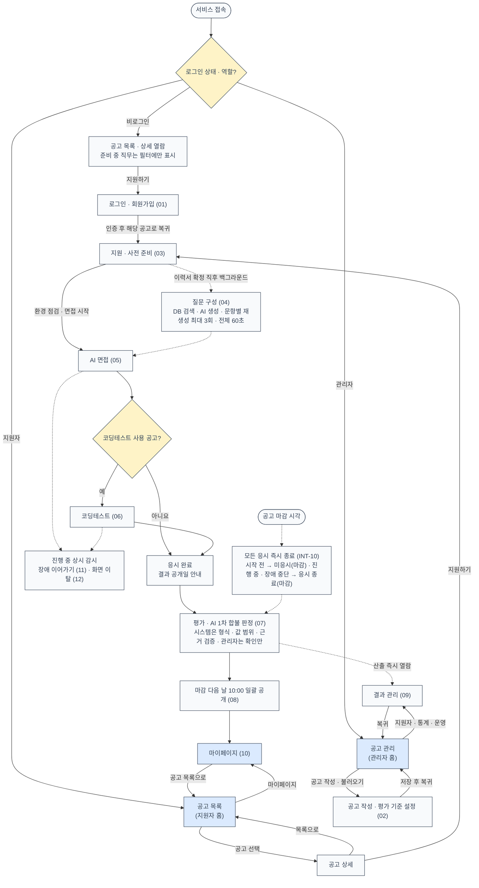

설계 기준: 지원자는 공고 목록, 관리자는 공고 관리 화면이 홈이다. 관리자 계정은 1개이며 설치 때 만들어 두고, 회원가입은 지원자만 한다(N8). 응시는 지원 건당 1회이고, 첫 질문이 제시되는 시점에 차감된다(INT-09). 1차 합불은 AI가 판정하고 시스템이 결과의 형식·값 범위·근거를 검증하며, 관리자를 포함해 누구도 수정할 수 없다(1-3 ①②). 공고 마감 시각이 되면 시작 전이든 진행 중이든 그 공고의 응시는 즉시 끝난다(INT-10).

---

## 01 회원가입·로그인

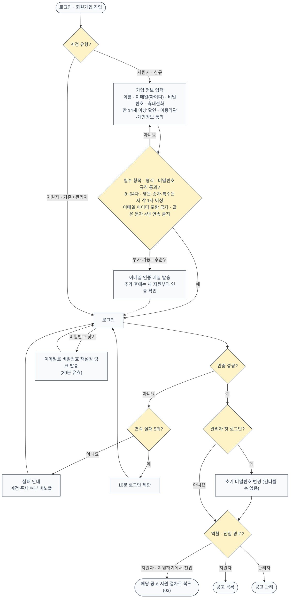

설계 기준: 이메일 인증은 부가 기능(후순위)이다. 추가 전에는 인증 없이 가입·지원할 수 있고, 점선은 추가 후 경로다(ACC-02). 추가 후에도 이미 진행 중인 지원은 확인하지 않고 새 지원을 만들 때만 인증 여부를 본다(추천안). 생년월일·성별·주소·사진·주민등록번호는 수집하지 않는다(ACC-02). 세션은 마지막 요청 후 2시간 유지하며 면접 중에는 연장한다(ACC-01). 복귀 경로는 허용된 내부 경로만 쓴다(ACC-04). 지원자는 본인 데이터만, 관리자 API는 관리자만 쓸 수 있으며 서버가 모든 요청에서 역할과 데이터 주인을 확인한다(ACC-06).

---

## 02 공고 작성·평가 기준 설정

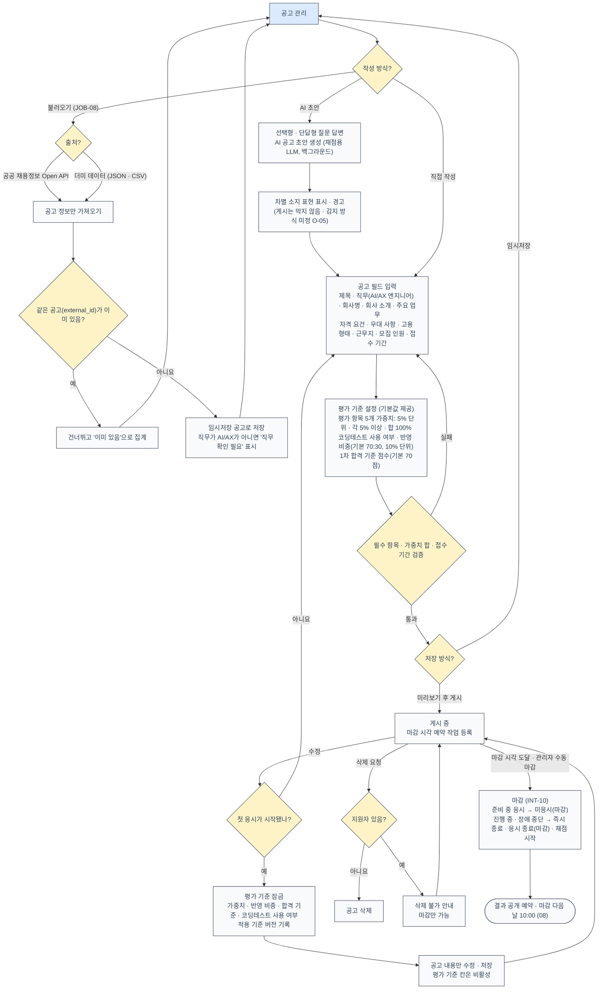

설계 기준: 질문은 관리자가 입력·선택·편집하지 않는다(JOB-06). 평가 항목과 루브릭은 수정할 수 없고 가중치만 조정한다(JOB-04). 코딩테스트 문제는 관리자가 화면에서 입력하지 않고 문제 은행에서 시스템이 출제한다(JOB-03). ‘준비 중’ 직무 6개는 직무 선택 목록에 보이지만 선택할 수 없다(2-4). 불러온 공고도 직무가 AI/AX 엔지니어여야 게시할 수 있다. 수동 마감 전 확인 창에서 진행 중 면접 건수를 알려 준다. 잠금 이후에는 기존 결과를 재산출하지 않는다(JOB-07).

---

## 03 지원·사전 준비

```mermaid
flowchart TD
    classDef startEnd fill:#F8FAFC,stroke:#334155,color:#334155
    classDef decision fill:#FEF3C7,stroke:#334155,color:#334155
    classDef hub fill:#DBEAFE,stroke:#334155,color:#334155
    classDef process fill:#F8FAFC,stroke:#334155,color:#334155

    jobDetail["공고 상세<br/>코딩테스트 포함 여부 · 예상 소요 시간 · 결과 공개일"]:::hub -- 지원하기 --> loggedIn{"로그인 상태?"}:::decision
    loggedIn -- 아니요 --> login["로그인 · 가입 (01)"]:::process
    login -- "인증 후 복귀" --> applyCheck
    loggedIn -- 예 --> applyCheck{"서버 검증<br/>접수 기간 · 중복 지원 · 응시 이력<br/>(이메일 인증 추가 후: 인증 여부)"}:::decision
    applyCheck -- "실패 (마감 · 이미 지원 · 응시 종료/취소 이력)" --> denied["지원 불가 사유 안내"]:::process
    denied --> jobDetail

    applyCheck -- 통과 --> consent["필수 동의 (APP-03)<br/>① 응시 데이터 수집·이용 ② AI 자동 평가와 AI의 1차 합격·불합격 판정<br/>③ 공고를 운영하는 관리자에게 결과 제공 ④ 보관 기간(응시 데이터 공개일 + 7일 · 녹화 3일)<br/>⑤ 응시 규칙(1회 응시 · 중단 버튼 없음 · 화면 이탈 경고/강제 퇴장)"]:::process
    consent --> agreed{"모두 동의?"}:::decision
    agreed -- 아니요 --> noConsent["다음 단계 진행 불가"]:::process
    noConsent --> jobDetail
    agreed -- 예 --> consentLog["동의 문구 버전 · 항목 · 일시 기록"]:::process

    consentLog --> resumeWay{"이력서 제출 방식?"}:::decision
    resumeWay -- "파일 업로드 (PDF · JPG · PNG)" --> fileCheck{"확장자 · 실제 파일 형식 일치?<br/>서버 보호 한도 이내? (사용자에게 비노출)"}:::decision
    fileCheck -- 아니요 --> failModal
    fileCheck -- 예 --> estimate["예상 처리 시간 표시<br/>글자 있는 쪽 × 0.5초 + 스캔 쪽 × 쪽당 OCR 시간 + AI 정리 시간<br/>경과 시간 함께 표시"]:::process
    estimate --> pageType{"쪽마다 글자 50자 이상?"}:::decision
    pageType -- "예 (텍스트 PDF 쪽)" --> textExtract["PDF 글자 바로 추출"]:::process
    pageType -- "아니요 (스캔 쪽 · 사진 파일)" --> ocr["온프레미스 OCR<br/>300dpi 이미지 변환 · 기울기 보정 · 줄별 신뢰도"]:::process
    ocr --> ocrOk{"OCR 실패 기준에 걸림?<br/>예상 시간의 2배(최소 60초) 초과<br/>읽은 글자 없음 · 평균 신뢰도 0.5 미만"}:::decision
    ocrOk -- 예 --> failModal["'이력서를 불러오는 데 실패했습니다'<br/>직접 입력하시겠어요?"]:::process
    failModal -- 다른 파일 올리기 --> resumeWay
    failModal -- 직접 입력하기 --> manual
    ocrOk -- 아니요 --> extract
    textExtract --> extract["AI 정보 정리<br/>학력 · 경력 · 프로젝트 · 기술 · 자격"]:::process
    resumeWay -- 직접 작성 --> manual["이력서 직접 작성"]:::process
    resumeWay -- 마이페이지 등록본 --> loadSaved["등록본 불러오기"]:::process
    extract --> confirm["지원자 확인 · 수정 (필수)<br/>OCR 신뢰도 0.80 미만 줄에서 나온 항목은 강조 표시"]:::process
    manual --> confirm
    loadSaved --> confirm
    confirm --> basicInfo{"기본 정보 충족?<br/>성명 + 학력 또는 경력 1건 이상"}:::decision
    basicInfo -- 아니요 --> confirm
    basicInfo -- 예 --> applied["지원 완료 · 응시 상태 '준비 중'<br/>이력서 스냅샷 저장(변경 불가)"]:::process
    applied -.-> composeStart(["질문 구성 백그라운드 시작 (04)"]):::startEnd

    applied --> envCheck["환경 점검 (APP-06)<br/>① 마이크 입력 레벨 ② 카메라 영상 ③ 스피커 테스트음 후 '들립니다' 확인<br/>④ 네트워크 상태 ⑤ AI 서버 상태"]:::process
    envCheck --> envOk{"모두 통과?"}:::decision
    envOk -- 아니요 --> envFix["실패 항목 안내 · 시작 버튼 비활성"]:::process
    envFix -- 재점검 --> envCheck
    envOk -- 예 --> rules["시작 전 안내 (APP-07)<br/>진행 방식 · 질문 수 · 답변 시간 · 코딩테스트 여부 · 예상 소요 시간<br/>중단 버튼 없음 · 장애 시 이어가기 · 화면 이탈 1회 경고 · 2회 취소<br/>공고 마감 시각에 면접이 끝남"]:::process
    rules --> ruleCheck{"규칙 확인 체크?"}:::decision
    ruleCheck -- 아니요 --> rules
    ruleCheck -- "예 · '면접 시작' 선택" --> capacity{"입장 가능?<br/>진행 중 면접이 상한 N건 미만 (INT-08)<br/>자동 보호(GPU 메모리 92% · 다음 질문 시간 초과) 꺼짐"}:::decision
    capacity -- 아니요 --> retryWait["'동시 면접 인원이 찼습니다' 안내 + '다시 시도' 버튼<br/>상태 '준비 중' 그대로 · 응시 횟수 미차감 · 대기 줄 없음<br/>버튼은 10초 동안 막음"]:::process
    retryWait -- 다시 시도 --> capacity
    retryWait -- 나중에 --> toMyPage(["마이페이지 (10)"]):::startEnd
    capacity -- 예 --> begin(["전체 화면 전환 → AI 면접 (05)<br/>질문이 덜 만들어졌으면 '질문 준비 중'(최대 60초)"]):::startEnd
```

설계 기준: 중복 지원·응시 이력 검증을 동의·이력서 입력보다 먼저 해서, 통과할 수 없는 지원자가 입력을 반복하지 않게 한다. 이력서 파일은 용량·쪽수 상한을 화면에 두지 않는다(APP-04). 자기소개서는 필수가 아니다(APP-05). OCR 중간 이미지는 처리 직후 지우고, 원본과 뽑은 글자는 면접 데이터로 보고 공개일 + 7일에 지운다(TRD 7-6). 지원 환경은 데스크톱 Chrome·Edge 최신 2개 버전이다. 상한 N은 운영 장비에서 측정해 정한 초기값으로 시작하며, 서비스 재시작 없이 바꿀 수 있다(AC-21). ‘다시 시도’ 안내는 추천안으로 팀 확인 대기 중이다.

---

## 04 질문 구성

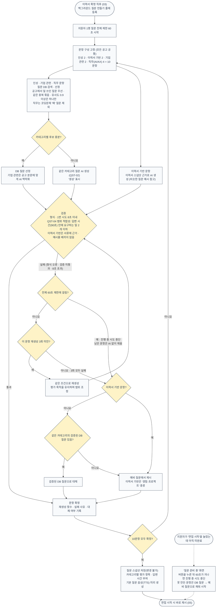

설계 기준: 질문은 관리자의 검토·승인 없이 시스템이 자동 구성한다(JOB-06, QST-01~03). 이력서 확정 직후 미리 만들어 두므로 보통 지원자는 기다리지 않는다(QST-03). AI가 질문을 만들지 못하면 그 문항을 같은 조건으로 최대 3회 재생성하고, 3회 모두 실패하면 검증된 DB 질문으로, DB 후보도 없으면 예비 질문으로 대체한다. 이력서 기반 문항은 맞는 DB 종류가 없어 바로 예비 질문으로 간다(QST-05, TRD 7-4 ⑤). 대체는 감점·장애 판정 대상이 아니다. 예비 질문은 관리자가 미리 확인해 명령어·파일로 넣는다(종류별 5개 이상). 응시하지 않으면 응시 횟수를 쓰지 않으며, 쓰지 않은 질문 구성은 응시 데이터 보관 규칙대로 지운다. 평가와 리포트는 질문 스냅샷을 기준으로 한다.

---

## 05 AI 면접·꼬리질문

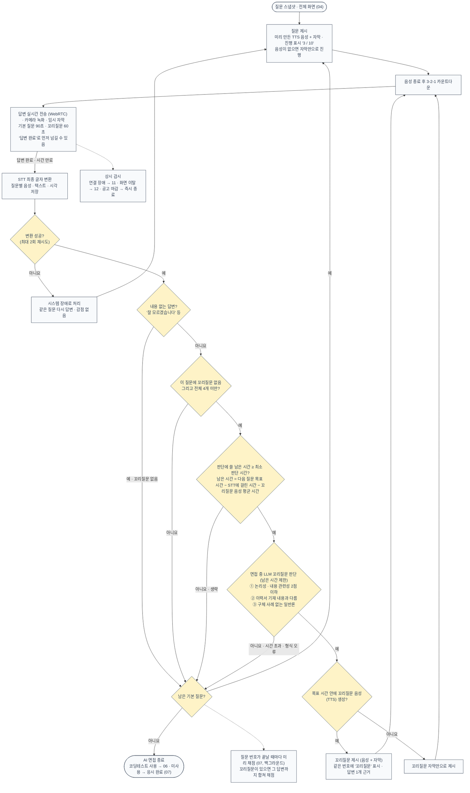

설계 기준: 중단·일시정지 버튼은 없다(INT-03). 면접관 아바타는 쓰지 않는다(INT-01). 답변이 끝나고 다음 질문이 뜨기까지의 목표 시간은 운영 서버에서 재서 정하며(TRD 12장), 꼬리질문 판단에는 고정 시간 대신 그 답변의 남은 시간만 준다. 녹화는 평가에 쓰지 않고 장애·부정행위 판정 확인용으로 3일만 보관한다(INT-05). 꼬리질문은 거짓 여부를 판정하지 않는다. 내용 없는 답변은 같은 질문을 반복하지 않고 해당 문항을 1점으로 평가한다(INT-07). 예상 소요 시간은 약 25분이다.

---

## 06 코딩테스트 응시·채점

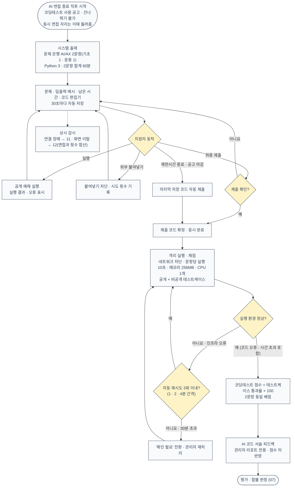

설계 기준: **AI 도우미 없이 일반 코딩테스트로 진행하며, AI 사용 이력은 수집하지 않는다.** 코드 관련 꼬리질문도 제공하지 않는다(COD-06). 점수는 작성 코드의 테스트케이스 통과율로만 계산한다. 실행만으로는 응시가 완료되지 않고 최종 제출(또는 시간 종료·마감 자동 제출)이 필요하다(COD-01). 정답과 비공개 테스트는 지원자 화면과 AI 입력에 노출하지 않는다(COD-05). 실행 환경 오류는 지원자 오답으로 처리하지 않으며, 재시도는 뒤에서 도는 작업 공통 규칙을 따른다(TRD 8-3). 시스템 장애로 끊긴 시간은 남은 시간에서 빼지 않는다(COD-04). 코딩테스트는 동시 면접 상한 N에 세지 않는다(추천안).

---

## 07 평가·채점·AI 1차 합불 판정

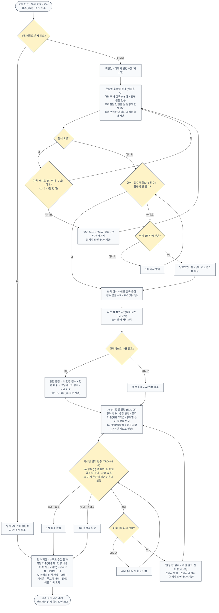

평가 항목과 기본 가중치: 직무 전문성 30% · 논리성 25% · 내용 관련성·구체성 20% · 전달력 10% · 조직 적합성 15%.

루브릭 척도: 0 미응답 · 1 답변했으나 최저 수준(관련성 거의 없음, ‘모르겠습니다’, 근거 인용 불가) · 2 부분적 · 3 기본 충족 · 4 우수 · 5 탁월.

설계 기준: AI는 루브릭 채점·근거 인용과 함께 1차 합격·불합격과 판정 사유를 낸다. 시스템은 점수를 집계하고 AI 결과의 형식·값 범위·근거 문장을 검증하며, 합격 여부를 ‘총점 ≥ 합격 기준’ 같은 별도 규칙으로 다시 판정하지 않는다(1-3 ②, EVL-03~06, TRD 1-2). 검증을 통과한 결정만 확정한다(AC-13). 같은 작업이 두 번 돌아도 결과는 한 번만 생기게 한다(TRD 8-3). 부정행위로 취소된 응시는 평가 없이 1차 불합격이다. 이름·연락처 등 인적 정보와 음성 특성은 평가 입력에서 뺀다. 관리자의 승인 단계와 수정 기능은 없다. 응시 완료 후 p90 10분 안에 결과를 산출하며, ‘분석 실패’라는 최종 상태는 두지 않는다(EVL-08).

---

## 08 결과 공개·알림·보관 삭제

### 08-A 결과 공개와 보관

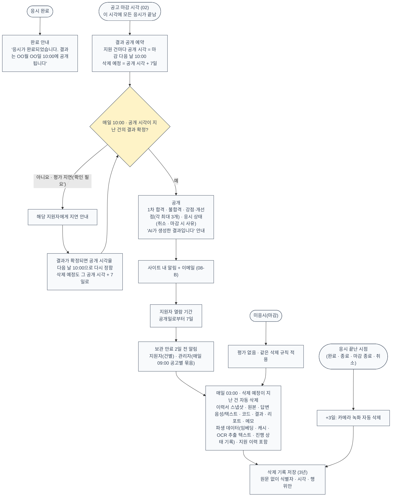

설계 기준: 공개 전에는 결과가 지원자 화면·API에 나타나지 않는다. 지원자 공개용 결과는 관리자용과 별도로 만들며, 점수·총점·코딩테스트 세부·근거 인용·내부 기록은 공개하지 않는다(RPT-03, RPT-04). 이의제기·근거 설명 요청 창구는 두지 않는다(N7). 모든 예약 작업과 날짜 계산은 한국 시간 기준이다. 삭제 작업은 매일 실행하고 결과를 기록한다(10-3).

### 08-B 알림 발송

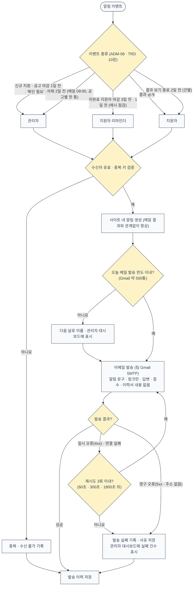

설계 기준: 면접 일정 관리·통보 기능과 외부 캘린더 연동은 범위 밖이다(N1, N5, C-23). 같은 이벤트는 한 번만 발송한다.

---

## 09 관리자 결과 관리

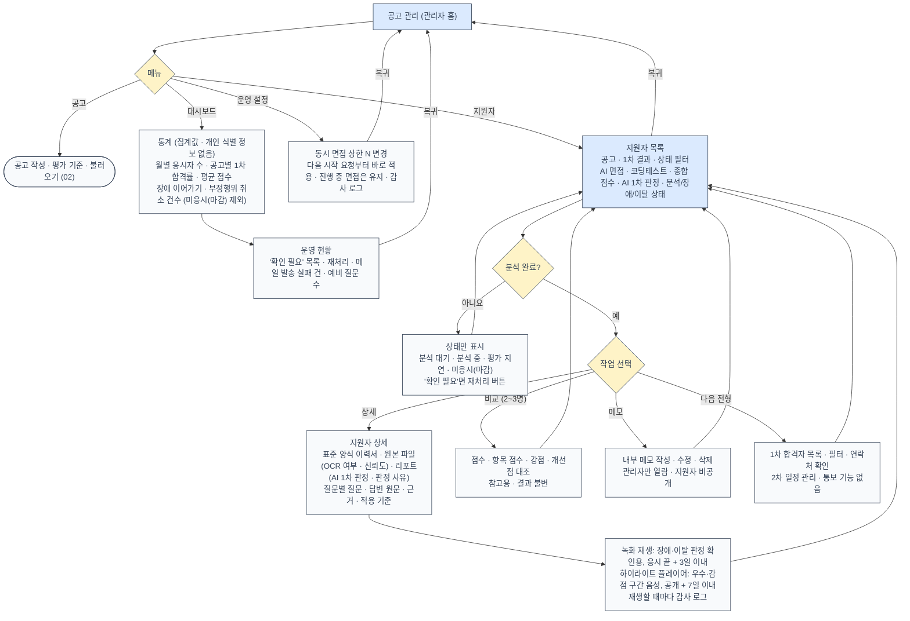

설계 기준: 관리자는 AI 판정 결과와 판정 사유·적용 기준·근거를 확인만 하며, 판정을 바꾸는 버튼·입력은 없다(ADM-01, AC-14). 재처리는 같은 응시 자료로 분석을 다시 돌릴 뿐 판정을 사람이 고치지 않는다(EVL-08). 관리자는 판정 즉시 결과를 볼 수 있지만, 지원자에게는 마감 다음 날 10:00에 공개된다. 응시 데이터는 결과 공개일로부터 7일 뒤 삭제되므로 다음 전형 대상자 관리는 그 안에 끝내야 하며, 삭제 2일 전 알림을 보낸다(ADM-06). 문제 은행·예비 질문은 관리 화면 없이 명령어·파일로 넣는다. 관리자용 리포트 구성은 RPT-01을 따른다.

---

## 10 지원자 마이페이지

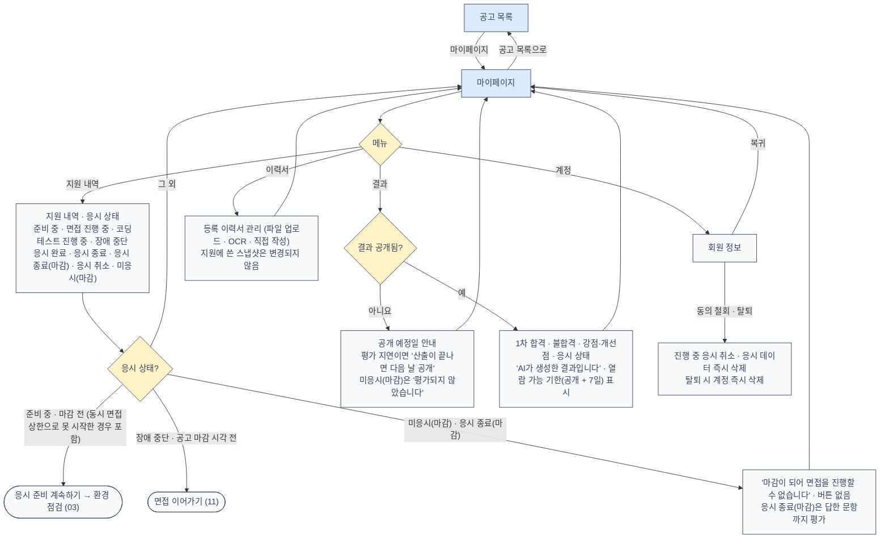

설계 기준: 응시는 공고 상세의 지원 절차(03)에서 시작한다. 마이페이지에서 응시로 들어가는 경로는 지원을 마쳤지만 아직 시작하지 않은 경우(동시 면접 상한으로 못 시작한 경우 포함, INT-08)와 장애 이어가기(RES-03) 두 가지다. 공고 마감 시각이 지나면 두 경로 모두 막힌다(INT-10). 보관 기간이 지나면 지원 이력과 결과가 함께 지워져 목록에서 사라진다(10-2). 지원에 쓴 이력서와 서류는 수정할 수 없다(APP-05).

---

## 11 장애 이어가기

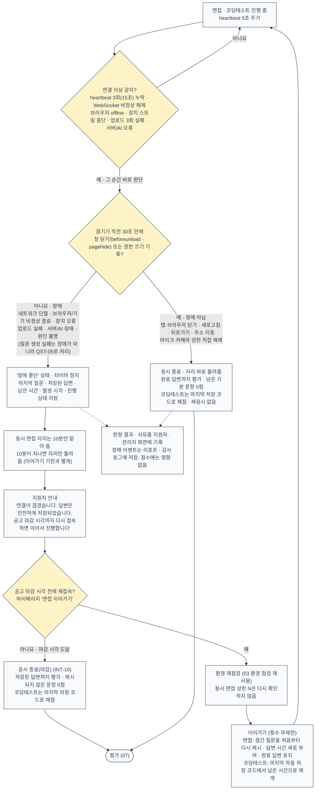

설계 기준: 장애로 끊긴 시간은 면접 답변 시간과 코딩테스트 제한시간에서 빼지 않는다(RES-01). 판정은 끊긴 지 15초가 되는 순간 시스템이 직전 기록을 근거로 자동 수행하며, 재접속 때까지 미루지 않고 수동 검토 단계도 없다(TRD 7-2). 원인을 특정할 수 없거나 창 닫기 기록이 서버에 오지 못했으면 지원자에게 유리하게 장애로 판정한다. 자리를 이미 돌려준 뒤 다시 들어와도 N을 다시 확인하지 않는다(TRD 5-3). 장애로 판정된 연결 소실은 화면 이탈 횟수에 넣지 않는다(CHT-04).

---

## 12 부정행위: 화면 이탈

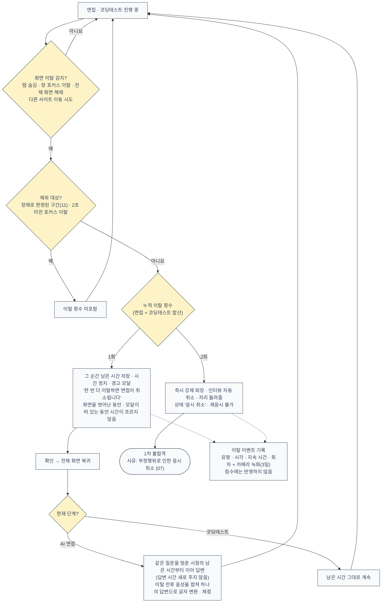

설계 기준: 이탈은 경고와 취소로만 처리하고 점수에 반영하지 않는다(CHT-05). 시선 추적·얼굴 표정 분석으로 부정행위를 판정하지 않는다(CHT-06). 관리자는 이탈 기록과 녹화로 판정 근거를 확인할 수 있다. 1회차 이탈 뒤 남은 시간부터 이어 가는 방식은 TRD v1.5 7-3을 따랐다. PRD v1.3 CHT-02는 아직 ‘답변 시간 새로 부여’로 적혀 있어 PRD 개정 때 맞춰야 한다.

---

## 문서 간 확인이 필요한 부분

08v에서는 07v ‘PRD에 정의되지 않아 가정한 부분’ 표의 항목이 모두 정리되었다. OCR은 PRD v1.3 APP-04로, 예비 질문 관리 주체는 단일 관리자(TRD 15장 T-05)로, 08-A 지연 공개는 마감 즉시 종료(INT-10)로, 06 재시도는 TRD 8-3으로, 운영자는 단일 관리자(N8)로 확정됐다. 질문 구성 시점(QST-03), 근거 설명 요청 창구(N7 없음), 알림 수신자·메일 재시도(TRD 10장)도 정해졌다.

남은 것은 문서끼리 말이 다른 아래 항목이다.

| 위치 | 내용 | 도면의 선택 | 근거 |
|---|---|---|---|
| 12 화면 이탈 | 1회차 이탈 뒤 답변 시간: PRD v1.3 CHT-02는 새로 부여, TRD v1.5 7-3은 남은 시간부터 이어 감 | TRD를 따름 | CHT-02, TRD 7-3 |
| 05 AI 면접 | STT 최종 실패: PRD INT-04·화면정의서 D-02는 같은 질문 다시 답변, TRD v1.5 7-2는 장애(장애 중단 화면)로 분류 | PRD를 따름 | INT-04, TRD 7-2 |
| 03·10 동시 면접 상한 | PRD 6-2는 ‘대기’ 상태를 두지만, TRD 7-1은 저장 상태 없이 ‘다시 시도’ 안내만 둠(추천안, 팀 확인 대기) | TRD를 따름 | INT-08, TRD 5-3·7-1 |
| 전체 | TRD v1.5는 PRD v1.6을 기준으로 적혀 있으나 팀에 공유된 PRD는 v1.3 | v1.3 + TRD v1.5 | TRD 표지 |
