# AI 1차 채용면접 자동화 플랫폼 — 기술 아키텍처

v1.1 | 2026-10-29 | 팀 AIIT | 상태: 내부 검토본

| 버전 | 변경 내용 |
|---|---|
| v1.0 | 최초 작성 |
| v1.1 | 팀 검토 반영. ① 판정 검증은 TRD 8-2⑤를 따라 형식·값 범위·근거만 확인(ADR-06 변경) ② STT 최종 실패는 TRD 7-2대로 장애 처리 ③ 시나리오 기획서·플로우차트 08v 개정 반영(접속 범위 등 해소된 충돌 정리) ④ 장 번호 참조 수정 ⑤ worker→브라우저 직접 응답 화살표를 api 경유로 수정 ⑥ 임시 자막 반환 경로(Redis Pub/Sub)·메일 전달 경로(Celery `mail` 큐) 추가 ⑦ 이름을 API 명세서에 맞춤(`attempt_status`, `/interview/{sid}/events`, `/draft-ai/status`) |

## 0. 문서 안내

### 0-1. 이 문서가 하는 일

시스템을 어떤 덩어리(컨테이너·컴포넌트)로 나누고, 덩어리끼리 어떻게 통신하며, 왜 그렇게 나눴는지를 그림과 결정 기록(ADR)으로 정한다.

| 문서 | 다루는 것 | 이 문서와의 관계 |
|---|---|---|
| PRD | 무엇을 해야 하는가 (사용자 관점) | 아키텍처 드라이버(2장)의 출처 |
| TRD | 무엇을 어떤 값으로 만드는가 (스택·테이블·API·설정값) | 값과 세부 규격은 TRD를 가리키고 여기서 반복하지 않는다 |
| 화면정의서 | 화면 배치와 상호작용 | 프론트엔드 컴포넌트(5-1)의 출처 |
| **기술 아키텍처 (이 문서)** | 구조, 경계, 흐름, 배치, 결정 이유, 기술 리스크 | 구현 착수 전 팀이 같은 그림을 보게 한다 |

### 0-2. 기준 문서와 충돌 시 우선순위

| 순위 | 문서 | 버전 |
|---|---|---|
| 1 | TRD | v1.5 (PRD v1.6 기준으로 작성됨) |
| 2 | 화면정의서 | v0.5 (2026-10-29) |
| 3 | PRD | v1.3 (팀 폴더에 있는 최신본) |
| 4 | 시나리오 기획서 | PRD v1.3 · TRD v1.5 기준 (2026-10-29 개정) |
| 5 | 서비스 플로우차트 | 08v (PRD v1.3 · TRD v1.5 기준) |
| 참고 | API 명세서 | 2026-10-29 (TRD v1.5 기준). 경로·필드 이름은 이 명세서를 따른다 |

- 충돌이 나면 위 순위를 따른다. 남아 있는 충돌과 처리 결과는 모두 14장에 기록했다.
- TRD v1.5는 PRD v1.6을 근거로 하지만 팀 폴더에는 PRD v1.3만 있다. 두 PRD가 다르면 TRD에 반영된 내용(PRD v1.6)을 따른 것으로 본다.

### 0-3. 표기

- 도면은 C4 모델(시스템 컨텍스트 → 컨테이너 → 컴포넌트) 순서로 상세해진다.
- `ADR-nn`은 12장의 아키텍처 결정 기록, `R-nn`은 13장의 리스크, `[TRD 요청]`은 주담당이 TRD에 반영해야 할 항목이다.

---

## 1. 시스템 개요

기업이 정한 평가 기준으로 AI가 1차 면접을 진행·채점하고 1차 합격·불합격까지 판정하는 온프레미스 플랫폼이다. 서버 PC 한 대(GPU 6GB · RAM 58GB)에 모든 구성요소를 docker compose로 띄우고, 외부 AI API를 쓰지 않는다.

```
공고·평가 기준 → 지원·동의·이력서(OCR) → 환경 점검 → AI 면접(10문항 + 꼬리질문 ≤4)
  → [코딩테스트 사용 공고] 코딩테스트 → AI 채점 · AI 1차 판정 · 시스템 검증 → 마감 다음 날 10:00 공개 → 7일 뒤 삭제
```

---

## 2. 아키텍처 드라이버

구조를 결정한 요구사항만 추렸다. 전체 목록은 PRD·TRD를 따른다.

### 2-1. 핵심 기능 드라이버

| ID | 드라이버 | 출처 | 구조에 준 영향 |
|---|---|---|---|
| F-1 | 실시간 음성 면접(TTS 질문 → 음성 답변 → 실시간 자막 → 꼬리질문) | INT-01~07 | 음성 수신과 STT 분리, 상태 머신(LangGraph) 도입 |
| F-2 | 지원자별 질문 10개 자동 구성(DB 검색 + RAG 생성 + 재생성 3회 + 대체) | QST-01~05 | 백그라운드 질문 구성 그래프, pgvector |
| F-3 | AI 채점 + AI 1차 판정 + 시스템 검증 | EVL-01~08 | 채점 LLM 분리(CPU), 검증 계층, 멱등 작업 |
| F-4 | 장애 이어가기 · 화면 이탈 판정 | RES · CHT | heartbeat·이벤트 수집, 체크포인트 |
| F-5 | 코딩테스트 격리 실행 | COD-01~07 | 1회용 sandbox 컨테이너 |
| F-6 | 스캔 이력서 OCR | APP-04 | CPU OCR 작업 줄 |
| F-7 | AI 공고 자동 작성(질문에 답하면 초안 생성, 코딩테스트 사용 여부 포함) | JOB-02, 프로젝트 추가 요구 | 채점 LLM 재사용, 비동기 작업 |
| F-8 | 정해진 시각 공개 · 보관 만료 삭제 | RPT-02, 10-2 | 스케줄러, 삭제 일괄 작업 |

### 2-2. 품질 속성 시나리오

| ID | 품질 | 시나리오 | 목표 | 대응 전술 |
|---|---|---|---|---|
| Q-1 | 성능 | 답변 완료 → 다음 질문 표시 | p95 `next_question_target_sec`(기준 5초) | 면접 중 LLM·STT는 GPU, 기본 질문 TTS 미리 생성, 꼬리질문 판단 시간 동적 배분 |
| Q-2 | 성능 | 응시 완료 → 결과 확정 | p90 10분 | 문항별 선채점(EVL-07), 최종 단계는 집계·판정만 |
| Q-3 | 용량 | 동시 면접 N건 | GPU 5.4GB 이하 | Redis 원자적 입장 관리 + 자동 보호 |
| Q-4 | 가용성 | 네트워크 단절 | 15초 안에 '장애 중단', 재접속 시 이어가기 | heartbeat, LangGraph 체크포인트(PostgreSQL) |
| Q-5 | 신뢰성 | 채점 작업 유실·중복 | 누락 0건, 결과 1개 | 멱등 키, 5분 주기 누락 점검 |
| Q-6 | 보안 | 면접 데이터 외부 전송 | 0건 | `internal: true` 망, 나가는 길은 api·mailer만 |
| Q-7 | 보안 | 다른 지원자 데이터 접근 | 불가(존재도 숨김) | `require_owner`, 404 |
| Q-8 | 변경 용이성 | 재시도·시간·N 조정 | 재시작 없이 반영 | `app_settings` 중앙 설정 |

### 2-3. 제약

| 제약 | 내용 |
|---|---|
| 장비 | 서버 1대, GPU VRAM 6GB, RAM 58GB, NVIDIA Container Toolkit |
| 배포 | docker compose 단일 호스트. **접속은 서버 PC 안(127.0.0.1)에서만** (TRD 2-1, ADR-01) |
| 데이터 | AI 추론·저장은 온프레미스. 외부로 나가는 것은 공고 Open API 조회와 Gmail SMTP 알림뿐 |
| 브라우저 | 데스크톱 Chrome·Edge 최신 2개 버전 |
| 일정 | 개발 완료 2026년 11월 중순 |
| 범위 | 관리자 1명, 멀티테넌시 없음(N8) |

---

## 3. 시스템 컨텍스트 뷰 (C4 Level 1)

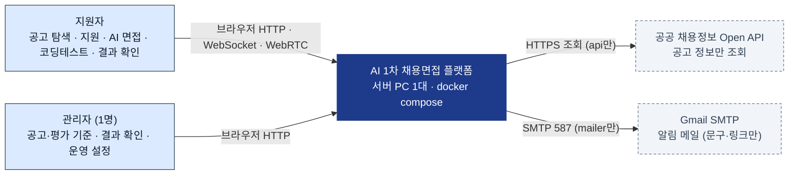

- 면접 데이터(이력서·음성·답변·점수)는 플랫폼 밖으로 나가지 않는다. 메일에는 알림 문구와 링크만 넣는다.

---

## 4. 컨테이너 뷰 (C4 Level 2)

### 4-1. 컨테이너 구성도

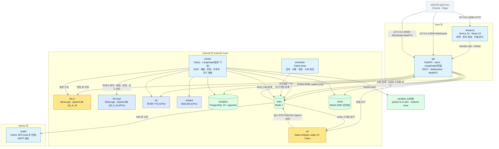

- 실제 compose에서는 api가 front·internal·egress 망에, mailer가 internal·egress 망에 함께 붙는다(TRD 2-3). 그림은 주 역할 기준으로 묶었다.
- 브라우저에 열리는 포트는 `127.0.0.1`의 8080·8000·UDP 40000~40019뿐이다. MinIO·DB·AI 컨테이너는 포트를 열지 않는다.

### 4-2. 컨테이너 책임과 경계

| 컨테이너 | 책임 | 하지 않는 일 | GPU |
|---|---|---|---|
| frontend | 화면 렌더링, 장치 점검, 전체 화면·이탈 신호 수집, heartbeat, 녹화 조각 업로드 | 업무 판단(점수·상태 전이) | - |
| api | 인증·권한, 공고·지원 API, 입장 관리, **면접 진행 그래프**, 실시간 통신, 장애·이탈 판정, 점수 계산 | 오래 걸리는 작업(OCR·채점·메일) | - |
| worker | 질문 구성 그래프, OCR·이력서 정리, 선채점·최종 판정·리포트, 임베딩, 코드 채점, 공고 초안, 메일 작업 | 실시간 통신 | - |
| scheduler | 정해진 시각에 작업 등록(공개 10:00, 삭제 03:00, 누락 점검 5분, 마감 처리) | 작업 실행(등록만) | - |
| llm-rt | 면접 중 LLM: 이력서 기반 질문, 맥락화, 범위 조정, 꼬리질문 판단 | 채점 | ● |
| stt | 실시간 임시 자막, 최종 전사(word timestamps 포함) | - | ● |
| llm-eval | 채점·판정·리포트·이력서 정리·공고 초안 | 면접 중 실시간 응답 | CPU |
| tts · embed | 질문 음성, 임베딩 | - | CPU |
| postgres | 업무 데이터 원장, pgvector, LangGraph 체크포인트 | - | - |
| redis | Celery 브로커·결과 저장, 음성 조각 스트림, 임시 자막 Pub/Sub, 입장 카운터, heartbeat 시각, 짧은 상태 | 원장(영구 데이터) | - |
| minio | 이력서 원본, 답변 음성, 녹화, 질문 음성 | 브라우저 직접 노출 | - |
| mailer | `mail` 큐만 처리하는 Celery 워커. 외부 SMTP(운영 Gmail, 개발 Mailpit) 발송과 재시도 | 다른 작업, 다른 외부 접속 | - |
| sandbox | 제출 코드 1회 실행 | 네트워크 | - |

### 4-3. 통신 방식 정리

| 구간 | 방식 | 동기/비동기 | 근거 |
|---|---|---|---|
| 브라우저 ↔ frontend ↔ api | HTTP REST (Next.js rewrites, 같은 출처 쿠키) | 동기 | TRD 2-1 |
| 브라우저 ↔ api (면접) | WebSocket: 질문·자막·상태·heartbeat·신호 | 양방향 | TRD 5-2 |
| 브라우저 → api (답변 음성) | WebRTC 오디오 (aiortc). PoC 실패 시 WebSocket PCM 조각으로 바꾼다 | 실시간 | ADR-03 |
| 브라우저 → api (카메라 녹화) | REST `POST /interview/{sid}/recording`, MediaRecorder 10초 WebM 조각 | 비동기 | ADR-04 |
| 브라우저 → api (창 닫기 기록) | REST `POST /interview/{sid}/events` (`sendBeacon`) | 단방향 | 6-4 |
| 브라우저 ↔ api (뒤에서 끝나는 작업) | 브라우저가 상태 API를 폴링하고, api가 DB·Celery 결과를 읽어 돌려준다. worker는 브라우저와 직접 통신하지 않는다 | 폴링 | 6-1, 6-7 |
| api → stt (음성 조각) | Redis Streams `audio:{session_id}` | 비동기 | TRD 5-2 |
| stt → api (임시 자막) | Redis Pub/Sub `caption:{session_id}`. 놓쳐도 되는 값이라 저장하지 않는다. api는 면접 세션이 열려 있는 동안만 구독한다 | 비동기 | 이 문서에서 정함 |
| worker → mailer | Celery `mail` 큐 (Redis 브로커). mailer만 egress 망에 붙는다 | 비동기 | 이 문서에서 정함 |
| api → llm-rt · stt(최종) · tts | 내부 HTTP (OpenAI 호환 / 서비스 API), 시간 제한 필수 | 동기 | TRD 7-5 |
| api · scheduler → worker | Celery 작업 (Redis 브로커), 멱등 키 | 비동기 | TRD 8-3 |
| worker → sandbox | Docker Engine API (docker.sock) | 동기 | TRD 9 |
| 브라우저 ← 미디어 | api의 `/media/*`가 권한 확인 후 MinIO에서 읽어 전달 | 동기 | ADR-05 |

---

## 5. 컴포넌트 뷰 (C4 Level 3)

### 5-1. frontend

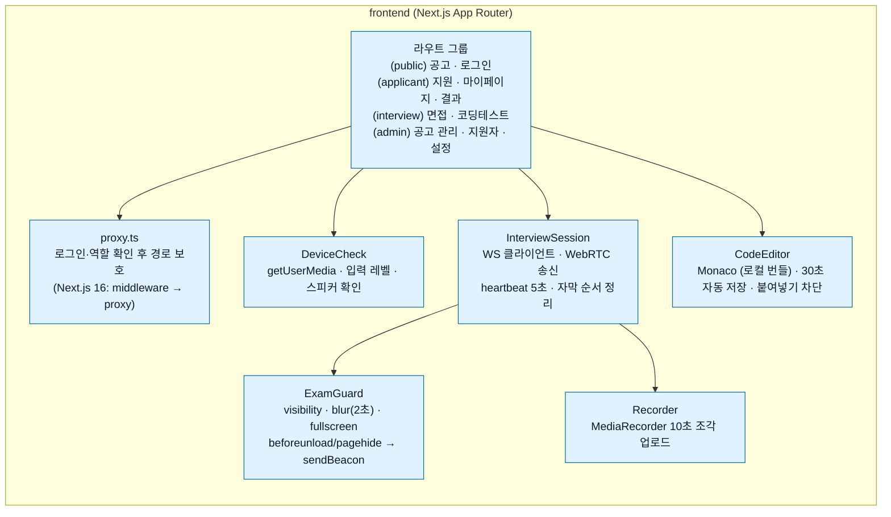

- Monaco는 `@monaco-editor/react` 기본값이 CDN에서 불러오므로 `loader.config({ monaco })`로 로컬 번들을 쓴다. 실행 중 외부 리소스 요청은 0건이어야 한다(AC-19).
- 서버 상태(질문 번호, 남은 시간, 이탈 횟수)의 기준은 서버다. 화면은 받은 값만 표시한다.

### 5-2. api

```mermaid
flowchart TB
    classDef c fill:#E0F2FE,stroke:#0369A1,color:#0F172A
    classDef core fill:#FEF3C7,stroke:#B45309,color:#0F172A
    subgraph api["api (FastAPI)"]
        auth["auth<br/>세션 쿠키 · Argon2id · 잠금 · require_admin/require_owner"]:::c
        posting["posting<br/>공고 CRUD · 게시 · 잠금 · import · 초안 요청"]:::c
        application["application<br/>지원 · 동의 · 이력서 업로드 · 확정"]:::c
        admission["admission<br/>Redis Lua 입장 · holds_seat · 자동 보호"]:::core
        rtc["rtc gateway<br/>aiortc 수신 · 1초 조각 → Redis Stream · MinIO 이어 쓰기"]:::c
        ws["ws hub<br/>question · caption · warn · terminate · paused · resume"]:::c
        graph["interview graph (LangGraph)<br/>질문 → 대기(interrupt) → STT → 꼬리질문 판단 → 분기"]:::core
        integrity["integrity<br/>heartbeat 감시 · 장애 판정 · 이탈 집계"]:::core
        scoring["scoring<br/>Decimal 점수 계산 · 판정 검증 규칙"]:::core
        media["media<br/>/media/* 권한 확인 후 스트리밍"]:::c
        result["result<br/>지원자 public_view · 관리자 리포트(읽기 전용)"]:::c
        settings["settings<br/>app_settings 조회·변경 · 감사 로그"]:::c
    end
    admission --> graph
    rtc --> graph
    ws --> graph
    integrity --> graph
    graph --> scoring
```

- `scoring`은 worker와 공유하는 순수 함수 모듈(`domain/scoring.py`)로 둔다. api는 조회용, worker는 확정용으로 같은 코드를 쓴다.
- 상태 전이는 `applications.attempt_status`가 원장이고, LangGraph 체크포인트는 그래프를 이어 가는 데만 쓴다(TRD 7-5).

### 5-3. worker

| 컴포넌트 | 작업 줄(queue) | 우선순위 | 모델 |
|---|---|---|---|
| resume_extract (텍스트 추출 → OCR → 항목 정리) | `ocr`, `eval_hi` | 높음 (지원자가 화면 앞에서 기다림) | PaddleOCR(CPU), llm-eval |
| draft_posting (AI 공고 초안) | `eval_hi` | 높음 (관리자가 기다림) | llm-eval |
| compose_questions (질문 구성 그래프) | `compose` | 낮음 (면접 요청에 양보) | llm-rt(`compose_slots`), embed, tts |
| prescore (문항별 선채점) | `eval_lo` | 보통 | llm-eval |
| finalize (집계 → AI 판정 → 검증 → 리포트) | `eval_lo` | 보통 | llm-eval |
| grade_code (코드 채점) | `sandbox` | 보통 | - |
| send_mail (등록만, 실행은 mailer 컨테이너) | `mail` | 낮음 | - |
| purge · release · reconcile | `ops` | scheduler가 등록 | - |

- 작업 줄 이름은 이 문서의 제안이다. TRD에는 `compose`·`ocr`만 이름이 있다.
- 모든 작업에 멱등 키(지원 번호 + 단계)를 붙이고, 재시도 1·2·4분 3회 뒤 `needs_review`로 넘긴다(TRD 8-3).

---

## 6. 런타임 뷰 (주요 흐름)

### 6-1. 지원 → 이력서 → 질문 미리 구성

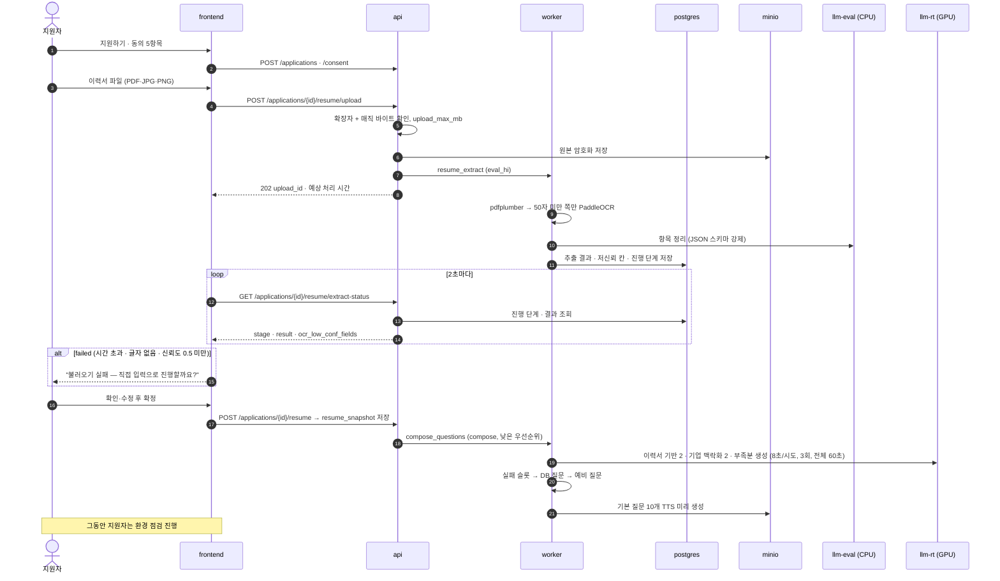

### 6-2. 면접 시작과 입장 관리

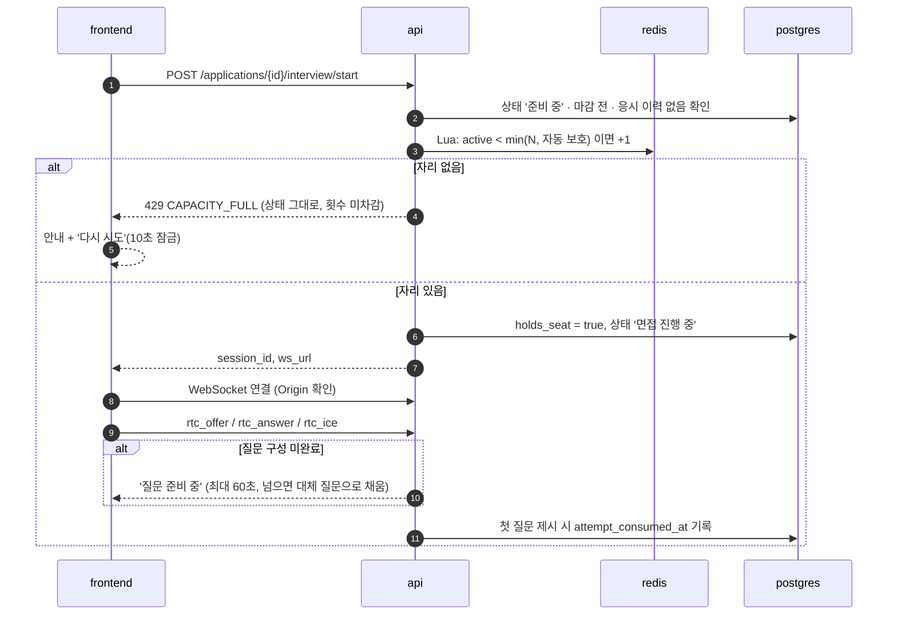

### 6-3. 질문 1개 처리 루프 (면접 진행 그래프)

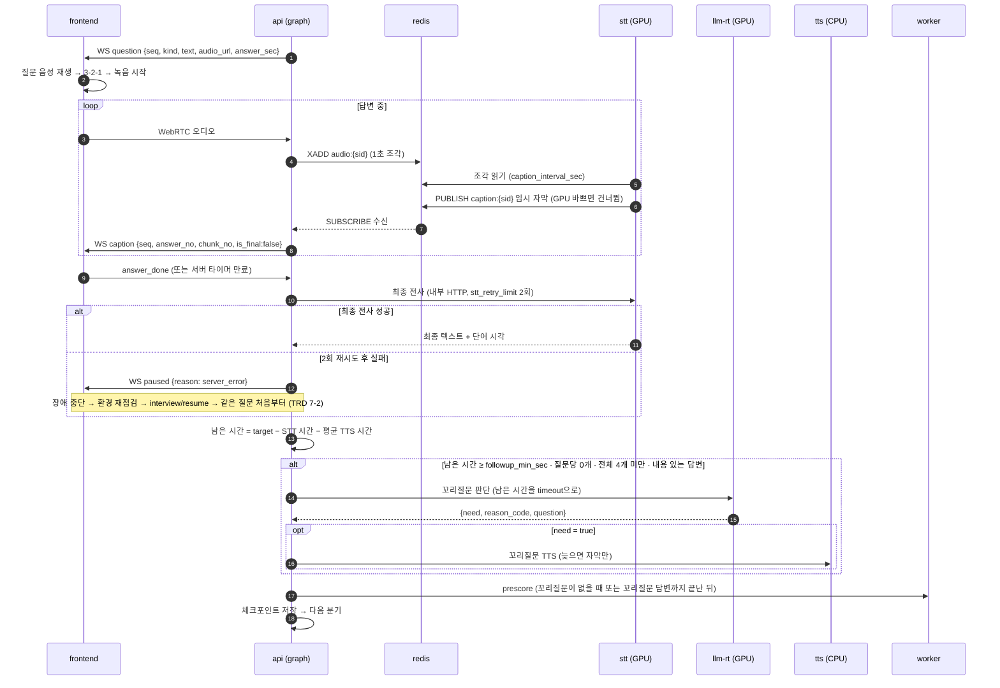

### 6-4. 장애와 화면 이탈

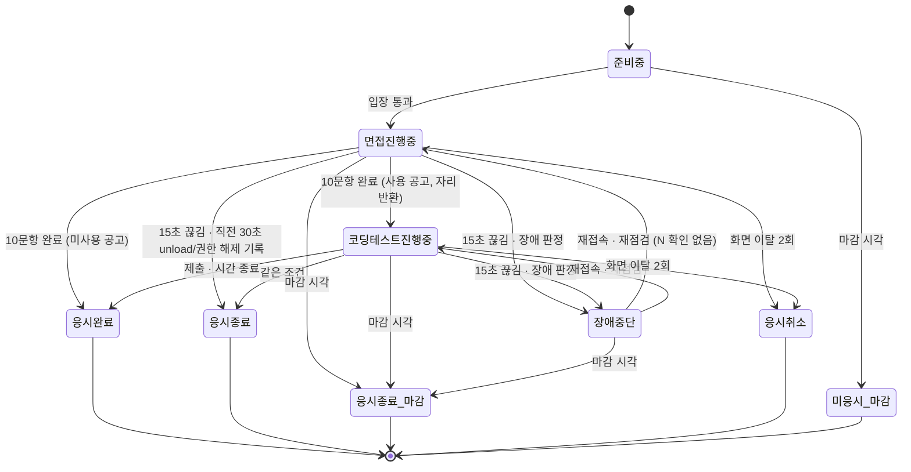

판정 위치와 시점은 아래 원칙을 따른다.

| 상황 | 판정 주체 | 시점 | 처리 |
|---|---|---|---|
| heartbeat 15초 누락 | api `integrity` | 15초가 되는 순간 즉시 | 직전 30초 `unload`·`permission` 기록 → 응시 종료(OV-07). 없으면 장애 중단, 남은 시간 저장, 자리 10분 보유 |
| 1회 화면 이탈 | api `integrity` | 신호 수신 즉시 | 남은 시간 저장·타이머 정지 → 경고 → 확인 시 남은 시간부터 재개, 앞뒤 음성을 이어 붙임 |
| 2회 화면 이탈 | api `integrity` | 즉시 | `terminate{reason}` → 응시 취소, 자리 반환 |
| 마감 시각 | scheduler → api | 마감 정각 | `terminate{reason:'closed'}` → 응시 종료(마감), 채점 등록 |
| STT 최종 실패 (2회 재시도 후) | api `graph` | 실패 즉시 | 연결이 살아 있어도 장애 중단. `paused` 전송, 남은 시간 저장, 자리 10분 보유. 재점검 후 `interview/resume`으로 같은 질문을 처음부터 (TRD 7-2·7-5) |

구현 시 꼭 지킬 것:
- **이탈 경고 중 수신 음성은 버린다.** 경고 모달이 떠 있는 동안 WebRTC로 들어온 조각은 스트림에 넣지 않는다(이어 붙인 답변이 오염되지 않게). 화면도 경고 중에는 오디오 트랙을 끈다(`track.enabled = false`).
- **이탈 경고 중에는 heartbeat 누락 판정을 멈춘다.** 숨겨진 탭에서는 브라우저가 타이머를 늦출 수 있다. 경고 상태인 세션은 heartbeat 15초 판정에서 빼고, 복귀 후 다시 센다. WebSocket 비정상 종료와 `offline`은 그대로 판정한다(R-05).
- 창 닫기 기록은 `sendBeacon`으로 `POST /interview/{sid}/events`에 보낸다(API 명세서). WebSocket은 창이 닫히는 순간 메시지를 보장하지 않는다. `sendBeacon`에 문자열을 넣으면 `text/plain`으로 가서 FastAPI 본문 파싱이 실패하므로, 화면은 `Blob([json], {type: 'application/json'})`으로 보낸다. `[TRD 요청]` 5-1에 경로 추가.

### 6-5. 채점 · AI 1차 판정 · 검증

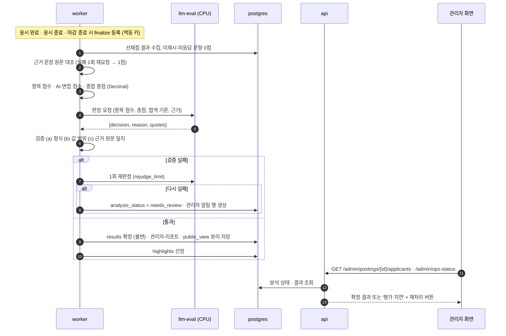

- 서버는 합격 여부를 '총점 ≥ 합격 기준' 같은 규칙으로 다시 판정하지 않는다. 검증은 형식·값 범위·근거 세 가지만 한다(TRD 1-2·8-2⑤, ADR-06).
- 총점과 어긋난 판정이 얼마나 자주 나오는지는 정답 세트로 재고(TRD T-04), 잦으면 판정 지시문을 고친다(R-09).
- 부정행위로 취소된 응시는 LLM을 부르지 않고 `fail / 응시 취소`로 확정한다.

### 6-6. 코딩테스트

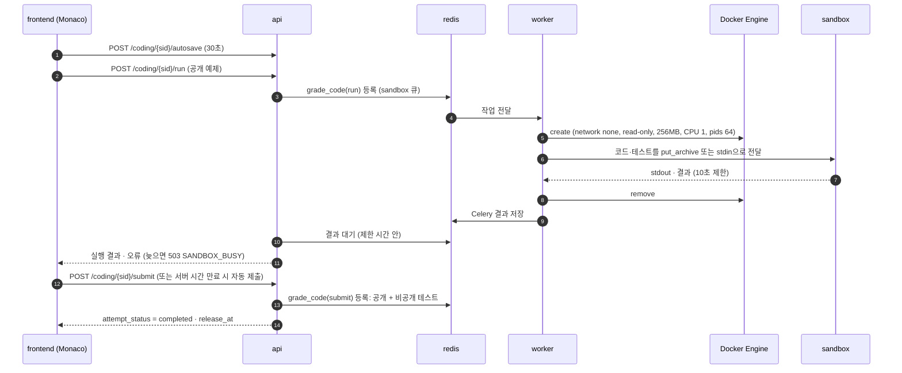

- worker도 컨테이너이므로 bind mount 경로는 **호스트 기준**으로 해석된다. 코드 파일을 worker 안 경로로 마운트하면 sandbox에서 보이지 않는다. 그래서 코드는 `put_archive`나 stdin으로 넣는다.
- 인프라 오류(이미지 없음, Docker 오류)는 오답이 아니다. 재시도 3회 후 `needs_review`로 넘긴다.

### 6-7. AI 공고 자동 작성

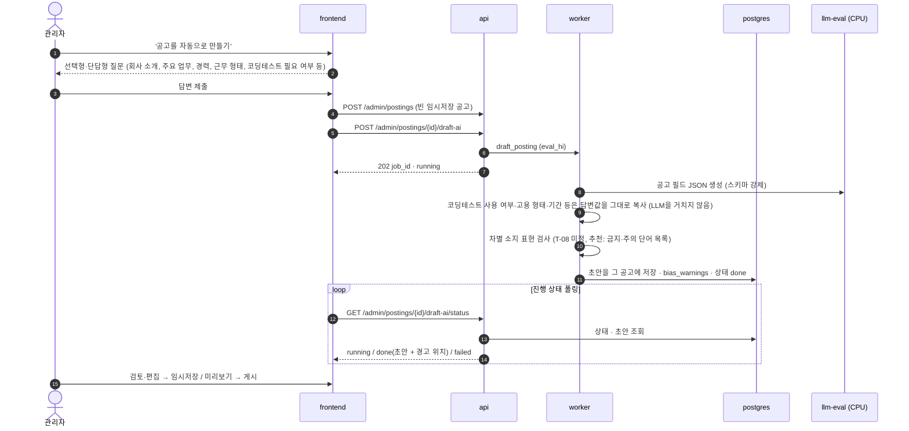

- 초안은 항상 '임시저장' 상태로 만든다. 게시는 관리자가 직접 누른다.
- 평가 기준 값(코딩테스트 사용 여부 등)은 관리자의 답변을 규칙으로 채운다. LLM은 공고 문장만 쓴다.
- 화면을 떠나도 초안 작성은 계속되고 결과는 그 공고에 채워진다(API 명세서 4장). `[TRD 요청]` 5-1에 `GET /admin/postings/{id}/draft-ai/status` 추가.

### 6-8. 결과 공개 · 보관 만료 삭제

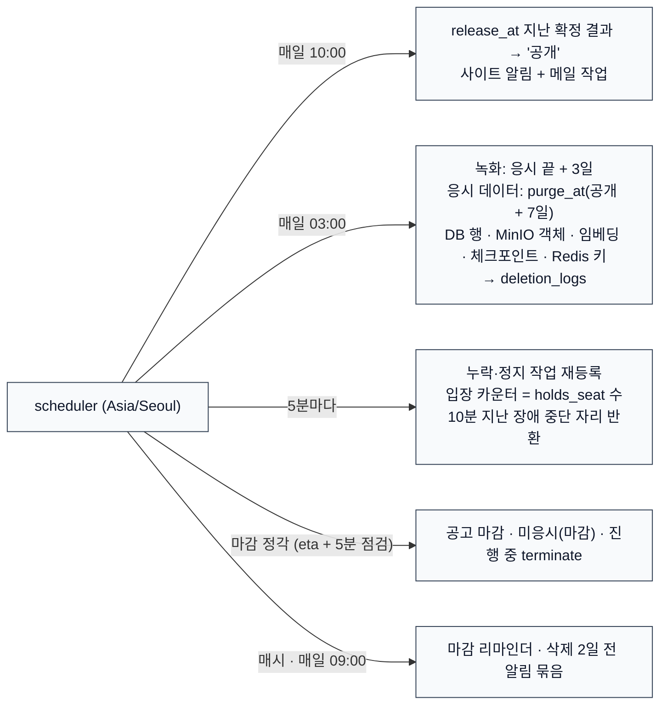

- 결과가 공개 시각에 늦은 건은 확정되는 순간 `release_at`을 다음 날 10:00으로 정해 같은 작업이 처리한다.

---

## 7. 배포 뷰

### 7-1. 단일 호스트 배치

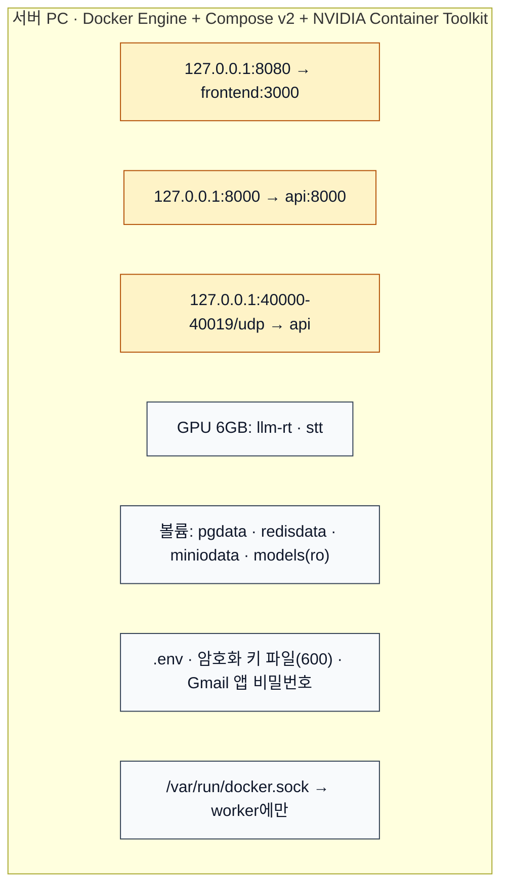

| 항목 | 기준 |
|---|---|
| 기동 | `docker compose up -d`. postgres·redis·minio healthcheck 통과 후 api·worker·scheduler |
| 재시작 | 모든 컨테이너 `restart: unless-stopped` |
| 이미지 | 태그와 다이제스트로 고정, `latest` 금지. 모델 파일은 sha256 기록 |
| 환경 분리 | 운영 `.env`, 개발 `.env.dev` (개발은 Mailpit, N=1, 느슨한 시간 제한) |
| 초기 적재 | `manage.py load_questions` (질문 엑셀 → questions + 임베딩), 관리자 계정 생성 명령 |

### 7-2. 외부 접속 확장안 (현재 범위 밖)

지금은 지원자가 응시 장소에 마련된 서버 PC에서 응시한다(시나리오 기획서 개정판, TRD 1-3). 나중에 지원자가 자기 PC에서 접속하게 바꾸려면 아래가 필요하다. 이번 범위에서는 만들지 않고, 바꿀 지점만 남긴다(ADR-01).

| 바뀌는 곳 | 필요한 것 | 이유 |
|---|---|---|
| 진입점 | HTTPS 리버스 프록시 1개(443), TLS 1.2+ | 브라우저는 localhost가 아니면 HTTPS에서만 마이크·카메라를 연다 |
| WebRTC | STUN + TURN 서버(coturn), 공인 IP 후보 | NAT 너머의 지원자는 고정 UDP 범위로 직접 붙지 못하는 경우가 많다 |
| 쿠키 | `cookie_secure = true` | HTTPS 전용 |
| 포트 | 8080·8000 직접 노출 제거, 프록시만 노출 | 공격 면 축소 |
| 대체 | ADR-03 대체안(WebSocket 음성)을 쓰면 TURN 없이 443 하나로 해결된다 | 확장 비용이 가장 작다 |

---

## 8. 데이터 뷰

### 8-1. 저장소별 책임

| 저장소 | 담는 것 | 수명 |
|---|---|---|
| PostgreSQL | 원장: 계정, 공고, 평가 기준(버전), 지원, 동의, 질문 DB(+임베딩), 출제 질문, 답변 텍스트, 점수, 결과, 이벤트, 알림, 감사·삭제 로그, 설정, LangGraph 체크포인트 | 10-2 보관 규칙 |
| Redis | 휘발성: Celery 작업·결과, `audio:{sid}` 스트림, `caption:{sid}` Pub/Sub 채널, `interview:active`, heartbeat 시각, 이탈 횟수 캐시 | 세션 종료 시 삭제. 원장은 항상 DB |
| MinIO | 바이너리: `resumes/` 원본, `answers/` 답변 음성, `recordings/` 녹화 조각, `questions/` 질문 음성 | 녹화 3일, 나머지 공개 + 7일 |

### 8-2. 핵심 엔터티 관계

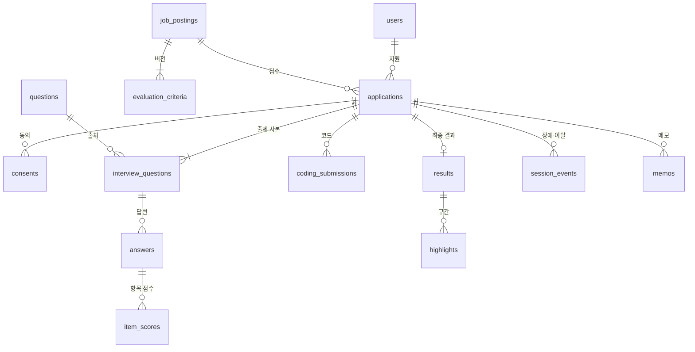

- 칸 정의는 테이블 정의서를 따른다. 여기서는 소유 관계와 삭제 단위만 정한다.
- **삭제 단위는 `applications` 1건**이다. 지원 1건을 지우면 그 아래 행, MinIO 객체, 체크포인트(thread_id = 지원 번호), Redis 키를 한 작업으로 지운다.
- 불변 데이터: `resume_snapshot`, `interview_questions`(사본), `evaluation_criteria`(잠금 후), `results`(확정 후). 앱 레벨에서 UPDATE 경로를 두지 않는다.

### 8-3. 데이터 수명주기

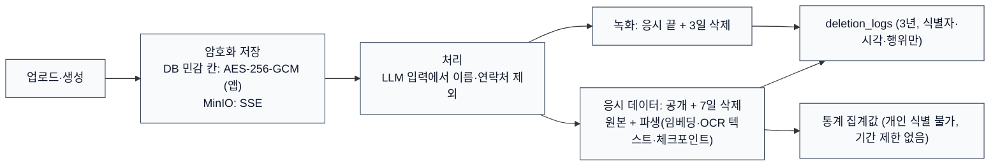

- MinIO SSE-S3는 KMS 설정이 있어야 켜진다. 단일 키 방식(`MINIO_KMS_SECRET_KEY`)을 쓰고, 키는 암호화 키 파일과 같은 방식으로 관리한다.

---

## 9. AI 모델 배치 뷰

### 9-1. 배치와 GPU 예산

| 모델 | 컨테이너 | 위치 | 메모리(추정) | 쓰는 때 |
|---|---|---|---|---|
| Qwen3-4B Instruct Q4_K_M | llm-rt | GPU | 2.5GB + KV 0.3GB × (N + compose_slots) | 면접 중, 질문 구성 |
| Whisper Large V3 Turbo int8_float16 | stt | GPU | 약 1.0GB | 자막, 최종 전사 |
| Qwen3-8B Instruct Q4_K_M | llm-eval | CPU / RAM | 6~8GB | 이력서 정리, 채점, 판정, 리포트, 공고 초안 |
| BGE-M3 | embed | CPU | 약 2.5GB | 질문 적재·검색·RAG |
| PaddleOCR PP-OCRv5 (한국어) | worker | CPU | 1~2GB | 이력서 OCR |
| 한국어 TTS (후보 Supertonic) | tts | CPU | 1GB 미만 | 질문 음성 |

GPU 합계: 2.5 + 0.3 × (N + 1) + 1.0 + 0.5 ≤ 5.4GB → **N ≈ 2~3** (실측 전 추정, TRD 13-2에서 확정).

### 9-2. LLM 호출 공통 규칙

- LangChain `ChatOpenAI`에 내부 주소(`http://llm-rt:8080/v1`, `http://llm-eval:8080/v1`)를 넣는다. 외부로 나가지 않는다.
- 모든 호출: JSON 스키마 강제(`with_structured_output` / llama.cpp grammar) → Pydantic 재검증 → 업무 검증 순서. Qwen3는 `/no_think`.
- 모든 호출에 시간 제한을 건다. 면접 중 호출은 남은 예산을 timeout으로 쓴다.
- llm-rt 슬롯은 면접용과 질문 구성용(`compose_slots`)으로 나눠 질문 구성이 면접을 밀어내지 않게 한다.

### 9-3. 8B CPU 사용처 경합

llm-eval 하나를 이력서 정리(지원자가 기다림), 공고 초안(관리자가 기다림), 선채점·최종 판정(10분 여유)이 함께 쓴다. Celery 작업 줄 우선순위로 `eval_hi`(이력서·초안)를 먼저 처리한다. CPU 8B는 수백 토큰 생성에 수십 초가 걸릴 수 있으므로 화면은 항상 진행 표시를 하고 결과를 폴링한다(R-02).

---

## 10. 보안 아키텍처

| 계층 | 통제 |
|---|---|
| 네트워크 | 127.0.0.1 바인딩, `internal: true` 망, 외부로 나가는 컨테이너는 api(Open API)·mailer(SMTP 587)만 |
| 인증 | 세션 쿠키(HttpOnly, SameSite=Lax, `cookie_secure`는 HTTPS 전환 시 켬), Argon2id, 5회 실패 10분 잠금, 2시간 만료(면접 중 연장) |
| 인가 | `/admin/*`는 `require_admin`, 지원자 API는 `require_owner`(모든 조회에 소유자 조건). 남의 데이터 요청은 404. 미디어도 같은 검사(ADR-05) |
| 실시간 | WebSocket Origin 확인, 면접 세션 토큰(sid)과 로그인 사용자 일치 확인 |
| 입력 | Pydantic `extra="forbid"`, 업로드는 확장자 + 매직 바이트 + `upload_max_mb`, 로그인 복귀 경로 허용 목록(`/postings/`, `/applications/`, `/me`) |
| 저장 | DB 민감 칸 AES-256-GCM, MinIO SSE, 키 파일 권한 600 |
| 실행 격리 | sandbox: network none, read-only, 비루트, 256MB, CPU 1, pids 64, 10초 |
| 로그·감사 | 앱 로그에서 답변 원문·개인정보 마스킹. 감사 로그: 결과 열람, 녹화 재생, 메모, 동의, 기준·설정 변경, 삭제, 장애·이탈 판정 |
| LLM 입력 | 채점 자료 생성 함수에서 이름·연락처·음성 특징 제외, 테스트로 고정 |

- docker.sock을 가진 worker는 사실상 호스트 관리자 권한이다. worker는 외부 망에 붙이지 않고, sandbox 생성 코드는 고정 이미지·고정 옵션만 쓰도록 한 곳(`sandbox_runner`)에 모은다(R-06).

---

## 11. 횡단 관심사

| 관심사 | 방식 |
|---|---|
| 설정 | `app_settings`(재시작 없이 반영) + `.env`(비밀값·접속 정보). 변경은 감사 로그. 목록은 TRD 14장 |
| 시간 | 모든 계산 Asia/Seoul, ISO 8601 +09:00. 면접·코딩 타이머의 기준은 서버 |
| 오류 응답 | `{"code","message"}` 단일 형식. 동시 면접 초과는 `CAPACITY_FULL`로 통일(화면정의서 §12 #27) |
| 숫자 | 점수는 Decimal, 전송은 문자열(`"70.15"`) |
| 멱등성 | Celery 작업: 지원 번호 + 단계. 입장: `holds_seat`으로 이중 증감 방지 |
| 관측 | 별도 모니터링 도구 없음. 구조화 로그 + 성능 지표(다음 질문 시간, API 응답, 결과 산출 시간, NVML GPU 메모리)를 DB에 기록해 관리자 대시보드에 표시 |
| 테스트 | SDD/TDD. 도메인 규칙(점수·검증·상태 전이·입장)은 순수 함수 단위 테스트, API 통합 테스트, Playwright E2E(장애·이탈), freezegun(공개·삭제·마감) |

---

## 12. 아키텍처 결정 기록 (ADR)

| ID | 결정 | 상태 | 대안 | 결정 이유 / 결과 |
|---|---|---|---|---|
| ADR-01 | 서버 PC 안(127.0.0.1)에서만 접속, HTTPS·프록시 없음. 외부 접속은 확장안(7-2)으로만 둔다 | 채택 (TRD 우선, 팀 확인 2026-10-29) | 인터넷 접속 + HTTPS + TURN | 일정과 인프라 부담. 시나리오 기획서 개정판도 '응시 장소의 서버 PC에서 응시'로 맞춰졌다. PRD 10-3의 '인터넷 접속·HTTPS'는 PRD 개정 대상 |
| ADR-02 | 면접 중 LLM 4B는 GPU, 채점 LLM 8B는 CPU로 분리 | 채택 (TRD 6장) | 4B 하나 / 8B 하나 | 6GB에서 실시간 응답과 채점 품질을 함께 얻는 유일한 배치. 8B CPU 시간이 10분을 넘으면 TRD 6-4 B·C로 바꾼다 |
| ADR-03 | 답변 음성은 WebRTC(aiortc). **1주차 PoC 실패 시 WebSocket 1초 PCM 조각 전송으로 바꾼다** | 채택 + 대체안 (팀 확인 2026-10-29) | 처음부터 WebSocket | 뒤쪽(Redis 스트림 → STT)은 그대로라 바꾸는 범위가 rtc gateway 하나로 끝난다 |
| ADR-04 | 카메라 녹화는 MediaRecorder 10초 WebM 조각을 REST로 올린다. 3회 실패는 '업로드 실패 = 장애'로 본다 | 채택 (팀 확인 2026-10-29) | WebRTC 영상 트랙 | 녹화는 실시간일 필요가 없고, 서버 영상 디코딩 부담이 없다. 경로는 API 명세서의 `POST /interview/{sid}/recording`. `[TRD 요청]` 5-1에 경로 추가 |
| ADR-05 | 브라우저가 쓰는 파일(질문 음성, 하이라이트, 녹화)은 api `/media/*`가 권한 확인 후 MinIO에서 읽어 전달한다(구간 재생용 `Range` 지원). frontend rewrites에 `/media/*`를 추가한다 | 제안 | MinIO 사전 서명 URL | MinIO 포트를 열지 않으므로 사전 서명 URL은 브라우저가 닿지 않는다. 권한 검사와 감사 로그를 한 곳에 둘 수 있다. `[TRD 요청]` 8-4 '5분짜리 임시 주소' 문구 수정. `[API 명세서 요청]` `GET /admin/applicants/{aid}/media`가 MinIO 주소 대신 파일을 직접 흘려보내도록 수정 |
| ADR-06 | AI 판정 검증은 형식·값 범위·근거 원문 일치 세 가지만 한다. 서버는 '총점 ≥ 합격 기준' 규칙으로 다시 판정하지 않는다. 검증 실패는 1회 재판정 → 확인 필요 | 채택 (TRD 1-2·8-2⑤, 팀 확인 2026-10-29) | 화면정의서 v0.4 D-06 (기준 일치까지 검증) | 최우선 문서인 TRD와 개정된 시나리오·08v·API 명세서에 맞춘다. 결과: 총점과 어긋난 판정이 확정될 수 있다(R-09). 화면정의서 D-06과 PRD AC-13은 개정 대상 |
| ADR-07 | 면접 진행은 api 안의 LangGraph, 질문 구성은 worker의 LangGraph. 상태 원장은 `applications` | 채택 (TRD 7-4, 7-5) | 전부 worker / 직접 구현 상태 머신 | interrupt·체크포인트로 이어가기 구현이 단순해진다. 그래프는 이어가기 수단일 뿐 원장이 아니다 |
| ADR-08 | 동시 면접 상한은 Redis Lua + DB `holds_seat` 재동기화. 대기열 없음 | 채택 (TRD 5-3) | 대기열·자동 입장 | 단순함. '대기'는 저장 상태가 아니다 |
| ADR-09 | 코드 실행은 worker가 docker.sock으로 1회용 컨테이너를 만든다. 코드는 put_archive/stdin으로 넣는다 | 채택 (TRD 9장 + 보완) | 상시 실행 sandbox / gVisor | 구현이 가장 작다. bind mount 경로 문제를 피한다 |
| ADR-10 | AI 공고 초안: 평가 기준 값(코딩테스트 사용 여부 등)은 관리자 답변을 규칙으로 채우고, LLM은 문장만 쓴다. 결과는 항상 임시저장 | 제안 | LLM이 기준까지 제안 | 평가 기준은 관리자가 정한다는 원칙(1-3 ②)을 지킨다 |

---

## 13. 기술 리스크와 검증 계획

| ID | 리스크 | 영향 | 대응 | 검증 시점 |
|---|---|---|---|---|
| R-01 | aiortc(aioice)가 UDP 포트 범위 고정을 공식 지원하지 않는다. Docker 브리지에서 후보 주소를 127.0.0.1로 바꿔야 한다 | 면접 음성 불통 | PoC: 컨테이너 안 aiortc ↔ Chrome 연결, 포트 범위 고정. 실패 시 ADR-03 대체안 | 1주차 |
| R-02 | 8B CPU 생성 속도. 이력서 정리·공고 초안을 사람이 기다린다 | 체감 지연, 결과 10분 초과 | 실측(TRD 13-2 ⑤). 느리면 이력서 정리·초안을 4B로 옮기는 안 검토(GPU 예산 재계산 필요) | 1~2주차 |
| R-03 | GPU 6GB 예산. 4B + KV + STT가 넘치면 공유 메모리로 넘어가 크게 느려진다 | 다음 질문 지연 | NVML 기록, 자동 보호(92%), N 실측 | 2주차 |
| R-04 | 한국어 TTS(Supertonic) 품질·속도 미확인 | 질문 전달 품질 | 청취 평가. 실패 시 다른 설치형 TTS, 최악은 자막만(INT-01 허용) | 1주차 |
| R-05 | 숨겨진 탭·최소화 창에서 브라우저가 타이머·네트워크를 늦춰 heartbeat가 밀릴 수 있다 | 이탈이 장애로 잘못 판정 | paused 세션은 장애 판정 제외(6-4). heartbeat는 WebSocket 수신 시각 기준 | E2E |
| R-06 | docker.sock 노출 | 호스트 권한 탈취 경로 | worker만 마운트, 고정 이미지·옵션, worker는 외부 망 없음 | 코드 리뷰 |
| R-07 | MinIO 무료판 이미지 업데이트 중단 | 보안 패치 없음 | 내부망 전용, 포트 비노출, 태그 고정 | 상시 |
| R-08 | Gmail 하루 발송 한도(약 500통) | 결과 공개일 알림 지연 | `mail_daily_limit` 초과 시 다음 날로 미루고 대시보드 표시. 사이트 알림은 항상 생성 | 운영 |
| R-09 | AI 판정이 총점·합격 기준과 어긋난 채 확정될 수 있다(ADR-06) | 설명하기 어려운 합불 | 정답 세트로 어긋나는 빈도를 잰다(TRD T-04). 잦으면 판정 지시문을 고친다 | 2주차 |
| R-10 | 연결이 정상인데 STT가 실패해도 장애 중단 → 재점검 → 이어가기를 거친다(TRD 7-2) | 지원자 체감 저하 | STT 재시도 2회 안에 끝나게 시간 제한을 둔다. 실패 빈도를 기록해 잦으면 처리 방식을 재검토한다 | E2E |
| R-11 | Next.js `proxy.ts`가 `/api` 경로에 걸리면 요청 본문이 기본 약 10MB로 잘린다(버전별 설정 이름 확인 필요) | 50MB 한도의 이력서 업로드 실패 | `proxy.ts` matcher에서 `/api`·`/media`를 빼거나 본문 크기 설정을 올린다 | 1주차 |
| R-12 | 같은 PC에서 `localhost:8080`으로 접속하면 쿠키·Origin이 `127.0.0.1`과 달라 WebSocket 접속이 거부된다 | 면접 입장 실패 | 접속 주소를 `127.0.0.1`로 고정 안내하고, `localhost`로 들어오면 리다이렉트 | 1주차 |

---

## 14. 문서 간 충돌 처리 기록

### 14-1. 남아 있는 충돌과 결정 (2026-10-29 기준)

| # | 주제 | 문서별 내용 | 이 문서의 결정 | 고쳐야 할 문서 |
|---|---|---|---|---|
| 1 | 판정 검증 | TRD 8-2⑤·시나리오·08v·API 명세서: 형식·범위·근거만 / 화면정의서 v0.4 D-06·PRD EVL-05·AC-13: 기준 일치까지 | TRD (ADR-06, 팀 확인) | PRD EVL-05·AC-13 (화면정의서는 v0.5에서 반영) |
| 2 | 신규 지원 알림 | TRD 10장·화면정의서 D-10: 없음 / PRD ADM-08·08v 08-B·시나리오 8-2·API 명세서 `new_application`: 있음 | 없음 (TRD·화면정의서, 팀 확인) | 08v, 시나리오 8-2, API 명세서 9장, PRD ADM-08 |
| 3 | STT 최종 실패 | TRD 7-2·7-5·API 명세서: 장애 중단 / PRD INT-04·화면정의서 D-02(OV-04)·08v: 같은 화면에서 재답변 | TRD (팀 확인, R-10) | 08v 05·미정의 표, PRD INT-04 (화면정의서는 v0.5에서 반영) |
| 4 | 미디어 재생 | TRD 8-4·API 명세서 `/admin/applicants/{aid}/media`: MinIO 5분 임시 주소 / TRD 2-3: MinIO 포트 비노출 | api `/media/*` 경유 (ADR-05) | TRD 8-4, API 명세서 10장 |
| 5 | 동시 면접 초과 코드 | TRD 4-3: `SEATS_FULL` / TRD 5-3·화면정의서·API 명세서: `CAPACITY_FULL` | `CAPACITY_FULL` | TRD 4-3 |
| 6 | 1회 이탈 후 재개 | PRD v1.3 CHT-02: 답변 시간 새로 부여 / TRD 7-3·화면정의서 D-08·08v·API 명세서: 남은 시간부터 | 남은 시간부터 | PRD CHT-02 |
| 7 | 접속 범위 | PRD 10-3: 인터넷 접속·HTTPS / TRD·시나리오 개정판: 서버 PC 안에서만 | TRD (ADR-01) | PRD 10-3 |
| 8 | 음성 전송 | TRD: WebRTC / 지난 검토 추천: WebSocket | WebRTC + 대체안 (ADR-03) | 없음 (PoC 실패 시 TRD 5-2) |
| 9 | 녹화 업로드 | PRD INT-05: 녹화 3일 / TRD: 경로 없음 / API 명세서: `POST /interview/{sid}/recording` | API 명세서 경로 (ADR-04) | TRD 5-1 |

### 14-2. 해소된 충돌

시나리오 기획서 개정판과 플로우차트 08v가 PRD v1.3·TRD v1.5에 맞춰지면서 아래는 더 이상 충돌이 아니다: 시나리오의 '집에서 응시', 플로우차트의 '대기' 저장 상태·PDF만 10MB·마감 후 24시간 재개·재접속 시 장애 판정·기업 담당자/운영자 구분.

### 14-3. 문서별 반영 요청

**TRD (주담당)**
1. 5-1에 추가: `POST /interview/{sid}/events`(sendBeacon), `POST /interview/{sid}/recording`, `GET /admin/postings/{id}/draft-ai/status`, `/media/*`
2. 8-4 하이라이트 재생: MinIO 임시 주소 → api `/media/*` 경유 (ADR-05)
3. 4-3 예시 `SEATS_FULL` → `CAPACITY_FULL`
4. 9장에 '코드는 put_archive/stdin으로 전달' 추가 (ADR-09)
5. 3장 Monaco '로컬 번들(`loader.config`)', Next.js 16 `proxy.ts` 표기
6. 이탈 경고 중 음성 폐기·heartbeat 판정 제외 규칙 (6-4)
7. 임시 자막 반환(`caption:{sid}` Pub/Sub)과 mailer(`mail` 큐 전용 Celery 워커) 구성 (4-3)

**API 명세서**
1. `GET /admin/applicants/{aid}/media`를 파일 직접 전달(`Range` 지원)로 수정, `question.audio_url`의 `/media/*` 처리 경로 명시 (ADR-05)
2. 9장 알림 `kind`에서 `new_application` 삭제
3. 기준 문서를 화면정의서 v0.4로 갱신
4. `sendBeacon` 본문을 `application/json` Blob으로 보내도록 명시 (6-4)

**화면정의서** — v0.5에서 반영 완료 (D-06·D-02 변경, OV-04 삭제, T-26, S-R03 판정 문구, §12 #9·#28 삭제)

**플로우차트 08v · 시나리오 기획서**
1. 신규 지원 알림 삭제 (08v 08-B, 시나리오 8-2)
2. 08v 05 도면 STT 최종 실패를 TRD대로 장애 처리로 변경, 미정의 표의 'PRD를 따름' 수정

**PRD (다음 개정)**
1. EVL-05·AC-13 판정 검증, ADM-08 신규 지원 알림, INT-04 STT 실패, CHT-02 이탈 재개, 10-3 접속 범위
