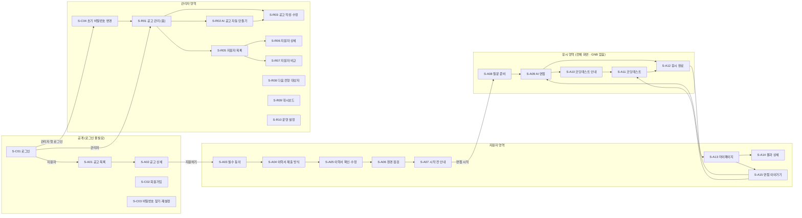
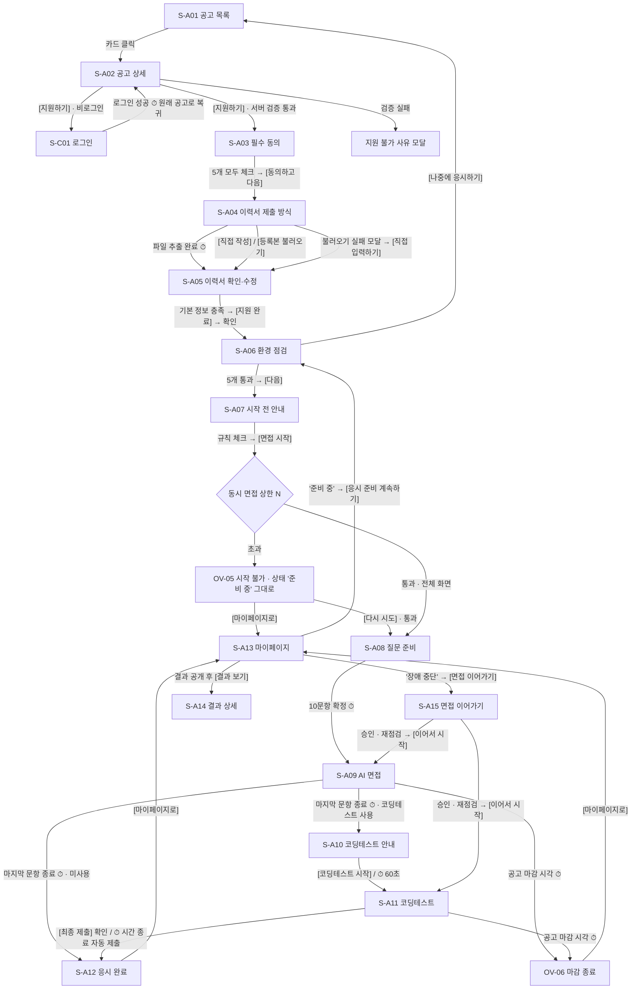

# 🖥️ 화면정의서 — AI 1차 채용면접 자동화 플랫폼

> **문서 범위:** 통합 PRD v1.6 · TRD v1.5 · 서비스 플로우차트 08v를 **화면 단위**로 풀어낸 정의서입니다.
> 화면마다 와이어프레임, 구성 요소와 동작, **다음 화면으로 넘어가는 버튼·자동 전환 조건**, API, 예외 처리를 적었습니다.
> 화면 흐름은 플로우차트 08v의 도면 번호(00~12)를 그대로 따릅니다.

| 항목 | 내용 |
|---|---|
| 문서 버전 | v0.5 (초안) — 팀 검토 반영(2026-10-29): AI 판정은 형식·값 범위·근거만 검증하고 합격 기준으로 다시 판정하지 않음(D-06 변경), STT 최종 실패는 장애 중단으로 처리(D-02 변경, OV-04 삭제), 기준 플로우차트 08v·우선순위 변경 |
| 이전 버전 | v0.4 — TRD v1.5 반영: AI 판정이 합격 기준과 어긋나면 '확인 필요'(D-06, v0.5에서 변경), '대기' 상태 폐지(D-07), 이탈 1회차는 남은 시간부터 이어서(D-08), 장애 판단은 끊긴 시점에 즉시 + 권한 해제 종료 오버레이 OV-07(D-09), 장애 중단 자리는 10분만 유지, 답변 실시간 자막, 꼬리질문 판단 시간 가변, 신규 지원 알림 제거(D-10) |
| 이전 버전 | v0.3 — v0.2 검토 반영: 깨진 표 수정, '확인 필요' 용어 통일, 동시 면접 상한은 AI 면접만, '작성 중' 배지, 상태별 라우트 가드, 모바일 미지원 안내, 환경 점검 [나중에 응시하기], 경고창 중 이탈 = 2회째, 빈 상태 정의, 게시 후 수정 규칙, 코딩 타이머 정지, 뒤로가기 history 트랩 |
| 이전 버전 | v0.2 — v0.1에 PRD v1.3·TRD v1.2 반영 (단일 관리자, 마감 시 즉시 중단, OCR·용량 상한 없음, 비밀번호 규칙 등) |
| 작성일 | 2026-10-29 |
| 작성 | AIIT (AI Interview Training) |
| 기준 문서 | 통합 PRD v1.6 (`merged_prd_v1.6`) · TRD v1.5 (`Final_Project_TRD_v1.5.pdf`) · 서비스 플로우차트 08v (`AI_면접통합서비스 플로우차트_08v.md`) · 시나리오 기획서(PRD v1.3 · TRD v1.5 기준 개정판) |
| 문서 간 우선순위 | TRD → 화면정의서 → PRD → 시나리오 기획서 → 플로우차트 (2026-10-29 팀 결정). 상충 시 팀 결정을 받아 §1에 기록 |
| 대상 | 프론트엔드(Next.js App Router) · 백엔드(FastAPI) 개발자, 디자이너 |
| 상태 | Draft |

### 표기 규칙

| 표기 | 의미 |
|---|---|
| `S-Cxx` / `S-Axx` / `S-Rxx` | 화면 ID: 공통(인증) / 지원자 / 관리자 |
| `T-xx` / `Tech-xx` | 화면 전환 ID (§3) / 기술 구현 문제 ID (§11). `TRD 15장 T-xx`는 TRD 문서의 자체 ID |
| `OV-xx` | 응시 중 화면 위에 뜨는 오버레이·모달 |
| `ACC-`, `APP-`, `INT-` … `AC-` | PRD v1.6 요구사항·인수 기준 ID (화면 ID와 겹치지 않게 화면은 `S-` 접두어 사용) |
| 플로우 `03` | 플로우차트 08v 도면 번호 |
| 🔗 | 화면 구현에 필요하지만 TRD v1.5에 없는 API·필드. §12에 모아 두었고 TRD 반영 필요 |
| `G-xx` | 세 문서에 정의가 없어 이 문서에서 정한 가정. §1.2 |
| **[버튼]** | 화면에 실제 표시되는 버튼 라벨 |
| ⏱ 자동 | 사용자 조작 없이 조건이 충족되면 넘어가는 전환 |

> API 경로는 TRD 5장 기준이며 Base URL은 생략합니다.

---

## 목차
1. [결정·가정 사항](#1-결정가정-사항)
2. [정보 구조(IA)와 화면 목록](#2-정보-구조ia와-화면-목록)
3. [화면 전환 규칙](#3-화면-전환-규칙)
4. [공통 UI 규칙](#4-공통-ui-규칙)
5. [공통·인증 화면](#5-공통인증-화면)
6. [지원자 화면 — 탐색·지원·사전 준비](#6-지원자-화면--탐색지원사전-준비)
7. [지원자 화면 — 응시(전체 화면)](#7-지원자-화면--응시전체-화면)
8. [응시 중 오버레이](#8-응시-중-오버레이)
9. [지원자 화면 — 마이페이지·결과·이어가기](#9-지원자-화면--마이페이지결과이어가기)
10. [관리자 화면](#10-관리자-화면)
11. [기술 구현 시 예상 문제점과 대응](#11-기술-구현-시-예상-문제점과-대응)
12. [TRD 반영이 필요한 API·필드](#12-trd-반영이-필요한-api필드)
13. [미결 사항과 PRD 인수 기준 추적표](#13-미결-사항과-prd-인수-기준-추적표)

---

## 1. 결정·가정 사항

### 1.1 문서 간 상충 결정 (2026-10-28 팀 결정)

| # | 주제 | 문서별 내용 | 결정 | 후속 조치 |
|---|---|---|---|---|
| D-01 | 스캔(이미지) PDF OCR | (v0.1) PRD·TRD 미지원 / 플로우 03 포함 | **OCR 포함.** PRD v1.3 APP-04(PDF·JPG·PNG, 상한 없음)와 TRD v1.2 7-6에 반영되어 상충 해소 | 없음 |
| D-02 | STT 변환 최종 실패 시 화면 | PRD INT-04·플로우 08v 05: 같은 질문을 다시 답변(감점 없음) / TRD 7-2·7-5·API 명세서: "장애 처리" | **TRD v1.5를 따른다 (2026-10-29 변경).** STT를 2번 다시 해도 실패하면 연결이 정상이어도 '장애 중단'으로 처리한다. OV-01 → 마이페이지 → S-A15 재점검 → 끊긴 질문을 처음부터 새 답변 시간으로. v0.4의 OV-04(같은 화면 재답변)는 삭제 | PRD INT-04 문구 정리 필요(다음 PRD 개정). 플로우차트 08v 05 도면도 TRD 기준으로 수정 필요 |
| D-03 | 결과 화면 문의 안내 | PRD v1.3 N7·RPT-03: 이의제기·근거 설명 요청 창구를 두지 않음, 동의 ②에서 "설명 요구권 안내" 삭제 | **버튼(이의제기·설명 요청)은 두지 않고, 결과 화면 맨 아래 작은 글씨로 "결과에 문제가 있으면 채용 담당자 이메일(공고별 문의 이메일)로 문의해 주세요"만 표시한다.** 문의는 관리자가 보관 중인 판정 근거(PRD 10-3)로 대응. 동의 ② 문구는 PRD v1.3대로(설명 요구권 안내 없음) | **PRD N7·RPT-03에 "연락처 안내는 둔다" 한 줄 추가 필요.** 공고에 문의 이메일 필드 추가(§12) |
| D-04 | 마감 시각의 진행 중 응시 | v0.1: PRD v1.1 O-06(끝까지 진행, 재개 마감+24시간) / PRD v1.3 INT-10·RES-03·AC-23, TRD v1.2 10장: **진행 중이어도 즉시 중단**, 재개 기한 = 마감 시각 | **PRD v1.3을 따른다 (2026-10-28 팀 결정).** 시작 전 → '미응시(마감)', 진행 중·장애 중단 → '응시 종료(마감)'(답한 문항까지 평가, 남은 기본 문항 0점, 코딩은 마지막 저장 코드로 채점). 응시 중이면 OV-06을 띄운다 | 없음 |
| D-05 | 이력서 파일 상한 | v0.1: 10MB / PRD v1.3 APP-04: 용량·쪽수 상한 없음, TRD 7-6: 서버 보호용 `upload_max_mb`(50MB)만 두고 사용자에게 비노출 | **PRD를 따른다.** 화면에 용량 문구를 쓰지 않는다. 서버 한도를 넘으면 실패 모달("이력서를 불러오는 데 실패했습니다")과 같은 흐름으로 안내 | 없음 |
| D-06 | AI 1차 판정과 합격 기준의 관계 | TRD v1.5 1-2·8-2⑤·시나리오·플로우 08v 07: 서버는 형식·값 범위·근거만 검증하고 '총점 ≥ 합격 기준'으로 다시 판정하지 않음 / PRD v1.3 EVL-05·AC-13: 기준과 어긋나면 재판정 후 '확인 필요' | **TRD v1.5를 따른다 (2026-10-29 변경).** AI가 총점·합격 기준·근거를 보고 판정하고, 시스템은 형식·값 범위·근거 문장만 검증한다. '총점 ≥ 합격 기준'으로 다시 판정하지 않는다. 검증에 실패하면 1회 다시 판정하고, 그래도 실패하면 '확인 필요'로 넘겨 관리자가 [재처리]한다 | PRD EVL-05·AC-13 문구 정리 필요(다음 PRD 개정). TRD 반영 요청 없음 |
| D-07 | 동시 면접 상한 초과 시 상태 | PRD 6-2·플로우 03: '대기' 상태 / TRD v1.5 7-1·5-3: '대기'는 저장 상태가 아니고 '준비 중' 그대로, '다시 시도' 버튼 | **TRD v1.5를 따른다.** '대기' 상태·배지·카드를 두지 않는다. 마이페이지 재진입은 '준비 중' 카드 [응시 준비 계속하기] (G-02) | PRD 6-2에서 '대기' 삭제 (TRD 15장 T-07 추천안 확정) |
| D-08 | 화면 이탈 1회차 후 재개 | 플로우 12·시나리오 E3: 같은 질문을 처음부터 새 답변 시간 / TRD v1.5 7-3: 시간을 멈췄다가 남은 시간부터 이어서, 이탈 전후 음성을 합쳐 한 답변 | **TRD v1.5를 따른다.** 경고창이 떠 있는 동안 답변 시간이 멈추고, 확인 후 같은 질문의 남은 시간부터 이어서 답한다 | TRD 7-3에 "멈춘 동안 들어온 음성은 답변에 넣지 않는다" 명시 필요 |
| D-09 | 장애 판단 시점 | 플로우 11: 재접속 시 판정 / TRD v1.5 7-2: 끊긴 지 15초가 되는 순간 판정, '장애 아님'은 '장애 중단'을 거치지 않고 바로 '응시 종료' | **TRD v1.5를 따른다.** S-A15는 이미 내려진 판정을 보여 준다. 브라우저가 살아 있는데 '장애 아님'으로 끝나는 경우(권한 직접 해제)는 OV-07로 안내 | WebSocket `terminate` 사유 값 추가 (§12 #26) |
| D-10 | 관리자 '신규 지원' 알림 | PRD ADM-08(v1.1)·시나리오 8-2: 있음 / TRD v1.5 10장: 없음 | **화면에서 뺀다** (2026-10-29 결정) | 시나리오 8-2에서도 삭제 |

### 1.2 이 문서에서 정한 가정 (G)

세 문서에 정의가 없어 화면 흐름을 끊기지 않게 하려고 정한 값입니다. 팀 검토 후 확정이 필요합니다.

| ID | 위치 | 가정 내용 | 이유 |
|---|---|---|---|
| G-01 | 지원 절차 | 지원 시작 시 지원서(application)를 '작성 중'으로 만들고, 이력서 제출 완료 시 '지원 완료 · 준비 중'이 된다. '작성 중'은 중복 지원으로 막지 않고 이어서 작성하게 한다 | TRD는 `POST /applications` 후 동의·이력서를 받는데 6-2 상태표에는 작성 중 상태가 없음 |
| G-02 | 마이페이지 | '준비 중'(지원 완료 후 면접 미시작) 지원도 마이페이지에서 **[응시 준비 계속하기]** → 환경 점검(S-A06)으로 들어간다 | 플로우 10은 마이페이지 진입을 '대기'·'장애 중단' 두 가지만 정의. 지원 완료 후 창을 닫은 지원자의 재진입 경로가 없음 (공고 상세는 '이미 지원'으로 막힘) |
| G-03 | 코딩테스트 시작 | AI 면접이 끝나면 코딩테스트 안내 화면(S-A10)을 보여 주고 **[코딩테스트 시작]** 또는 ⏱ 60초 후 자동 시작 | COD-01 "면접 종료 직후·건너뛰기 불가". 안내 없이 바로 시작하면 당황하고, 무한 대기하면 응시가 끝나지 않음. 동시 면접 자리는 AI 면접이 끝나는 순간 반납하므로 이 화면은 상한과 무관 (§8.5) |
| G-04 | TTS 실패 | 음성 없이 자막만 진행할 때는 자막 표시 ⏱ 5초 후 3-2-1 카운트다운 시작 | INT-02의 "음성 종료 후 카운트다운" 기준점이 없어짐 |
| G-05 | 공고 임시저장 | **[임시저장]** 후 공고 관리(S-R01)로 돌아간다 | 플로우 02 "임시저장 → 공고 관리" 그대로 |
| G-06 | AI 공고 초안 | 생성 중 화면을 떠나도 생성은 계속되고, 결과는 '임시저장' 공고로 저장된다 | 평가용 LLM(8B, CPU)으로 1~3분 걸림 (§11 Tech-07) |
| G-07 | 마이페이지 이력서 | 등록 이력서는 1개만 둔다 (수정·삭제 가능) | PRD에 개수 정의 없음. 단순화 |
| ~~G-08~~ | 비밀번호 규칙 | **PRD v1.3 5-1로 확정되어 가정 해제.** 8~64자, 영문·숫자·특수문자 각 1자 이상, 이메일 아이디(@ 앞) 포함 금지, 같은 문자 4번 이상 연속 금지. 관리자 계정도 같음 | PRD 5-1, TRD 11장 |
| ~~G-09~~ | 내부 메모 | **가정 해제.** 단일 관리자라 작성자 구분이 필요 없음. 관리자는 메모를 작성·수정·삭제할 수 있다 | PRD v1.3 ADM-05 "관리자만 열람" |
| G-10 | 접수 마감 시 '작성 중' 지원 | PRD INT-10은 '준비 중'·'대기'만 '미응시(마감)'으로 정의. **'작성 중'(G-01)도 마감 시각에 '미응시(마감)'으로 본다.** 화면 처리(버튼 비활성, "마감이 되어 면접을 진행할 수 없습니다.", 결과 탭 '미응시(마감)', 관리자 목록 '미응시' 배지, 판정 통계 제외)는 INT-10·D-04를 따른다 | '작성 중'은 이 문서의 가정 상태라 PRD에 없음 |
| ~~G-11~~ | OCR 처리 시간 | **TRD v1.2 7-6으로 확정되어 가정 해제.** 예상 시간 = 텍스트 쪽수×0.5초 + 스캔 쪽수×8초(측정 후 갱신) + LLM 정리 시간(`resume_llm_sec`, 13-2에서 재고 그 뒤 최근 평균으로 갱신, TRD v1.5). 실패: 예상의 2배(최소 60초) 초과, 추출 글자 없음, 평균 신뢰도 0.5 미만 | TRD 7-6, 14장 |
| G-12 | 모바일 | **모바일·태블릿은 지원하지 않는다.** 공고 탐색·결과 확인은 열어 두되 상단에 미지원 배너를 고정하고, 지원 절차(S-A03~S-A07)·응시(S-A08~S-A12)·이어가기(S-A15)·관리자 화면은 진입 시 안내 화면으로 막는다 (§4.8) | 응시에 웹캠·전체 화면·Chrome/Edge 데스크톱이 필요하고, 모바일 Chrome은 S-A06 브라우저 점검을 통과해 버림 |
| G-13 | OV-02 표시 중 이탈 | **경고창(OV-02)이 떠 있는 동안 다시 이탈하면 2회째 이탈로 보고 OV-03(응시 취소)으로 간다.** 임시 결정 | PRD·TRD에 정의 없음. **PRD·TRD에 이 경우가 명시되면 그 내용을 따르고, 화면정의서 버전업 때마다 다시 점검한다** (§13 O-10) |
| G-14 | 게시 후 공고 수정 | 게시 중 공고는 정해진 항목만 고칠 수 있고, 고친 내용은 공고 본문의 '수정 사항'에 날짜와 함께 자동으로 붙는다 (§10.3 게시 후 수정 규칙) | PRD JOB-07은 평가 기준 잠금만 정의. 지원자가 본 공고 내용이 말없이 바뀌지 않게 하기 위함 |

---

## 2. 정보 구조(IA)와 화면 목록

### 2.1 사이트맵



### 2.2 화면 목록과 라우트

| 화면 ID | 화면명 | 라우트 | 권한 | 플로우 | 관련 PRD |
|---|---|---|---|---|---|
| S-C01 | 로그인 | `/login?next=` | 공개 | 01 | ACC-01·04·05 |
| S-C02 | 회원가입 | `/signup?next=` | 공개 | 01 | ACC-02 |
| S-C03 | 비밀번호 찾기·재설정 | `/password/forgot`, `/password/reset?token=` | 공개 | 01 | ACC-05 |
| S-C04 | 초기 비밀번호 변경 | `/password/change` | 관리자 | 01 | ACC-03 |
| S-A01 | 공고 목록 (지원자 홈) | `/jobs` | 공개 | 00 | APP-01, 2-4 |
| S-A02 | 공고 상세 | `/jobs/[postingId]` | 공개 | 00, 03 | APP-01·02 |
| S-A03 | 필수 동의 | `/apply/[applicationId]/consent` | 지원자 | 03 | APP-03 |
| S-A04 | 이력서 제출 방식 | `/apply/[applicationId]/resume` | 지원자 | 03 | APP-04 |
| S-A05 | 이력서 확인·수정 | `/apply/[applicationId]/resume/confirm` | 지원자 | 03 | APP-04·05 |
| S-A06 | 환경 점검 | `/apply/[applicationId]/precheck` | 지원자 | 03 | APP-06 |
| S-A07 | 시작 전 안내·규칙 확인 | `/apply/[applicationId]/rules` | 지원자 | 03 | APP-07, INT-08 |
| S-A08 | 질문 준비 | `/exam/[applicationId]` (phase=preparing) | 지원자 | 04 | QST-01~05 |
| S-A09 | AI 면접 | `/exam/[applicationId]` (phase=interview) | 지원자 | 05 | INT-01~09 |
| S-A10 | 코딩테스트 안내 | `/exam/[applicationId]` (phase=coding-intro) | 지원자 | 06 | COD-01 |
| S-A11 | 코딩테스트 | `/exam/[applicationId]` (phase=coding) | 지원자 | 06 | COD-01~07 |
| S-A12 | 응시 완료 | `/exam/[applicationId]` (phase=done) | 지원자 | 08-A | RPT-05 |
| S-A13 | 마이페이지 | `/mypage?tab=` (`applications` · `results` · `resume` · `account`) | 지원자 | 10 | 6-2, RES-03 |
| S-A14 | 결과 상세 | `/mypage/results/[applicationId]` | 지원자 | 10 | RPT-03~05 |
| S-A15 | 면접 이어가기 | `/exam/[applicationId]/resume` | 지원자 | 11 | RES-01~05 |
| S-R01 | 공고 관리 (관리자 홈) | `/admin/postings` | 관리자 | 02, 09 | JOB-01 |
| S-R02 | AI 공고 자동 만들기 | `/admin/postings/new/ai` | 관리자 | 02 | JOB-02·03 |
| S-R03 | 공고 작성·수정 (3단계) | `/admin/postings/new`, `/admin/postings/[id]/edit?step=` (`1` · `2` · `3`) | 관리자 | 02 | JOB-01~07 |
| S-R04 | 공고 미리보기 | `/admin/postings/[id]/preview` | 관리자 | 02 | JOB-01 |
| S-R05 | 지원자 목록 | `/admin/applicants?posting=` | 관리자 | 09 | ADM-01 |
| S-R06 | 지원자 상세 | `/admin/applicants/[applicationId]?tab=` | 관리자 | 09 | ADM-02·04·05, RPT-01 |
| S-R07 | 지원자 비교 | `/admin/compare?ids=a,b,c` | 관리자 | 09 | ADM-03 |
| S-R08 | 다음 전형 대상자 | `/admin/next-stage?posting=` | 관리자 | 09 | ADM-06 |
| S-R09 | 대시보드 (통계·운영 현황) | `/admin/dashboard` | 관리자 | 09 | ADM-07·08, EVL-08 |
| S-R10 | 운영 설정 | `/admin/settings` | 관리자 | — | INT-08 (PRD 3장 관리자 운영 업무) |

> **관리자는 단일 계정이다** (PRD v1.3 3장·N8, TRD 1-3). 회사 전환·회사별 데이터 구분·관리자 초대 화면은 없다. 공고의 회사명·회사 소개는 공고마다 입력하는 내용이다.

> **응시 영역(S-A08~S-A12)은 한 라우트 안에서 phase만 바꾼다.** 페이지 이동이 일어나면 `beforeunload`·`pagehide`가 발생해 '임의 종료'로 판정될 수 있기 때문이다 (§11 Tech-03).

### 2.3 라우트 가드

| 조건 | 동작 |
|---|---|
| 비로그인으로 지원자·관리자 전용 경로 접근 | `/login?next=<원래 경로>` (ACC-04: `next`는 내부 경로만 허용) |
| 지원자가 `/admin/**` 접근 | `/jobs`로 이동 + "접근 권한이 없습니다" 토스트 |
| 관리자가 `/apply/**`, `/exam/**`, `/mypage/**` 접근 | `/admin/postings`로 이동 |
| 관리자 `must_change_password=true` | 모든 경로 → `/password/change` |
| 본인 지원서가 아닌 `applicationId` | 404 화면 (존재 여부 비노출, ACC-06·TRD 11장) |
| 지원자 토큰으로 `/admin` API 호출 | 서버 403 → 화면은 `/jobs` + "접근 권한이 없습니다" (AC-01) |
| `/apply/[id]/**`, `/exam/[id]` 진입 시 | 서버 응시 상태로 이동할 화면을 정한다. 아래 상태별 가드 표 |
| 모바일·태블릿에서 지원 절차·응시·이어가기·관리자 경로 접근 | 모바일 미지원 안내 화면 (§4.8, G-12) |
| 로그인 상태로 `/login` 접근 | 역할별 홈으로 이동 |
| 세션 만료 (마지막 요청 후 2시간, 응시 중 연장) | "다시 로그인해 주세요" 모달 → `/login?next=` |

#### 상태별 가드 (`/apply/[id]/**` · `/exam/[id]`)

§3.4의 응시 상태를 기준으로, 지원자가 주소를 직접 입력하거나 새로고침·알림 클릭으로 들어왔을 때 어느 화면으로 보낼지 정한다. 허용 화면이면 그대로 보여 주고, 아니면 '이동' 칸의 화면으로 보낸다.

| 응시 상태 | 허용 화면 | 그 밖의 경로로 들어오면 이동 | 함께 보여 줄 안내 |
|---|---|---|---|
| 작성 중 (G-01) | S-A03~S-A05 중 아직 끝내지 않은 단계까지 | 동의 전이면 S-A03, 동의 후면 S-A04 (이력서 임시 입력값이 있으면 S-A05) | "지원서 작성을 이어서 진행합니다" 토스트 |
| 준비 중 | S-A06, S-A07 | S-A06 (S-A03~S-A05는 '완료 ✓' 읽기 전용) | — |
| 면접 진행 중 · 코딩테스트 진행 중 | 응시가 열린 그 창의 `/exam/[id]` | S-A13 | "다른 창에서 응시 중입니다" |
| 장애 중단 | S-A15 | S-A15 | — |
| 응시 완료 | — | S-A13 | "응시가 완료되었습니다. 결과는 MM월 DD일 10:00에 공개됩니다" |
| 응시 종료 | — | 응시 종료 안내 화면 (S-A15 '미충족'과 같은 화면) | 종료 사유 |
| 응시 취소 | — | 응시 취소 안내 화면 (OV-03과 같은 문구) | — |
| **미응시(마감)** (INT-10, G-10) | — | S-A13 지원 내역 (카드 버튼 비활성) | "마감이 되어 면접을 진행할 수 없습니다." |
| **응시 종료(마감)** (INT-10) | — | 마감 종료 안내 화면 (OV-06과 같은 문구) → **[마이페이지로]** | 답변한 문항까지 평가, 결과 공개일 |

- '작성 중'은 지원 절차 경로(`/apply/**`)에만, '미응시(마감)'·'응시 종료(마감)'은 지원 절차·응시 경로 어디로 들어와도 위 표의 이동 화면으로 보낸다.
- 화면을 보고 있는 중에 상태가 바뀌면(마감 시각 도달 등) §3.4·OV-06 규칙으로 처리하고, 이 표는 **진입 시점**에만 적용한다.

---

## 3. 화면 전환 규칙

> 모든 화면은 **"다음에 무엇을 해야 하는지"를 버튼 하나(주 버튼)로 보여 준다**(PRD 8장 UX 원칙). 자동 전환은 ⏱로 표시한다.

### 3.1 지원자 전체 흐름



### 3.2 전환표 — 지원자

| # | 출발 | 트리거 (버튼 / ⏱ 조건) | 도착 | 비고 |
|---|---|---|---|---|
| T-01 | S-A01 | 공고 카드 클릭 | S-A02 | |
| T-02 | S-A02 | **[지원하기]** · 비로그인 | S-C01 (`next=/jobs/{id}?apply=1`) | ACC-04 |
| T-03 | S-C01 | 로그인 성공 · `apply=1` | ⏱ S-A02에서 지원 검증 자동 실행 | 다시 누르지 않아도 됨 |
| T-04 | S-A02 | **[지원하기]** · 검증 통과 | S-A03 | 접수 기간·중복 지원·응시 이력 검증 (플로우 03) |
| T-05 | S-A02 | 검증 실패 | 사유 모달 → **[확인]** → S-A02 | 버튼 상태 갱신 |
| T-06 | S-A03 | 5개 체크 → **[동의하고 다음]** | S-A04 | 미체크 시 버튼 비활성 |
| T-07 | S-A03 | **[취소]** | S-A02 | 지원서는 '작성 중'으로 남음 (G-01) |
| T-08 | S-A04 | 파일 업로드 → 텍스트/OCR 추출 완료 | ⏱ S-A05 (추출값 채움) | |
| T-09 | S-A04 | OCR 실패·시간 초과·글자 없음·지원하지 않는 파일 | 실패 모달 → **[직접 입력하기]** S-A05 빈 폼 / **[다른 파일 올리기]** S-A04 | APP-04, TRD 7-6 |
| T-10 | S-A04 | **[직접 작성]** / **[등록본 불러오기]** 선택 → **[다음]** | S-A05 | |
| T-11 | S-A05 | 기본 정보 충족 → **[지원 완료]** → 확인 모달 **[제출하기]** | S-A06 + "지원이 완료되었습니다" 토스트 | 이력서 스냅샷 확정, 상태 '준비 중' |
| T-12 | S-A06 | 5개 항목 통과 → **[다음]** | S-A07 | 하나라도 실패면 비활성 |
| T-13 | S-A07 | 규칙 체크 → **[면접 시작]** · 상한 초과 | OV-05 → **[다시 시도]**(10초 후 활성) 또는 **[마이페이지로]** → S-A13 | 상태 '준비 중' 그대로('대기' 상태 없음, D-07), 횟수 미차감, 자동 대기열 없음 (TRD 5-3) |
| T-14 | S-A07 | 규칙 체크 → **[면접 시작]** · 통과 | 전체 화면 전환 + S-A08 | 이 클릭이 전체 화면 요청의 사용자 동작 |
| T-15 | S-A08 | 10문항 확정·첫 질문 TTS 준비 완료 | ⏱ S-A09 | 첫 질문 제시 시점에 응시 횟수 차감 (INT-09). 질문은 이력서 확정 직후 미리 구성하므로 보통 바로 넘어감 (QST-03) |
| T-16 | S-A09 | 마지막 기본 문항(+꼬리질문) 종료 | ⏱ S-A10 (코딩 사용) / ⏱ S-A12 (미사용) | |
| T-17 | S-A10 | **[코딩테스트 시작]** / ⏱ 60초 | S-A11 | G-03, 건너뛰기 없음 |
| T-18 | S-A11 | **[최종 제출]** → 확인 **[제출하기]** / ⏱ 남은 시간 0 | S-A12 | 시간 종료 시 마지막 저장 코드 자동 제출 |
| T-19 | S-A12 | **[마이페이지로]** / **[공고 목록으로]** | S-A13 / S-A01 | 전체 화면 해제 |
| T-20 | 응시 중 | 장애 감지 (heartbeat 15초 누락 등) | OV-01 → **[마이페이지에서 이어가기]** → S-A13 | |
| T-21 | S-A13 | '장애 중단' 카드 **[면접 이어가기]** | S-A15 | 재개 기한: 공고 마감 시각 (RES-03·INT-10) |
| T-22 | S-A15 | 승인 → 재점검 통과 → **[이어서 시작]** | S-A09 (끊긴 질문 처음부터) / S-A11 (마지막 저장 코드·남은 시간) | |
| T-23 | S-A15 | 미충족 / 기한 만료 | 종료 안내 → **[마이페이지로]** | |
| T-24 | 응시 중 | 화면 이탈 1회 | OV-02 → **[확인하고 돌아가기]** → 같은 질문을 남은 답변 시간부터 이어서 / 코딩 계속 | D-08 |
| T-25 | 응시 중 | 화면 이탈 2회 | OV-03 → **[마이페이지로]** | 응시 취소 · 1차 불합격 |
| T-26 | S-A09 | STT 2회 재시도 후 실패 (서버 `paused`) | OV-01 → **[마이페이지에서 이어가기]** → S-A13 → S-A15 | D-02. 끊긴 질문을 처음부터 새 답변 시간으로 |
| T-27 | S-A13 | '준비 중' 카드 **[응시 준비 계속하기]** | S-A06 | G-02, D-07 |
| T-28 | S-A13 | 결과 공개 후 **[결과 보기]** | S-A14 | 공개일 + 7일까지 |
| T-29 | 응시 중 | 공고 마감 시각 도달 (서버 `terminate{reason:'closed'}`) | OV-06 → **[마이페이지로]** → S-A13 | D-04. 상태 '응시 종료(마감)' |
| T-30 | S-A06 | **[나중에 응시하기]** | S-A01 + "마이페이지에서 언제든 응시를 이어서 준비할 수 있습니다 (접수 마감 MM.DD HH:mm까지)" 토스트 | 상태 '준비 중' 그대로, 응시 횟수 미차감. 다시 할 때는 T-27 |
| T-31 | OV-02 표시 중 | 다시 이탈 (탭·창 전환, 2초 이상 포커스 이탈) | OV-03 → **[마이페이지로]** | G-13 임시 결정. 2회째 이탈로 보고 응시 취소 |
| T-32 | 응시 중 | 마이크·카메라 권한 직접 해제 → 서버 '장애 아님' 판정 (`terminate{reason:'ended'}`) | OV-07 → **[마이페이지로]** → S-A13 | D-09. 상태 '응시 종료', 재응시 불가 |

### 3.3 전환표 — 관리자

| # | 출발 | 트리거 | 도착 | 비고 |
|---|---|---|---|---|
| T-41 | S-C01 | 관리자 로그인 · 첫 로그인 | S-C04 → 변경 완료 ⏱ S-R01 | ACC-03 (계정은 설치 시 생성) |
| T-42 | S-C01 | 관리자 로그인 | S-R01 | 관리자 홈 |
| T-43 | S-R01 | **[+ 새 공고 만들기]** → 방식 선택 모달 **[AI로 자동 만들기]** | S-R02 | |
| T-44 | S-R01 | 방식 선택 모달 **[직접 작성]** | S-R03 1단계 (빈 폼) | |
| T-45 | S-R02 | 필수 질문 답변 → **[AI 초안 만들기]** → 생성 완료 | ⏱ S-R03 1단계 (초안 채움 + 차별 표현 경고) | 실패 시 **[다시 시도]**/**[직접 작성으로]** |
| T-46 | S-R03 | 1단계 **[다음]** (검증 통과) → 2단계 **[다음]** (가중치 합 100%) | 3단계 미리보기 | 검증 실패 시 해당 필드로 이동 |
| T-47 | S-R03 | 어느 단계든 **[임시저장]** | S-R01 + "임시저장했습니다" 토스트 | G-05 |
| T-48 | S-R03 | 3단계 **[게시하기]** → 확인 모달 **[게시]** | S-R01 + "게시했습니다" 토스트 | 상태 '게시 중' |
| T-49 | S-R01 | 행 **[지원자 n명]** | S-R05 (`posting=` 필터) | |
| T-50 | S-R05 | 분석 완료 행 클릭 / **[상세]** | S-R06 | 분석 전 행은 클릭 불가 |
| T-51 | S-R05 | 2~3명 체크 → **[선택한 n명 비교]** | S-R07 | |
| T-52 | S-R01 | 행 메뉴 **[마감]** → 확인 | S-R01 (상태 '마감', 결과 공개 예정일 표시) | 진행 중 면접도 즉시 종료됨 (INT-10) |
| T-53 | 사이드바 | **공고 관리 / 지원자 / 다음 전형 / 대시보드 / 운영 설정** | S-R01 / S-R05 / S-R08 / S-R09 / S-R10 | |
| T-54 | S-R01 | **[공고 불러오기]** → 적재 완료 | S-R01 (`임시저장` 탭, 불러온 공고 강조) | JOB-08 |
| T-55 | S-R05·S-R09 | '확인 필요' 행 **[재처리]** → 확인 | 같은 화면, 배지 '분석 중' | EVL-08 |

### 3.4 응시 상태 → 화면·버튼 매핑 (단일 기준)

PRD 6-2 상태를 그대로 쓰며, 공고 상세(S-A02)와 마이페이지(S-A13)는 이 표만 보고 버튼을 그린다.

| 응시 상태 | S-A02 공고 상세 버튼 | S-A13 마이페이지 카드 버튼 | 안내 문구 |
|---|---|---|---|
| (지원 없음) | **[지원하기]** | — | — |
| 작성 중 (G-01) | **[지원 이어서 작성]** → S-A03/S-A04 | **[이어서 작성]** | 지원서 작성이 끝나지 않았습니다 |
| 준비 중 | [마이페이지에서 확인] (보조) | **[응시 준비 계속하기]** → S-A06 | 환경 점검을 마치면 면접을 시작할 수 있습니다 · 접수 마감 MM.DD |
| 면접 진행 중 / 코딩테스트 진행 중 | 비활성 "응시 진행 중" | 비활성 "응시 진행 중" | 다른 창에서 응시 중입니다 |
| 장애 중단 | [마이페이지에서 확인] | **[면접 이어가기]** → S-A15 (강조) | 연결 문제로 중단되었습니다. MM.DD HH:mm까지 이어갈 수 있습니다 |
| 응시 완료 | 비활성 "응시 완료" | 공개 전: 없음 / 공개 후: **[결과 보기]** | 결과는 MM월 DD일 10:00에 공개됩니다 |
| 응시 종료 | 비활성 "응시 종료" | 공개 후 **[결과 보기]** | 지원자 조작으로 연결이 종료되어 답변한 문항까지 평가합니다 |
| 응시 종료(마감) (INT-10) | 비활성 "접수 마감" | 공개 후 **[결과 보기]** | 마감이 되어 면접을 진행할 수 없습니다. 답변한 문항까지 평가합니다 |
| 응시 취소 | 비활성 "응시 취소" | 공개 후 **[결과 보기]** | 화면 이탈 규칙에 따라 응시가 취소되었습니다 |
| 미응시(마감) (INT-10, G-10) | 비활성 "접수 마감" | 버튼 비활성 | 마감이 되어 면접을 진행할 수 없습니다. |

> **공고 마감 시각이 되면 시작 전이든 진행 중이든 그 공고의 면접은 즉시 중단된다** (PRD v1.3 INT-10, D-04). 시작 전 지원은 '미응시(마감)', 진행 중·장애 중단 지원은 '응시 종료(마감)'이 된다. 장애 중단 이어가기도 마감 시각까지만 가능하다 (RES-03).

> 공고 상세는 상태를 보여 주기만 하고, **응시로 들어가는 버튼은 마이페이지 한 곳에만 둔다** (플로우 10 · RES-03). 예외는 '작성 중' 이어서 작성뿐이다.

---

## 4. 공통 UI 규칙

### 4.1 레이아웃

| 영역 | 레이아웃 | 상단 | 하단 | 비고 |
|---|---|---|---|---|
| 공개·지원자 | `ApplicantLayout` | GNB (고정, 높이 64px) | Footer | 콘텐츠 최대 폭 1120px |
| 지원 절차 (S-A03~A07) | `ApplicantLayout` + 단계 표시줄 | GNB + 단계 표시줄 | 고정 하단 버튼 바 | 다음 단계 버튼 위치 고정 |
| 응시 (S-A08~A12) | `ExamLayout` | 최소 헤더 (높이 48px) | 없음 | **GNB·링크 없음**, 전체 화면 |
| 관리자 | `AdminLayout` | 상단 헤더 | — | 왼쪽 사이드바 240px |

#### 지원자 GNB

```
┌──────────────────────────────────────────────────────────────────────────────────────┐
│ [로고]   공고   마이페이지                                  🔔(2)   👤 홍길동 ▾      │
│                                                              └ 마이페이지 · 로그아웃 │
└──────────────────────────────────────────────────────────────────────────────────────┘
  비로그인:  [로고]   공고                                       [로그인] [회원가입]
```

| 요소 | 동작 |
|---|---|
| 로고 | `/jobs` |
| `공고` / `마이페이지` | `/jobs`, `/mypage`. 현재 메뉴 강조 (`aria-current="page"`) |
| 🔔 알림 | 사이트 내 알림 팝오버 (§4.7) |
| 프로필 | 마이페이지 / 로그아웃 |

#### 지원 절차 단계 표시줄 (S-A03~S-A07)

```
┌────────────────────────────────────────────────────────────────────────────────────────┐
│  ● 1 동의  ──  ● 2 이력서  ──  ○ 3 환경 점검  ──  ○ 4 시작 안내   ▶ AI 면접            │
│  지원 공고: AI/AX 엔지니어 (신입) · (주)휴지테크        결과 공개: 11월 12일(목) 10:00 │
└────────────────────────────────────────────────────────────────────────────────────────┘
          ...본문...
┌────────────────────────────────────────────────────────────────────────────────────────┐
│ [이전]                                                          [다음 단계 ▶]          │ ← 고정 하단 바
└────────────────────────────────────────────────────────────────────────────────────────┘
```

- 지난 단계는 클릭해 돌아갈 수 있지만 **지원 완료(이력서 제출) 이후에는 1·2단계를 수정할 수 없다** (APP-05 스냅샷). 지원 완료 후 1·2단계는 "완료 ✓"로만 표시.
- 결과 공개일은 모든 단계에서 상단에 보여 준다 (PRD 8장 "결과가 언제 나오는지 항상 안내").

#### 응시 헤더 (`ExamLayout`)

```
┌──────────────────────────────────────────────────────────────────────────────────┐
│ 로고 │ AI/AX 엔지니어 (신입)          진행 3 / 10        ● 녹화 중   ● 연결 양호 │
└──────────────────────────────────────────────────────────────────────────────────┘
```
- 중단·일시정지·나가기 버튼은 **두지 않는다** (INT-03, AC-08).
- 연결 표시: ● 초록(정상) / ● 노랑(지연·재연결 중) / ● 빨강(끊김 → OV-01).

#### 관리자 레이아웃

```
┌──────────────┬──────────────────────────────────────────────────────────────────────┐
│ [로고]       │  공고 관리                                       🔔(3)   👤 관리자 ▾ │
│              ├──────────────────────────────────────────────────────────────────────┤
│ ▤ 공고 관리  │                                                                      │
│ ▥ 지원자     │                       {본문}                                         │
│ ▦ 다음 전형  │                                                                      │
│ ▧ 대시보드   │                                                                      │
│ ⚙ 운영 설정  │                                                                      │
└──────────────┴──────────────────────────────────────────────────────────────────────┘
```
- 첫 화면은 공고 관리 (PRD 4-2). 대시보드는 사이드바 메뉴.
- 단일 관리자라 회사 이름·회사 전환 메뉴를 두지 않는다.
- 프로필 메뉴: 비밀번호 변경 · 로그아웃.

### 4.2 디자인 토큰

| 토큰 | 값 | 용도 |
|---|---|---|
| `--color-ink` | `#0F172A` | 본문, 로고 |
| `--color-primary` | `#2563EB` | 주 버튼, 링크, 진행 표시 |
| `--color-primary-soft` | `#DBEAFE` | 선택 상태, 허브 화면 배지 |
| `--color-success` | `#16A34A` | 통과, 1차 합격(관리자 화면), 저장됨 |
| `--color-warning` | `#D97706` | 확인 필요, 장애 중단, 차별 표현 경고 |
| `--color-danger` | `#DC2626` | 오류, 응시 취소, 남은 시간 임박, 삭제 |
| `--color-neutral` | `#64748B` | 보조 텍스트, 비활성, 지원자 화면의 1차 불합격 |
| `--color-bg` | `#F8FAFC` | 페이지 배경 |
| 글꼴 | Pretendard (자체 호스팅) | 본문 16px / 표 14px / 면접 자막 28px / 남은 시간 32px |
| 모서리 | 8px (카드 12px) | |
| 간격 | 4px 배수 | |

> 지원자 화면에서 **1차 결과의 '1차 불합격'** 은 빨간색으로 표시하지 않는다. 결과를 받는 사람의 감정을 고려해 중립 회색을 쓴다.
> 예외: **응시 상태 배지 '응시 취소'는 지원자·관리자 화면 모두 빨간색(`--color-danger`)** 을 쓴다. 평가 결과가 아니라 응시 규칙(화면 이탈 2회)을 어겨 취소되었다는 사실을 분명히 알리는 상태 표시이기 때문이다. 같은 화면에 함께 나오는 1차 결과 '1차 불합격'은 회색 그대로 둔다.

### 4.3 버튼 규칙

| 종류 | 모양 | 규칙 |
|---|---|---|
| 주 버튼 | 파란 채움 | **화면당 1개.** 다음 단계로 가는 동작. 오른쪽 아래(고정 바) 또는 카드 오른쪽 아래 |
| 보조 버튼 | 테두리 | 이전·취소·다시 시도. 주 버튼 왼쪽 |
| 텍스트 버튼 | 밑줄 없는 링크 | 비밀번호 찾기, 상세 보기 |
| 위험 버튼 | 빨간 채움 | 삭제·탈퇴·동의 철회. 반드시 확인 모달 |
| 비활성 | 회색 + 커서 금지 | **왜 비활성인지 버튼 아래 한 줄로 안내** (예: "마이크 점검을 통과해야 시작할 수 있습니다") |

- 요청 중에는 버튼을 비활성화하고 스피너를 넣는다 (중복 제출 방지).
- 앞으로 가는 버튼은 오른쪽, 뒤로 가는 버튼은 왼쪽.

### 4.4 상태 배지

| 구분 | 상태 | 지원자 화면 | 관리자 화면 |
|---|---|---|---|
| 응시 | 작성 중 · 준비 중 · 미응시(마감) | 회색 | 회색 |
| 응시 | 면접 진행 중 · 코딩테스트 진행 중 | 파랑 | 파랑 |
| 응시 | 장애 중단 | 주황 | 주황 |
| 응시 | 응시 완료 | 초록 | 초록 |
| 응시 | 응시 종료 · 응시 종료(마감) | 회색 | 회색 |
| 응시 | 응시 취소 | **빨강** (§4.2 예외) | 빨강 |
| 분석 | 분석 대기 · 분석 중 | — | 회색 · 파랑 |
| 분석 | 확인 필요 | — | 주황 "확인 필요" + **[재처리]** (EVL-08). 관리자 화면에서는 이 이름 하나만 쓴다 |
| 분석 | 분석 완료 | — | 표시 안 함 (점수가 보임) |
| 1차 결과 | 판정 전 | "결과 공개 전" | 회색 "판정 전" |
| 1차 결과 | 1차 합격 | 파랑 강조 | 초록 |
| 1차 결과 | 1차 불합격 | 중립 회색 | 회색 |
| 공고 | 임시저장 · 게시 중 · 마감 | — | 회색 · 초록 · 진회색 |

### 4.5 토스트·모달

| 유형 | 자동 닫힘 | `aria-live` | 예 |
|---|---|---|---|
| 성공 | 3초 | polite | "임시저장했습니다" |
| 안내 | 4초 | polite | "지원이 완료되었습니다" |
| 경고 | 6초 | polite | "외부에서 복사한 내용은 붙여넣을 수 없습니다" |
| 오류 | 수동 닫기 + **[다시 시도]** | assertive | "저장하지 못했습니다" |

- 모달: 포커스 가두기, ESC로 닫기. **응시 중 모달(OV-0x)은 ESC로 닫히지 않는다** (ESC는 전체 화면 해제와 겹침).
- 브라우저 기본 `alert`·`confirm`은 쓰지 않는다 (응시 중 포커스 이탈로 감지될 수 있음).

### 4.6 공통 오류 처리

| HTTP / 상황 | 화면 처리 |
|---|---|
| 400·422 검증 오류 | 해당 입력란 아래 빨간 한 줄. 토스트 사용 안 함 |
| 401 | `/login?next=` |
| 403 / 본인 데이터 아님 | 404 화면과 동일 (존재 여부 비노출) |
| 404 | "찾을 수 없는 페이지입니다" + **[공고 목록으로]** / 관리자 **[공고 관리로]** |
| 409 (잠금·중복 등) | 화면별 표에 명시 |
| 429 (면접 시작) | OV-05 |
| 5xx·네트워크 (응시 외) | 목록: 오류 영역 + **[다시 시도]**, 폼: 오류 토스트 + 입력값 유지 |
| 5xx·네트워크 (응시 중) | 장애 감지 규칙(§8 OV-01)으로 처리 |

### 4.7 사이트 내 알림 (🔔)

```
┌─ 알림 ──────────────────────────── 모두 읽음 ┐
│ ● 결과가 공개되었습니다                      │
│   AI/AX 엔지니어 (신입) · 11.12 10:00        │
│ ○ 접수 마감 1일 전입니다. 응시를 마쳐 주세요 │
│   AI/AX 엔지니어 (신입) · 11.10 09:00        │
└──────────────────────────────────────────────┘
```

| 대상 | 알림 (PRD ADM-08·RPT-02·RPT-05) | 클릭 시 이동 |
|---|---|---|
| 지원자 | 결과 공개 | S-A14 |
| 지원자 | 미완료 응시 리마인더 (마감 3일 전·1일 전) | S-A13 지원 내역 |
| 지원자 | 결과 열람 만료 2일 전 | S-A14 |
| 관리자 | 공고 마감 1일 전 | S-R01 |
| 관리자 | 응시 데이터 보관 만료 2일 전 (매일 09:00 공고별 묶음 1통, TRD 10장) | S-R08 |
| 관리자 | 분석 '확인 필요' 발생 (EVL-08) | S-R09 확인 필요 목록 |

- 이메일도 함께 발송한다 (TRD 10장). 메일이 최종 실패해도 사이트 내 알림은 남고, 실패 건수는 관리자 대시보드에 보인다 (ADM-08). 화면에는 최근 20건, 미읽음 배지 표시. 🔗 알림 API는 §12.
- 빈 상태: 팝오버 가운데 "새 알림이 없습니다". '모두 읽음'은 숨긴다.

### 4.8 지원 환경 — 모바일 미지원 (G-12)

**이 서비스는 PC(Windows·macOS)의 Chrome·Edge 최신 2개 버전만 지원한다. 모바일·태블릿은 지원하지 않는다.**

| 화면 | 모바일·태블릿에서의 처리 |
|---|---|
| S-A01 공고 목록 · S-A02 공고 상세 · S-A13 마이페이지 · S-A14 결과 상세 · S-C01~S-C03 | 볼 수 있다. GNB 바로 아래에 닫을 수 없는 주황 배너 "모바일 기기에서는 지원·응시를 할 수 없습니다. PC의 Chrome 또는 Edge에서 이용해 주세요." |
| S-A02 **[지원하기]** | 서버 호출(`POST /applications`) 없이 바로 모바일 미지원 안내 화면 (모바일에서 '작성 중' 지원서가 생기지 않게) |
| S-A03~S-A12, S-A15, 관리자 화면(`/admin/**`) 진입 (마이페이지 버튼·주소 직접 입력 포함) | 모바일 미지원 안내 화면 (아래). 마이페이지 버튼은 따로 막지 않고 이 가드가 받는다 |

```
┌──────────────────────────────────────────┐
│              [로고]                      │
│   모바일 기기는 지원하지 않습니다.       │
│   PC의 Chrome 또는 Edge에서              │
│   다시 접속해 주세요.                    │
│   (웹캠·마이크와 전체 화면이 필요합니다) │
│         [ 공고 목록으로 ]                │
└──────────────────────────────────────────┘
```

- 판별: `navigator.userAgentData.mobile`(지원 브라우저) → 없으면 User-Agent의 `Mobi`·`Android`·`iPhone`·`iPad` + `(pointer: coarse)` 조합. iPadOS처럼 데스크톱 UA를 쓰는 기기는 `maxTouchPoints > 1`로 함께 거른다.
- 구현 범위는 판별 함수 1개, `ApplicantLayout` 배너 1개, `/apply`·`/exam`·`/admin` 레이아웃 가드 1곳, [지원하기] 처리 1곳이다. 서버 쪽 확인은 두지 않는다. User-Agent는 쉽게 바꿀 수 있어 막는 효과가 적고, API·TRD 변경만 늘어나기 때문이다.
- S-A06 브라우저 점검(Chrome·Edge 최신 2개 버전)만으로는 모바일 Chrome을 거르지 못하므로 이 규칙을 따로 둔다.

### 4.9 빈 상태 규칙

목록·표·탭에 보여 줄 데이터가 없을 때의 공통 규칙이다. 화면별 문구는 각 화면의 표에 적었다.

- 목록 영역 가운데에 **한 줄 안내 + (있다면) 다음 행동 버튼 1개**. 그림·아이콘은 넣지 않는다.
- 데이터가 원래 없는 경우("아직 지원한 공고가 없습니다")와 필터 결과가 없는 경우("조건에 맞는 … 없습니다" + **[필터 초기화]**)를 나눠 쓴다.
- 로딩(스켈레톤)과 오류(§4.6)는 빈 상태와 다르게 보여 준다. 오류를 빈 목록으로 보여 주지 않는다.

---

## 5. 공통·인증 화면

### 5.1 S-C01 로그인

```
┌──────────────────────────────────────────────────┐
│                    [로고]                        │
│        AI가 함께하는 더 나은 채용의 시작         │
│                                                  │
│  이메일    [ name@example.com             ]      │
│  비밀번호  [ ••••••••                   👁 ]      │
│                                                  │
│  ⚠ 이메일 또는 비밀번호가 올바르지 않습니다.     │ ← 실패 시
│                                                  │
│  [               로그인               ]          │
│                                                  │
│  비밀번호 찾기          처음이신가요? [회원가입] │
│ ─────────────────────────────────────────────────│
│  관리자도 이 화면에서 로그인합니다.              │
└──────────────────────────────────────────────────┘
```

| 항목 | 동작 |
|---|---|
| 역할 선택 | 두지 않는다. 계정의 역할로 서버가 판단해 이동 (지원자 → `next` 또는 `/jobs`, 관리자 → `/admin/postings`) |
| 입력 검증 | 빈 값만 확인. 형식 검증은 가입 화면에서 |
| 실패 문구 | 항상 "이메일 또는 비밀번호가 올바르지 않습니다" (계정 존재 여부 비노출, ACC-05) |
| 5회 연속 실패 | "로그인을 5회 실패해 10분간 로그인할 수 없습니다. 남은 시간 09:12" + 버튼 비활성 (남은 시간 카운트다운) |
| `next` | 허용된 내부 경로만. 그 밖이면 역할 홈 (ACC-04). ⚠ TRD 11장 허용 접두어(`/postings/`·`/applications/`·`/me`)가 이 문서의 화면 라우트와 다름 → §11 Tech-16 |
| 관리자 첫 로그인 | S-C04로 이동 |

| API | `POST /auth/login` |
|---|---|

### 5.2 S-C02 회원가입 (지원자)

```
┌─────────────────────────────────────────────────────────────────┐
│  회원가입                                                       │
│  이름 *          [               ]                              │
│  이메일(아이디) * [               ]                             │
│  비밀번호 *      [               ]  8~64자 · 영문·숫자·특수문자 │
│  비밀번호 확인 *  [               ]  ✓ 일치합니다               │
│  휴대전화 *      [ 010-0000-0000 ]  장애 처리·다음 전형 연락용  │
│                                                                 │
│  ☐ 전체 동의                                                    │
│    ☐ (필수) 만 14세 이상입니다                                  │
│    ☐ (필수) 이용약관 동의                        [보기 ▾]       │
│    ☐ (필수) 개인정보 수집·이용 동의                [보기 ▾]     │
│                                                                 │
│  ⓘ 생년월일·성별·주소·사진은 받지 않습니다.                     │
│                                    [취소]  [가입하기]           │
└─────────────────────────────────────────────────────────────────┘
```

| 항목 | 동작 |
|---|---|
| 수집 항목 | 이름·이메일·비밀번호·휴대전화·만 14세 이상 확인·필수 동의만 (ACC-02, AC-02). 그 외 입력란 없음 |
| 비밀번호 규칙 | PRD 5-1: 8~64자, 영문·숫자·특수문자 각 1자 이상, 이메일 아이디(@ 앞) 포함 금지, 같은 문자 4번 이상 연속 금지. 입력란 아래 4줄 체크리스트(✓/✕)로 실시간 표시하고, 서버도 같은 규칙으로 검증 (TRD 11장). S-C03·S-C04·계정 탭 비밀번호 변경도 같은 체크리스트를 쓴다 |
| 휴대전화 | 숫자만 입력해도 `010-0000-0000` 형식으로 자동 하이픈 |
| [가입하기] | 모든 필수 항목 유효 + 필수 동의 3개 체크 시 활성 |
| 가입 성공 | S-C01로 이동, 이메일 미리 채움 + "가입이 완료되었습니다. 로그인해 주세요" (플로우 01). `next` 유지 |
| 이메일 중복 | 이메일 입력란 아래 "이미 가입된 이메일입니다" |
| 이메일 인증 (후순위) | 현재는 화면 없음. 기능 추가 시 가입 직후 "인증 메일을 보냈습니다" 화면을 넣고, `email_verification_required=true`면 **새 지원을 만들 때만** 인증 여부를 확인한다. 기존 가입자의 진행 중 지원은 그대로 이어간다. 미인증이면 S-A02에서 "이메일 인증 후 지원할 수 있습니다" + **[인증 메일 다시 받기]**(1분에 1회) (ACC-02 추천안, TRD 10장) |

| API | `POST /auth/signup` |
|---|---|

### 5.3 S-C03 비밀번호 찾기·재설정

| 단계 | 화면 | 동작 |
|---|---|---|
| ① 요청 | 이메일 입력 + **[재설정 링크 받기]** | 결과와 상관없이 "가입된 계정이면 재설정 링크를 보냈습니다. 30분 안에 열어 주세요" (존재 여부 비노출) |
| ② 재설정 | 새 비밀번호 · 확인 + **[변경하기]** | 성공 → S-C01 + "비밀번호를 변경했습니다" |
| 만료 링크 | "링크가 만료되었습니다(30분)" + **[다시 요청하기]** → ① | |

| API | `POST /auth/password-reset` (요청·확정) |
|---|---|

### 5.4 S-C04 초기 비밀번호 변경 (관리자 첫 로그인 · 계정은 설치 시 생성)

```
┌───────────────────────────────────────────────────┐
│  처음 로그인하셨습니다. 비밀번호를 변경해 주세요. │
│  현재(초기) 비밀번호 [            ]               │
│  새 비밀번호        [            ]                │
│  새 비밀번호 확인    [            ]               │
│                            [변경하고 시작하기]    │
└───────────────────────────────────────────────────┘
```
- 건너뛸 수 없다. 변경 전에는 다른 화면에 접근할 수 없다 (§2.3).
- 완료 → ⏱ S-R01.
- 🔗 `POST /auth/password-change` (§12).

---

## 6. 지원자 화면 — 탐색·지원·사전 준비

### 6.1 S-A01 공고 목록 (지원자 홈 · 로그인 불필요)

```
┌───────────────────────────────────────────────────────────────────────────────────────────────┐
│ [GNB]                                                                                         │
├───────────────────────────────────────────────────────────────────────────────────────────────┤
│  🔍 [ 공고명·회사명 검색                                    ] [검색]                          │
│  직무  (● 전체) (○ AI/AX 엔지니어)                                                            │
│        (백엔드 개발자 준비 중) (프론트엔드 개발자 준비 중) (데이터 엔지니어 준비 중)          │
│        (데이터 사이언티스트·분석가 준비 중) (DevOps·클라우드 준비 중) (모바일 앱 준비 중)     │
├───────────────────────────────────────────────────────────────────────────────────────────────┤
│  접수 중인 공고 12건                                                                          │
│ ┌────────────────────────────────────┐ ┌────────────────────────────────────┐                 │
│ │ [AI/AX 엔지니어] [코딩테스트 포함] │ │ [AI/AX 엔지니어]                   │                 │
│ │ (주)휴지테크                       │ │ (주)에이아이랩                     │                 │
│ │ AI/AX 엔지니어 (신입)              │ │ LLM 서비스 엔지니어 (경력 3년+)    │                 │
│ │ 정규직 · 서울 강남 · 3명           │ │ 정규직 · 판교 · 2명                │                 │
│ │ 마감 D-3 (11.11)   결과 11.12 공개 │ │ 마감 D-12 (11.20)  결과 11.21 공개 │                 │
│ │                    [지원 완료 ✓]   │ │                                    │                 │
│ └────────────────────────────────────┘ └────────────────────────────────────┘                 │
│                              ‹ 1  2 ›                                                         │
└───────────────────────────────────────────────────────────────────────────────────────────────┘
```

| 요소 | 동작 |
|---|---|
| 직무 필터 | 'AI/AX 엔지니어'만 선택 가능. 준비 중 6개는 회색 칩 + "준비 중" 표시, 클릭 불가, 마우스 올리면 "준비 중인 직무입니다" (2-4, AC-03) |
| 검색 | 공고명·회사명. 필터·검색·페이지는 URL 쿼리에 저장 (새로고침·공유 시 유지) |
| 목록 범위 | '게시 중'이고 접수 기간 안의 공고만 |
| 카드 | 직무·코딩테스트 포함 배지, 회사, 제목, 고용 형태·근무지·모집 인원, 마감 D-day(D-3 이하 빨강), 결과 공개일 |
| 지원 상태 배지 | 로그인 지원자의 지원 건이 있을 때만 표시. **'작성 중'(이력서 제출 전)이면 회색 [작성 중]**, 이력서를 제출해 '준비 중' 이후 상태가 되면 [지원 완료 ✓]. 지원 건이 없으면 배지 없음 |
| 카드 클릭 | S-A02 |

| API | `GET /postings?q=&job=&page=` |
|---|---|

| 예외 | 처리 |
|---|---|
| 0건 (검색·필터 적용 중) | "조건에 맞는 공고가 없습니다" + **[필터 초기화]** |
| 0건 (접수 중인 공고 자체가 없음) | "지금 접수 중인 공고가 없습니다" (버튼 없음) |
| 로딩 | 카드 스켈레톤 6개 |
| 오류 | 오류 영역 + **[다시 시도]** |

### 6.2 S-A02 공고 상세

```
┌───────────────────────────────────────────────────────────────────────────────────────┐
│ ← 공고 목록                                                                           │
│ [AI/AX 엔지니어] [코딩테스트 포함]                                                    │
│ AI/AX 엔지니어 (신입)                                                                 │
│ (주)휴지테크                                                                          │
├────────────────────────────────────────────────────┬──────────────────────────────────┤
│ ■ 회사 소개                                        │  ┌─ 요약 ──────────────────────┐ │
│   …                                                │  │ 접수 기간  11.01 ~ 11.11    │ │
│ ■ 주요 업무                                        │  │ 모집 인원  3명              │ │
│   • …                                              │  │ 고용 형태  정규직           │ │
│ ■ 자격 요건                                        │  │ 근무지    서울 강남         │ │
│   • …                                              │  │─────────────────────────────│ │
│ ■ 우대 사항                                        │  │ 전형 절차                   │ │
│   • …                                              │  │ ① 지원·사전 준비            │ │
│                                                    │  │ ② AI 면접 약 25분           │ │
│ ■ 면접 안내                                        │  │ ③ 코딩테스트 60분 (Python)  │ │
│   • AI가 음성으로 10개 질문을 합니다 (답변 90초)   │  │ ④ 결과 공개 11.12(목) 10:00 │ │
│   • 꼬리질문이 최대 4개 추가될 수 있습니다         │  │ 예상 소요  약 1시간 30분    │ │
│   • 한 번만 응시할 수 있고 중단 버튼이 없습니다    │  │─────────────────────────────│ │
│   • 웹캠·마이크·스피커, Chrome/Edge 필요           │  │ [       지원하기        ]   │ │
│   • ⚠ 접수 마감 시각(11.11 23:59)이 되면           │  │  마감까지 D-3               │ │
│     진행 중인 면접도 중단됩니다                    │  │                             │ │
│                                                    │  └─────────────────────────────┘ │
│ ■ 수정 사항 (2건)                                  │                                  │
│   • 11.05 14:00  근무지: 서울 강남구 → 서울 서초구 │                                  │
│   • 11.03 09:30  주요 업무 내용이 수정되었습니다   │                                  │
└────────────────────────────────────────────────────┴──────────────────────────────────┘
```

| 요소 | 동작 |
|---|---|
| 필수 표시 항목 | 코딩테스트 포함 여부, 예상 소요 시간, 결과 공개일 (APP-01) |
| 예상 소요 시간 | AI 면접 약 25분(5-5) + 코딩테스트 60분(사용 시) + 사전 준비 약 5분. 코딩 미사용 공고는 "약 30분" |
| 결과 공개일 | 마감일 다음 날 10:00 (RPT-02) |
| 마감 중단 안내 | 면접 안내에 "접수 마감 시각이 되면 진행 중인 면접도 중단됩니다"를 항상 표시 (INT-10). 경고색 아이콘 + 마감 일시 |
| 회사명·회사 소개 | 공고마다 입력한 값 (JOB-01). 회사 계정과 연결되지 않음 |
| 지원 버튼 | §3.4 상태별 표 + 아래 공고 상태 |
| 본문 | 텍스트로만 렌더링 (줄바꿈 유지, HTML 해석 안 함) |
| 수정 사항 | 게시 후 수정이 있으면 본문 맨 아래에 '■ 수정 사항 (n건)'을 최신순으로 표시. 짧은 값은 "항목: 이전 → 이후", 긴 글 항목은 "○○ 내용이 수정되었습니다". 3건이 넘으면 최근 3건 + **[전체 보기 ▾]**. 수정이 없으면 이 영역을 그리지 않는다. 공고 카드(S-A01)에는 '수정됨' 표시를 하지 않는다 (§10.3 게시 후 수정 규칙, G-14) |

| 공고 상태 | 버튼 |
|---|---|
| 접수 시작 전 | 비활성 "11.01 접수 시작" |
| 접수 중 · 지원 없음 | **[지원하기]** |
| 마감 · 지원 없음 | 비활성 "접수 마감" |
| 마감 · 내 지원 있음 ('미응시(마감)'·'응시 종료(마감)') | 비활성 "접수 마감" + 버튼 아래 회색 문구 "마감이 되어 면접을 진행할 수 없습니다." (INT-10) |

**[지원하기] 클릭 순서** (플로우 03)
1. 비로그인 → S-C01 (`next=/jobs/{id}?apply=1`) → 로그인 후 이 화면으로 돌아와 ⏱ 2번 자동 실행
2. 서버 검증: 접수 기간 · 중복 지원 · 응시 이력 (이메일 인증 기능 추가 후: 인증 여부)
3. 통과 → 지원서 '작성 중' 생성 → S-A03

| API | `GET /postings/{id}` · `POST /applications` |
|---|---|

| 예외 | 처리 |
|---|---|
| 접수 마감 | 모달 "접수가 마감된 공고입니다" → **[확인]**, 버튼 비활성으로 갱신 |
| 이미 지원 | 모달 "이미 지원한 공고입니다. 진행 상황은 마이페이지에서 확인할 수 있습니다" → **[마이페이지로]** |
| 응시 종료·취소 이력 | 모달 "이 공고는 다시 응시할 수 없습니다" (APP-02) |
| 404 | "찾을 수 없는 공고입니다" + **[공고 목록으로]** |

### 6.3 S-A03 필수 동의

```
┌──────────────────────────────────────────────────────────────────────────────────────────┐
│ [단계 표시줄: ● 1 동의 ○ 2 이력서 ○ 3 환경 점검 ○ 4 시작 안내]                           │
├──────────────────────────────────────────────────────────────────────────────────────────┤
│  지원을 위해 아래 내용에 모두 동의해 주세요.                                             │
│                                                                                          │
│  ☐ 전체 동의                                                                             │
│ ─────────────────────────────────────────────────────────────────────────────────────────│
│  ☐ (필수) ① 응시 데이터 수집·이용                                     [자세히 ▾]         │
│        이력서, 답변 음성·텍스트, 카메라 녹화, 코드, 장애·이탈 기록                       │
│  ☐ (필수) ② AI 자동 평가와 AI의 1차 합격·불합격 판정                   [자세히 ▾]        │
│  ☐ (필수) ③ 공고를 운영하는 관리자에게 결과 제공                        [자세히 ▾]       │
│  ☐ (필수) ④ 보관 기간: 응시 데이터 결과 공개일부터 7일 · 녹화 3일 후 자동 삭제           │
│  ☐ (필수) ⑤ 응시 규칙                                                [자세히 ▾]          │
│        1회만 응시 · 중단 버튼 없음 · 화면 이탈 1회 경고, 2회 강제 퇴장                   │
│                                                                                          │
│  동의 문구 버전 v1.3 · 동의를 철회하면 진행 중 응시가 취소되고 데이터가 즉시 삭제됩니다. │
├──────────────────────────────────────────────────────────────────────────────────────────┤
│ [취소]                                                       [동의하고 다음 ▶]           │
│                                          ↳ 5개 항목에 모두 동의해야 진행할 수 있습니다   │
└──────────────────────────────────────────────────────────────────────────────────────────┘
```

| 항목 | 동작 |
|---|---|
| 항목 | APP-03(v1.3)의 5개 그대로. ②에 설명 요구권 안내는 없고, ③은 "공고를 운영하는 관리자에게 결과 제공". 각 항목 [자세히]로 전문 펼침 |
| 전체 동의 | 5개 일괄 체크/해제 |
| **[동의하고 다음]** | 5개 모두 체크 시 활성 → 동의 기록(문구 버전·항목·일시) 저장 → S-A04 |
| **[취소]** | S-A02 (G-01: 지원서 '작성 중' 유지) |
| 재동의 | 문구 버전이 바뀐 뒤 새 지원 시 다시 받는다 |

| API | `POST /applications/{id}/consent` |
|---|---|

### 6.4 S-A04 이력서 제출 방식

```
┌────────────────────────────────────────────────────────────────────────────────────────────────────────┐
│ [단계 표시줄: ✓ 1 동의 ● 2 이력서 ○ 3 환경 점검 ○ 4 시작 안내]                                         │
├────────────────────────────────────────────────────────────────────────────────────────────────────────┤
│  이력서를 어떻게 제출할까요?                                                                           │
│ ┌──────────────────────────────┐ ┌────────────────────────┐ ┌────────────────────────┐                 │
│ │ 📄 파일 업로드               │ │ ✍ 직접 작성            │ │ 📁 등록본 불러오기     │                 │
│ │ AI가 내용을 읽어 채워 줍니다 │ │ 항목을 직접 입력합니다 │ │ 마이페이지 이력서 사용 │                 │
│ │ PDF · JPG · PNG              │ │                        │ │ 최종 수정 10.20        │                 │
│ └──────────────────────────────┘ └────────────────────────┘ └────────────────────────┘                 │
│                                                     (등록본 없으면 비활성: "등록된 이력서가 없습니다") │
│                                                                                                        │
│ ┌─ 파일 업로드 선택 시 ───────────────────────────────────────────────────────┐                        │
│ │        ⬆  이력서 파일을 여기로 끌어다 놓거나  [파일 선택]                   │                        │
│ │        PDF·JPG·PNG · 스캔본·사진도 글자 인식(OCR)으로 읽습니다              │                        │
│ └─────────────────────────────────────────────────────────────────────────────┘                        │
│                                                                                                        │
│ ┌─ 처리 중 ───────────────────────────────────────────────────────────────────┐                        │
│ │  이력서_홍길동.pdf (2.1MB)                                       [취소]     │                        │
│ │  ✓ 업로드  →  ✓ 파일 확인  →  ● 글자 인식(OCR) 중…  →  ○ AI 정보 추출       │                        │
│ │  ▓▓▓▓▓▓▓▓▓░░░░░░░░  스캔한 PDF라 조금 더 걸립니다                           │                        │
│ │  예상 처리 시간 약 1분 25초 (스캔 8쪽) · 지금까지 18초                      │                        │
│ └─────────────────────────────────────────────────────────────────────────────┘                        │
│                                                                                                        │
│ ┌─ 실패 시 모달 ───────────────────────────────────────────────────┐                                   │
│ │  이력서를 불러오는 데 실패했습니다.                              │                                   │
│ │  글자를 인식하기 어렵거나 시간이 너무 오래 걸렸습니다.           │                                   │
│ │  직접 입력하시겠어요?                                            │                                   │
│ │                  [다른 파일 올리기]   [ 직접 입력하기 ]          │                                   │
│ └──────────────────────────────────────────────────────────────────┘                                   │
├────────────────────────────────────────────────────────────────────────────────────────────────────────┤
│ [이전]                                                            [다음 ▶]                             │
└────────────────────────────────────────────────────────────────────────────────────────────────────────┘
```

| 항목 | 동작 (플로우 03, D-01) |
|---|---|
| 받는 파일 | PDF·JPG·PNG. 화면에 용량·쪽수 상한을 쓰지 않는다 (APP-04, D-05). 확장자와 파일 시그니처를 서버가 함께 확인 |
| 텍스트 PDF | 업로드 → 파일 확인 → AI 정보 추출 → ⏱ S-A05 |
| 스캔 PDF·이미지 | 업로드 → 파일 확인 → **글자 인식(OCR)** → AI 정보 추출 → ⏱ S-A05. 쪽당 글자가 50자 미만인 쪽만 OCR로 보낸다(TRD 7-6). 처리 단계 표시줄에 OCR 단계를 추가해 보여 준다 |
| 예상 처리 시간 | 업로드 직후 서버가 계산한 값을 보여 준다: 텍스트 쪽수×0.5초 + 스캔 쪽수×8초 + LLM 정리 시간 (TRD 7-6①, 14장 `ocr_sec_per_page`·`resume_llm_sec`). 경과 시간을 함께 표시 |
| 실패 (지원하지 않는 파일 · 서버 한도 초과 · 예상의 2배(최소 60초) 초과 · 글자 없음 · 평균 신뢰도 0.5 미만) | 처리를 멈추고 **실패 모달** "이력서를 불러오는 데 실패했습니다. 직접 입력하시겠어요?" → **[직접 입력하기]** S-A05 빈 폼 / **[다른 파일 올리기]** 업로드 영역으로 (APP-04, TRD 7-6③) |
| [취소] (처리 중) | 처리 취소 → 방식 선택 상태로 |
| 직접 작성 / 등록본 | 선택 → **[다음]** → S-A05 (등록본은 내용 채움) |
| **[다음]** | 파일 업로드는 처리 완료 시 자동 이동하므로 직접 작성·등록본일 때만 활성 |

| API | `POST /applications/{id}/resume` (파일) · 🔗 `GET /applications/{id}/resume/extract-status` (진행 상태 폴링, §12) |
|---|---|

### 6.5 S-A05 이력서 확인·수정

```
┌───────────────────────────────────────────────────────────────────────────────────────────┐
│ [단계 표시줄: ✓ 1 동의 ● 2 이력서 ○ 3 환경 점검 ○ 4 시작 안내]                            │
├───────────────────────────────────────────────────────────────────────────────────────────┤
│  내용을 확인하고 틀린 부분을 고쳐 주세요.   필수: 성명 ✓ · 학력 또는 경력 1건 이상 ✓      │
│ ┌─ 입력 ────────────────────────────────────┐ ┌─ 원본 파일 ──────────────────────┐        │
│ │ 기본 정보                                 │ │                                  │        │
│ │  성명 *  [홍길동      ]                   │ │   (PDF·이미지 미리보기, 쪽 넘김) │        │
│ │ 학력                          [+ 추가]    │ │                                  │        │
│ │  🔍 [휴지대학교] [컴퓨터공학] [2020~2024] │ │                                  │        │
│ │ 경력                          [+ 추가]    │ │                                  │        │
│ │ 프로젝트                       [+ 추가]   │ │                                  │        │
│ │  🔍 [RAG 기반 사내 검색] [2023] [설명…]   │ │                                  │        │
│ │ 기술      [Python ✕] [PyTorch ✕] [+]      │ │                                  │        │
│ │ 자격      [+ 추가]                        │ │                                  │        │
│ │ 자기소개서 (선택)  [                    ] │ │                                  │        │
│ │                                           │ │                                  │        │
│ │ 🔍 = 글자를 확실히 읽지 못한 항목입니다.  │ │                                  │        │
│ │      원본과 다른지 꼭 확인해 주세요.      │ │                                  │        │
│ └───────────────────────────────────────────┘ └──────────────────────────────────┘        │
├───────────────────────────────────────────────────────────────────────────────────────────┤
│ [이전]                                                         [지원 완료 ▶]              │
│                                       ↳ 성명과 학력 또는 경력 1건 이상이 필요합니다       │
└───────────────────────────────────────────────────────────────────────────────────────────┘
```

| 항목 | 동작 |
|---|---|
| 필수 표시 | 상단에 필수 조건 충족 여부를 실시간 표시 (APP-05) |
| 인식 신뢰도 낮은 항목 | OCR 줄 신뢰도 0.80 미만에서 나온 항목(`ocr_low_conf_fields`)만 왼쪽에 🔍 + 연한 주황 배경 (APP-04, AC-22, TRD 7-6④). 지원자가 그 항목을 수정하거나 **[확인]**을 누르면 표시 해제 |
| 원본 파일 패널 | 파일 업로드일 때만 오른쪽에 표시. 직접 작성·등록본이면 입력 영역이 전체 폭 |
| 자기소개서 | 선택 (APP-05) |
| **[지원 완료]** | 필수 충족 시 활성 → 확인 모달 |
| 확인 모달 | "지원서를 제출합니다. 제출한 이력서는 이 공고에서 수정할 수 없습니다." **[계속 수정]** **[제출하기]** |
| 제출 성공 | 이력서 스냅샷 저장, 상태 '준비 중' → S-A06 + "지원이 완료되었습니다" 토스트. 이때 서버가 면접 질문 10문항 구성을 백그라운드로 시작한다 (QST-03) |
| **[이전]** | S-A04 (입력값 유지) |

| API | `POST /applications/{id}/resume` (확정 데이터) |
|---|---|

| 예외 | 처리 |
|---|---|
| 필수 누락으로 서버 거부 | 누락 항목으로 스크롤 + 빨간 테두리 |
| 저장 실패 | 오류 토스트 + **[다시 시도]**, 입력값 유지 |

### 6.6 S-A06 환경 점검

```
┌──────────────────────────────────────────────────────────────────────────────────────┐
│ [단계 표시줄: ✓ 1 동의 ✓ 2 이력서 ● 3 환경 점검 ○ 4 시작 안내]                       │
├──────────────────────────────────────────────────────────────────────────────────────┤
│  면접 전에 장비와 연결을 확인합니다.                                                 │
│ ┌──────────────────────────────────────────────┐  ┌──────────────────────────────┐   │
│ │ ① 마이크   [기본 마이크 ▾]      ✓ 통과       │  │                              │   │
│ │    ▁▃▅▇▅▃▁  "아무 말이나 해 보세요"          │  │      (카메라 미리보기)       │   │
│ │ ② 카메라   [내장 웹캠 ▾]       ✓ 통과        │  │                              │   │
│ │ ③ 스피커   [기본 스피커 ▾]     ● 확인 중     │  │                              │   │
│ │    [▶ 테스트음 재생]  [들립니다] [안 들려요] │  └──────────────────────────────┘   │
│ │ ④ 네트워크                    ✓ 통과         │                                     │
│ │ ⑤ AI 서버                     ✓ 정상         │                                     │
│ └──────────────────────────────────────────────┘                                     │
├──────────────────────────────────────────────────────────────────────────────────────┤
│ [나중에 응시하기]  [다시 점검]                              [다음: 시작 안내 ▶]      │
│                                   ↳ 스피커 확인이 남았습니다 (4 / 5 통과)            │
└──────────────────────────────────────────────────────────────────────────────────────┘
```

| 점검 | 통과 조건 (APP-06) | 실패 시 안내 |
|---|---|---|
| ① 마이크 | 입력 레벨이 기준 이상으로 1초 이상 감지 | 권한 거부: "주소창 왼쪽 🔒 → 마이크 '허용'으로 바꾼 뒤 [다시 점검]" / 신호 없음: "다른 마이크를 선택해 보세요" |
| ② 카메라 | 영상 프레임 수신 | 권한 거부 안내 동일 / "다른 프로그램이 카메라를 쓰고 있는지 확인하세요" |
| ③ 스피커 | **[테스트음 재생]** 후 **[들립니다]** 클릭 | **[안 들려요]** → "음량과 출력 장치를 확인하세요" + 재생 다시 가능 |
| ④ 네트워크 | 서버 점검 API 통과 | "연결이 불안정합니다. 권장 5Mbps 이상" |
| ⑤ AI 서버 | 서버 점검 API 정상 | "AI 서버를 확인하지 못했습니다. 잠시 후 [다시 점검]" |

| 항목 | 동작 |
|---|---|
| 자동 실행 | 화면 진입 시 ①②④⑤ 자동 시작. ③은 지원자 조작 필요 |
| **[다음]** | 5개 모두 통과 시 활성 (AC-05) → S-A07 |
| **[나중에 응시하기]** | 보조 버튼(테두리), 하단 바 맨 왼쪽. 점검 결과와 상관없이 항상 활성 → 카메라·마이크 스트림을 끄고 S-A01(메인 페이지)로 이동 + 토스트 "마이페이지에서 언제든 응시를 이어서 준비할 수 있습니다 (접수 마감 MM.DD HH:mm까지)" (T-30). 상태는 '준비 중' 그대로, 응시 횟수 차감 없음. 다시 할 때는 마이페이지 **[응시 준비 계속하기]** → S-A06 |
| 비활성 사유 | 버튼 아래에 남은 항목 표시 |
| 지원 브라우저 | Chrome·Edge 최신 2개 버전이 아니면 상단 빨간 배너 "Chrome 또는 Edge 최신 버전에서 응시할 수 있습니다" + 점검 불가. 모바일·태블릿은 이 화면에 들어오기 전에 §4.8 안내 화면으로 막는다 |
| 장치 선택 | 장치가 여러 개면 드롭다운으로 바꿀 수 있고, 선택값은 면접 중에도 쓴다 |

| API | `POST /applications/{id}/precheck` |
|---|---|

> 이 화면은 S-A15(면접 이어가기)의 재점검에서도 그대로 재사용한다. 재점검에서 **[나중에 응시하기]** 를 누르면 상태는 '장애 중단' 그대로 S-A01로 가고, 접수 마감 시각까지 마이페이지에서 다시 이어갈 수 있다.

### 6.7 S-A07 시작 전 안내·규칙 확인

```
┌─────────────────────────────────────────────────────────────────────────────────────────┐
│ [단계 표시줄: ✓ 1 동의 ✓ 2 이력서 ✓ 3 환경 점검 ● 4 시작 안내]                          │
├─────────────────────────────────────────────────────────────────────────────────────────┤
│  면접을 시작하기 전에 꼭 읽어 주세요.                                                   │
│ ┌─ 진행 방식 ───────────────┐ ┌─ 질문과 시간 ────────────┐ ┌─ 코딩테스트 ───────────┐   │
│ │ AI가 음성+자막으로 질문   │ │ 기본 질문 10개 · 90초    │ │ 포함 · 2문항 · 60분    │   │
│ │ 3-2-1 후 답변 녹음        │ │ 꼬리질문 최대 4개 · 60초 │ │ Python 3               │   │
│ │ 카메라 녹화 (평가 미사용) │ │ 예상 약 25분             │ │ AI 면접 직후 바로 시작 │   │
│ └───────────────────────────┘ └──────────────────────────┘ └────────────────────────┘   │
│ ┌─ ⚠ 응시 규칙 ─────────────────────────────────────────────────────────────────────┐   │
│ │ • 한 번만 응시할 수 있고, 중단·일시정지 버튼이 없습니다.                          │   │
│ │ • 다른 탭·창으로 이동, 전체 화면 해제(ESC 포함)는 화면 이탈입니다.                │   │
│ │   1회: 경고 후 멈춘 시점의 남은 시간부터 이어서 · 2회: 면접 자동 취소(1차 불합격) │   │
│ │ • 새로고침하거나 창을 닫으면 응시가 종료되고 다시 응시할 수 없습니다.             │   │
│ │ • 인터넷·장비 문제로 끊기면 답변은 저장되고, 마이페이지에서 이어갈 수 있습니다.   │   │
│ │ • 다른 프로그램 알림(메신저 등)은 미리 꺼 주세요.                                 │   │
│ │ • 접수 마감 시각(11월 11일(수) 23:59)이 되면 진행 중이어도 면접이 중단됩니다.     │   │
│ └───────────────────────────────────────────────────────────────────────────────────┘   │
│  ⚠ 마감까지 1시간 10분 남았습니다. 예상 소요 약 1시간 30분보다 짧습니다.                │ ← 남은 시간 < 예상 소요일 때만
│  결과는 11월 12일(목) 10:00에 공개됩니다.                                               │
│                                                                                         │
│  ☐ 위 응시 규칙을 모두 확인했습니다.                                                    │
├─────────────────────────────────────────────────────────────────────────────────────────┤
│ [이전]                                         [면접 시작 (전체 화면으로 전환) ▶]       │
└─────────────────────────────────────────────────────────────────────────────────────────┘
```

| 항목 | 동작 |
|---|---|
| 안내 항목 | 진행 방식, 질문 수와 답변 시간, 코딩테스트 포함 여부, 예상 소요 시간, 중단 버튼 없음, 장애 시 이어가기, 화면 이탈 규칙, **마감 시각 도달 시 중단** (APP-07 v1.3) |
| 마감 임박 경고 | 서버 시각 기준 마감까지 남은 시간이 예상 소요 시간보다 짧으면 규칙 박스 아래 주황 경고 한 줄. 시작은 막지 않는다 (D-04) |
| 추가 안내 | ESC·새로고침·창 닫기가 무엇으로 처리되는지 명시 (PRD 7-2 판정표: 새로고침·탭 닫기 = 임의 종료) |
| **[면접 시작]** | 규칙 체크 시 활성 |
| 클릭 시 | ① 입장 제어 API 호출 ② 통과 → 전체 화면 요청 → S-A08 / 상한 초과(429) → OV-05 |
| 전체 화면 거부 | 브라우저가 거부하면 "전체 화면으로 전환해야 시작할 수 있습니다" + 버튼 다시 활성 |

| API | `POST /applications/{id}/interview/start` (통과 시 세션 토큰, 초과 시 429) |
|---|---|

---

## 7. 지원자 화면 — 응시(전체 화면)

> 이 장의 모든 화면은 `/exam/[applicationId]` 한 라우트 안에서 phase만 바뀐다. 상시 감시(heartbeat 5초, 화면 이탈 감지)는 S-A08 진입부터 S-A12 직전까지 켜져 있다.

### 7.1 S-A08 질문 준비

```
┌────────────────────────────────────────────────────────────────────────────────┐
│ 로고 │ AI/AX 엔지니어 (신입)                                       ● 연결 양호 │
├────────────────────────────────────────────────────────────────────────────────┤
│                                                                                │
│                       면접 질문을 준비하고 있습니다                            │
│                                                                                │
│              ✓ 질문 구성  →  ● 질문 음성 준비  →  ○ 시작                       │
│              ▓▓▓▓▓▓▓▓▓▓▓▓▓░░░░░░                                               │
│                                                                                │
│        준비가 끝나면 첫 질문이 자동으로 시작됩니다. 창을 닫지 마세요.          │
│        ⓘ 질문이 끝나면 3-2-1 후 답변이 녹음됩니다. 답변은 90초입니다.          │
│                                                                                │
└────────────────────────────────────────────────────────────────────────────────┘
```

| 항목 | 동작 |
|---|---|
| 버튼 | 없음 |
| 언제 보이나 | 질문은 이력서 확정 직후 백그라운드에서 구성하므로(QST-03) 보통 이 화면은 잠깐만 보인다. 구성이 덜 끝났을 때만 '질문 준비 중'으로 기다린다 (최대 60초, QST-05 상한) |
| ⏱ 자동 전환 | 10문항 확정 + 첫 질문 음성 준비 완료 → S-A09 (T-15) |
| 응시 횟수 | 이 화면에서는 차감되지 않는다. 첫 질문 제시 시점에 차감 (INT-09) |
| 지연 안내 | 30초를 넘기면 "조금 더 걸리고 있습니다. 창을 닫지 마세요"로 문구 변경 |
| 질문 생성 실패 | 화면에 드러내지 않는다. 서버가 슬롯마다 재생성(최대 3회, 전체 60초 상한) → DB 질문 → 예비 질문으로 대체 (QST-05). 장애 아님 |
| 서버·AI 장애 | OV-01 |

### 7.2 S-A09 AI 면접

```
┌────────────────────────────────────────────────────────────────────────────────────────┐
│ 로고 │ AI/AX 엔지니어 (신입)          진행 3 / 10        ● 녹화 중   ● 연결 양호       │
├────────────────────────────────────────────────────────────────────────────────────────┤
│  ○ ○ ● ○ ○ ○ ○ ○ ○ ○                                                                   │
│                                                                                        │
│        이력서에 적은 RAG 기반 사내 검색 프로젝트에서                                   │
│        검색 품질을 높이려고 시도한 방법 한 가지를 설명해 주세요.                       │
│                                                                                        │
│        🔊 질문을 읽고 있습니다…                                    ← ① 질문 중         │
│                                                                                        │
│      ┌────────────────────────────────────────────────────────────┐  ┌──────────────┐  │
│      │  ● 답변 중                                 남은 시간 01:12 │  │  (내 카메라) │  │
│      │  ▓▓▓▓▓▓▓▓▓▓▓▓▓▓▓▓▓▓▓▓░░░░░░░░░                             │  │   ● REC      │  │
│      │  🎙 ▁▃▅▇▅▃▁                                                 │  └──────────────┘  │
│      │  📝 저는 이전 프로젝트에서 데이터 불균형을…  (실시간 자막) │                    │
│      │                                   [   답변 완료   ]        │                    │
│      └────────────────────────────────────────────────────────────┘                    │
└────────────────────────────────────────────────────────────────────────────────────────┘

  꼬리질문일 때 헤더:  진행 3 / 10  [꼬리질문]       답변 시간 60초
  카운트다운:          화면 가운데 큰 숫자  3 → 2 → 1 → "답변하세요"
  처리 중:             "답변을 확인하고 다음 질문을 준비하고 있습니다…" (스피너)
```

**질문 1개의 단계 흐름** (플로우 05)

| 단계 | 화면 | 다음으로 가는 조건 |
|---|---|---|
| ① 질문 | 자막 표시 + TTS 재생 표시 | ⏱ 음성 종료 (TTS 실패 시 자막 표시 5초 후, G-04) |
| ② 카운트다운 | 3 → 2 → 1 큰 숫자 | ⏱ 3초 |
| ③ 답변 | 녹음·녹화, 남은 시간 막대, 마이크 레벨, **[답변 완료]** | **[답변 완료]** 클릭 / ⏱ 시간 만료 (기본 90초, 꼬리 60초) |
| ④ 처리 | 스피너 + "다음 질문을 준비하고 있습니다" | ⏱ 서버가 다음 질문(또는 꼬리질문) 전송. 목표 `next_question_target_sec`(100번 중 95번, 처음 기준 5초, TRD 13-2에서 측정해 확정) |
| (예외) STT 최종 실패 | OV-01 (장애 중단) | 이어가기 후 같은 질문 ①부터 (D-02) |
| (예외) 공고 마감 시각 | OV-06 | 즉시 종료 (INT-10) |

| 요소 | 동작 |
|---|---|
| 진행 표시 | "3 / 10". 꼬리질문은 번호를 늘리지 않고 같은 번호에 **[꼬리질문]** 배지 (INT-02) |
| 진행 점 | 10개 점. 완료 ●(채움), 현재 ●(강조), 남음 ○ |
| 자막 | 28px, 화면 가운데, 최대 3줄. 질문 텍스트는 질문 스냅샷 그대로 |
| 남은 시간 | 막대 + mm:ss. 10초 이하 빨간색 |
| **[답변 완료]** | 답변 단계에서만 활성. 누르면 바로 ④로 (되돌릴 수 없음) |
| 내 카메라 | 오른쪽 아래 240×180, "● REC" 표시 (INT-05) |
| 실시간 자막 | 답변 중 마이크 레벨 아래에 지원자 답변의 임시 자막을 한두 줄(16px, `--color-neutral`)로 보여 준다 (TRD 5-2 `caption`). 질문 번호·답변 번호가 다르거나 조각 번호가 지난 것보다 작으면 버린다. 서버가 바쁘면 자막이 늦거나 건너뛸 수 있으므로 자막 오른쪽에 "(실시간 자막 · 평가는 답변 전체로 합니다)"를 마우스 올림 안내로 둔다. 자막이 틀려도 화면에서 고칠 수 없다 |
| 꼬리질문 TTS 지연 | 목표 시간 안에 꼬리질문 음성이 만들어지지 않으면 음성 없이 자막만으로 낸다 (TRD 7-5, `audio_url = null`). 화면 처리는 TTS 실패와 같다 |
| TTS 실패 | 자막 아래 작은 안내 "음성 없이 자막으로 진행합니다" (INT-01) |
| 내용 없는 답변 | 화면 변화 없음. 꼬리질문 없이 다음 질문 (INT-07) |
| 없는 것 | 중단·일시정지·건너뛰기 버튼, 면접관 아바타, 다른 페이지 링크 (INT-01·03) |
| ⏱ 종료 | 마지막 문항 끝 → S-A10(코딩 사용) / S-A12(미사용) |

| API | WebSocket `/ws/interview/{sid}`: 서버→ `question`(seq, kind, 자막, TTS URL, 답변 시간, 진행 표시) · `caption`(seq, answer_no, chunk_no, text, is_final) · `warn`·`terminate`·`paused`·`resume` / 클라이언트→ `heartbeat`·`answer_done`·`visibility`·`blur`·`fullscreen`·`device_error` · WebRTC 연결 준비 `rtc_offer`·`rtc_answer`·`rtc_ice` / 답변 음성은 파일 업로드 없이 **WebRTC로 실시간 전송** (TRD 5-2) |
|---|---|

### 7.3 S-A10 코딩테스트 안내

```
┌─────────────────────────────────────────────────────────────────────────────────┐
│ 로고 │ AI/AX 엔지니어 (신입)          코딩테스트                    ● 연결 양호 │
├─────────────────────────────────────────────────────────────────────────────────┤
│                     ✓ AI 면접이 끝났습니다. 수고하셨습니다.                     │
│                     이어서 코딩테스트를 진행합니다.                             │
│                                                                                 │
│      • 2문항 (기초 1 · 응용 1) · Python 3 · 두 문항 합계 60분                   │
│      • [실행]으로 공개 예제를 몇 번이든 돌려 볼 수 있습니다                     │
│      • 코드는 30초마다 자동 저장됩니다                                          │
│      • 외부에서 복사한 내용은 붙여넣을 수 없습니다                              │
│      • [최종 제출]을 해야 응시가 끝납니다. 시간이 다 되면 자동 제출됩니다       │
│      • 화면 이탈 횟수는 면접과 이어서 셉니다 (현재 0 / 2)                       │
│                                                                                 │
│                        [   코딩테스트 시작   ]                                  │
│                      60초 후 자동으로 시작됩니다 (0:42)                         │
└─────────────────────────────────────────────────────────────────────────────────┘
```

| 항목 | 동작 |
|---|---|
| **[코딩테스트 시작]** / ⏱ 60초 | S-A11. 제한시간 60분은 이 시점부터 서버 기준으로 잰다 (G-03) |
| 건너뛰기 | 없음 (COD-01) |
| AI 도우미 | 없음. 안내에도 넣지 않는다 (COD-06) |

### 7.4 S-A11 코딩테스트

```
┌────────────────────────────────────────────────────────────────────────────────────┐
│ 로고 │ 코딩테스트        남은 시간 52:14        자동 저장됨 10:21:30   [최종 제출] │
├────────────────────────────────────────────────────────────────────────────────────┤
│ [문제 1 · 기초 ✓저장] [문제 2 · 응용]                                              │
├─────────────────────────────────┬──────────────────────────────────────────────────┤
│ 문제 1. 토큰 개수 세기          │  1  def solution(text: str) -> int:              │
│                                 │  2      ...                                      │
│ 설명 …                          │  3                                               │
│                                 │                                                  │
│ 입력 형식 …                     │                (코드 편집기 · Python 3)          │
│ 출력 형식 …                     │                                                  │
│                                 │                                                  │
│ 예시 1                          ├──────────────────────────────────────────────────┤
│  입력: "hello world"            │ 실행 결과                            [▶ 실행]    │
│  출력: 2                        │  예시 1  ✓ 통과  (0.02초)                        │
│                                 │  예시 2  ✕ 실패  기대값 3 / 실제값 2             │
│                                 │  > Traceback … (오류 메시지)                     │
└─────────────────────────────────┴──────────────────────────────────────────────────┘
```

| 요소 | 동작 (COD-01~07) |
|---|---|
| 남은 시간 | 서버 기준 타이머. 5분 이하 빨간색. **장애로 끊긴 동안은 타이머가 멈춘다** (COD-04). 이어가면 끊긴 시점의 남은 시간부터 다시 줄어든다 |
| 문제 탭 | 2개. 탭 이름 옆에 저장 상태. 탭을 바꿔도 각 코드 유지 |
| **[▶ 실행]** | 현재 문제의 **공개 예제**만 실행. 실행 중 버튼 비활성 + "실행 중…" (최대 10초). 결과·오류 표시. 실행만으로는 응시 완료가 아니다 |
| 자동 저장 | 30초마다 + 탭 전환 시. 헤더에 마지막 저장 시각 |
| 붙여넣기 | 편집기 밖에서 복사한 내용은 막고 경고 토스트 "외부에서 복사한 내용은 붙여넣을 수 없습니다". 시도 횟수 기록 (COD-07). 편집기 안 복사·붙여넣기는 허용 |
| **[최종 제출]** | 확인 모달 (아래) |
| ⏱ 시간 종료 | "시간이 끝나 마지막으로 저장된 코드를 제출했습니다" 안내 2초 → S-A12 |
| 노출 금지 | 정답, 비공개 테스트케이스, 점수 (COD-05) |
| 없는 것 | AI 도우미, 코드 관련 꼬리질문, 중단 버튼 |

**최종 제출 확인 모달**

```
┌─ 최종 제출 ──────────────────────────────────────────────┐
│ 두 문항을 모두 제출합니다. 제출 후에는 고칠 수 없습니다. │
│                                                          │
│  문제 1 · 기초   ✓ 작성함   마지막 저장 10:21:30         │
│  문제 2 · 응용   ⚠ 작성한 코드가 없습니다                │
│                                                          │
│                       [계속 작성]  [제출하기]            │
└──────────────────────────────────────────────────────────┘
```

| API | `POST /coding/{sid}/run` · `/autosave` · `/submit` |
|---|---|

### 7.5 S-A12 응시 완료

```
┌──────────────────────────────────────────────────────────────────────────────┐
│                                                                              │
│                         ✓ 응시가 완료되었습니다.                             │
│                   결과는 11월 12일(목) 10:00에 공개됩니다.                   │
│                                                                              │
│          AI 면접  ✓ 완료        코딩테스트  ✓ 제출 완료                      │
│                                                                              │
│          • 결과가 공개되면 사이트 알림과 이메일로 알려 드립니다.             │
│          • 결과는 공개일부터 7일 동안 마이페이지에서 볼 수 있습니다.         │
│                                                                              │
│                 [공고 목록으로]          [마이페이지로]                      │
└──────────────────────────────────────────────────────────────────────────────┘
```

| 항목 | 동작 |
|---|---|
| 문구 | RPT-05 문구 그대로 |
| 전체 화면 | 응시 상태가 '응시 완료'로 바뀐 **뒤에** 전체 화면을 해제한다 (해제가 이탈로 잡히지 않게) |
| 감시 | heartbeat·이탈 감지 종료 |
| 버튼 | **[마이페이지로]** (주) · **[공고 목록으로]** (보조) |

---

## 8. 응시 중 오버레이

> 모든 오버레이는 응시 화면 위에 뜨며, ESC로 닫히지 않는다.

### 8.1 OV-01 장애 중단

```
┌───────────────────────────────────────────────────────────────────────────────┐
│                                ⚠                                              │
│                        연결이 끊겼습니다.                                     │
│                    답변은 안전하게 저장되었습니다.                            │
│             다시 접속하면 끊긴 질문부터 이어서 진행합니다.                    │
│                                                                               │
│     • 끊긴 질문은 처음부터 새 답변 시간으로 다시 진행합니다. 감점은 없습니다. │
│     • 접수 마감 11월 11일(수) 23:59까지 이어갈 수 있습니다.                   │
│     • 연결 상태:  ● 다시 연결됨                                               │
│                                                                               │
│                       [ 마이페이지에서 이어가기 ]                             │
│                     (연결이 돌아오면 버튼이 활성화됩니다)                     │
└───────────────────────────────────────────────────────────────────────────────┘
```

| 항목 | 동작 (RES-01~05, 플로우 11) |
|---|---|
| 뜨는 조건 | 브라우저가 살아 있는 상태에서: WebSocket 비정상 종료, 브라우저 offline, 장치 스트림 중단, 업로드 재시도 초과, 서버 `paused` 이벤트(STT 최종 실패 포함, D-02) (감지 신호·횟수는 TRD 7-2·14장). 서버는 끊긴 지 15초가 되는 순간 장애 여부를 판정하므로(D-09), 그 전에는 헤더 연결 표시만 노랑(재연결 중)으로 바꾸고, '장애'로 판정되면 이 화면을 띄운다. '장애 아님'(권한 직접 해제 등)으로 판정되면 이 화면 대신 OV-07 |
| 자리 | 동시 면접 자리는 끊긴 뒤 10분(`disconnect_seat_hold_min`)만 맡아 두고 그 뒤 반납한다. 이어갈 때는 반납 여부와 상관없이 상한을 다시 확인하지 않는다 (TRD 5-3). 화면 안내에는 쓰지 않는다 |
| 문구 | RES-05 문구 그대로. 단, 연결은 살아 있고 서버 오류(`paused.reason = server_error`, STT 최종 실패 등)로 멈춘 경우 첫 줄만 "일시적인 서버 오류로 면접이 멈췄습니다."로 바꾼다 |
| 타이머 | 서버가 멈춘다. 화면 타이머도 정지 표시 |
| 재개 기한 | 공고 마감 시각까지 (RES-03·INT-10). 마감이 지나면 이어가기가 열리지 않는다 (AC-23) |
| **[마이페이지에서 이어가기]** | 온라인일 때 활성 → S-A13 (해당 카드 강조). 이어가기는 반드시 마이페이지를 거친다 (RES-03) |
| 브라우저가 꺼진 경우 | 이 화면은 뜨지 않는다. 다시 로그인하면 마이페이지 상단 배너로 안내 (§9.1) |

### 8.2 OV-02 화면 이탈 경고 (1회차)

```
┌─ ⚠ 화면 이탈이 감지되었습니다 (1 / 2) ──────────────────────────────┐
│                                                                     │
│   감지된 동작: 다른 탭으로 전환                                     │
│                                                                     │
│   한 번 더 이탈하면 면접이 취소됩니다.                              │
│   확인을 누르면 전체 화면으로 돌아가                                │
│   · AI 면접: 같은 질문을 멈춘 시점의 남은 시간부터 이어서 답합니다. │
│     (이탈 전에 한 답변은 그대로 이어 붙습니다)                      │
│   · 코딩테스트: 남은 시간 그대로 이어서 진행합니다.                 │
│                                                                     │
│   ⚠ 이 창이 떠 있는 동안 다른 탭·창으로 이동해도 2회째 이탈입니다.  │
│                                                                     │
│                       [ 확인하고 돌아가기 ]                         │
└─────────────────────────────────────────────────────────────────────┘
```

| 항목 | 동작 (CHT-01·02·04) |
|---|---|
| 감지 대상 | 다른 탭·창 전환, 2초 이상 포커스 이탈, 전체 화면 해제(ESC 포함), 다른 사이트 이동 시도 |
| 제외 | 2초 미만 포커스 이탈, 장애로 판정된 연결 소실 |
| 표시 중 | 진행 정지. 서버가 이탈 신호를 받은 순간 답변 남은 시간을 저장하고 멈춘다 (면접 답변 시간·코딩 타이머 모두). 화면은 녹음 표시를 멈추고, 멈춘 동안 들어온 음성은 답변에 넣지 않는다 (D-08) |
| **[확인하고 돌아가기]** | 전체 화면 다시 요청(이 클릭이 사용자 동작) → 면접: 같은 질문의 ③ 답변 단계로 돌아가 3-2-1 카운트다운 후 **저장된 남은 시간부터** 이어서 녹음 (서버 `resume` 메시지의 남은 시간 사용, TRD 5-2·7-3). 이탈 전후 음성은 한 답변으로 합쳐 평가 / 코딩: 남은 시간 유지. 이탈이 질문 음성(①)·카운트다운(②) 중이었으면 그 질문 ①부터 다시 |
| 횟수 | 면접 + 코딩테스트 합산 |
| 표시 중 다시 이탈 (G-13 임시) | 경고창이 떠 있는 동안 다른 탭·창 전환이나 2초 이상 포커스 이탈이 감지되면 **2회째 이탈**로 보고 바로 OV-03 (T-31). 전체 화면은 이미 풀린 상태라 '전체 화면 해제'는 다시 세지 않는다. ⚠ PRD·TRD에 정의가 없어 임시로 정한 규칙이다 (TRD v1.5 7-3에도 없음, 2026-10-29 확인). PRD·TRD에 명시되면 그쪽을 따르고, 화면정의서 버전업 때마다 다시 확인한다 (§13 O-10) |

### 8.3 OV-03 강제 퇴장 (2회차)

```
┌────────────────────────────────────────────────────────────────────────────────┐
│                                ✕                                               │
│                        응시가 취소되었습니다.                                  │
│      화면 이탈이 2회 감지되어 응시 규칙에 따라 면접이 자동으로 취소되었습니다. │
│        이 지원은 1차 불합격으로 처리되며, 다시 응시할 수 없습니다.             │
│                                                                                │
│                           [ 마이페이지로 ]                                     │
└────────────────────────────────────────────────────────────────────────────────┘
```
- 즉시 표시, 응시 상태 '응시 취소' (CHT-03). 전체 화면 해제. 감시 종료.

### 8.4 OV-04 (v0.5에서 삭제)

- STT 최종 실패는 TRD v1.5 7-2대로 장애 중단(OV-01)으로 처리한다 (D-02). 번호는 다른 오버레이 참조가 바뀌지 않도록 비워 둔다.

### 8.5 OV-05 동시 면접 상한 초과

```
┌─ 지금은 면접을 시작할 수 없습니다 ──────────────────────────────┐
│                                                                 │
│  지금은 진행 중인 면접이 많아 시작할 수 없습니다.               │
│  응시 기회는 차감되지 않았습니다.                               │
│  잠시 후 [다시 시도]를 누르거나, 마이페이지에서 나중에          │
│  [응시 준비 계속하기]를 눌러 주세요.                            │
│  (접수 마감 11월 11일(수) 23:59 전까지 시작해야 합니다)         │
│                                                                 │
│              [ 다시 시도 (8초) ]      [ 마이페이지로 ]          │
└─────────────────────────────────────────────────────────────────┘
```
- S-A07에서 `start`가 429(`CAPACITY_FULL`)일 때. 상태는 '준비 중' 그대로다 ('대기' 상태 없음, D-07, AC-21). 전체 화면으로 바뀌기 전에 뜬다.
- 429는 진행 중 면접이 N개일 때뿐 아니라, 그래픽카드 메모리·다음 질문 지연 때문에 **자동 보호가 새 입장을 잠시 막을 때도** 온다 (TRD 5-3). 그래서 문구는 "인원이 모두 찼다"고 원인을 단정하지 않는다. ⚠ TRD 4-3 예시는 오류 코드를 `SEATS_FULL`로 적고 있어 `CAPACITY_FULL`로 통일 필요 (§12 #27)
- **[다시 시도]**: 같은 `start`를 다시 호출한다. 연타를 막기 위해 누른 뒤 10초 동안 비활성 + 남은 초 표시. 자동 대기열·자동 입장은 없다 (TRD 5-3).
- 통과하면 모달을 닫고 S-A07의 **[면접 시작]**과 같은 흐름(전체 화면 요청 → S-A08)으로 간다. 전체 화면 요청은 이 클릭이 사용자 동작이 된다.
- **상한 N은 GPU를 쓰는 AI 면접(S-A08~S-A09)만 센다.** AI 면접이 끝나 코딩테스트 안내(S-A10)로 넘어가는 순간 자리를 반납한다. 코딩테스트(S-A10~S-A11)는 GPU 처리가 아니므로 상한과 관계없고, 코딩테스트 중 장애 중단·이어가기에도 이 모달은 뜨지 않는다.
- AI 면접 중 장애 중단된 세션은 끊긴 뒤 10분(`disconnect_seat_hold_min`)만 자리를 맡아 두고 그 뒤 반납한다. 면접으로 이어갈 때는 자리를 반납했든 아니든 상한을 다시 확인하지 않으므로 이 모달은 뜨지 않는다 (TRD 5-3).

### 8.6 OV-06 접수 마감으로 면접 종료 (D-04)

```
┌──────────────────────────────────────────────────────────────────────────────┐
│                                ⏰                                            │
│                  마감이 되어 면접을 진행할 수 없습니다.                      │
│          접수 마감 시각(11월 11일(수) 23:59)이 되어 면접이 종료되었습니다.   │
│                                                                              │
│     • 답변한 문항까지 평가합니다. 남은 질문은 0점으로 처리됩니다.            │
│     • 코딩테스트는 마지막으로 저장된 코드로 채점합니다.                      │
│     • 결과는 11월 12일(목) 10:00에 공개됩니다.                               │
│                                                                              │
│                           [ 마이페이지로 ]                                   │
└──────────────────────────────────────────────────────────────────────────────┘
```
- 서버가 WebSocket `terminate{reason:'closed'}`를 보내면 즉시 표시 (TRD 10장). 상태 '응시 종료(마감)' (INT-10).
- 녹음·녹화·타이머를 멈추고, 상태가 바뀐 **뒤에** 전체 화면을 해제한다 (해제가 이탈로 잡히지 않게).
- 응시 중이 아닌 화면(S-A06·S-A07·S-A15)에 있다가 마감되면, 주 버튼을 비활성으로 바꾸고 같은 문구를 버튼 아래에 표시한다. 서버는 `start`·이어가기 요청을 409로 거부한다.

### 8.7 브라우저 이탈 경고 (`beforeunload`)와 뒤로가기 처리

- 응시 중 **새로고침·창(탭) 닫기·주소창 이동**을 하면 브라우저 기본 확인창(`beforeunload`)이 뜬다. 브라우저 정책상 **문구를 바꿀 수 없다.**
- 그래서 결과(응시 종료, 재응시 불가)는 S-A07 규칙 안내에서 미리 알린다.
- 지원자가 나가기를 선택하면 `unload` 이벤트를 기록하고, 다시 들어오면 응시 종료 안내 화면(S-A15 미충족과 같은 화면)을 보여 준다.
- **뒤로가기는 `beforeunload`가 발생하지 않는다.** Next.js App Router 안에서 뒤로 가면 페이지를 다시 불러오지 않고 클라이언트 라우팅으로 이전 화면(S-A07)으로 조용히 빠져나간다. 그래서 응시 중에는 history 트랩으로 뒤로가기를 막는다 (§11 Tech-03).
  - 뒤로가기를 누르면 화면은 그대로 두고 경고 토스트 "응시 중에는 이전 화면으로 갈 수 없습니다"를 띄운다. 화면 이탈·임의 종료로 세지 않는다.
  - 응시가 끝나면(S-A12, OV-03, OV-06, OV-07) 트랩을 풀고, 이후 이동은 일반 라우팅을 따른다.

### 8.8 OV-07 응시 종료 (장애 아님, D-09)

```
┌──────────────────────────────────────────────────────────────────────────────┐
│                                ⏹                                             │
│                         응시가 종료되었습니다.                               │
│        마이크·카메라 권한이 꺼져 응시 규칙에 따라 면접이 종료되었습니다.     │
│                                                                              │
│     • 답변한 문항까지 평가합니다. 남은 질문은 0점으로 처리됩니다.            │
│     • 다시 응시할 수 없습니다.                                               │
│     • 결과는 11월 12일(목) 10:00에 공개됩니다.                               │
│                                                                              │
│                           [ 마이페이지로 ]                                   │
└──────────────────────────────────────────────────────────────────────────────┘
```
- 브라우저가 살아 있는데 서버가 '장애 아님'으로 판정해 바로 '응시 종료'로 끝낼 때 표시한다 (TRD 7-2: 권한을 끈 기록 → 장애 아님). 지금 정의된 경우는 **마이크·카메라 권한 직접 해제**뿐이다. 창 닫기·새로고침은 브라우저가 사라지므로 이 화면이 뜨지 않고, 다시 들어오면 응시 종료 안내 화면(S-A15 '미충족')을 보여 준다 (§8.7).
- 서버가 WebSocket `terminate{reason:'ended'}`(사유 코드 포함)를 보내면 즉시 표시. 문구 둘째 줄은 사유 코드로 고른다. 🔗 `terminate` 사유 값은 TRD에 `closed`만 있어 추가 필요 (§12 #26).
- 녹음·녹화·타이머를 멈추고, 상태가 바뀐 **뒤에** 전체 화면을 해제한다. 감시 종료. 오버레이 동작은 OV-06과 같다.

---

## 9. 지원자 화면 — 마이페이지·결과·이어가기

### 9.1 S-A13 마이페이지

```
┌──────────────────────────────────────────────────────────────────────────────────────────┐
│ [GNB]                                                                                    │
├──────────────────────────────────────────────────────────────────────────────────────────┤
│ ┌─ ⚠ 이어갈 면접이 있습니다 ───────────────────────────────────────────────────────────┐ │
│ │ AI/AX 엔지니어 (신입) · 11.11 23:59(접수 마감)까지              [면접 이어가기]      │ │ ← 장애 중단 있을 때만
│ └──────────────────────────────────────────────────────────────────────────────────────┘ │
│  마이페이지                                                                              │
│  [지원 내역]  [결과]  [이력서]  [계정]                                                   │
│ ─────────────────────────────────────────────────────────────────────────────────────────│
│ ┌──────────────────────────────────────────────────────────────────────────────────────┐ │
│ │ AI/AX 엔지니어 (신입) · (주)휴지테크          [장애 중단]                            │ │
│ │ 지원 10.30 · 접수 마감 11.11                                                         │ │
│ │ 연결 문제로 중단되었습니다. 11.11 23:59까지 이어갈 수 있습니다.  [면접 이어가기]     │ │
│ └──────────────────────────────────────────────────────────────────────────────────────┘ │
│ ┌──────────────────────────────────────────────────────────────────────────────────────┐ │
│ │ LLM 서비스 엔지니어 · (주)에이아이랩           [준비 중]                             │ │
│ │ 환경 점검을 마치면 면접을 시작할 수 있습니다.            [응시 준비 계속하기]        │ │
│ └──────────────────────────────────────────────────────────────────────────────────────┘ │
│ ┌──────────────────────────────────────────────────────────────────────────────────────┐ │
│ │ AX 컨설턴트 · (주)휴먼AI                      [응시 완료]                            │ │
│ │ 결과는 11.05(목) 10:00에 공개됩니다.                                                 │ │
│ └──────────────────────────────────────────────────────────────────────────────────────┘ │
└──────────────────────────────────────────────────────────────────────────────────────────┘
```

**[지원 내역] 탭** — 카드 버튼은 §3.4 표를 따른다.

| 항목 | 동작 |
|---|---|
| 정렬 | 행동이 필요한 카드(장애 중단 → 준비 중 → 작성 중) 먼저, 그다음 최신 지원순 |
| 상단 배너 | '장애 중단'이 있으면 모든 탭 위에 고정 표시 |
| 접수 마감 시각 도달 | '준비 중'·'작성 중'(G-10) → '미응시(마감)', '장애 중단' → '응시 종료(마감)'. 버튼 비활성 + "마감이 되어 면접을 진행할 수 없습니다." (INT-10). 화면을 보고 있으면 서버 시각 기준 카운트다운이 0이 될 때 상태를 다시 조회해 바로 바꾼다 (§11 Tech-15) |
| 보관 만료 | 응시 데이터와 함께 지원 이력도 삭제되므로 카드가 사라진다 (10-2) |
| 빈 상태 | "아직 지원한 공고가 없습니다" + **[공고 보러 가기]** → S-A01 |

**[결과] 탭**

| 상태 | 표시 | 버튼 |
|---|---|---|
| 공개 전 | "11.12(목) 10:00 공개 예정" | 없음 |
| 미응시(마감) | "미응시(마감) — 접수 마감까지 응시하지 않아 평가되지 않았습니다" (INT-10) | 없음 |
| 지연 공개 | "결과 산출이 늦어지고 있습니다. 산출이 끝나면 다음 날 공개됩니다" (EVL-08) | 없음 |
| 공개 · 7일 이내 | 1차 결과 배지 + "11.19까지 열람 가능 (D-5)" | **[결과 보기]** → S-A14 |
| 빈 상태 (결과가 나올 지원이 없음) | "아직 표시할 결과가 없습니다. 응시를 마치면 결과 공개일이 여기에 표시됩니다" | 없음 |

- 공개일 + 7일이 지나면 응시 데이터와 지원 이력이 함께 삭제되어(8-3) 결과 행 자체가 사라진다. 그래서 '보관 기간이 지나 볼 수 없습니다' 같은 만료 행은 두지 않는다. 만료 2일 전 알림(§4.7)으로 미리 알린다.

**[이력서] 탭**
- 등록 이력서 1개 관리 (G-07). S-A04·S-A05와 같은 편집기 사용 (파일 업로드·OCR·직접 작성).
- **[저장]** · **[삭제]**(확인 모달). 상단 안내: "여기서 바꿔도 이미 지원에 쓴 이력서는 바뀌지 않습니다."
- 빈 상태: "등록된 이력서가 없습니다. 등록해 두면 지원할 때 불러올 수 있습니다" + **[이력서 등록하기]** (S-A04와 같은 제출 방식 선택)

**[계정] 탭**

| 항목 | 동작 |
|---|---|
| 회원 정보 | 이름·휴대전화 수정, 이메일은 읽기 전용, **[비밀번호 변경]** (PRD 5-1 규칙 체크리스트) |
| 지원별 동의 | 진행 중·완료 지원 목록 + 각 행 **[동의 철회]**. 지원이 없으면 "동의한 지원이 없습니다" 한 줄 (위험 버튼) → 확인 모달 "동의를 철회하면 진행 중 응시가 취소되고 이 지원의 응시 데이터가 즉시 삭제됩니다. 되돌릴 수 없습니다." (APP-03) |
| **[회원 탈퇴]** | 확인 모달에서 "탈퇴" 입력 후 활성 → 진행 중 응시 취소, 응시 데이터·계정 즉시 삭제 → 로그아웃 → S-A01 |

| API | 🔗 `GET /me/applications` · `GET·PUT·DELETE /me/resume` · `PATCH /me` · `DELETE /me` · `POST /applications/{id}/consent/withdraw` (§12) · `GET /me/results/{id}` |
|---|---|

### 9.2 S-A14 결과 상세

```
┌────────────────────────────────────────────────────────────────────────────────────┐
│ ← 마이페이지                                                                       │
│ AI/AX 엔지니어 (신입) · (주)휴지테크                    11.19까지 열람 가능 (D-5)  │
├────────────────────────────────────────────────────────────────────────────────────┤
│ ┌──────────────────────────────────────────────────────────────────────────┐       │
│ │                          1차 합격                                        │       │
│ │       축하드립니다. 다음 전형은 기업에서 개별로 연락드립니다.            │       │
│ │       응시 상태: 응시 완료                                               │       │
│ └──────────────────────────────────────────────────────────────────────────┘       │
│ ┌─ 강점 ─────────────────────────────┐ ┌─ 개선점 ──────────────────────────┐       │
│ │ 1. 프로젝트 경험을 수치로 설명함   │ │ 1. 답변의 결론을 먼저 말하면 좋음 │       │
│ │ 2. …                               │ │ 2. …                              │       │
│ │ 3. …                               │ │                                   │       │
│ └────────────────────────────────────┘ └───────────────────────────────────┘       │
│  ⓘ AI가 생성한 결과입니다.                                                         │
│                                                                                    │
│ ───────────────────────────────────────────────────────────────────────────────────│
│  결과에 문제가 있으면 채용 담당자 이메일(recruit@hugitech.co.kr)로 문의해 주세요.  │ ← 작은 회색 글씨
└────────────────────────────────────────────────────────────────────────────────────┘
```

| 항목 | 동작 (RPT-03~05) |
|---|---|
| 1차 결과 | "1차 합격" (파랑 강조) / "1차 불합격" (중립 회색) + 한 줄 문구 ("이번 1차 전형에서는 함께하지 못하게 되었습니다") |
| 응시 상태 | 응시 완료 / 응시 종료 / 응시 종료(마감) / 응시 취소 (취소면 빨간 배지 + 사유 "화면 이탈 규칙에 따른 응시 취소", 마감이면 "접수 마감으로 면접 종료") |
| AI 안내 | "AI가 생성한 결과입니다" (RPT-03 v1.3) |
| 강점·개선점 | 각 최대 3개 |
| 표시하지 않는 것 | 점수, 총점, 코딩테스트 세부, 근거 인용, 내부 기록 (RPT-03, AC-16) |
| 문의 안내 (D-03) | 화면 맨 아래, 구분선 아래 작은 회색 글씨(13px, `--color-neutral`). 버튼 없음. 이메일은 공고의 문의 이메일, `mailto:` 링크. 이의제기·설명 요청 버튼은 두지 않는다 (N7). ⚠ PRD N7·RPT-03에 연락처 안내 허용 문구 추가 필요 |
| 공개 전 접근 | API가 404 → "아직 결과가 공개되지 않았습니다. 11.12(목) 10:00 공개" |
| 공개일 + 7일 이후 접근 | 결과·지원 이력이 삭제되어 일반 404 화면(§4.6)과 같다. 별도 만료 문구는 두지 않는다 |

| API | `GET /me/results/{application_id}` (공개 후에만 `public_view`) |
|---|---|

### 9.3 S-A15 면접 이어가기

```
 ① 확인 중 (자동)                     ② 승인                                ② 미충족
┌─────────────────────────────────┐  ┌──────────────────────────────────────────┐  ┌──────────────────────────────┐
│  연결 기록을 확인하고 있습니다… │  │ ✓ 시스템 장애로 확인되었습니다.          │  │ 응시가 종료되었습니다.       │
│        (스피너)                 │  │   사유: 네트워크 연결 끊김               │  │ 사유: 새로고침으로 연결 종료 │
│                                 │  │ 장비를 다시 점검한 뒤 이어서 시작합니다. │  │ 답변한 문항까지 평가하며,    │
│                                 │  │ ┌─ 환경 재점검 (S-A06 재사용) ─────────┐ │  │ 다시 응시할 수 없습니다.     │
│                                 │  │ │ ① 마이크 ✓ ② 카메라 ✓ ③ 스피커 …     │ │  │                              │
│                                 │  │ └──────────────────────────────────────┘ │  │         [마이페이지로]       │
│                                 │  │ 3번 질문부터 다시 시작합니다.            │  └──────────────────────────────┘
│                                 │  │ (코딩: 남은 시간 38:20부터)              │
│                                 │  │  [이어서 시작 (전체 화면)]               │
└─────────────────────────────────┘  └──────────────────────────────────────────┘
```

| 단계 | 동작 (RES-02~04, 플로우 11) |
|---|---|
| ① 확인 중 | 서버는 끊긴 지 15초가 되는 순간 이미 판정을 마쳤다 (TRD 7-2, D-09). 이 단계는 그 판정 결과·사유를 조회만 한다. ⏱ 결과에 따라 ② |
| ② 승인 | 판정 사유 표시 → 환경 재점검(5개) → 모두 통과 시 **[이어서 시작]** 활성 → 전체 화면 → 면접: 끊긴 질문 ①부터 새 답변 시간 / 코딩: 마지막 자동 저장 코드 + 남은 시간. 이어가기 횟수 제한 없음 |
| ② 미충족 | 탭·브라우저 닫기, 새로고침, 뒤로가기, 주소 이동, 권한 직접 해제 → "응시가 종료되었습니다" + 사유 → **[마이페이지로]**. '장애 아님'은 '장애 중단'을 거치지 않고 바로 '응시 종료'가 되므로 마이페이지에 [면접 이어가기]가 생기지 않는다. 이 화면은 주소 직접 입력·재접속 때 응시 종료 안내 화면으로 쓰인다 (§2.3, §8.7) |
| 기한 만료 (공고 마감) | "마감이 되어 면접을 진행할 수 없습니다. 저장된 답변까지 평가하며, 제시되지 않은 문항은 0점입니다" → **[마이페이지로]** (RES-03·INT-10). 이어가기 API는 409 |
| 동시 면접 상한 | AI 면접 중 장애 중단된 세션은 끊긴 뒤 10분만 자리를 맡아 두지만, 이어갈 때는 반납 여부와 상관없이 상한을 다시 확인하지 않는다 (TRD 5-3). 코딩테스트 중 장애 중단은 원래 상한과 무관하다 (§8.5) |
| 기록 | 판정 결과·사유는 지원자·관리자 화면 모두에 남는다 (RES-05) |

| API | 🔗 `GET /applications/{id}/interview/state` (판정 결과) · `POST /applications/{id}/precheck` · 🔗 `POST /applications/{id}/interview/resume` (§12) |
|---|---|

---

## 10. 관리자 화면

### 10.1 S-R01 공고 관리 (관리자 홈)

```
┌──────────────┬────────────────────────────────────────────────────────────────────────────────┐
│ [사이드바]   │  공고 관리                      [⬇ 공고 불러오기] [+ 새 공고 만들기]           │
│              │  [전체 6] [임시저장 1] [게시 중 3] [마감 2]        🔍 [공고명 검색]            │
│              │ ───────────────────────────────────────────────────────────────────────────────│
│              │ 공고명                 상태    접수 기간      지원자  평가 기준  결과 공개     │
│              │ AI/AX 엔지니어 (신입)   게시 중  11.01~11.11  [24명]  🔒 잠금   11.12 예정 ⋯   │
│              │  [코딩테스트]          D-3                    완료 18 · 판정 15                │
│              │ LLM 엔지니어 (경력)     게시 중  11.05~11.20  [3명]   수정 가능  11.21 예정 ⋯  │
│              │ AX 컨설턴트            마감    10.20~11.01   [31명]  🔒 잠금   11.02 공개됨 ⋯  │
│              │ AI 엔지니어 (인턴) ✨AI초안 임시저장  —          —       수정 가능   —       ⋯ │
│              │ ML 엔지니어 ⬇OpenAPI   임시저장  11.10~11.30   —       수정 가능   —       ⋯   │
└──────────────┴────────────────────────────────────────────────────────────────────────────────┘
   ⋯ 메뉴:  수정 · 미리보기 · 지원자 보기 · 마감 · 삭제
```

| 요소 | 동작 |
|---|---|
| **[+ 새 공고 만들기]** | 작성 방식 선택 모달 (아래) |
| 상태 탭 | 임시저장 / 게시 중 / 마감 (JOB-01) |
| 공고명 클릭 | 임시저장 → S-R03 / 게시 중·마감 → S-R05 |
| ⋯ **[수정]** | 임시저장·게시 중만. 게시 중이면 게시 후 수정 규칙(§10.3)에 따라 일부 항목만 열린다. 마감 공고는 메뉴 비활성 + "마감된 공고는 수정할 수 없습니다" |
| **[n명]** | S-R05 (`posting=` 필터) |
| 평가 기준 | 🔒 잠금(첫 응시 시작 후) / 수정 가능 (JOB-07) |
| ✨AI초안 / ⬇OpenAPI / ⬇더미 | 공고 출처 배지. AI 초안(G-06), 불러온 공고(JOB-08, `source`) |
| **[⬇ 공고 불러오기]** | 공고 불러오기 모달 (아래, JOB-08) |
| ⋯ **[마감]** | 게시 중만. 확인 모달 "마감하면 더 이상 지원을 받지 않고, **진행 중인 면접 n건도 바로 종료됩니다**(답변한 문항까지 평가). 결과는 11.12(목) 10:00에 지원자에게 공개됩니다." 진행 중 0건이면 굵은 문장은 빼고 보여 준다 (INT-10. 마감일이 지나면 자동 마감) |
| ⋯ **[삭제]** | 지원자 0명일 때만 활성. 그 외 비활성 + "지원자가 있는 공고는 삭제할 수 없고 마감만 가능합니다" |
| 빈 상태 (공고 0건) | "아직 만든 공고가 없습니다" + **[+ 새 공고 만들기]** (헤더의 같은 버튼과 동일 동작) |
| 빈 상태 (탭·검색 결과 0건) | "조건에 맞는 공고가 없습니다" + **[전체 보기]** |

**작성 방식 선택 모달**

```
┌─ 새 공고 만들기 ──────────────────────────────────────────────────────────────┐
│ ┌─────────────────────────────────────┐  ┌──────────────────────────────────┐ │
│ │ ✨ AI로 공고 자동 만들기            │  │ ✍ 직접 작성                      │ │
│ │ 몇 가지 질문에 답하면               │  │ 빈 양식에 처음부터 작성합니다    │ │
│ │ AI가 우리 회사에 맞는 초안을 씁니다 │  │                                  │ │
│ │ 약 1~3분 · 초안은 검토·수정 후 게시 │  │                                  │ │
│ │              [AI로 만들기]          │  │              [직접 작성]         │ │
│ └─────────────────────────────────────┘  └──────────────────────────────────┘ │
└─────────────────────────────────────────────────────────────────────── [닫기] ┘
```

**공고 불러오기 모달** (JOB-08)

```
┌─ 공고 불러오기 ────────────────────────────────────────────────────────┐
│  (● 채용정보 OpenAPI)  (○ 더미 데이터 파일 JSON·CSV)                   │
│  OpenAPI:  검색어 [ AI 엔지니어 ]  건수 [ 20 ▾ ]                       │
│  파일:     [파일 선택]  sample_postings.json                           │
│  ⓘ 공고 정보만 가져오며 지원자·면접 데이터는 밖으로 보내지 않습니다.   │
│  ⓘ 불러온 공고는 '임시저장'으로 들어옵니다. 직무·평가 기준을 확인한 뒤 │
│    게시해 주세요.                                                      │
│                                       [취소]  [불러오기 ▶]             │
├────────────────────────────────────────────────────────────────────────┤
│  결과:  새로 등록 12건 · 이미 있음(건너뜀) 3건 · 실패 1건 [자세히 ▾]   │
│                                              [임시저장 공고 보기]      │
└────────────────────────────────────────────────────────────────────────┘
```

| 항목 | 동작 (JOB-08, TRD 5-1) |
|---|---|
| **[불러오기]** | `POST /admin/postings/import` → 진행 중 스피너 → 결과 요약 |
| 중복 | `external_id`가 같은 공고는 건너뛰고 '이미 있음'으로 센다 |
| 직무 | 불러온 공고도 직무는 AI/AX 엔지니어만 게시 가능. 다른 직무면 임시저장 목록에 "직무 확인 필요" 표시 |
| **[임시저장 공고 보기]** | S-R01 `임시저장` 탭, 불러온 공고 강조 (T-54) |

| API | 🔗 `GET /admin/postings?status=` · `POST /postings/{id}/close` · 🔗 `DELETE /postings/{id}` (§12) · `POST /admin/postings/import` |
|---|---|

### 10.2 S-R02 AI 공고 자동 만들기

> PRD JOB-02(선택형·단답형 질문 → AI 초안)와 프로젝트 추가 요구사항("회사 상황에 맞춰 AI가 공고를 자동 생성, 코딩테스트 필요 여부까지 질문")을 반영한 화면입니다.

```
┌──────────────┬──────────────────────────────────────────────────────────────────────────┐
│ [사이드바]   │  ← 공고 관리     AI로 공고 자동 만들기          필수 답변 6 / 8 완료     │
│              │ ─────────────────────────────────────────────────────────────────────────│
│              │  1. 직무 *          (● AI/AX 엔지니어) (백엔드 준비 중) …                │
│              │  2. 경력 수준 *      (○ 신입) (● 경력) (○ 무관)   경력 [ 3 ]년 이상      │
│              │  3. 고용 형태 *      (● 정규직) (○ 계약직) (○ 인턴)                      │
│              │  4. 근무지 *         [ 서울 강남구                 ]                     │
│              │  5. 모집 인원 *      [ 2 ]명                                             │
│              │  6. 접수 기간 *      [2026-11-01] ~ [2026-11-20]                         │
│              │  7. 주로 맡을 일 * (복수 선택)                                           │
│              │     [✓ LLM 서비스 개발] [✓ RAG·검색] [ 모델 파인튜닝] [ MLOps]           │
│              │     [ 데이터 파이프라인] [ 컴퓨터 비전] [ 업무 자동화(AX)] [+ 직접 입력] │
│              │  8. 필요한 기술 (복수 선택)                                              │
│              │     [✓ Python] [✓ PyTorch] [ LangChain] [ SQL] [ Docker] [+ 직접 입력]   │
│              │  9. 우대 사항 (선택)   [ 사내 AI 도입 경험                    ]          │
│              │ 10. 회사명 *          [ (주)휴지테크                         ]           │
│              │     회사·팀 소개 *     [ 제조 데이터를 다루는 AI 조직…         ]         │
│              │ 11. 지금 회사 상황·강조할 점 (선택)                                      │
│              │     [ 신규 AI 조직 신설, 초기 멤버로서 주도적으로 일할 사람        ]     │
│              │ 12. 코딩테스트를 볼까요? *                                               │
│              │     (● 예) (○ 아니요)                                                    │
│              │     ⓘ AI 면접 뒤 Python 2문항(60분)을 봅니다. 문제는 자동 출제되며,      │
│              │       반영 비중은 다음 단계에서 정합니다 (기본 AI 면접 70 : 코딩 30).    │
│              │ ─────────────────────────────────────────────────────────────────────────│
│              │  [취소]                                     [AI 초안 만들기 ▶]           │
└──────────────┴──────────────────────────────────────────────────────────────────────────┘
```

**질문 항목과 초안 반영 방식**

| # | 질문 | 형식 | 필수 | 초안 반영 |
|---|---|---|---|---|
| 1 | 직무 | 선택 | ✓ | 직무 필드 (AI/AX 엔지니어만 선택 가능, 2-4) |
| 2 | 경력 수준 (+연차) | 선택 + 숫자 | ✓ | 제목·자격 요건 문장 생성에 사용 |
| 3 | 고용 형태 | 선택 | ✓ | **그대로 복사** |
| 4 | 근무지 | 단답 | ✓ | **그대로 복사** |
| 5 | 모집 인원 | 숫자 | ✓ | **그대로 복사** |
| 6 | 접수 기간 | 날짜 | ✓ | **그대로 복사** |
| 7 | 주로 맡을 일 | 복수 선택 + 직접 입력 | ✓ | 주요 업무 문장 생성 |
| 8 | 필요한 기술 | 복수 선택 + 직접 입력 | | 자격 요건 문장 생성 |
| 9 | 우대 사항 | 단답 | | 우대 사항 문장 생성 |
| 10 | 회사명 · 회사·팀 소개 | 단답 2개 | ✓ | 회사명은 **그대로 복사**, 소개는 회사 소개 문장 생성. 단일 관리자라 회사 계정 정보로 미리 채우지 않는다 (JOB-01 v1.3) |
| 11 | 회사 상황·강조할 점 | 단답 | | 회사 소개·주요 업무 어조에 반영 |
| 12 | 코딩테스트 여부 | 예/아니요 | ✓ | **평가 기준 2단계의 코딩테스트 토글에 그대로 설정** |

> 정해진 값(3·4·5·6·10의 회사명·12)은 AI를 거치지 않고 그대로 복사한다. AI가 잘못 바꿀 여지를 없애기 위해서다.

**생성 중 · 결과**

```
┌─ AI가 공고 초안을 쓰고 있습니다 ─────────────────────────────┐
│  ✓ 답변 정리  →  ● 초안 작성 중  →  ○ 표현 점검              │
│  ▓▓▓▓▓▓▓▓░░░░░░  보통 1~3분 걸립니다                         │
│  이 화면을 떠나도 계속 작성되며, 완성되면 공고 관리의        │
│  '임시저장'에서 열 수 있습니다.                              │
│                                         [목록으로 가기]      │
└──────────────────────────────────────────────────────────────┘
```

| 결과 | 동작 |
|---|---|
| 완료 (화면에 있을 때) | ⏱ S-R03 1단계로 이동, 모든 칸이 채워진 상태. 상단 배너 "AI가 만든 초안입니다. 내용을 확인하고 고쳐 주세요." |
| 완료 (화면을 떠났을 때) | 임시저장 공고로 저장, S-R01 목록에 ✨AI초안 표시 (G-06) |
| 실패 | "초안을 만들지 못했습니다" + **[다시 시도]** / **[직접 작성으로]** (직접 작성으로 가면 3·4·5·6·12 답변은 해당 칸에 채워 둔다) |

| API | `POST /postings/{id}/draft-ai` (비동기) · 🔗 `GET /postings/{id}/draft-ai/status` (§12) |
|---|---|

### 10.3 S-R03 공고 작성·수정 (3단계)

공통 단계 표시줄: **① 공고 내용 → ② 평가 기준 → ③ 미리보기·게시**
고정 하단 바: `[취소]` ··· `[임시저장]` `[이전]` `[다음 ▶]` (3단계는 `[게시하기]`)

#### 1단계 — 공고 내용

```
┌──────────────┬─────────────────────────────────────────────────────────────────┐
│ [사이드바]   │ ● 1 공고 내용 ── ○ 2 평가 기준 ── ○ 3 미리보기·게시             │
│              │ ┌─ ✨ AI가 만든 초안입니다. 내용을 확인하고 고쳐 주세요. ───┐   │
│              │ └───────────────────────────────────────────────────────────┘   │
│              │ ┌─ ⚠ 차별로 보일 수 있는 표현이 2건 있습니다 (주황색 글씨) ─┐   │
│              │ │ 나이·성별 등으로 지원을 제한하면 채용 차별로 문제가 될 수 │   │
│              │ │ 있습니다. 게시는 가능하지만 내용을 확인하고 고쳐 주세요.  │   │
│              │ │  · '20~30대' (나이)   · '남성' (성별)                     │   │
│              │ └───────────────────────────────────────────────────────────┘   │
│              │  제목 *       [ AI/AX 엔지니어 (경력 3년 이상)            ]     │
│              │  회사명 *     [ (주)휴지테크                            ]       │
│              │  직무 *       [ AI/AX 엔지니어 ▾ ]  (그 외 직무: 준비 중)       │
│              │  회사 소개 *   [ …                                    ]         │
│              │  주요 업무 *   [ …                                    ]         │
│              │  자격 요건 *   [ … 20~30대 …                          ]         │
│              │                    ^^^^^^ ← 주황색 글씨 (마우스 올리면 이유)    │
│              │  우대 사항     [ …                                    ]         │
│              │  고용 형태 *   [ 정규직 ▾ ]   근무지 * [ 서울 강남구 ]          │
│              │  모집 인원 *   [ 2 ]명       접수 기간 * [11-01] ~ [11-20]      │
│              │  문의 이메일 * [ recruit@hugitech.co.kr ]  (결과 화면에 표시)   │
│              │ ────────────────────────────────────────────────────────────────│
│              │ [취소]                          [임시저장]          [다음 ▶]    │
└──────────────┴─────────────────────────────────────────────────────────────────┘
```

| 요소 | 동작 (JOB-01·02) |
|---|---|
| 필드 | JOB-01 그대로: 제목, 직무, 회사명, 회사 소개, 주요 업무, 자격 요건, 우대 사항, 고용 형태, 근무지, 모집 인원, 접수 시작일·마감일 + **문의 이메일**(D-03, 기본값은 관리자 계정 이메일, 지원자 결과 화면에 표시) |
| 직무 | AI/AX 엔지니어만 선택 가능, 준비 중 6개는 목록에 회색으로 표시하고 선택 불가 (AC-03) |
| 차별 소지 표현 | 해당 단어를 **주황색 글씨**(`#B45309`, 굵게 — `--color-warning`은 흰 바탕 글씨 대비가 4.5:1에 못 미쳐 한 단계 진하게)로 표시 + 마우스 올리면 "나이를 제한하는 표현일 수 있습니다". 상단 주황 경고 박스에 건수·이유·목록을 보여 주고, 목록 항목을 누르면 그 위치로 이동. 고치면 주황색이 풀리고 건수가 줄어든다. 0건이면 경고 박스가 사라진다. AI 초안에서만 표시. **게시를 막지 않는다** (JOB-02). 색만으로 구분하지 않도록 경고 박스 목록과 `aria-describedby`를 함께 둔다 |
| 검증 | 필수 항목, 접수 시작일 ≤ 마감일, 마감일은 오늘 이후. 실패 시 해당 칸 빨간 한 줄 + 첫 오류 칸으로 스크롤 |
| **[다음]** | 검증 통과 시 2단계 |
| 저장 안 하고 떠나기 | "저장하지 않은 내용이 있습니다. 나갈까요?" |

#### 2단계 — 평가 기준

```
┌──────────────┬───────────────────────────────────────────────────────────────────────────┐
│ [사이드바]   │ ✓ 1 공고 내용 ── ● 2 평가 기준 ── ○ 3 미리보기·게시                       │
│              │ ┌─ 판정 방식 ───────────────────────────────────────────────────┐         │
│              │ │ AI가 항목별로 평가 → 시스템이 가중치로 합산 → 종합 총점이     │         │
│              │ │ 합격 기준 이상이면 AI가 1차 합격으로 판정합니다(시스템 검증). │         │
│              │ │ 시스템은 판정의 형식·근거만 확인하고 다시 판정하지 않습니다.  │         │
│              │ │ 판정 결과는 관리자를 포함해 누구도 바꿀 수 없습니다.          │         │
│              │ └───────────────────────────────────────────────────────────────┘         │
│              │  ① 평가 항목 가중치  (5% 단위 · 항목당 5% 이상 · 합계 100%)  [기본값으로] │
│              │   직무 전문성          [−]  30%  [+]  ▓▓▓▓▓▓░░░░░░░░                      │
│              │   논리성              [−]  25%  [+]  ▓▓▓▓▓░░░░░░░░░                       │
│              │   내용 관련성·구체성    [−]  20%  [+]  ▓▓▓▓░░░░░░░░░░                     │
│              │   전달력              [−]  10%  [+]  ▓▓░░░░░░░░░░░░                       │
│              │   조직 적합성          [−]  15%  [+]  ▓▓▓░░░░░░░░░░░                      │
│              │                                       합계 100% ✓                         │
│              │   ⓘ 평가 항목과 채점 기준(루브릭)은 바꿀 수 없습니다. [채점 기준 보기 ▾]  │
│              │                                                                           │
│              │  ② 코딩테스트       [● 사용]  ← AI 초안 12번 답변으로 설정됨              │
│              │     반영 비중  AI 면접 70 ━━━━━━━●━━━ 30 코딩테스트  (10% 단위)           │
│              │     ⓘ 문제는 운영 문제 은행에서 자동 출제 (Python 3 · 2문항 · 60분)       │
│              │                                                                           │
│              │  ③ 1차 합격 기준 점수   [ 70 ]점 (0~100)                                  │
│              │     ⓘ AI가 종합 총점과 이 점수를 기준으로 1차 합불을 판정합니다.          │
│              │                                                                           │
│              │  ⓘ 면접 질문은 시스템이 자동으로 구성합니다                               │
│              │     (인성 2 · 이력서 기반 2 · 기업 관련 2 · 직무 4 = 10문항)              │
│              │ ──────────────────────────────────────────────────────────────────────────│
│              │ [취소]                    [임시저장]   [이전]        [다음 ▶]             │
└──────────────┴───────────────────────────────────────────────────────────────────────────┘
```

| 요소 | 동작 (JOB-03~07) |
|---|---|
| 가중치 | [−]/[+]로 5%씩. 5% 미만으로 내려가지 않음. 합계가 100이 아니면 "합계 95% — 100%가 되어야 합니다" 빨간 표시 + **[다음]** 비활성 |
| **[기본값으로]** | 30/25/20/10/15 |
| 코딩테스트 | 토글. 사용이면 반영 비중 슬라이더(10% 단위, 기본 70:30). 미사용이면 슬라이더 숨김, 종합 총점 = AI 면접 점수 |
| 합격 기준 | 0~100 정수, 기본 70 (기본값이 채워져 있어 미설정 공고가 생기지 않음). AI가 종합 총점·이 기준·항목별 근거를 보고 판정한다. 시스템은 판정의 형식·값 범위·근거만 검증하고 기준으로 다시 판정하지 않는다 (D-06, TRD 8-2⑤). 판정 방식 박스 문구가 이 규칙을 설명한다 |
| 질문 설정 | 입력란 없음. 안내만 (JOB-06, AC-06) |
| **잠금 상태** | 첫 응시 시작 후: 상단 배너 "🔒 첫 응시가 시작되어 평가 기준을 바꿀 수 없습니다 (적용 기준 v1). 공고 내용은 수정할 수 있습니다." + ①②③ 전부 비활성 (AC-15). 서버가 409를 주면 같은 배너 |

#### 3단계 — 미리보기·게시

- 지원자가 보는 S-A02를 그대로 보여 주고 오른쪽 위에 "미리보기" 표시. 지원 버튼은 동작하지 않는다.
- 아래에 평가 기준 요약 (가중치·반영 비중·합격 기준).
- **[게시하기]** → 확인 모달:

```
┌─ 공고를 게시할까요? ───────────────────────────────────────────────┐
│ 게시하면 지원자에게 공개됩니다.                                    │
│ 첫 응시가 시작되면 평가 기준(가중치·반영 비중·합격 기준·코딩테스트 │
│ 사용 여부)을 바꿀 수 없습니다.                                     │
│ ⚠ 확인이 필요한 표현 2건이 남아 있습니다. (게시는 할 수 있습니다)  │
│                                       [취소]  [게시하기]           │
└────────────────────────────────────────────────────────────────────┘
```

- 성공 → S-R01 + "게시했습니다" 토스트. 이미 게시된 공고를 수정할 때는 버튼이 **[변경 사항 저장]**.

#### 게시 후 수정 규칙 (G-14)

게시 중인 공고는 아래 표의 항목만 고칠 수 있다. 마감된 공고는 고칠 수 없다(읽기 전용). 고친 내용은 서버가 **공고 본문의 '수정 사항'** (S-A02 맨 아래)에 수정 시각과 함께 자동으로 붙인다.

| 항목 | 게시 후 수정 | '수정 사항' 표시 |
|---|---|---|
| 제목 · 회사명 · 고용 형태 · 근무지 · 모집 인원 · 문의 이메일 | 가능 | "항목: 이전 값 → 새 값" |
| 회사 소개 · 주요 업무 · 자격 요건 · 우대 사항 | 가능 | "○○ 내용이 수정되었습니다" (긴 글이라 전후 비교는 싣지 않음) |
| 직무 | 불가 | — |
| 접수 기간 (시작일·마감일) | 불가. 일찍 끝내려면 S-R01 ⋯ **[마감]** | — |
| 코딩테스트 사용 여부 | 첫 응시 시작 전만 가능 (JOB-07) | "코딩테스트: 없음 → 있음" (지원자에게 보이는 전형 절차가 바뀌므로 표시) |
| 가중치 · 반영 비중 · 합격 기준 | 첫 응시 시작 전만 가능 (JOB-07) | 표시하지 않음 (지원자에게 공개하지 않는 정보) |

- 수정할 수 없는 항목은 입력란을 비활성으로 두고 "게시 후에는 바꿀 수 없습니다"를 입력란 아래 한 줄로 안내한다.
- **[변경 사항 저장]** → 확인 모달 "아래 내용이 공고 본문의 '수정 사항'에 수정 시각과 함께 공개됩니다." + 바뀐 항목 목록 → **[저장]**. 바뀐 항목이 없으면 버튼 비활성.
- '수정 사항' 항목은 저장 1번에 1건이며, 관리자도 고치거나 지울 수 없다. 시각은 서버 시각(Asia/Seoul).
- 임시저장 공고(게시 전)의 수정은 '수정 사항'에 남기지 않는다.

| API | `POST /postings` · `PATCH /postings/{id}` (게시 중이면 허용 항목만 받고 '수정 사항' 생성) · `POST /postings/{id}/publish` · 🔗 '수정 사항' 저장 구조 (§12 #25) |
|---|---|

### 10.4 S-R04 공고 미리보기
- S-R03 3단계와 같은 화면을 읽기 전용으로 연다 (S-R01 ⋯ 메뉴에서). 버튼: **[수정하기]** → S-R03, **[닫기]** → S-R01.

### 10.5 S-R05 지원자 목록

```
┌──────────────┬────────────────────────────────────────────────────────────────────────┐
│ [사이드바]   │  지원자                                                                │
│              │  공고 [AI/AX 엔지니어 (신입) ▾]  1차 결과 [전체 ▾]  응시 상태 [전체 ▾] │
│              │  분석 상태 [전체 ▾]   🔍 [이름 검색]                                   │
│              │ ┌─ ⓘ 이 공고의 응시 데이터는 11.19에 삭제됩니다 (D-7) ─────┐           │
│              │ └──────────────────────────────────────────────────────────┘           │
│              │  ☐ 이름   지원일  응시 상태  AI 면접  코딩  종합 ▼  AI 1차 판정  기록  │
│              │  ☑ 홍길동 10.30  응시 완료   74.5    60.0  70.15   1차 합격    ⚡1     │
│              │  ☑ 김철수 10.31  응시 완료   81.0    70.0  77.70   1차 합격            │
│              │  ☐ 이영희 11.01  응시 취소    —       —     —      1차 불합격  👁2      │
│              │  ☐ 박민수 11.02  응시 완료    —       —     —      [확인 필요][재처리] │
│              │  ☐ 최지우 11.03  면접 진행 중  —       —     —      [분석 대기]        │
│              │                                                                        │
│              │  2명 선택됨                                 [선택한 2명 비교 ▶]        │
└──────────────┴────────────────────────────────────────────────────────────────────────┘
   기록 아이콘:  ⚡n 장애 이어가기 n회 · 👁n 화면 이탈 n회 · ⏹ 응시 종료
```

| 요소 | 동작 (ADM-01) |
|---|---|
| 필터 | 공고, 1차 결과(판정 전·1차 합격·1차 불합격), 응시 상태, 분석 상태. URL 쿼리에 저장 |
| 점수 열 | AI 면접 점수, 코딩테스트 점수(미사용 공고는 열 숨김), 종합 총점. 열 머리 클릭으로 정렬 |
| 분석 전 행 | 점수 "—", 상태 배지(분석 대기·분석 중·확인 필요)만. 행 클릭·체크 불가 |
| 응시 취소 행 | 평가 없이 1차 불합격(사유: 응시 취소). 상세는 열 수 있다(이탈 기록 확인용) |
| 미응시(마감) 행 | 점수·판정 "—", 회색 '미응시(마감)' 배지. 클릭·체크 불가. 판정 통계(S-R09)에서 제외 (INT-10) |
| 응시 종료(마감) 행 | 일반 행과 같이 평가·판정. 기록 열에 ⏰ 아이콘 ("접수 마감으로 종료, 남은 문항 0점") |
| '확인 필요' 행 | 주황 배지 '확인 필요' + **[재처리]** 버튼. 누르면 확인 모달 "같은 응시 자료로 분석을 다시 실행합니다. 판정은 바꿀 수 없습니다." → **[재처리]** → 배지 '분석 중' (EVL-08, T-55) |
| 행 클릭 | 분석 완료 행 → S-R06 |
| 비교 | 2~3명 체크 시 **[선택한 n명 비교]** 활성. 1명·4명 이상이면 "2~3명을 선택하세요" |
| 보관 안내 | 결과 공개 후 삭제 예정일 배너 (ADM-06) |
| 없는 것 | 판정 변경·승인 버튼, 판정 입력란 (AC-14) |
| 빈 상태 (이 공고에 지원자 0명) | "아직 지원자가 없습니다" (버튼 없음) |
| 빈 상태 (필터·검색 결과 0건) | "조건에 맞는 지원자가 없습니다" + **[필터 초기화]** |
| 빈 상태 (공고가 하나도 없음) | "공고를 먼저 만들어 주세요" + **[공고 관리로]** → S-R01 |

| API | `GET /admin/postings/{id}/applicants` · `POST /admin/analysis/{aid}/reprocess` |
|---|---|

### 10.6 S-R06 지원자 상세

```
┌──────────────┬──────────────────────────────────────────────────────────────────────┐
│ [사이드바]   │ ← 지원자 목록                                                        │
│              │ 홍길동 · hong@ex.com · 010-1234-5678 · 지원 10.30 · 응시 완료        │
│              │ ┌───────────────────────────────────────────────────────────────┐    │
│              │ │ AI 1차 판정  [1차 합격]       종합 총점 70.15 / 합격 기준 70  │    │
│              │ │ AI 면접 74.5 × 70%  +  코딩테스트 60.0 × 30%                  │    │
│              │ │ 판정 사유: 직무 전문성 답변에서 "검색 정확도를 12% 올렸다"는… │    │
│              │ │ 적용 기준 v1 · 가중치 30/25/20/10/15 · 반영 70:30 · 기준 70점 │    │
│              │ └───────────────────────────────────────────────────────────────┘    │
│              │ [리포트] [질문별 답변] [이력서] [코딩테스트] [장애·이탈 기록] [메모] │
│              │ ─────────────────────────────────────────────────────────────────────│
│              │ 항목별 점수                                                          │
│              │  직무 전문성      80  ▓▓▓▓▓▓▓▓░░   근거 "…" (Q7)                     │
│              │  논리성          70  ▓▓▓▓▓▓▓░░░   근거 "…" (Q3)                      │
│              │  …                                                                   │
│              │ 강점 1~3 · 개선점 1~3 · 총평                                         │
│              │ ┌─ 하이라이트 (음성 11.19까지) ─────────────────────────────────┐    │
│              │ │ Q1 ──●── Q2 ──── Q3 ──▼── Q4 ─── … ── Q10                     │    │
│              │ │ ● 우수 구간  ▼ 감점 구간          ▶ 00:42 / 01:30             │    │
│              │ └───────────────────────────────────────────────────────────────┘    │
└──────────────┴──────────────────────────────────────────────────────────────────────┘
```

| 탭 | 내용 (RPT-01, ADM-02·04·05) |
|---|---|
| 리포트 | 항목별 점수와 근거 인용(인용을 누르면 질문별 답변 탭의 해당 문장으로 이동), 강점·개선점(각 1~3순위), 총평, 하이라이트 플레이어 (우수 ●·감점 ▼ 구간을 시간 축에 표시, 누르면 그 구간 음성 재생, 음성 보관 7일 이내) |
| 질문별 답변 | 출제 순서대로 펼침 목록: 카테고리 · 질문(생성·대체 질문이면 표시) · 답변 원문 · 항목 점수·인용 · ▶ 음성 · 꼬리질문은 원 질문 아래 들여쓰기 |
| 이력서 | 표준 양식 이력서(스냅샷) + **[원본 파일 보기]**. OCR로 읽은 이력서면 "OCR 추출" 배지와 평균 신뢰도, 지원자가 직접 고친 항목 표시 (`resume_extract_method`, `ocr_confidence`) |
| 코딩테스트 | 점수, 문항별 통과 테스트 수(예: 8 / 10), 제출 코드(읽기 전용), AI 코드 피드백("점수에 반영되지 않음" 표시), 붙여넣기 시도 횟수 |
| 장애·이탈 기록 | 시간순 목록: 유형·시각·지속 시간·판정·사유. 카메라 녹화 재생 (응시 종료 후 3일, "11.15 14:20까지 재생 가능", 이후 "보관 기간 만료"). 재생 시 "재생 기록이 남습니다" 안내 (감사 로그) |
| 메모 | 메모 목록 + 입력란 **[저장]**, 각 메모 **[수정]**·**[삭제]**. "관리자만 볼 수 있고 지원자에게는 보이지 않습니다" (ADM-05 v1.3) |

| 탭 | 빈 상태 |
|---|---|
| 질문별 답변 | 응시 취소 등으로 답변이 없으면 "답변한 질문이 없습니다" |
| 코딩테스트 | 코딩테스트 미사용 공고는 탭을 숨긴다. 사용 공고인데 코딩테스트 전에 끝났으면 "코딩테스트를 시작하지 않았습니다" |
| 장애·이탈 기록 | "장애·이탈 기록이 없습니다" |
| 메모 | 입력란 위에 "아직 작성한 메모가 없습니다" |

- 판정·점수를 바꾸는 버튼은 어디에도 없다 (EVL-05, AC-14).
- 분석이 끝나지 않았을 때(분석 대기·분석 중·확인 필요) 접근하면 상태 배지 + "분석이 끝나면 점수와 판정이 표시됩니다" + 공개 가능한 정보(이력서·기록)만 표시. '확인 필요'면 상단에 **[재처리]** 버튼 (EVL-08).

| API | `GET /admin/applicants/{aid}` · `POST /admin/applicants/{aid}/memo` · 🔗 녹화·음성 재생 URL (§12) |
|---|---|

### 10.7 S-R07 지원자 비교 (2~3명)

```
┌──────────────┬────────────────────────────────────────────────────────────────────────┐
│ [사이드바]   │ ← 지원자 목록    지원자 비교   ⓘ 참고용이며 결과는 바뀌지 않습니다     │
│              │                 홍길동            김철수            (3번째 자리)       │
│              │ AI 1차 판정      1차 합격          1차 합격                            │
│              │ 종합 총점        70.15            77.70                                │
│              │ AI 면접          74.5             81.0                                 │
│              │ 코딩테스트       60.0             70.0                                 │
│              │ 직무 전문성      80               85                                   │
│              │ 논리성          70               80                                    │
│              │ …                                                                      │
│              │ 강점            • …               • …                                  │
│              │ 개선점          • …               • …                                  │
│              │ ┌─ 항목 점수 레이더 (5축) ─┐                                           │
│              │ └──────────────────────────┘                                           │
│              │                    [상세 보기]       [상세 보기]                       │
└──────────────┴────────────────────────────────────────────────────────────────────────┘
```
- 차트와 같은 값을 표로도 보여 준다 (접근성). 각 열 **[상세 보기]** → S-R06 (ADM-03).

### 10.8 S-R08 다음 전형 대상자

```
┌──────────────┬─────────────────────────────────────────────────────────────────────────────┐
│ [사이드바]   │  다음 전형 대상자 (1차 합격자)                                              │
│              │  공고 [AI/AX 엔지니어 (신입) ▾]   🔍 [이름 검색]                            │
│              │ ┌─ ⚠ 응시 데이터와 연락처는 11.19에 삭제됩니다 (D-2). 그 전에 연락하세요 ┐  │
│              │ └────────────────────────────────────────────────────────────────────────┘  │
│              │  이름     이메일           휴대전화        종합 총점   판정일               │
│              │  김철수   kim@ex.com      010-…          77.70      11.04  [상세]           │
│              │  홍길동   hong@ex.com     010-…          70.15      11.03  [상세]           │
│              │                                                                             │
│              │  ⓘ 2차 전형 일정 관리·통보 기능은 제공하지 않습니다.                        │
└──────────────┴─────────────────────────────────────────────────────────────────────────────┘
```
- 1차 합격자만 공고별로 보여 준다 (ADM-06). 삭제 2일 전에는 배너가 주황색으로 바뀌고 알림이 간다.
- 빈 상태: 판정 전이면 "아직 1차 판정이 끝나지 않았습니다", 판정이 끝났는데 합격자가 없으면 "이 공고의 1차 합격자가 없습니다". 버튼 없음.

| API | 🔗 `GET /admin/postings/{id}/passed` (§12) |
|---|---|

### 10.9 S-R09 대시보드 (통계·운영 현황)

```
┌──────────────┬────────────────────────────────────────────────────────────────────────────────┐
│ [사이드바]   │  대시보드                                        최근 12개월                   │
│              │ ┌─────────────┐┌───────────┐┌───────────────┐┌──────────────┐┌──────────────┐  │
│              │ │이번 달 응시 ││1차 합격률 ││평균 종합 점수 ││장애 이어가기 ││부정행위 취소 │  │
│              │ │   42명      ││   31%     ││  68.4점       ││   5건        ││   1건        │  │
│              │ └─────────────┘└───────────┘└───────────────┘└──────────────┘└──────────────┘  │
│              │  월별 응시자 수  ▁▂▃▅▇▆ (막대)                                                 │
│              │  공고별         응시자  1차 합격률  평균 점수                                  │
│              │  AI/AX (신입)    24      29%       67.9                                        │
└──────────────┴────────────────────────────────────────────────────────────────────────────────┘
```
- 집계값만 표시하고 개인 식별 정보는 없다 (ADM-07). 차트 값은 표로도 제공.
- 빈 상태: 응시 기록이 없으면 카드 값은 "0" 또는 "—"(비율·평균), 차트·공고별 표 자리에는 "아직 집계할 응시가 없습니다".

**운영 현황** (통계 아래, 단일 관리자의 운영 업무 — PRD 3장)

```
┌─ 운영 현황 ───────────────────────────────────────────────────────────┐
│ ⚠ 분석 확인 필요 2건                                                  │
│   홍길동 · AI/AX (신입) · 11.12 01:20부터            [재처리] [상세]  │
│   이영희 · AI/AX (신입) · 11.12 02:05부터            [재처리] [상세]  │
│ ✉ 메일 발송 실패 3건 (최근 7일)                        [목록 보기 ▾]  │
│   결과 공개 알림 · kim***@… · 주소 없음(5xx) · 11.12 10:03            │
│ 📚 문항 현황  면접 질문 7,162 · 예비 질문 120 (카테고리별 5개 이상 ✓) │
│               코딩테스트 문제 기초 24 · 응용 18                       │
│               ⓘ 문항 추가·수정은 적재 명령(`manage.py`)으로 합니다    │
└───────────────────────────────────────────────────────────────────────┘
```

| 항목 | 동작 |
|---|---|
| 분석 확인 필요 | `needs_review` 건 목록. **[재처리]**는 S-R05와 같은 확인 모달 (EVL-08). 0건이면 "✓ 확인 필요한 분석이 없습니다" |
| 메일 발송 실패 | 3회 재시도 후 최종 실패 건 (ADM-08, TRD 10장). 이메일은 일부 가림. 사이트 내 알림은 따로 남았음을 표시. 0건이면 "✓ 최근 7일 메일 발송 실패가 없습니다" |
| 문항 현황 | 읽기 전용. 예비 질문이 카테고리별 5개 미만이면 주황 경고 (TRD 15장 T-05). 문제은행·예비 질문 관리 화면은 두지 않고 명령어·파일 적재로 한다 (2026-10-28 팀 결정) |

| API | 🔗 `GET /admin/stats` · 🔗 `GET /admin/ops-status` (확인 필요·메일 실패·문항 수, §12) · `POST /admin/analysis/{aid}/reprocess` |
|---|---|

### 10.10 S-R10 운영 설정

```
┌──────────────┬───────────────────────────────────────────────────────────────────────┐
│ [사이드바]   │  운영 설정                                                            │
│              │ ──────────────────────────────────────────────────────────────────────│
│              │  동시 면접 상한 (N)     [ 2 ]명   현재 진행 중 1명                    │
│              │    ⓘ 바꾸면 다음 입장부터 바로 적용됩니다. 낮춰도 진행 중인           │
│              │      면접은 끊지 않습니다. AI 면접만 세고 코딩테스트는 세지 않습니다. │
│              │                                                    [저장]             │
│              │ ──────────────────────────────────────────────────────────────────────│
│              │  최근 변경  11.10 14:02  2 → 3 → 2 (관리자)                           │
└──────────────┴───────────────────────────────────────────────────────────────────────┘
```

| 항목 | 동작 (INT-08, TRD 5-3·14장) |
|---|---|
| 동시 면접 상한 N | 1 이상의 정수. **[저장]** → 확인 모달 "동시 면접 상한을 2명에서 3명으로 바꿉니다" → `PUT /admin/settings/max_concurrent_interviews` → 토스트 "저장했습니다" |
| 상한 대상 | **AI 면접(S-A08~S-A09)만 센다.** AI 면접이 끝나 코딩테스트로 넘어가면 자리를 반납한다. 코딩테스트는 GPU를 쓰지 않으므로 인원 제한이 없다 (§8.5) |
| 현재 진행 중 | 면접 진행 중 + AI 면접 도중 장애 중단되어 아직 자리를 맡아 둔 수(끊긴 지 10분 이내, `holds_seat`). 코딩테스트 진행 중·코딩테스트 도중 장애 중단은 넣지 않는다 |
| 최근 변경 | 감사 로그의 설정 변경 기록 |
| 그 밖의 설정 | 화면에 두지 않는다. 재시도 횟수·임계값 등은 TRD 14장 설정값 표대로 서버 설정 파일에서 관리 |

| API | `PUT /admin/settings/{key}` · 🔗 `GET /admin/settings` (§12) |
|---|---|

---

## 11. 기술 구현 시 예상 문제점과 대응

| # | 문제 | 영향 화면 | 대응 |
|---|---|---|---|
| Tech-01 | **전체 화면 API는 사용자 클릭 안에서만 요청할 수 있다.** 자동으로 다시 켤 수 없다 | S-A07, OV-02, S-A15 | 전체 화면이 필요한 시점마다 버튼 클릭을 둔다 (**[면접 시작]**, **[확인하고 돌아가기]**, **[이어서 시작]**). 이 문서의 흐름은 모두 반영함 |
| Tech-02 | **ESC 한 번으로 전체 화면이 풀려 즉시 이탈 1회가 된다.** 실수로 누르는 경우가 많음 | S-A09, S-A11 | S-A07 규칙 안내에 ESC를 명시. 브라우저 정책상 ESC를 막을 수 없음. 경고 1회 기회가 이 실수를 흡수하는 역할 |
| Tech-03 | **응시 중 페이지 이동은 `beforeunload`·`pagehide`를 발생시켜 '임의 종료'로 판정될 수 있다. 반대로 브라우저 뒤로가기는 `beforeunload`가 발생하지 않는다.** Next.js App Router는 뒤로가기를 클라이언트 라우팅(`popstate`)으로 처리해, 확인창 없이 S-A07로 조용히 빠져나간다 | S-A08~A12, S-A15 | ① 응시 화면을 한 라우트(`/exam/[id]`)의 phase로 구현하고 Next.js 라우터 이동을 쓰지 않는다. ② **history 트랩:** 응시 진입 시(**[면접 시작]**·**[이어서 시작]** 클릭 처리 안에서) `history.pushState(history.state, '', location.href)`로 같은 주소의 기록을 하나 더 쌓고, `popstate`가 오면 다시 `pushState`해 제자리에 둔 뒤 토스트 "응시 중에는 이전 화면으로 갈 수 없습니다"를 띄운다 (§8.7). 이탈·임의 종료로 세지 않는다. 응시 종료(S-A12·OV-03·OV-06) 때 리스너를 떼고 트랩을 푼다. ⚠ 주의 1: `history.state`를 그대로 복사해야 한다. Next.js 내부 키가 없는 기록으로 돌아가면 App Router가 페이지를 새로 불러오고, 그러면 `beforeunload` → 임의 종료로 판정될 수 있다. ⚠ 주의 2: Chrome은 사용자 동작 없이 쌓은 기록을 뒤로가기 때 건너뛰므로 반드시 클릭 처리 안에서 쌓는다. ⚠ 주의 3: 뒤로가기 버튼을 길게 눌러 여러 단계를 한 번에 건너뛰면 막을 수 없다. 이때는 응시 화면 컴포넌트가 사라지는 시점(unmount)에 이탈 이벤트를 보내고 WebSocket을 닫아, 서버의 이벤트 로그 판정(TRD 7-2)으로 처리한다. → 실제 Next.js 버전에서 E2E 테스트(Playwright `page.goBack()`)로 검증 필요 |
| Tech-04 | **창을 닫을 때 WebSocket으로 보낸 `unload` 이벤트는 전송되지 않을 수 있다** | 임의 종료 판정 | TRD v1.2 7-2에 `navigator.sendBeacon` 기록과 "못 닿으면 원인 불명 → 장애"가 반영됨. 남은 일: 비콘 수신 엔드포인트 경로를 TRD 5-1에 명시 (§12 #11) |
| Tech-05 | 브라우저 권한 팝업·OS 알림이 뜨면 포커스를 잃는다 | S-A09, S-A11 | 장치 권한은 S-A06에서 모두 받아 둔다. `blur_threshold_sec`(2초) 미만 이탈은 제외(CHT-04, TRD 7-3·14장). 메신저 알림 끄기를 S-A07에서 안내 |
| Tech-06 | S-A08 질문 준비 지연 | S-A08 | **TRD v1.2 7-4⑥에 반영됨**: 이력서 확정 시 낮은 우선순위 `compose` 큐로 미리 구성, 실시간 LLM 슬롯을 면접용·구성용으로 분리, 전체 60초 상한. 화면은 구성이 덜 끝났을 때만 '질문 준비 중'을 보여 준다 |
| Tech-07 | **AI 공고 초안은 평가용 8B 모델(CPU)에서 1~3분 걸리고, 지원자 평가 작업과 CPU를 나눠 쓴다** | S-R02 | 비동기 처리 + 화면 이탈 허용(G-06). Celery 큐를 나눠 **지원자 평가를 우선**하고 초안 생성은 낮은 우선순위로. 정해진 값은 AI 없이 복사해 출력 길이를 줄임 |
| Tech-08 | 차별 소지 표현 감지 방식 | S-R03 | **규칙 기반 사전으로 확정(2026-10-28).** 성별·나이·출신 지역·외모·혼인·종교 등 항목별 단어·패턴 사전 매칭, 항목명을 이유로 표시. 한계: 문맥을 몰라 오탐(예: '남성복 MD')이 생기고 돌려 말한 표현은 놓침 → 게시를 막지 않는 경고라 허용. ⚠ **TRD v1.5 15장 T-08도 아직 '미정'으로 남아 있어 갱신 필요** |
| Tech-09 | 상한 없는 업로드와 CPU OCR 시간 | S-A04 | TRD v1.2 7-6에 엔진(PaddleOCR, CPU)·예상 시간 공식·실패 기준(예상의 2배, 최소 60초)이 반영됨. 화면만 실패로 바꾸지 말고 **서버 `ocr` 작업도 같은 기준으로 끊어야** CPU가 계속 돌지 않는다. 사용자에게 상한을 보여 주지 않으므로 서버 한도(`upload_max_mb` 50MB) 초과도 같은 실패 모달로 안내해야 한다. TRD v1.5는 NGINX를 쓰지 않고 api가 직접 크기를 확인하므로, api의 크기 초과 오류 응답(`{code, message}`)을 화면에서 잡아 처리한다 |
| Tech-10 | 외부 붙여넣기 차단은 편집기 내부 복사 버퍼와 비교하는 방식(TRD 9장)이라, 드래그 앤 드롭·IME 입력 우회가 가능하다 | S-A11 | Monaco의 drop 이벤트도 막는다. 완전 차단은 불가하며 시도 횟수 기록이 목적임을 팀이 알고 있어야 함 |
| Tech-11 | 답변 종료 → 다음 질문 목표(`next_question_target_sec`, 처음 기준 5초) 안에 STT·꼬리질문 판단·꼬리질문 TTS를 모두 해야 한다. TRD v1.5 7-5는 꼬리질문 판단에 고정 시간을 두지 않고 "목표 − STT 실제 시간 − TTS 평균 시간"만 주며, `followup_min_sec`보다 짧으면 꼬리질문을 생략한다. 서버가 바쁘면 꼬리질문이 저절로 줄어든다 | S-A09 | ④ 처리 단계에 스피너와 문구를 항상 보여 준다. 목표 시간이 넘으면 "조금만 기다려 주세요"로 바꿈 |
| Tech-12 | 로그인 5회 실패 잠금을 '존재하는 계정'에만 걸면 잠금 메시지로 계정 존재 여부가 드러난다 | S-C01 | 없는 이메일에도 같은 실패 카운트·잠금 문구를 적용 (ACC-05) |
| Tech-13 | 꼬리질문 판단 주체가 문서마다 다르다: PRD INT-06·플로우 05는 "AI 선평가 점수", TRD v1.5는 "면접 중 4B 모델의 별도 판단(남은 시간만큼, 7-5)". 미리 채점(8B, 8-2①)은 꼬리질문까지 끝난 뒤 하므로 꼬리질문 판단에 쓸 수 없다 | 화면 영향 없음 | 화면은 결과(꼬리질문 유무)만 보여 주므로 영향 없음. TRD와 PRD 문구 정리만 필요 |
| Tech-14 | **일반 `<textarea>`는 글자 일부만 색을 바꿀 수 없다** | S-R03 | 주황색 글씨는 textarea 뒤에 같은 글꼴·줄바꿈의 표시층을 겹치는 방식(highlight overlay)이나 간단한 리치 텍스트 편집기로 구현. 저장 값은 일반 텍스트로 유지 |
| Tech-15 | 마감 시각 전환을 지원자 브라우저 시계로 판단하면 시계가 틀린 PC에서 어긋난다 | S-A02, S-A07, S-A13 | 마감 판정은 서버 시각 기준(TRD 10장: `close_at` 예약 작업 + 5분 점검, Asia/Seoul). 화면은 서버가 준 남은 시간으로 카운트다운하고, 0이 되면 상태를 다시 조회 |
| Tech-16 | **로그인 복귀 경로 허용 목록이 화면 라우트와 다르다.** TRD 11장은 `next`로 `/postings/`·`/applications/`·`/me`만 허용하는데, 이 문서의 라우트는 `/jobs/`·`/apply/`·`/mypage`다 | S-C01, S-A02 | 그대로 구현하면 비로그인 [지원하기] 후 로그인해도 공고로 돌아오지 못하고 `/me`로 간다(ACC-04 위반). **TRD 허용 접두어를 `/jobs/`·`/apply/`·`/mypage`로 고치는 것을 권장** (또는 화면 라우트를 TRD에 맞춤) |
| Tech-17 | 마감 시각에 **답변 녹음 중이던 문항**을 '답한 문항'으로 볼지 정의가 없다 | OV-06, S-R05 | 업로드가 끝난 답변까지만 평가하고, 녹음 중이던 문항은 미응답(0점)으로 보는 것이 TRD 7-1(장애 시 끊긴 질문은 처음부터)과 일관됨. 녹음 중이던 음성 조각은 버린다. TRD 10장에 한 줄 추가 필요 |
| Tech-18 | 단일 관리자 계정을 여러 사람이 같이 쓰면 감사 로그에 누가 했는지 남지 않는다 | S-R06, S-R10 | 범위상 계정은 하나(N8)이므로 화면은 그대로 둔다. 운영 시 계정 공유 인원을 최소화하고, 녹화 재생·설정 변경 로그에 접속 IP를 함께 남기는 정도로 대응 |

---

## 12. TRD 반영이 필요한 API·필드

TRD v1.5 5-1도 "주요" API만 적혀 있어, 화면을 만들려면 아래가 추가로 필요합니다 (2026-10-29 TRD v1.5 기준 재확인: #1~#25 모두 아직 미반영). 이미 반영된 항목은 표 아래에 따로 적었습니다.

| # | API / 필드 | 쓰는 화면 | 용도 |
|---|---|---|---|
| 1 | `POST /auth/password-change` | S-C04, S-A13 | 초기·일반 비밀번호 변경 (규칙은 TRD 11장) |
| 2 | `GET /me/applications` | S-A02, S-A13 | 내 지원 내역과 응시 상태 |
| 3 | `GET·PUT·DELETE /me/resume` | S-A04, S-A13 | 마이페이지 등록 이력서 |
| 4 | `PATCH /me` · `DELETE /me` | S-A13 | 회원 정보 수정, 탈퇴 |
| 5 | `POST /applications/{id}/consent/withdraw` | S-A13 | 동의 철회 (APP-03) |
| 6 | `GET /applications/{id}/resume/extract-status` (단계·`estimated_seconds`·실패 사유) | S-A04 | 업로드·OCR·AI 추출 진행 상태, 예상 시간, 실패 모달 (TRD 7-6은 처리 규칙만 있고 조회 API가 없음) |
| 7 | `GET /applications/{id}/interview/state` | `/exam` 가드, S-A15 | 현재 응시 상태, 장애 판정 결과·사유, 재개 기한(마감 시각) |
| 8 | `POST /applications/{id}/interview/resume` | S-A15 | 이어가기 시작 (재점검 통과 후, 마감 후 409) |
| 9 | ~~WebSocket 서버→클라이언트 `stt_retry`~~ | — | v0.5에서 삭제 (D-02 변경, OV-04 삭제) |
| 10 | WebSocket 서버→클라이언트 `preparing` (진행 단계) | S-A08 | 질문 준비 진행률 |
| 11 | `sendBeacon` 수신 엔드포인트 경로 (예: `POST /interview/{sid}/events`) | 임의 종료 판정 | TRD 7-2에 방식은 있으나 경로가 없음 (§11 Tech-04) |
| 12 | `GET /notifications` · `POST /notifications/{id}/read` | 🔔 | 사이트 내 알림 |
| 13 | `GET /admin/postings?status=` · `DELETE /admin/postings/{id}` | S-R01 | 공고 목록·삭제 |
| 14 | `GET /admin/postings/{id}/draft-ai/status` | S-R02 | AI 초안 생성 상태 |
| 15 | `GET /admin/postings/{id}/passed` | S-R08 | 1차 합격자 목록·연락처 |
| 16 | `GET /admin/stats` | S-R09 | 통계 |
| 17 | 녹화 재생 URL (`GET /admin/applicants/{aid}/recording`) | S-R06 | 보관 기간 안에서만 발급하는 서명 URL, 재생 감사 로그 (하이라이트 음성은 TRD 8-4에 반영됨) |
| 18 | `job_postings.source`에 `'ai_draft'` 값 추가 · `bias_warnings(jsonb)` | S-R01, S-R03 | ✨AI초안 배지, 차별 표현 위치 (TRD는 `manual/open_api/dummy`만 있음) |
| 19 | `applications.attempt_status = 'drafting'` (작성 중) | S-A02, S-A13 | G-01, 마감 시 `not_taken_closed`로 전환 (G-10) |
| 20 | `job_postings.contact_email` | S-R03, S-A14 | 결과 화면 문의 이메일 (D-03) |
| 21 | `GET /admin/ops-status` | S-R09 | 분석 확인 필요 목록, 메일 발송 실패 목록, 문항 수 |
| 22 | `GET /admin/settings` | S-R10 | 현재 N, 진행 중 인원, 최근 변경 이력 (변경 API `PUT`은 TRD에 있음) |
| 23 | 마감 종료 시 녹음 중이던 문항 처리 규칙 | OV-06 | §11 Tech-17 |
| 24 | 로그인 `next` 허용 접두어 수정 | S-C01 | §11 Tech-16 |
| 25 | `posting_revisions`(posting_id, revised_at, field, before, after) · `GET /postings/{id}` 응답에 `revisions[]` | S-R03, S-A02 | 게시 후 수정 규칙(G-14). `PATCH /postings/{id}`가 게시 중 공고에서 허용 항목만 받고 수정 사항을 만든다 |
| 26 | WebSocket `terminate` 사유 값 추가 (`closed` 외에 `ended`·`cancelled` + 사유 코드) | OV-03, OV-07 | 브라우저가 살아 있을 때 '장애 아님' 응시 종료(권한 직접 해제)와 응시 취소를 화면에 알림 (D-09) |
| 27 | 동시 면접 상한 오류 코드 통일 | OV-05 | TRD 4-3 예시 `SEATS_FULL` ↔ 5-3 `CAPACITY_FULL`. `CAPACITY_FULL`로 통일 |
| 28 | ~~AI 판정의 합격 기준 일치 검증~~ | — | v0.5에서 삭제 (D-06 변경, TRD 1-2·8-2⑤를 따름) |
**TRD v1.5에서 반영되어 목록에서 뺀 항목:** WebSocket `caption`(실시간 자막)·`warn`·`paused`·`resume` 메시지, 장애 중단 자리 10분 유지(`disconnect_seat_hold_min`).

**TRD v1.2에서 반영되어 목록에서 뺀 항목:** OCR 필드(`resume_extract_method`·`ocr_confidence`·`ocr_low_conf_fields`), 마감 상태(`not_taken_closed`·`ended_closed`)와 마감 일괄 처리, 하이라이트 구간 산출(8-4), 관리자 API 경로(`/admin/*`), 공고 적재(`POST /admin/postings/import`), 설정 변경·분석 재처리 API, 비밀번호 규칙 서버 검증, 메일 재시도.

---

## 13. 미결 사항과 PRD 인수 기준 추적표

### 13.1 미결 사항

| # | 항목 | 현재 화면 처리 | 필요한 조치 |
|---|---|---|---|
| O-06 | 결과 화면 문의 이메일(D-03)과 PRD N7 "근거 설명 요청 창구 없음"의 문구 정리 | 이메일 안내 유지 (팀 결정) | PRD N7·RPT-03에 "연락처 안내는 둔다" 추가 |
| O-07 | 차별 표현 감지 결정(O-05)이 PRD·TRD에 아직 '결정 대기' | 규칙 기반 사전으로 설계 | PRD 11장, TRD 15장 T-08 갱신 |
| O-08 | 로그인 복귀 경로 허용 목록 불일치 | 화면 라우트 유지 | TRD 11장 수정 (§11 Tech-16) |
| O-09 | 마감 시 녹음 중이던 문항 처리 | 미응답(0점)으로 가정 | TRD 10장 한 줄 추가 (§11 Tech-17) |
| O-10 | 화면 이탈 경고창(OV-02)이 떠 있는 동안의 재이탈 | 2회째 이탈로 보고 응시 취소 (G-13 임시 결정) | PRD CHT-02·TRD 7-3에 이 경우를 명시하도록 요청 (TRD v1.5 확인: 아직 정의 없음). **화면정의서 버전업 때마다 PRD·TRD에 정의가 생겼는지 확인하고, 생겼으면 그쪽을 따른다** |
| O-11 | 게시 후 공고 수정 규칙과 '수정 사항' 표시 | §10.3 규칙대로 설계 (G-14) | PRD JOB-01·07에 수정 가능 항목과 '수정 사항' 표시 추가, TRD에 저장 구조 추가 (§12 #25) |
| O-12 | 모바일 미지원 | §4.8대로 탐색·결과만 허용, 지원·응시 차단 (G-12) | PRD 비기능 요구사항(지원 환경)에 "PC 전용, 모바일 미지원" 명시 |

**해결된 미결 (2026-10-28 팀 결정, PRD v1.3·TRD v1.2 반영 확인)**

| # | 결정 | 반영 위치 |
|---|---|---|
| O-01 | 마감 시각에 시작 전은 '미응시(마감)', 진행 중·장애 중단은 즉시 '응시 종료(마감)'. 이어가기도 마감 시각까지 (PRD INT-10) | D-04, G-10, §3.4, S-A02, S-A07, OV-06, S-A13, S-A15, S-R01, S-R05 |
| O-02 | 용량·쪽수 상한 없음(사용자 비노출), 예상 처리 시간 표시, 실패 시 "불러오는 데 실패" + 직접 입력 여부 질문 (PRD APP-04, TRD 7-6) | D-05, S-A04, S-A05, §11 Tech-09 |
| O-03 | 결과 화면 맨 아래 문의 이메일 안내 유지. 동의 ②는 PRD v1.3 문구 | D-03, S-A03, S-A14, S-R03 (문구 정리는 O-06) |
| O-04 | 비밀번호 규칙 PRD 5-1 확정 | S-C02, TRD 11장 |
| O-05 | 차별 표현: 규칙 기반 사전, 주황색 글씨 + 경고 박스, 게시는 막지 않음 | S-R03, §11 Tech-08 (문서 갱신은 O-07) |

### 13.2 인수 기준(AC) ↔ 화면

| AC | 내용 요약 | 화면 |
|---|---|---|
| AC-01 | 비로그인 접근 차단, 지원자 간 데이터 접근 불가, 지원자 토큰의 관리자 API 거부 | §2.3 라우트 가드, §4.6 |
| AC-02 | 가입 항목 최소, 만 14세 확인 필수 | S-C02 |
| AC-03 | 준비 중 직무 선택 불가 | S-A01 필터, S-R02·S-R03 직무 |
| AC-04 | 두 번째 응시 거부 | S-A02 검증 모달, §3.4 |
| AC-05 | 동의·이력서·점검·규칙 미완료 시 시작 불가 | S-A03, S-A05, S-A06, S-A07 버튼 비활성 |
| AC-06 | 10문항 고정, 꼬리 4개 이하, 관리자 질문 편집 없음 | S-A09 진행 표시, S-R03 2단계 안내 |
| AC-07 | 질문 범위 적합성 | 서버 처리 (화면 영향 없음) |
| AC-08 | 중단·일시정지 버튼 없음 | S-A09, S-A11 |
| AC-09 | 장애 시 15초 내 중단, 재접속 이어가기 반복 | OV-01, S-A13 배너, S-A15 |
| AC-10 | 탭 닫기·새로고침 → 응시 종료 | §8.7, S-A15 미충족 (뒤로가기는 history 트랩으로 막음, §11 Tech-03) |
| AC-11 | 이탈 1회 경고, 2회 취소 | OV-02, OV-03 |
| AC-12~13 | 점수·판정 계산 | S-R05, S-R06 표시 (계산은 서버) |
| AC-14 | 관리자 판정 수정·승인 기능 없음 | S-R05, S-R06 (재처리는 판정 변경이 아님) |
| AC-15 | 첫 응시 후 기준 잠금 | S-R03 2단계 잠금 상태, S-R01 🔒 |
| AC-16 | 공개 전 비노출, 공개 후 합불·강점·개선점만 | S-A13 결과 탭, S-A14 |
| AC-17 | 누락 0건 | S-R05 분석 상태 배지, S-R09 확인 필요 목록 |
| AC-18 | 보관 기간 후 삭제 | S-A13 카드·결과 행 사라짐, S-A14 404, S-R05·S-R08 삭제 예정 배너, S-R06 녹화 만료 |
| AC-19 | 외부 전송 0건 | 화면 자산(글꼴·편집기·차트) 모두 자체 호스팅, 외부 CDN 금지. 공고 불러오기는 공고 정보만 가져옴 |
| AC-20 | 질문 생성 실패 시 대체 | S-A08 (실패를 드러내지 않음), S-R06 질문별 답변의 '대체' 표시 |
| AC-21 | 동시 면접 상한 N 초과 시 미차감 거부 | OV-05 **[다시 시도]**, S-A13 '준비 중' 카드, S-R10 |
| AC-22 | 스캔 PDF·이미지 OCR, 신뢰도 낮은 항목 표시 | S-A04, S-A05 🔍 |
| AC-23 | 마감 시 시작 버튼 비활성·문구, 진행 중 즉시 종료, 이어가기 불가 | §3.4, S-A02, OV-06, S-A13, S-A15 |
