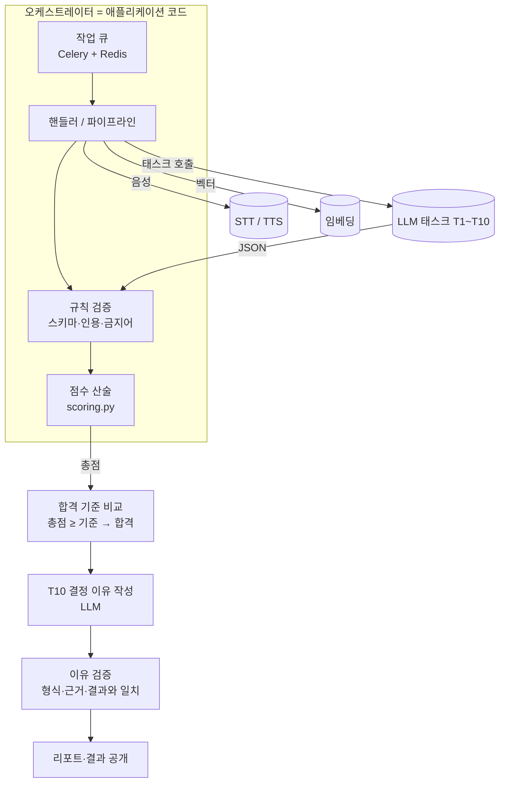
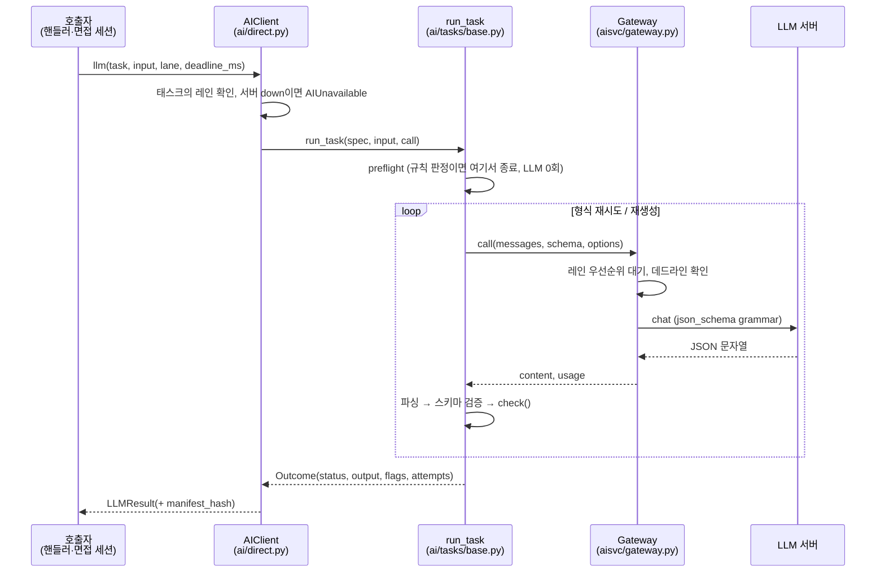
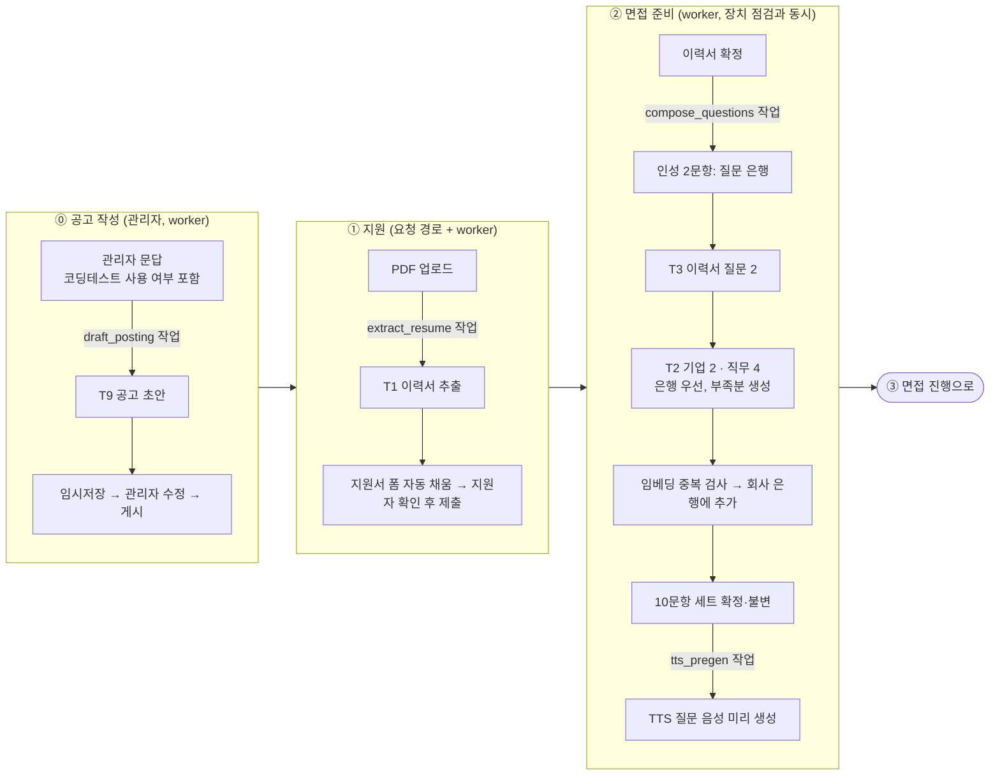
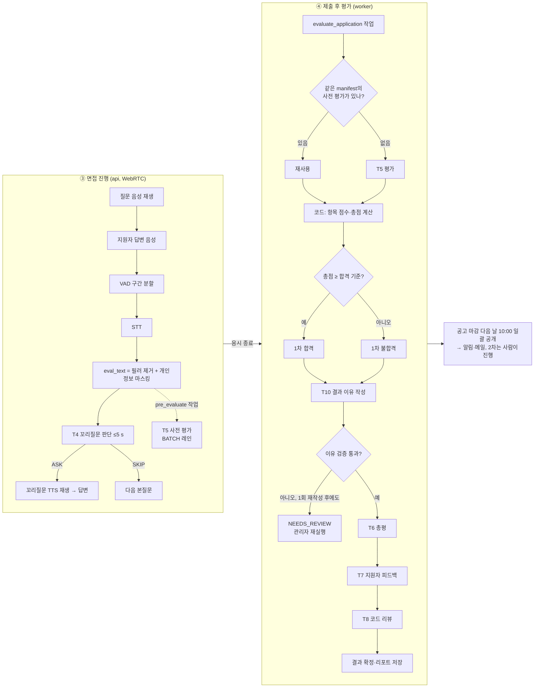

# AI 아키텍처 — LLM 오케스트레이션 구조

> 기준: 2026-10-30 `ai-hiring-platform` 브랜치 구현 (ADR-0003, 0005, 0006, 0008, 0013, 0014 / TRD 05), PRD v1.6, TRD v1.5.
> 특정 모델과 버전은 이 문서의 범위가 아니다. 각 모델은 **역할**로만 부른다. 모델을 바꿔도 아래 구조는 그대로 유지된다. 6GB 테스트 환경에서 쓰는 모델·설정값은 3.1절에 **예시 프로필**로만 적는다.
>
> **v1.1 (2026-10-30) 변경**: ① AI 공고 초안(T9, PRD JOB-02) 추가 ② GPU 6GB 테스트 프로필과 큰 환경 확장 방침 추가(3.1) ③ 1차 합격 여부를 LLM이 정하는 T10 추가(PRD EVL-05, TRD 8-2) ④ T5 채점을 PRD 기준(0~5점, 질문별 평가항목)으로 맞춤 ⑤ 질문 구성 시점·결과 공개 흐름을 PRD에 맞춤
>
> **v1.2 (2026-10-30) 변경**: ⑥ 재시도 횟수를 PRD QST-05·TRD 8-3에 맞춤 ⑦ VRAM 예산을 TRD 6-2 공식에 맞춤(슬롯 = N + `compose_slots`)
>
> **v1.3 (2026-10-30) 변경**: ⑧ 작업 큐를 TRD 기준(Celery 5.4 + Redis 7)으로 맞춤 ⑨ 총점이 합격 기준 미만이면 코드가 불합격을 확정하고 T10은 이유만 쓴다. 1차 결과는 관리자가 바꾸지 않는다
>
> **v1.4 (2026-10-30) 변경**: ⑩ 1차 합격 여부는 **총점 ≥ 합격 기준**으로만 정한다(기준 이상 = 합격, 미만 = 불합격). AI의 평가 역할은 루브릭에 따라 점수를 매겨 총점을 만드는 것이고(T5), T10은 정해진 결과의 이유만 쓴다. 점수와 결정이 엇갈리는 경우는 생기지 않는다

---

## 1. 한 줄 요약

**LLM끼리 서로 호출하거나 대화하지 않는다.** 오케스트레이터는 애플리케이션 코드(작업 큐와 파이프라인)다.
각 LLM 호출은 입력 하나에 대해 JSON 하나를 내는 **단일 목적 태스크**(T1~T10)다.
코드가 태스크를 순서대로 부르고, 출력을 규칙으로 검증하고, 다음 단계의 입력을 직접 만든다.
**AI는 루브릭에 따라 점수를 매기고, 합격·불합격은 그 점수로 정해진다.**

> **AI 평가는 어떻게 합격·불합격이 되나 (쉬운 설명)**
>
> 1. **AI가 채점한다(T5).** 질문마다 채점 기준표(루브릭)를 보고 "이 답변은 논리성 4점, 구체성 3점"처럼 0~5점을 매기고, 그 점수를 준 근거 문장을 답변에서 그대로 따온다. **평가에서 AI가 판단하는 부분은 여기다.**
> 2. **코드가 총점을 낸다.** AI가 매긴 점수들을 평균 내고, 항목 비율과 코딩테스트 반영 비율을 곱해 100점 만점 총점을 만든다. 계산은 AI가 틀릴 수 있어서 코드가 한다.
> 3. **총점으로 합격·불합격이 정해진다.** 총점이 공고의 합격 기준(예: 70점) 이상이면 합격, 미만이면 불합격이다. 같은 점수면 언제나 같은 결과가 나온다.
> 4. **AI가 이유를 쓴다(T10).** 정해진 결과를 바꾸지 않고, 왜 그런 점수가 나왔는지를 근거 문장을 들어 2~3문장으로 설명한다.
>
> 예: 항목 점수가 직무전문성 80, 논리성 70, 내용관련성·구체성 75, 전달력 60, 조직적합성 80이면 AI 면접 점수 74.5점. 코딩테스트 60점을 70:30으로 합치면 총점 70.15점 → 기준 70점 이상이므로 1차 합격(PRD 5-7 계산 예시).

---

## 2. 설계 원칙

| # | 원칙 | 구현 위치 |
|---|---|---|
| P1 | LLM은 **판단과 문장 생성**을 한다. 평가에서의 판단은 루브릭에 따른 항목 채점(T5)이다. 1차 합격 여부는 총점과 합격 기준 비교로 정해진다. 점수 합산, 가중치 적용, 반올림은 코드가 한다. | `evaluation/scoring.py` |
| P2 | LLM 출력은 **JSON 스키마로 강제**한다(디코딩 단계 grammar). 그 뒤 Pydantic으로 다시 검증한다. | `ai/tasks/base.py` `ollama_schema`, `run_task` |
| P3 | LLM이 "인용"이라고 낸 문자열은 믿지 않는다. **원문에서 위치(start, end)를 찾은 경우에만** 원문 조각으로 저장한다. | `evaluation/quotes.py` (ADR-0008) |
| P4 | 규칙으로 판정할 수 있는 경우(무응답, 너무 짧은 답, 꼬리질문 한도)에는 **LLM을 부르지 않는다**(preflight). | 각 TaskSpec `preflight` |
| P5 | 태스크마다 **보는 데이터가 다르다**. 평가에는 이름·연락처·목소리 특성을 넣지 않는다. 지원자용 피드백에는 점수·인용·가중치를 넣지 않는다. | `pipeline.unit_input`, `_feedback` |
| P6 | 실시간 요청은 **같은 서버의 하위 레인을 선점**해서 배치 작업을 기다리지 않는다. 서버를 나눌지 합칠지는 하드웨어 프로필(3.1)이 정하고, 코드는 `LANE_SERVER` 매핑만 본다. | `ai/direct.py` `LANE_SERVER` (ADR-0014), `aisvc/gateway.py` |
| P7 | 결과에 영향을 주는 것(모델 digest, 프롬프트, 옵션, 루브릭, 규칙 버전)은 모두 **manifest 해시**로 묶어 남긴다. | `ai/manifest.py` |
| P8 | LLM 호출은 수 초에서 수 분 걸린다. 그동안 **DB 트랜잭션을 열어 두지 않는다**(읽기 → 모델 호출 → 쓰기). 질문 구성도 예외가 아니다(10장). | `jobs/handlers.py`, `interview/turns.py` |
| P9 | **1차 합격 여부는 사람 없이 정한다.** AI가 루브릭으로 매긴 점수에서 나온 총점이 합격 기준 이상이면 합격, 미만이면 불합격이다. T10은 이 결과를 바꾸지 않고 이유만 쓴다. 그 밖의 태스크(T4~T9)는 "합격·불합격을 판단하거나 추천하지 않는다"가 시스템 프롬프트에 붙고, 출력은 P-8 탐지기로 한 번 더 거른다. 확정된 1차 결과는 관리자도 바꿀 수 없고, 2차 이후 채용 결정은 사람이 한다. | `TaskSpec.system_prompt`, `textrules.has_p8`, `evaluation/decision.py` |
| P10 | **한 지원 건의 같은 태스크는 항상 같은 모델로** 돈다. 서버가 내려가도 다른 모델로 바꿔 돌리지 않고 미룬다. 채점 기준이 지원자마다 달라지는 것을 막기 위해서다. | `ai/direct.py`, `ai/manifest.py` |

---

## 3. 구성 요소 (역할 기준)

| 역할 | 하는 일 | 처리 장치 (6GB 프로필) | 컨테이너 |
|---|---|---|---|
| **GPU LLM** | RT 레인(꼬리질문 판단), INTERACTIVE 레인(질문 구성, 이력서 추출, 공고 초안), BATCH 레인(답변 채점, 총평, 지원자 피드백, 코드 리뷰). 동시 슬롯 N + `compose_slots`개(TRD 6-2) | GPU | `llm-gpu` |
| **결정 LLM** | DECISION 레인(1차 결과 이유 작성 T10). 지원 1건당 1~2회 호출. 동시 슬롯 1개 | CPU (GPU에 층을 올리지 않음, `-ngl 0`) | `llm-eval` |
| **STT** | 지원자 음성을 텍스트로 변환 | GPU | `stt` |
| **TTS** | 질문 텍스트를 음성으로 변환(48 kHz PCM) | CPU | `tts` |
| **임베딩** | 생성 질문의 중복 검사(코사인 유사도 0.85 이상이면 중복) | CPU | `embed` |
| **오케스트레이터** | 위 서버를 부르는 쪽. 요청 경로는 `api`, 비동기 작업은 `worker` | — | `api`, `worker`, `scheduler` |

- 두 LLM 서버에는 **같은 모델을 올려도, 다른 모델을 올려도** 된다. 코드는 서버 URL과 레인만 안다.
- 런타임은 OpenAI 호환 llama.cpp 서버를 쓴다(`aisvc/llamacpp.py`). 다만 호출부는 `chat(messages, schema, options)` 하나로 추상화되어 있어서 다른 런타임으로 바꿀 수 있다(`aisvc/ollama.py`도 같은 형태다).
- `AIHIRE_AI_MODE`
    - `direct`: 분리된 컨테이너를 직접 호출한다(현재 배포 방식).
    - `service`: 단일 `ai` 프로세스를 거친다(로컬 개발용).
    - `fake`: 모델 없이 동작한다(구성 점검용, 운영에서는 거부).

### 3.1 하드웨어 프로필 — GPU 6GB 테스트 환경

> **6GB는 테스트(기준 PC)용 프로필이다.** 운영 환경이 커지면 아래 표의 프로필 값만 바꾸고 구조(레인, 태스크, 검증)는 그대로 둔다. 모델 크기, 슬롯 수, 레인 배치는 환경마다 달라질 수 있으며, 아래 숫자는 모델 파일 크기로 짐작한 값이라 TRD 13-2 측정으로 확정한다.

**원칙: 면접 중 지연에 영향을 주는 것과 시간이 오래 걸리는 것은 모두 GPU에 올리고, GPU에 못 올리는 것만 CPU로 보낸다.**

| 항목 | 6GB 테스트 프로필 (예시) | 근거 |
|---|---|---|
| GPU LLM | 4B급 Instruct, GGUF Q4_K_M, 모든 층 GPU(`-ngl 99`) | 8B급(약 5GB)은 STT와 함께 올릴 수 없다(TRD 6-3) |
| GPU LLM 슬롯 | `-np` = 동시 면접 N + 질문 만들기 자리 `compose_slots`(처음값 N=2, `compose_slots`=1 → 3개), 슬롯당 문맥 4096 토큰, `-fa on`, KV 캐시 `q8_0` | TRD 6-2 계산(대화 기억 = (N + 질문 만들기 자리 수) × 약 0.3GB)을 따른다. BATCH 작업은 새 슬롯을 늘리지 않고 이 슬롯이 빌 때만 쓴다(동시 1개) |
| BATCH 레인 | GPU LLM에서 실행, **동시 1개까지**. RT·INTERACTIVE가 오면 즉시 선점됨 | CPU 8B로 T5 한 번에 수십 초 걸리던 것을 GPU로 옮겨 EVL-07(10분 안 결과) 여유를 확보한다 |
| STT | large-v3-turbo급, `int8_float16`, GPU | 답변 직후 최종 전사가 다음 질문 지연에 바로 걸린다 |
| 결정 LLM | 8B급 Q4_K_M, CPU·일반 메모리(약 6~8GB) | 1건당 1~2회만 부르고 응시 후 10분 안에만 끝나면 된다. 관리자 리포트에 그대로 남는 결과 이유라 문장 품질을 위해 큰 모델을 쓴다 |
| 실시간 자막 | GPU가 바쁘면 그 차례는 건너뜀(TRD 7-5) | 면접 진행과 최종 전사에는 영향 없음 |

**VRAM 예산 (6GB = 6,144MiB, 추정치)**

| 항목 | 추정 |
|---|---|
| GPU LLM 모델(4B Q4_K_M) | 약 2.5GB |
| 대화 기억(KV 캐시): (N + `compose_slots`) × 약 0.3GB, 처음값 (2 + 1) | 약 0.9GB |
| STT(large-v3-turbo, int8_float16) | 약 1.0GB |
| 실행환경 | 약 0.5GB |
| **합계 (TRD 6-2 공식)** | **약 4.9GB ≤ 상한 5.4GB** |

TRD 6-2: 면접 중 LLM 2.5GB + 대화 기억((N + 질문 만들기 자리 수)개) + STT 1.0GB + 실행환경 약 0.5GB ≤ 5.4GB. N의 실제 값은 TRD 13-2 측정으로 정한다(TRD T-02).

- **13-2 측정 때 함께 확인할 것**: 기준 PC는 면접 브라우저(웹캠 영상)를 같이 띄우므로 화면이 쓰는 VRAM이 있고, LLM과 STT는 별도 프로세스라 실행환경(CUDA 컨텍스트)이 2개 생긴다. 이 둘이 "실행환경 약 0.5GB"를 넘는지 `nvidia-smi`로 재고, 넘으면 N을 줄인다.
- VRAM이 넘치면 Windows 드라이버가 일반 메모리를 몰래 빌려 써서 **오류 없이 수 배 느려진다.** NVIDIA 제어판의 "CUDA 시스템 메모리 대체 정책"을 "대체 안 함"으로 두어 넘칠 때 바로 실패하게 하고, 이 설정이 Docker(WSL2) 안에서도 적용되는지 13-2 측정 때 확인한다.
- 남는 VRAM이 있어도 **결정 LLM의 일부 층을 GPU에 올리지 않는다**(`-ngl 0`). 0.5GB 안팎으로는 속도 이득이 작고, 면접 중 VRAM이 넘치면 위 문제가 생긴다.
- 동시 면접 상한 N은 VRAM 사용률(NVML)과 '답변 끝 → 다음 질문' 시간을 보며 자동 보호한다(PRD INT-08, TRD 5-3).

**큰 환경으로 갈 때 (예시, 확정 아님)**

| 환경 | 바뀌는 점 |
|---|---|
| GPU 12GB급 | GPU LLM을 8B급으로 올리고, 결정 LLM(T10)도 같은 GPU 서버로 옮길 수 있다. 슬롯 3~4개 |
| GPU 24GB급 이상 / GPU 2장 | 실시간용(RT·INTERACTIVE)과 배치용(BATCH·DECISION) 서버를 GPU에 각각 둔다. STT를 비-turbo 모델로 바꾸는 것도 검토 |

프로필을 바꾸면 모델 digest가 바뀌므로 manifest 해시가 달라진다. **진행 중인 공고가 있을 때 프로필을 바꾸지 않는다**(같은 공고 지원자는 같은 모델로 채점, P10).

---

## 4. 호출 계층

| 계층 | 책임 |
|---|---|
| **AIClient** | 레인을 서버로 라우팅한다(6GB 프로필: `RT/INTERACTIVE/BATCH → GPU LLM`, `DECISION → 결정 LLM`). 레인별 기본 데드라인(RT 5 s, INTERACTIVE 120 s, BATCH 600 s, DECISION 600 s)을 정하고, 인프라 장애를 `AIUnavailable`로 바꾸고, manifest 해시를 붙인다. |
| **run_task** | 태스크 하나의 생명주기를 맡는다. preflight, 입력 분할과 병합(`split`/`merge`), 형식 재시도, 종류별 재생성, 최종 fallback을 처리한다. |
| **TaskSpec** | 태스크가 소유한 것들이다. 시스템 프롬프트, 출력 스키마(Pydantic), 온도·토큰 수, 재시도 한도, 검증기(`check`). |
| **Gateway** | LLM 서버 하나 앞에 있는 레인 스케줄러다. 우선순위 `RT > INTERACTIVE > BATCH`, 레인별 동시 실행 상한(BATCH 1), 절대 데드라인, 실행 시간 EWMA 추정, 장애 표시(15 s 동안 즉시 실패)를 처리한다. 같은 서버에서 상위 레인 요청이 오면 하위 레인 스트림을 끊고 그 요청을 자기 레인 맨 앞으로 되돌린다(선점). |

---

## 5. 태스크 카탈로그

| ID | 태스크 | 레인 | 입력 | 출력 | 검증·fallback |
|---|---|---|---|---|---|
| T1 | `resume_extract` | INTERACTIVE | PDF 추출 텍스트(6000자 단위로 나눠 호출한 뒤 병합) | 이력서 스키마(학력, 경력, 프로젝트 등) | 원문에 없는 값은 버린다(`dropped_values`). 실패하면 지원자가 직접 입력한다. |
| T2 | `question_generate` | INTERACTIVE | 공고, 회사 소개, 유형(COMPANY/JOB), 개수 | 질문과 `basis_quote` | 근거 인용 확인, 질문 형태, 금지 질문, 중복을 검사한다. 질문 한 자리마다 최대 3회 다시 만든다. 지원자 1명의 10문항 전체가 60초를 넘으면 남은 자리는 다시 만들지 않는다. 실패한 자리는 질문 은행 → 예비 질문 순으로 채운다(PRD QST-05). |
| T3 | `resume_question` | INTERACTIVE | 이력서 스냅샷, 직무 요약 | 질문과 이력서 근거 문장 | 자리마다 최대 3회 다시 만들고(60초 전체 제한 공유), 그래도 실패하면 예비 질문 중 경험·프로젝트 질문으로 채운다(`BANK_FALLBACK`, PRD QST-05). |
| T4 | `followup_decide` | **RT** | 본질문, 답변(`eval_text`), 이력서 근거 | `ASK`/`SKIP`, 사유, anchor 인용, 꼬리질문 | 재시도하지 않는다(5 s 예산, 처음값). anchor가 원문에 없거나, 새 주제이거나, 금지어가 있으면 INVALID로 SKIP한다. |
| T5 | `evaluate_answer` | BATCH | 질문 사본, 그 질문에 연결된 평가항목 설명·채점 기준표, 답변(꼬리질문 답변 합침, 이름·연락처 마스킹) | 연결된 평가항목별 quote, comment, **0~5점** | 무응답은 preflight에서 0점(LLM 0회). 인용 불일치나 근거 없는 점수면 1회 재생성 후 `INSUFFICIENT`(1점) 처리한다(PRD EVL-02). P-8 표현이 있으면 1회 재생성 후 해당 문장을 삭제한다. |
| T6 | `report_summary` | BATCH | 문항별 항목 점수, 코멘트, 근거 부족 여부 | 총평, 강점·개선점(각 1~3개, 문항 번호 포함) | 점수 숫자 재기재와 합불 표현이 있으면 재생성한다. 강점에는 그 항목 점수가 3점 이상인 문항만 넣을 수 있다(10장 T6 배치 오류 대응). |
| T7 | `candidate_feedback` | BATCH | 항목별 등급(상·중·하)과 코멘트 요지만 | 지원자에게 보여 줄 강점·개선점(각 최대 3개) | 총점·순위·합불 단어를 금지한다. 답변을 15자 이상 연속으로 그대로 옮기는 것도 금지한다(인용 유출 방지). |
| T8 | `code_review` | BATCH | 문제 설명, 공개 예제, 제출 코드 | 코드 리뷰 문장 | 숨김 테스트는 프롬프트에 넣지 않는다. 실패하면 빈칸으로 둔다(점수에 영향 없음). |
| **T9** | `posting_draft` | INTERACTIVE | 관리자 문답(6.0절): 회사 소개 메모, 팀·업무 키워드, 필수 기술, 우대 키워드, 경력 수준 | 공고 문장 칸만: 제목 후보, 회사 소개, 주요 업무, 자격 요건, 우대 사항 | 입력에 없는 숫자·연봉·복리후생을 지어내면 그 문장을 지운다(숫자는 입력에 있는 것만 허용). 차별로 보일 수 있는 표현은 **경고 표시만** 하고 막지 않는다(PRD JOB-02). 재생성 1회, 그래도 실패하면 입력값만 채운 빈 양식을 준다. |
| **T10** | `pass_reason` | **DECISION** | **코드가 정한 결과(합격/불합격)**, 항목 점수, AI 면접 점수, 코딩테스트 점수, 총점, 합격 기준 점수, 항목별 검증된 근거 문장 | `{reason(2~3문장), quotes[]}` | 결과는 입력으로만 받고 출력하지 않는다(결과를 바꿀 수 없음). 이유가 비어 있지 않은지, 근거 문장이 원문에 있는지, 이유가 결과와 반대 방향(합격인데 "불합격 사유"를 쓰는 등)이 아닌지 검증한다. 실패하면 1회 다시 쓰게 하고(`rejudge_limit`), 그래도 실패하면 `NEEDS_REVIEW`(확인 필요). 이름·연락처·이력서는 넣지 않는다. |

공통 사항:

- 모든 사용자 입력(지원자 답변, 이력서, 관리자 공고 문답)은 **nonce 펜스**(`fence('ANSWER', …, nonce)`)로 감싸서 프롬프트 인젝션과 분리한다. 인젝션으로 의심되는 문구는 `flags.injection_suspected`로 표시한다.
- 출력 옵션은 `seed=42`로 고정하고, 평가 태스크(T5·T10)는 `temperature=0`이다. 생성 태스크(T2·T4·T9)만 온도를 조금 높인다.
- 합격·불합격은 코드가 총점과 기준을 비교해 정하므로 점수와 결정이 엇갈리는 경우는 생기지 않는다.

---

## 6. 단계별 오케스트레이션

### 6.0 공고 작성 — AI 공고 초안 (T9)

1. 관리자가 공고 관리에서 **'AI로 공고 초안 만들기'** 를 누르면 문답 화면이 열린다.
2. 문답 항목은 두 종류로 나눈다.
    - **코드가 그대로 칸에 넣는 값**(LLM에 맡기지 않음): 직무(AI/AX 엔지니어), 고용 형태, 근무지, 모집 인원, 접수 시작일·마감일, **코딩테스트 사용 여부**와 반영 비율(기본 70:30, PRD JOB-03).
    - **T9가 문장으로 다듬는 값**: 회사 소개 메모, 팀·업무 키워드, 필수 기술, 우대 키워드, 경력 수준.
3. `POST /postings/{id}/draft-ai`가 `draft_posting` 작업을 큐에 넣고 바로 돌아온다. 화면은 상태 API를 주기적으로 확인해 '초안 만드는 중'을 보여 준다. 같은 공고에 이미 돌고 있는 초안 작업이 있으면 새로 넣지 않는다(멱등 키: 공고 ID + 문답 해시).
4. 결과는 항상 **임시저장(draft)** 상태로 들어간다. 자동 게시하지 않는다. 경고가 붙은 표현은 편집 화면에서 밑줄로 보여 준다.
5. 관리자가 읽고 고친 뒤 채점 기준(JOB-03~05)을 확인하고 게시한다. 첫 응시가 시작된 공고(JOB-07 잠금)에는 초안 만들기를 쓸 수 없다.

### 6.1 전체 흐름

### 6.2 면접 중 실시간 루프 (가장 지연에 민감한 경로)

1. 답변이 끝나면 STT 결과로 `eval_text`를 만들고 답변을 확정한다. 답변을 DB에 커밋한 **뒤** `pre_evaluate` 작업을 Celery에 넣는다. 커밋과 큐 넣기 사이에 프로세스가 죽어 빠진 작업은 5분마다 도는 점검 작업이 다시 넣는다(TRD 10장). 꼬리질문이 붙으면 꼬리질문 답변까지 끝난 뒤 합쳐서 넣는다(PRD EVL-07).
2. `decide_followup`이 한도와 규칙을 먼저 확인한다. 꼬리질문은 본질문당 1개, 전체 4개까지다. 무응답이거나 내용이 없으면 LLM을 부르지 않고 SKIP한다.
3. 규칙을 통과하면 T4를 **RT 레인**, 데드라인 "답변 확정 + 5 s"로 호출한다. 5 s는 처음값이며 TRD 13-2에서 `followup_min_sec`로 다시 정한다.
4. 결과가 `ASK`이고 검증을 통과하면 꼬리질문을 만든다. 같은 질문 줄에서 TTS를 바로 합성해 들려준다.
5. 타임아웃, INVALID, 인프라 장애가 나면 **면접을 멈추지 않고 SKIP**한다. 사유(`skip_cause`)는 `followup_decisions`에 남긴다.
6. 사전 평가(T5)는 같은 GPU LLM의 **BATCH 레인**에서 비동기로 돈다. RT 요청이 오면 Gateway가 BATCH 스트림을 끊고 RT를 먼저 처리하므로 실시간 루프를 막지 않는다. 끊긴 T5는 같은 레인 맨 앞에서 다시 시작한다(시도 횟수 미소모).

### 6.3 제출 후 평가

- `load_report_inputs`: 짧은 트랜잭션 하나로 필요한 행을 모두 읽는다. 코딩 채점이 아직 끝나지 않았으면 여기서 멈추고 나중에 다시 시도한다.
- `build_report`: DB 없이 모델만 호출한다.
    - 사전 평가가 현재 manifest와 같으면 재사용하고, 다르면 T5를 다시 돌린다.
    - 점수는 `compute()`로 계산한다(항목 점수 = 평균 ÷ 5 × 100, 가중 합, 코딩테스트 반영 비율, Decimal 소수 둘째 자리 — PRD EVL-03·04).
    - **총점이 합격 기준 이상이면 1차 합격, 미만이면 1차 불합격으로 정한다.** 그 결과와 점수·근거를 T10에 넣어 이유를 받는다. 검증에 실패하면 1회 다시 쓰게 하고, 그래도 실패하면 이후 단계를 멈추고 `NEEDS_REVIEW`로 둔다.
    - 결정이 확정되면 T6, T7, T8을 **순차** 호출한다.
- 저장: 새 트랜잭션에서 멱등 키(지원 번호 + 단계)로 이미 저장된 결과가 없는지 확인한 뒤 결과(결정·이유·점수 구성·기준 버전·모델·지시문 버전), 리포트, 항목 점수, 평가 run을 기록한다. 지원자용 결과(`public_view`)는 따로 만든다.
- T6과 T7은 **다른 입력**으로 따로 호출한다. 담당자용 총평이 지원자용 피드백에 섞이지 않게 하기 위해서다.
- 확정된 결과는 관리자도 고칠 수 없다(PRD EVL-05). 관리자는 `NEEDS_REVIEW` 건을 다시 돌리기만 한다.

---

## 7. 작업 큐 (비동기 오케스트레이션)

| 작업 | 리소스 큐 | 우선순위 | 최대 시도 | 쓰는 AI |
|---|---|---|---|---|
| `compose_questions` | LLM | 10 | 3 | T2, T3, 임베딩 |
| `tts_pregen` | CPU | 15 | 3 | TTS |
| `extract_resume` | LLM | 20 | 2 | T1 |
| `grade_coding` | RUNNER | 20 | 3 | (샌드박스, AI 없음) |
| `draft_posting` | LLM | 30 | 2 | T9 |
| `pre_evaluate` | LLM_BATCH | 40 | 1 + 재시도 3 | T5 |
| `evaluate_application` | LLM_BATCH + LLM_DECISION | 50 | 1 + 재시도 3 | T5, T10, T6, T7, T8 |

- **Celery 5.4 + Redis 7(브로커)** 로 돌린다(TRD 기술 스택). 정해진 시각 작업은 Celery beat가 맡는다.
- 리소스마다 Celery 큐를 따로 두고(`llm`, `llm_batch`, `llm_decision`, `cpu`, `runner`), 큐마다 전용 worker를 둔다. LLM 큐 worker는 동시 실행 1개로 둬서 GPU·CPU를 넘치게 쓰지 않는다. 표의 우선순위는 같은 큐 안에서의 순서다.
- 작업은 **DB 커밋 뒤에** 큐에 넣는다. 커밋 전에 넣으면 아직 없는 행을 worker가 읽을 수 있다. 커밋 뒤 큐 넣기 전에 죽어서 빠진 작업은 5분마다 도는 점검 작업이 DB 상태를 보고 다시 넣는다(TRD 10장).
- `acks_late`로 두어 worker가 죽으면 작업이 다시 나간다. Redis 브로커의 `visibility_timeout`은 가장 긴 작업(30분)보다 길게 잡는다. 짧으면 아직 도는 작업이 한 번 더 나간다. 두 번 돌아도 결과는 멱등 키로 하나만 남는다(TRD 8-3).
- worker는 작업을 시작하기 전에 해당 LLM 서버 상태를 확인한다. 내려가 있으면 `AIUnavailable`로 보고 **재시도 횟수를 쓰지 않고** 미룬다(Celery 기본 재시도 횟수와 따로 센다). 모델이 응답했는데 결과를 쓸 수 없는 경우(INVALID, TIMEOUT)만 재시도 횟수로 친다.
- Redis가 죽으면 백그라운드 작업 전체가 멈춘다. 서버 1대 구성이라 Redis는 대체 수단 없이 docker 자동 재시작(healthcheck)으로 되살리고, 빠진 작업은 위 5분 점검이 다시 넣는다.
- `draft_posting`은 지원자 쪽 작업(질문 구성, 이력서 추출)보다 뒤에 둔다. 지원자는 면접 시작을 기다리고 있고, 관리자는 진행 표시를 보며 기다릴 수 있기 때문이다.
- 평가 작업은 실패하면 1·2·4분 간격으로 최대 3번 다시 한다. 3번 다 실패하거나 30분을 넘으면 `NEEDS_REVIEW`(PRD '확인 필요', 관리자 화면 '평가 지연')가 된다(TRD 8-3). 점수 행을 만들지 않고, 관리자가 다시 돌릴 수 있다. 같은 작업이 두 번 돌아도 결과가 하나만 생기도록 멱등 키(지원 번호 + 단계)를 붙인다.

---

## 8. 품질과 안전 장치 요약

| 위험 | 장치 |
|---|---|
| JSON 깨짐, 필드 누락 | 디코딩 단계 스키마 강제 → Pydantic 검증 → 오류 내용을 붙여 재요청(형식 재시도 기본 2회) |
| 근거 없는 판단, 환각 인용 | 원문 위치 검증(정규화 후 부분 문자열 매칭, 내부 구두점과 숫자는 엄격 비교). 실패하면 재생성 1회 후 `근거 부족` |
| 과도한 LLM 의존 | preflight 규칙(무응답, 짧은 답, 한도). 결정적 텍스트 규칙(`textrules.py`)마다 버전이 있어 manifest에 포함된다 |
| LLM 산술·비교 오류 | 점수 합산·가중치·반올림과 합격 기준 비교는 코드만 한다 |
| 결과 이유의 근거 부족 | T10 이유의 근거 문장을 원문 위치 검증. 실패하면 1회 재작성 → `NEEDS_REVIEW` |
| 점수와 결정의 엇갈림 | 결과는 총점 ≥ 기준으로만 정하므로 생기지 않는다. T10 이유가 결과와 반대 방향이면 재작성 |
| 프롬프트 인젝션 | nonce 펜스, 제어 토큰 제거, 인젝션 문구 탐지 플래그 |
| 차별·사적 질문 | 금지 질문 규칙(`fq-1`). 생성 질문과 꼬리질문 모두 검사한다 |
| 공고의 차별 표현, 지어낸 조건 | T9 출력에 금지·주의 표현 목록 검사(경고만, 게시는 막지 않음). 입력에 없는 숫자·연봉·복리후생 문장 삭제. 자동 게시 없음 |
| 합불 표현 누출 | T4~T9 시스템 프롬프트 금지 + 출력 P-8 탐지 → 재생성 → 해당 문장 삭제. 합불은 코드가 총점으로 정하고, T10은 이유만 쓴다 |
| 편향 입력 | 평가 입력에서 이름, 연락처, 나이, 성별 자기 언급을 마스킹한다(`redact`). 이력서는 T5·T10에 넣지 않는다 |
| 정보 유출 | T7에는 점수, 인용, 가중치를 넣지 않는다. 답변을 15자 이상 그대로 옮기면 거부한다. T8에는 숨김 테스트를 넣지 않는다 |
| 재현성 | manifest 해시를 평가 run과 사전 평가에 저장한다. 해시가 다르면 사전 평가를 재사용하지 않는다. 한 지원 건은 한 모델로만 채점(P10) |
| VRAM 초과로 인한 조용한 감속 | 3.1 예산 관리, 시스템 메모리 대체 끄기, NVML 감시로 새 면접 입장 제한(INT-08) |

---

## 9. 실패 처리

| 상황 | 실시간 경로 (T4) | 비동기 작업 |
|---|---|---|
| LLM 서버 다운 | SKIP (`INFRA`), 면접은 계속 | 시도 횟수를 쓰지 않고 연기(다른 모델로 대체하지 않음) |
| 데드라인 초과 | SKIP (`TIMEOUT`) | 시도 1회 소모 |
| 출력 검증 실패 | SKIP (`INVALID`) | 형식 재시도·재생성 → 그래도 실패하면 시도 1회 소모 |
| T10 이유 검증 실패 | — | 1회 재작성 → 그래도 실패하면 `NEEDS_REVIEW` |
| T9 공고 초안 실패 | — | 입력값만 채운 빈 양식을 돌려주고 관리자가 직접 작성 |
| 재시도 한도 초과 | — | 평가는 1·2·4분 간격 3번 재시도 후 또는 30분 초과 시 `NEEDS_REVIEW`(TRD 8-3), 이력서 추출은 2회 실패 시 `FAILED`(직접 입력) |
| 상위 레인에 선점됨 | — | 같은 레인 맨 앞에서 재개, 시도 횟수 미소모 |

---

## 10. 알려진 한계와 다음 과제

- **GPU 하나를 실시간과 배치가 나눠 쓴다(6GB 프로필).** 선점으로 RT 지연은 지키지만, 면접이 몰리면 BATCH(T5)가 계속 밀려 결과가 늦어질 수 있다. TRD 13-2에서 동시 면접 N을 늘려 가며 '응시 끝 → 결과 확정'이 10건 중 9건 10분 안인지 같이 잰다. 못 지키면 N을 낮춘다.
- **결정 LLM(T10)은 CPU에서 돈다.** 1건당 수십 초~1분 수준으로 예상하며, 10분 목표 안에 들어가는지 13-2에서 잰다. 너무 느리면 T10도 GPU LLM으로 옮긴다. T10은 이유만 쓰므로 옮겨도 합격·불합격 결과에는 영향이 없다.
- **질문 구성(`compose_questions`)이 LLM 호출 중 트랜잭션을 잡고 있다.** 이번 변경으로 GPU LLM을 BATCH도 같이 쓰게 되어 호출이 더 길어질 수 있으므로, **반드시** 평가처럼 읽기·호출·쓰기로 나눠야 한다(P8).
- **STT 환각.** 무음 구간에서 짧은 인사말을 지어낸 사례가 있었다. VAD 임계값과 STT 무음 필터를 조정해야 한다.
- **T6 문장 배치 오류.** 항목 점수가 모두 최저일 때 약점 문장을 "강점"에 넣은 사례가 있었다. 5장 T6 검증 규칙(강점은 3점 이상 문항만)으로 막는다.
- **VRAM 예산은 TRD 6-2의 추정치다.** 화면·브라우저 몫과 프로세스별 실행환경을 포함해 TRD 13-2에서 재고, 5.4GB를 넘으면 N을 줄이거나 KV 캐시 문맥을 줄인다(4096 → 3072).
- **공고 차별 표현 감지 방식은 팀 결정 대기**(PRD JOB-02, TRD T-08). 이 문서는 TRD 추천안(금지·주의 표현 목록, 경고만)을 따른다.
