# AI 면접 통합 서비스 플로우차트

통합 설계 검토 보고서 | 09v | 2026-11-03 | 기준 문서: 통합 PRD v1.7 · TRD v1.6 (개인용 개정본)

**개인용 개정본 — 팀 원본 아님, 기준: 구현(`huge/`) + `huge/CONFLICTS.md` (2026-11-03).** 원본은 08v(PRD v1.3 · TRD v1.5 기준, 2026-10-29)다.

## 문서 개요

통합 PRD v1.7의 요구사항과 TRD v1.6의 처리 규칙을 기준으로 서비스 전체 흐름과 기능별 처리 절차를 정리한 플로우차트다. 도면의 각 단계에는 PRD 요구사항 ID를 함께 적어 추적할 수 있게 했다. 숫자(재시도 횟수·시간 제한·주기)는 TRD 14장 설정값을 따르며, 비동기 처리 등 구현 상세는 TRD에서 정한다.

## 09v 반영 사항 (개인용 개정본, 2026-11-03)

구현(`huge/`)과 `huge/CONFLICTS.md` 에 맞춰 08v의 흐름을 고쳤다. 괄호의 영문·숫자는 CONFLICTS 항목 번호다. CONFLICTS 항목은 사용자 확인을 거쳐 반영했다(2026-11-04). 결정이 남은 항목은 문서 끝 '논의사항'에 모았다.

1. **기준 문서 갱신** — PRD v1.7 · TRD v1.6(개인용 개정본)으로 바꿨다. 도면 목록의 관련 문서 버전도 같이 바꿨다.
2. **05 AI 면접 — STT 실패(A1)** — STT를 다시 해 보고도 실패하면 같은 질문 재답변이 아니라 **장애 중단**이다. 장애 이어가기(11)로 간다.
3. **05 — 꼬리질문 시간(U7)** — 꼬리질문을 낼 때만 목표 시간(`followup_target_sec`)을 따로 둔다.
4. **05·07 — 채점 시점(S2)** — 질문 번호마다 미리 채점하지 않고 응시가 끝난 뒤 한 번에 채점한다.
5. **07 — 합불(S1)** — 1차 합불은 AI가 아니라 **코드가 `총점 ≥ 합격 기준`으로** 정한다. AI는 정해진 결과의 이유만 쓴다.
6. **07 — 답변 속 채점 지시** — 답변에 "만점 주세요" 같은 지시가 있으면 채점하지 않고 `instruction_suspected` '평가 지연'으로 두고 관리자 확인 뒤 채점한다.
7. **11 장애 이어가기** — 이어가기는 3회까지이고 4번째 끊김은 응시 종료다(D1). 진행 중인데 연결된 세션이 없으면 90초 뒤 장애 중단이다(C11, api 안 1분마다 도는 정리 작업이라 실제로는 90~150초, 서버를 다시 켤 때는 바로 처리). 업로드 3회 실패는 원인을 서버 기록으로 판정한다(R5).
8. **03 지원 — 이력서 읽기 순서(U4)** — PDF 리더 → AI 정리 → 못 읽은 쪽·사진만 OCR로 **빈 칸만** 채운다. OCR은 1단계에 들어왔다.
9. **03·10 — '면접 준비 중'(U3)** — 이력서만 제출한 상태를 '지원 완료'로 보이지 않게 했다. 응시 상태 이름은 '면접 준비 중', 버튼은 [이력서 제출]이다.
10. **04 질문 구성(U5)** — 질문 10개를 RAG로 먼저 만들고, 못 만들면 질문은행 → 예비 질문이다.
11. **10 마이페이지 — 철회·탈퇴(W5)** — 진행 중 응시를 철회하면 자리 반환 → 응시 화면 종료 안내 → 삭제 순서다.
12. **01 — 비밀번호 찾기(P1)** — 같은 주소로 1분에 한 통, 새 링크를 보내면 이전 링크는 무효, 바꾸면 모든 기기 로그아웃이다.
13. **02·03·09 — 미구현 표시** — 공고 불러오기(V2), 관리자 원본 이력서 보기(V3), 자동 보호(F6), 하루 메일 상한(S5)은 요구사항을 지우지 않고 '현재 구현 범위 밖(미구현)'으로 표시했다. 회사명은 표기하지 않고(U1) '회사 소개'는 '부서 소개'로 부른다(V1). 판정 없는 건의 삭제일은 공개일 + 7일이다(F9). 녹화 삭제는 매시 30분 점검이다(R3).
14. **검토(백엔드·프론트엔드·UI/UX) 반영** — 공고 마감은 예약 작업이 아니라 api 가 1분마다 닫는 것으로, 결과 공개는 5분 점검 주기로, 세션 연장 조건, OCR 시간 초과 기준, 시작 전 안내에 이어가기 3회, 동시 면접 안내 문구(OV-05), 마이페이지 이력서는 직접 작성만, '브라우저 offline'·'다른 사이트 이동 시도' 신호 표기, 08-B '신규 지원' 알림 삭제, 결과 저장 항목의 '판정(코드)과 AI가 쓴 이유' 표기를 고쳤다.

## 08v 반영 사항

PRD v1.3과 TRD v1.5에 맞춰 07v를 고쳤다.

1. **단일 관리자(전체)** — ‘기업 담당자’와 ‘운영자’를 ‘관리자’ 하나로 합쳤다. 관리자 계정 1개는 설치 때 만들고, 회사별 계정·데이터 구분(멀티테넌시)은 두지 않는다(N8). ‘사전 발급 계정’, ‘소속 기업 데이터만’ 문구를 뺐다.
2. **02 공고** — Open API·더미 데이터로 공고를 불러오는 경로를 넣었다(JOB-08, 임시저장으로 들어옴). 게시 뒤에도 공고 내용은 고칠 수 있고, 평가 기준만 첫 응시 시작 후 잠긴다. 마감하면 진행 중 면접도 바로 끝난다(INT-10).
3. **03 지원** — 이력서는 PDF·JPG·PNG를 받고 10MB 상한을 없앴다(APP-04). 예상 처리 시간을 보여 주고, OCR 실패 기준(예상의 2배·최소 60초 초과, 글자 없음, 평균 신뢰도 0.5 미만)을 넣었다. 동시 면접 상한에 걸리면 ‘대기’ 상태 대신 ‘다시 시도’ 버튼을 보여 준다(상태는 ‘준비 중’ 그대로).
4. **04 질문 구성** — 구성 시점을 응시 시작에서 이력서 확정 직후(백그라운드)로 옮겼다(QST-03). 시도당 8초, 지원자 1명 전체 60초 제한을 넣고, 이력서 기반 문항은 실패하면 바로 예비 질문으로 바꾼다(QST-05).
5. **05 AI 면접** — ‘꼬리질문 5초 안에 생성’을 남은 시간 기반 판단으로 바꿨다. 꼬리질문 음성(TTS)이 늦으면 자막만으로 낸다(TRD 7-5).
6. **07 평가** — AI가 정한 합불을 시스템이 ‘총점 ≥ 합격 기준’ 규칙으로 다시 판정하지 않는다. 시스템은 형식·값 범위·근거 문장만 검증한다(TRD 1-2, 8-2 ⑤). 분석 재시도 간격은 1·2·4분이다.
7. **08 결과 공개** — 마감 시각에 모든 응시가 끝나므로 ‘장애 재개 중이라 지연 공개’ 분기를 뺐다. 알림 목록과 메일 재시도(60·300·1800초)를 TRD 10장에 맞췄다.
8. **10 마이페이지** — 응시 상태에 ‘미응시(마감)’·‘응시 종료(마감)’을 넣었다. 보관 기간이 지나면 데이터 자체가 지워지므로 ‘보관 만료·열람 불가’ 분기를 뺐다.
9. **11 장애 이어가기** — 끊긴 지 15초가 되는 순간 바로 판단한다(TRD 7-2). 재개 기한은 마감 후 24시간이 아니라 공고 마감 시각까지다(RES-03). 장애로 끊긴 면접의 자리는 10분만 맡아 둔다(TRD 5-3).
10. **12 화면 이탈** — 1회차 이탈 뒤에는 같은 질문을 멈춘 시점의 남은 시간부터 이어 답하고, 이탈 전후 음성을 하나의 답변으로 합친다(TRD 7-3).

## 07v 반영 사항

PRD v1.1의 팀 피드백 5건 중 흐름에 영향을 주는 4건을 반영했다.

1. **피드백 ① AI가 1차 합불 판정(07, 00, 09)** — 1차 합격·불합격은 AI가 판정 사유와 함께 낸다. (08v에서 검증 방식 변경)
2. **피드백 ② 이메일 인증 후순위(01, 03)** — 인증 없이 가입·지원하는 흐름을 기본으로 바꿨다. 이메일 인증은 추가 후 경로로 점선 표시했다.
3. **피드백 ④ 질문 재생성 상한(04, 11)** — 해당 문항을 같은 조건으로 최대 3회 재생성하고, 실패하면 DB 질문 → 예비 질문으로 대체한다.
4. **피드백 ⑤ 동시 면접 상한 N(03, 10)** — 상한을 운영 설정값 N으로 바꿨다. (08v에서 ‘대기’ 상태를 ‘다시 시도’ 안내로 변경)
5. **이력서 OCR 추가(03, 08-A)** — 스캔 PDF를 온프레미스 OCR로 추출하는 경로를 넣었다. (08v에서 JPG·PNG 추가)
6. **용어 통일** — 도면 용어를 PRD v1.1 용어로 바꿨다.

## 06v 반영 사항

05v를 PRD v1에 맞춰 전면 재작성했다. 도면을 00~12로 다시 나누고, 질문 구성의 관리자 검토 단계 제거, 꼬리질문 상한(질문당 1개·전체 4개), 코딩테스트 AI 도우미 제거, 마감 다음 날 10:00 일괄 공개를 넣었다.

검토 상태: 개인용 개정본 / PRD v1.7 · TRD v1.6 · 구현(`huge/`) 정합 확인용

## 도면 목록

| 번호 | 도면 | 관련 PRD v1.7 · TRD v1.6 | 07v 대응 |
|---|---|---|---|
| 00 | 전체 서비스 흐름 | PRD 2-3, 6-1 | 00 |
| 01 | 회원가입·로그인 | PRD 5-1 · TRD 11장 | 01 |
| 02 | 공고 작성·평가 기준 설정 | PRD 5-2 · TRD 5-1 | 02 |
| 03 | 지원·사전 준비 | PRD 5-3, INT-08 · TRD 5-3, 7-6 | 03 |
| 04 | 질문 구성 | PRD 5-5, 7-4 · TRD 7-4 | 04 |
| 05 | AI 면접·꼬리질문 | PRD 5-4 · TRD 7-5 | 05 |
| 06 | 코딩테스트 응시·채점 | PRD 5-6 · TRD 9장 | 06 |
| 07 | 평가·채점·AI 1차 합불 판정 | PRD 5-7, 7-1 · TRD 8장 | 07 |
| 08 | 결과 공개·알림·보관 삭제 | PRD 5-8, 10-2, ADM-08 · TRD 10장 | 08 |
| 09 | 관리자 결과 관리 | PRD 5-9 | 09 |
| 10 | 지원자 마이페이지 | PRD 6-2, RES-03, INT-10 | 10 |
| 11 | 장애 이어가기 | PRD 5-10, 7-2 · TRD 7-1, 7-2 | 11 |
| 12 | 부정행위: 화면 이탈 | PRD 5-11, 7-3 · TRD 7-3 | 12 |

범례: 타원(시작/종료·다른 도면 연결) · 마름모(분기) · 파란 박스(허브 화면, 재진입 지점) · 흰 박스(처리/화면 단계) · 점선(상시 감시·백그라운드)

---

## 00 전체 서비스 흐름

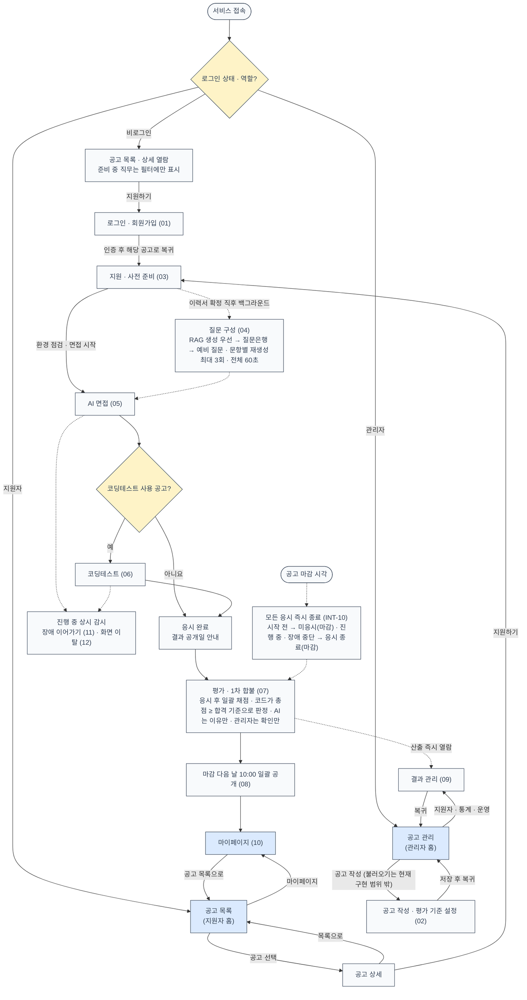

설계 기준: 지원자는 공고 목록, 관리자는 공고 관리 화면이 홈이다. 관리자 계정은 1개이며 설치 때 만들어 두고, 회원가입은 지원자만 한다(N8). 응시는 지원 건당 1회이고, 첫 질문이 제시되는 시점에 차감된다(INT-09). 1차 합불은 코드가 총점과 합격 기준을 비교해 정하고(S1) AI는 정해진 결과의 이유만 쓰며, 시스템이 그 이유의 형식·근거·방향을 검증한다. 관리자를 포함해 누구도 결과를 수정할 수 없다(1-3 ①②). (S1, 사용자 결정. 팀 원본 PRD v1.6·TRD v1.5 에는 옛 문구) 공고 마감 시각이 되면 시작 전이든 진행 중이든 그 공고의 응시는 즉시 끝난다(INT-10).

---

## 01 회원가입·로그인

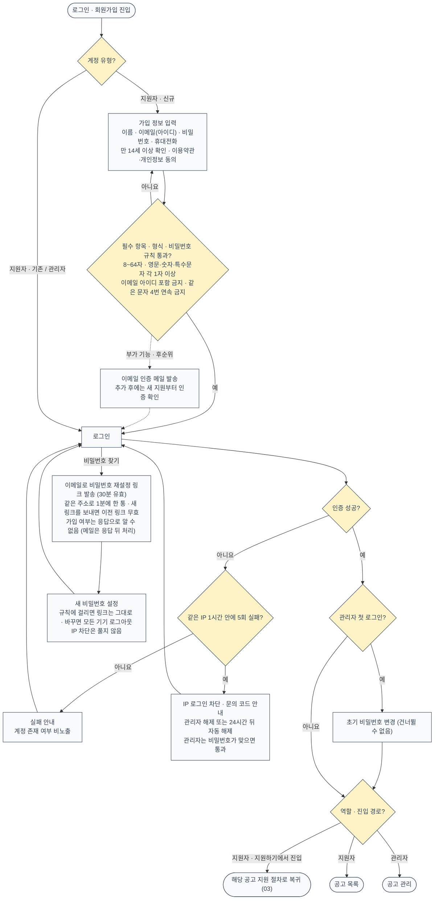

설계 기준: 이메일 인증은 부가 기능(후순위)이며 현재 구현 범위 밖(미구현)이다. 비밀번호 찾기는 같은 주소로 1분에 한 통만 보내고, 링크(토큰)는 DB·알림 표에 남기지 않고 메일 작업으로만 넘긴다(P1·P2). 추가 전에는 인증 없이 가입·지원할 수 있고, 점선은 추가 후 경로다(ACC-02). 추가 후에도 이미 진행 중인 지원은 확인하지 않고 새 지원을 만들 때만 인증 여부를 본다(추천안). 생년월일·성별·주소·사진·주민등록번호는 수집하지 않는다(ACC-02). 세션은 마지막 요청 후 2시간 유지하며 인증이 필요한 요청과 WebSocket 연결 때마다 연장한다(녹화 조각 업로드·코딩 자동 저장도 요청이라 면접 중에 연장되고, heartbeat 만으로는 연장되지 않는다, ACC-01). 복귀 경로는 허용된 내부 경로만 쓴다(ACC-04). 지원자는 본인 데이터만, 관리자 API는 관리자만 쓸 수 있으며 서버가 모든 요청에서 역할과 데이터 주인을 확인한다(ACC-06).

---

## 02 공고 작성·평가 기준 설정

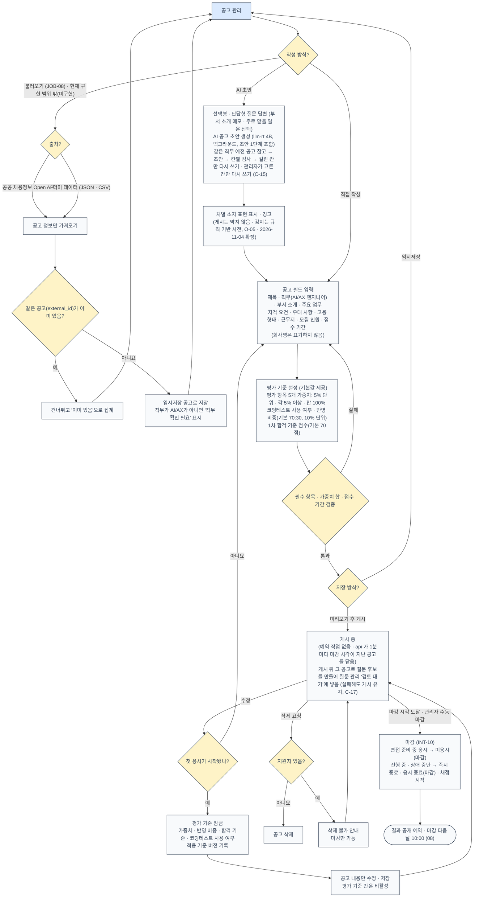

설계 기준: 질문은 관리자가 입력·선택·편집하지 않는다(JOB-06). 면접마다 낼 질문은 시스템이 정하고, 관리자는 AI 질문 후보를 질문은행(대체용)에 넣을지만 질문 관리 화면에서 [추가]·[제외]로 정한다(2026-11-10, C-17). 평가 항목과 루브릭은 수정할 수 없고 가중치만 조정한다(JOB-04). 코딩테스트 문제는 관리자가 화면에서 입력하지 않고 문제 은행에서 시스템이 출제한다(JOB-03). ‘준비 중’ 직무 6개는 직무 선택 목록에 보이지만 선택할 수 없다(2-4). 불러온 공고도 직무가 AI/AX 엔지니어여야 게시할 수 있다(불러오기는 현재 구현 범위 밖이다). 한 기업 전용 시스템이라 회사명은 표기하지 않고(U1) ‘회사 소개’는 ‘부서 소개’로 부른다(V1, DB·API 칸 이름은 그대로). AI 초안의 ‘주로 맡을 일’은 선택이다(U6). 수동 마감 전 확인 창에서 진행 중 면접 건수를 알려 준다. 잠금 이후에는 기존 결과를 재산출하지 않는다(JOB-07).

---

## 03 지원·사전 준비

```mermaid
flowchart TD
    classDef startEnd fill:#F8FAFC,stroke:#334155,color:#334155
    classDef decision fill:#FEF3C7,stroke:#334155,color:#334155
    classDef hub fill:#DBEAFE,stroke:#334155,color:#334155
    classDef process fill:#F8FAFC,stroke:#334155,color:#334155

    jobDetail["공고 상세<br/>코딩테스트 포함 여부 · 예상 소요 시간 · 결과 공개일"]:::hub -- 지원하기 --> loggedIn{"로그인 상태?"}:::decision
    loggedIn -- 아니요 --> login["로그인 · 가입 (01)"]:::process
    login -- "인증 후 복귀" --> applyCheck
    loggedIn -- 예 --> applyCheck{"서버 검증<br/>접수 기간 · 중복 지원 · 응시 이력<br/>(이메일 인증 추가 후: 인증 여부)"}:::decision
    applyCheck -- "실패 (마감 · 이미 지원 · 응시 종료/취소 이력)" --> denied["지원 불가 사유 안내"]:::process
    denied --> jobDetail

    applyCheck -- 통과 --> consent["필수 동의 (APP-03)<br/>① 응시 데이터 수집·이용 ② AI 자동 채점과 1차 합격·불합격 결정<br/>③ 공고를 운영하는 관리자에게 결과 제공 ④ 보관 기간(응시 데이터 공개일 + 7일 · 녹화 3일)<br/>⑤ 응시 규칙(1회 응시 · 중단 버튼 없음 · 화면 이탈 경고/응시 취소 · 이어가기 3회)"]:::process
    consent --> agreed{"모두 동의?"}:::decision
    agreed -- 아니요 --> noConsent["다음 단계 진행 불가"]:::process
    noConsent --> jobDetail
    agreed -- 예 --> consentLog["동의 문구 버전 · 항목 · 일시 기록"]:::process

    consentLog --> resumeWay{"이력서 제출 방식?"}:::decision
    resumeWay -- "파일 업로드 (PDF · JPG · PNG)" --> fileCheck{"확장자 · 실제 파일 형식 일치?<br/>서버 보호 한도 이내? (사용자에게 비노출)"}:::decision
    fileCheck -- 아니요 --> failModal
    fileCheck -- 예 --> estimate["예상 처리 시간 표시<br/>글자 있는 쪽 × 0.5초 + 스캔 쪽 × 쪽당 OCR 시간 + AI 정리 시간<br/>경과 시간 함께 표시"]:::process
    estimate --> pageType{"PDF 리더로 읽을 수 있는 쪽?<br/>(의미 있는 글자 50자 이상 · 깨진 글자 5% 미만)"}:::decision
    pageType -- "예 (텍스트 PDF 쪽)" --> textExtract["PDF 리더로 글자 추출<br/>PyMuPDF(읽는 순서 정렬) → 깨졌거나 모자란 쪽만 pdfplumber"]:::process
    textExtract --> extract["AI 정보 정리 (llm-rt 4B)<br/>학력 · 경력 · 프로젝트 · 기술 · 자격"]:::process
    pageType -- "아니요 (두 리더가 못 읽은 쪽 · 사진 파일)" --> ocr["온프레미스 OCR (PaddleOCR 한국어, CPU)<br/>줄별 신뢰도 · 쪽 수 상한 10쪽"]:::process
    extract -. "정리 뒤 성명 · 학력/경력이 비면 나머지 쪽도 OCR" .-> ocr
    ocr --> ocrOk{"OCR 실패 기준에 걸림?<br/>AI 정리가 남은 시간(예상의 2배, 최소 60초) 안에 못 끝남 · OCR 호출 하나당 60초 초과<br/>읽은 글자 없음 · 평균 신뢰도 0.5 미만"}:::decision
    ocrOk -- 예 --> failModal["'이력서를 불러오는 데 실패했습니다'<br/>직접 입력하시겠어요?"]:::process
    failModal -- 다른 파일 올리기 --> resumeWay
    failModal -- 직접 입력하기 --> manual
    ocrOk -- 아니요 --> fill["OCR 글자로 빈 칸만 채움"]:::process
    fill --> confirm
    resumeWay -- 직접 작성 --> manual["이력서 직접 작성"]:::process
    resumeWay -- 마이페이지 등록본 --> loadSaved["등록본 불러오기"]:::process
    extract --> confirm["지원자 확인 · 수정 (필수)<br/>OCR 신뢰도 0.80 미만 줄에서 나온 항목은 강조 표시"]:::process
    manual --> confirm
    loadSaved --> confirm
    confirm --> basicInfo{"기본 정보 충족?<br/>성명 + 학력 또는 경력 1건 이상"}:::decision
    basicInfo -- 아니요 --> confirm
    basicInfo -- 예 --> applied["[이력서 제출] 완료 · 응시 상태 '면접 준비 중'<br/>('지원 완료'로는 보이지 않음 · 공고 목록 배지는 실제 응시 상태)<br/>이력서 스냅샷 저장(변경 불가)"]:::process
    applied -.-> composeStart(["질문 구성 백그라운드 시작 (04)"]):::startEnd

    applied --> envCheck["환경 점검 (APP-06)<br/>① 마이크 입력 레벨 ② 카메라 영상·녹화 시작 가능 ③ 스피커 테스트음 후 '들립니다' 확인<br/>④ 네트워크 상태 ⑤ AI 서버 상태"]:::process
    envCheck --> envOk{"모두 통과?"}:::decision
    envOk -- 아니요 --> envFix["실패 항목 안내 · 시작 버튼 비활성"]:::process
    envFix -- 재점검 --> envCheck
    envOk -- 예 --> rules["시작 전 안내 (APP-07)<br/>진행 방식 · 질문 수 · 답변 시간 · 코딩테스트 여부 · 예상 소요 시간<br/>중단 버튼 없음 · 장애 시 이어가기(3회까지) · 화면 이탈 1회 경고 · 2회 취소<br/>공고 마감 시각에 면접이 끝남"]:::process
    rules --> ruleCheck{"규칙 확인 체크?"}:::decision
    ruleCheck -- 아니요 --> rules
    ruleCheck -- "예 · '면접 시작' 선택" --> capacity{"입장 가능?<br/>진행 중 면접이 상한 N건 미만 (INT-08, 상한 1~20)<br/>자동 보호(GPU 메모리 92% · 다음 질문 시간 초과)는 현재 구현 범위 밖(미구현)"}:::decision
    capacity -- 아니요 --> retryWait["'지금은 면접을 시작할 수 없습니다' 안내 ('지금 동시에 면접을 보는 지원자가 많습니다') + '다시 시도' 버튼<br/>상태 '면접 준비 중' 그대로 · 응시 횟수 미차감 · 대기 줄 없음<br/>버튼은 10초 동안 막음"]:::process
    retryWait -- 다시 시도 --> capacity
    retryWait -- 나중에 --> toMyPage(["마이페이지 (10)"]):::startEnd
    capacity -- 예 --> begin(["전체 화면 전환 → AI 면접 (05)<br/>질문이 덜 만들어졌으면 '질문 준비 중'(최대 60초)"]):::startEnd
```

설계 기준: 중복 지원·응시 이력 검증을 동의·이력서 입력보다 먼저 해서, 통과할 수 없는 지원자가 입력을 반복하지 않게 한다. 이력서 파일은 용량·쪽수 상한을 화면에 두지 않는다(APP-04). 자기소개서는 필수가 아니다(APP-05). OCR 중간 이미지는 처리 직후 지우고, 원본과 뽑은 글자는 면접 데이터로 보고 공개일 + 7일에 지운다(TRD 7-6). 지원 환경은 데스크톱 Chrome·Edge 120 이상이다(C5). 상한 N은 운영 장비에서 측정해 정한 초기값으로 시작하며, 서비스 재시작 없이 바꿀 수 있다(AC-21). ‘다시 시도’ 안내는 추천안으로 팀 확인 대기 중이다.

---

## 04 질문 구성

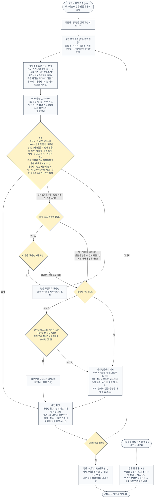

설계 기준: 질문은 관리자의 검토·승인 없이 시스템이 자동 구성한다(JOB-06, QST-01~03). 관리자 검토는 AI 질문 후보를 질문은행에 넣을 때만 한다(C-17). 모든 종류의 질문을 RAG로 먼저 만들고(U5, 중복 판정 기준 0.9는 사용자 확인으로 유지), 못 만들면 질문은행으로 바꾼다. 면접에 나오는 질문 종류의 순서는 이 구현에서 정했다. 이력서 확정 직후 미리 만들어 두므로 보통 지원자는 기다리지 않는다(QST-03). AI가 질문을 만들지 못하면 그 문항을 같은 조건으로 최대 3회 재생성하고, 3회 모두 실패하거나 60초를 넘기거나 임베딩 서버가 없으면 검증된 질문은행(엑셀) 질문으로, 후보도 없으면 예비 질문으로 대체한다. 이력서 기반 문항은 맞는 DB 종류가 없어 바로 예비 질문으로 간다(QST-05, TRD 7-4 ⑤). 대체는 감점·장애 판정 대상이 아니다. 예비 질문은 관리자가 미리 확인해 명령어·파일로 넣는다(종류별 5개 이상). 응시하지 않으면 응시 횟수를 쓰지 않으며, 쓰지 않은 질문 구성은 응시 데이터 보관 규칙대로 지운다. 평가와 리포트는 질문 스냅샷을 기준으로 한다.

---

## 05 AI 면접·꼬리질문

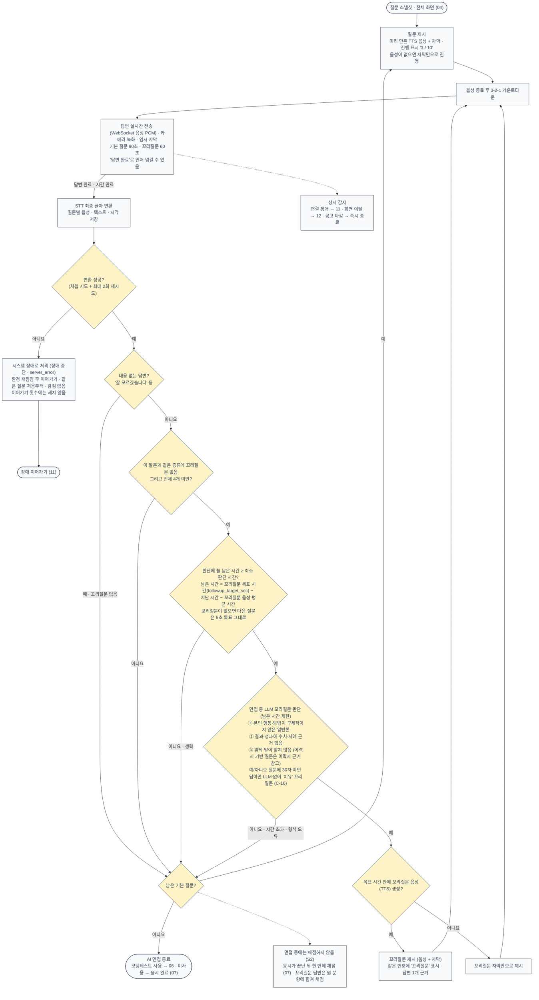

설계 기준: 중단·일시정지 버튼은 없다(INT-03). 면접관 아바타는 쓰지 않는다(INT-01). 답변이 끝나고 다음 질문이 뜨기까지의 목표 시간은 운영 서버에서 재서 정하며(TRD 12장), 꼬리질문 판단에는 고정 시간 대신 그 답변의 남은 시간만 준다. 꼬리질문을 낼 때는 T4 판단과 음성 만들기가 5초에 들어가지 않아 별도 목표 시간(운영 10초·개발 20초)을 둔다(U7). 면접 진행 순서는 LangGraph 그래프가 정하고 끊긴 질문은 원장을 읽어 다시 낸다(B1). 녹화는 평가에 쓰지 않고 장애·부정행위 판정 확인용으로 3일만 보관한다(INT-05). 꼬리질문은 거짓 여부를 판정하지 않는다. 내용 없는 답변은 같은 질문을 반복하지 않고 해당 문항을 1점으로 평가한다(INT-07). 예상 소요 시간은 약 25분이다.

---

## 06 코딩테스트 응시·채점

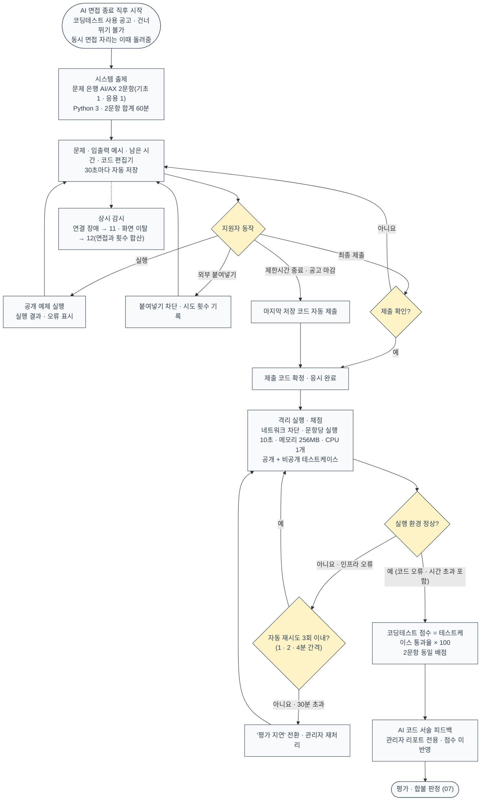

설계 기준: **AI 도우미 없이 일반 코딩테스트로 진행하며, AI 사용 이력은 수집하지 않는다.** 코드 관련 꼬리질문도 제공하지 않는다(COD-06). 점수는 작성 코드의 테스트케이스 통과율로만 계산한다. 실행만으로는 응시가 완료되지 않고 최종 제출(또는 시간 종료·마감 자동 제출)이 필요하다(COD-01). 정답과 비공개 테스트는 지원자 화면과 AI 입력에 노출하지 않는다(COD-05). 실행 환경 오류는 지원자 오답으로 처리하지 않으며, 재시도는 뒤에서 도는 작업 공통 규칙을 따른다(TRD 8-3). 시스템 장애로 끊긴 시간은 남은 시간에서 빼지 않는다(COD-04). 코딩테스트는 동시 면접 상한 N에 세지 않는다(추천안).

---

## 07 평가·채점·AI 1차 합불 판정

```mermaid
flowchart TD
    classDef startEnd fill:#F8FAFC,stroke:#334155,color:#334155
    classDef decision fill:#FEF3C7,stroke:#334155,color:#334155
    classDef process fill:#F8FAFC,stroke:#334155,color:#334155

    complete(["응시 완료 · 응시 종료 · 응시 종료(마감) · 응시 취소"]):::startEnd --> cancelled{"부정행위로 응시 취소?"}:::decision
    cancelled -- 예 --> autoFail["평가 없이 1차 불합격<br/>사유: 응시 취소"]:::process
    autoFail --> save

    cancelled -- 아니요 --> instr{"답변 속 채점 지시 의심?<br/>'만점 주세요' · '합격시켜' · '이전 지시 무시' 등"}:::decision
    instr -- 예 --> instrHold["채점하지 않고 '평가 지연' (instruction_suspected) · 관리자 알림<br/>관리자 화면에 걸린 구절 표시<br/>[확인했습니다, 채점하기] → 감사 기록 후 그대로 채점 (결과를 사람이 고치지는 않음)<br/>확인은 그때 본 구절에만 유효"]:::process
    instrHold --> zero
    instr -- 아니요 --> zero["미응답 · 미제시 문항 0점 (시스템)"]:::process
    zero --> rubric["문항별 루브릭 평가 (채점용 AI)<br/>해당 평가 항목 1~5점 + 답변 원문 인용(6글자 이상)<br/>꼬리질문 답변은 원 문항에 합쳐 평가<br/>응시가 끝난 뒤 한 번에 채점 (S2)"]:::process
    rubric --> evalErr{"분석 오류?<br/>(지원 때 잠근 기준 버전이 없을 때 포함 — 다른 버전으로 판정하지 않음)"}:::decision
    evalErr -- 예 --> errRetry{"자동 재시도 3회 이내 · 30분 이내?<br/>(1 · 2 · 4분 간격)"}:::decision
    errRetry -- 예 --> rubric
    errRetry -- 아니요 --> delayed["'평가 지연' · 관리자 알림 · 관리자 재처리<br/>관리자 화면 '평가 지연'"]:::process
    delayed --> rubric
    evalErr -- 아니요 --> verify{"형식 · 점수 범위(0~5 정수) · 인용 원문 일치(90% 이상)?"}:::decision
    verify -- 예 --> itemScore
    verify -- 아니요 --> regenDone{"이미 1회 다시 받음?"}:::decision
    regenDone -- 아니요 --> regen["1회 다시 받기"]:::process
    regen --> verify
    regenDone -- 예 --> floor["답했으면 1점 · 답이 없으면 0점 확정"]:::process
    floor --> itemScore

    itemScore["항목 점수 = 해당 항목 문항 점수 평균 ÷ 5 × 100 (시스템)"]:::process
    itemScore --> interviewScore["AI 면접 점수 = Σ(항목 점수 × 가중치)<br/>소수 둘째 자리까지"]:::process
    interviewScore --> useCode{"코딩테스트 사용 공고?"}:::decision
    useCode -- 예 --> totalMix["종합 총점 = AI 면접 점수 × 면접 비중 + 코딩테스트 점수 × 코딩 비중<br/>기본 70 : 30 (06 점수 사용)"]:::process
    useCode -- 아니요 --> totalOnly["종합 총점 = AI 면접 점수"]:::process
    totalMix --> decide
    totalOnly --> decide["1차 합불 결정 (시스템, EVL-05 · S1)<br/>종합 총점 ≥ 합격 기준(기본 70점) → 합격 · 미만 → 불합격<br/>같은 점수면 언제나 같은 결과"]:::process
    decide --> aiJudge["AI 결과 이유 작성 (T10, CPU 8B)<br/>정해진 결과를 바꾸지 않고 항목 점수 · 번호 붙은 근거 목록을 보고<br/>이유 2~3문장 + 쓴 근거 번호"]:::process
    aiJudge --> judgeCheck{"시스템 이유 검증 (TRD 8-2 ⑤)<br/>(a) 형식 (b) 근거 번호가 답변에서 확인된 근거 목록 안<br/>(c) 이유가 결과와 반대 방향이 아님"}:::decision
    judgeCheck -- "통과 · 합격" --> pass["1차 합격 확정"]:::process
    judgeCheck -- "통과 · 불합격" --> fail["1차 불합격 확정"]:::process
    judgeCheck -- 실패 --> rejudged{"이미 1회 다시 판정?"}:::decision
    rejudged -- 아니요 --> rejudge["AI에 이유 1회 다시 쓰기 요청"]:::process
    rejudge --> judgeCheck
    rejudged -- 예 --> judgeHold["'평가 지연' 전환 (EVL-08)<br/>관리자 알림 · 관리자 재처리 · 관리자 화면 '평가 지연'"]:::process
    judgeHold --> aiJudge
    pass --> save
    fail --> save["결과 저장 · 누구도 수정 불가<br/>적용 기준(가중치 · 반영 비중 · 합격 기준 · 버전) · 점수 구성 · 항목별 근거<br/>1차 판정(코드)과 AI가 쓴 이유 · 모델 · 지시문 · 루브릭 버전 · 장애/이탈 기록 요약"]:::process
    save --> toPublish(["결과 공개 대기 (08)<br/>관리자는 판정 즉시 확인 (09)"]):::startEnd
```

평가 항목과 기본 가중치: 직무 전문성 30% · 논리성 25% · 내용 관련성·구체성 20% · 전달력 10% · 조직 적합성 15%.

루브릭 척도: 0 미응답 · 1 답변했으나 최저 수준(관련성 거의 없음, ‘모르겠습니다’, 근거 인용 불가) · 2 부분적 · 3 기본 충족 · 4 우수 · 5 탁월.

설계 기준: AI는 루브릭 채점·근거 인용을 하고, **합격·불합격은 시스템(코드)이 ‘총점 ≥ 합격 기준’으로 정한다**(S1). AI(T10)는 정해진 결과의 이유만 쓰고 결과를 바꾸지 못한다. 시스템은 점수를 집계하고 이유의 형식·근거 번호·결과와의 방향을 검증한다(1-3 ②, EVL-03~06, TRD 8-2 ⑤). 검증을 통과한 결정만 확정한다(AC-13). 원본 08v는 AI가 합불을 정한다고 적었으나 구현대로 고쳤다. (S1, 사용자 결정. 팀 원본 PRD v1.6·TRD v1.5 에는 옛 문구) 답변 속 채점 지시가 의심되면 채점 전에 ‘평가 지연’로 멈춘다(`instruction_suspected`). 이 감지는 쉬운 표현만 잡는 보조 장치다. 채점은 응시가 끝난 뒤 한 번에 한다(S2). 같은 작업이 두 번 돌아도 결과는 한 번만 생기게 한다(TRD 8-3). 부정행위로 취소된 응시는 평가 없이 1차 불합격이다. 이름·연락처 등 인적 정보와 음성 특성은 평가 입력에서 뺀다. 관리자의 승인 단계와 수정 기능은 없다. 응시 완료 후 p90 10분 안에 결과를 산출하며, ‘분석 실패’라는 최종 상태는 두지 않는다(EVL-08).

---

## 08 결과 공개·알림·보관 삭제

### 08-A 결과 공개와 보관

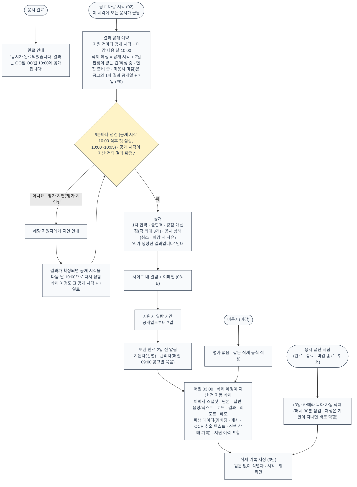

설계 기준: 공개 전에는 결과가 지원자 화면·API에 나타나지 않는다. 지원자 공개용 결과는 관리자용과 별도로 만들며, 점수·총점·코딩테스트 세부·근거 인용·내부 기록은 공개하지 않는다(RPT-03, RPT-04). 이의제기·근거 설명 요청 창구는 두지 않는다(N7). 모든 예약 작업과 날짜 계산은 한국 시간 기준이다. 삭제 작업은 매일 실행하고 결과를 기록한다(10-3).

### 08-B 알림 발송

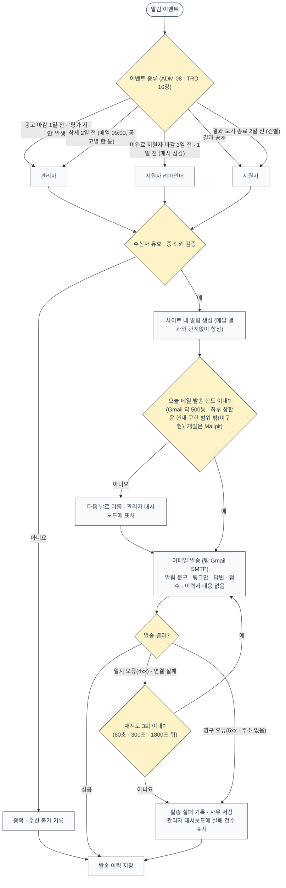

설계 기준: 면접 일정 관리·통보 기능과 외부 캘린더 연동은 범위 밖이다(N1, N5, C-23). 같은 이벤트는 한 번만 발송한다.

---

## 09 관리자 결과 관리

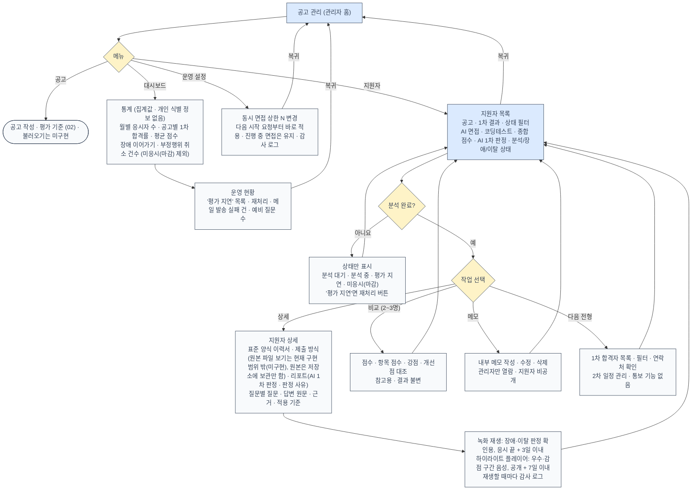

설계 기준: 관리자는 AI 판정 결과와 판정 사유·적용 기준·근거를 확인만 하며, 판정을 바꾸는 버튼·입력은 없다(ADM-01, AC-14). 재처리는 같은 응시 자료로 분석을 다시 돌릴 뿐 판정을 사람이 고치지 않는다(EVL-08). 관리자는 판정 즉시 결과를 볼 수 있지만, 지원자에게는 마감 다음 날 10:00에 공개된다. 응시 데이터는 결과 공개일로부터 7일 뒤 삭제되므로 다음 전형 대상자 관리는 그 안에 끝내야 하며, 삭제 2일 전 알림을 보낸다(ADM-06). 문제 은행·예비 질문은 관리 화면 없이 명령어·파일로 넣는다. 관리자용 리포트 구성은 RPT-01을 따른다. 예외: 자동 채점을 끝내지 못한 '평가 지연' 건은 6시간마다 자동으로 다시 채점하고(채점 지시 의심 건은 제외), '평가 지연'이 된 뒤 3일 안에 관리자가 사유를 적어 직접 합격·불합격을 정할 수 있다. 3일이 지나면 AI 가 정상일 때 마지막 재채점까지 실패해야 평가 미완료로 1차 불합격 처리하고, 장애가 길어져도 7일이면 닫는다(채점 지시 의심 건은 3일, 서비스가 멈췄다 돌아왔으면 24시간 더). 이때 점수와 근거는 없고 LLM 으로 이유를 만들지 않는다. 한 번 정한 결과는 바꿀 수 없다(U-5 결정).

---

## 10 지원자 마이페이지

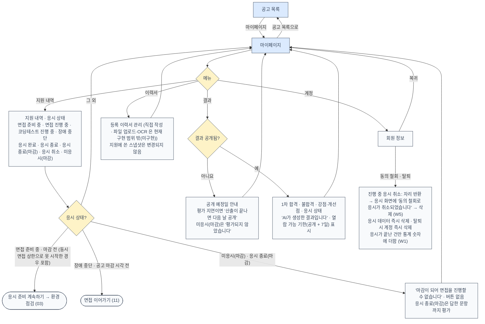

설계 기준: 응시는 공고 상세의 지원 절차(03)에서 시작한다. 마이페이지에서 응시로 들어가는 경로는 지원을 마쳤지만 아직 시작하지 않은 경우(동시 면접 상한으로 못 시작한 경우 포함, INT-08)와 장애 이어가기(RES-03) 두 가지다. 공고 마감 시각이 지나면 두 경로 모두 막힌다(INT-10). 보관 기간이 지나면 지원 이력과 결과가 함께 지워져 목록에서 사라진다(10-2). 지원에 쓴 이력서와 서류는 수정할 수 없다(APP-05).

---

## 11 장애 이어가기

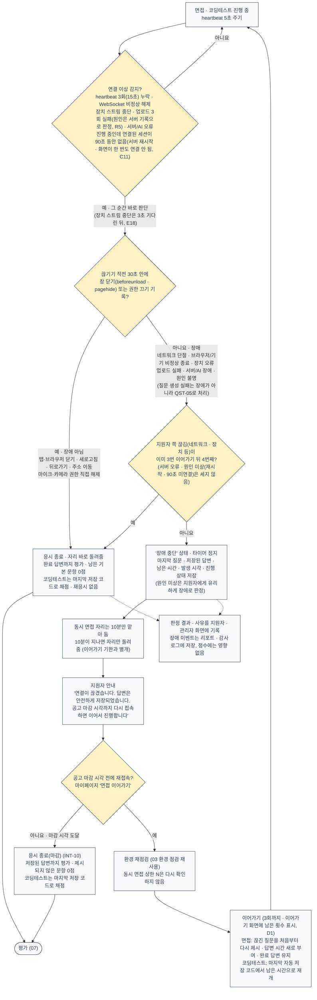

설계 기준: 이어가기는 3회까지다(`resume_limit`, 사용자 결정 D1). 4번째 끊김은 이어가기 대신 응시 종료(`resume_limit`)이고 답한 문항까지 채점한다. 이 제한은 (PRD v1.7·TRD v1.6 에 반영됨. 팀 원본에는 없음) 진행 중인데 연결된 세션이 90초 없으면 ‘원인 미상 장애’로 중단하고 이어가기를 허용한다(C11, api 안 1분마다 도는 정리 작업이라 실제로는 90~150초이고, 서버를 다시 켤 때는 기다리지 않고 바로 처리한다). 업로드 3회 실패는 저장소 오류 기록이 최근 60초 안에 있으면 서버 오류(횟수에 안 셈), 없으면 지원자 쪽(횟수에 셈)이다(R5). 장애로 끊긴 시간은 면접 답변 시간과 코딩테스트 제한시간에서 빼지 않는다(RES-01). 판정은 끊긴 지 15초가 되는 순간 시스템이 직전 기록을 근거로 자동 수행하며, 재접속 때까지 미루지 않고 수동 검토 단계도 없다(TRD 7-2). 원인을 특정할 수 없거나 창 닫기 기록이 서버에 오지 못했으면 지원자에게 유리하게 장애로 판정한다. 자리를 이미 돌려준 뒤 다시 들어와도 N을 다시 확인하지 않는다(TRD 5-3). 장애로 판정된 연결 소실은 화면 이탈 횟수에 넣지 않는다(CHT-04).

---

## 12 부정행위: 화면 이탈

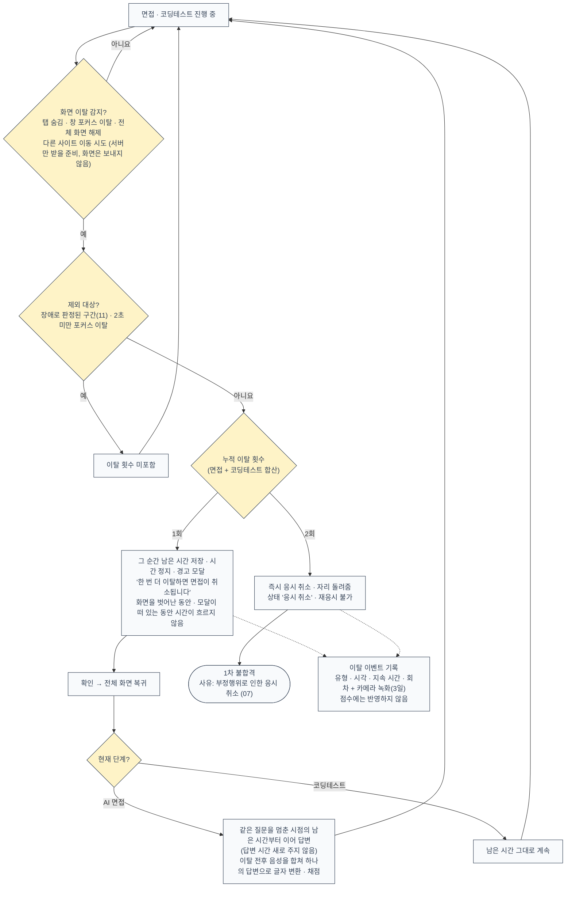

설계 기준: 이탈은 경고와 취소로만 처리하고 점수에 반영하지 않는다(CHT-05). 시선 추적·얼굴 표정 분석으로 부정행위를 판정하지 않는다(CHT-06). 관리자는 이탈 기록과 녹화로 판정 근거를 확인할 수 있다. 1회차 이탈 뒤 남은 시간부터 이어 가는 방식은 TRD v1.6 7-3을 따랐다. 원본 PRD v1.3 CHT-02는 ‘답변 시간 새로 부여’로 적혀 있었으므로 PRD v1.7에서 맞춰졌는지 확인한다. 구현은 경고창이 떠 있는 동안의 이탈 신호를 3초 안에는 같은 이탈로 합친다.

---

## 문서 간 확인이 필요한 부분

08v에서는 07v ‘PRD에 정의되지 않아 가정한 부분’ 표의 항목이 모두 정리되었다. OCR은 PRD v1.3 APP-04로, 예비 질문 관리 주체는 단일 관리자(TRD 15장 T-05)로, 08-A 지연 공개는 마감 즉시 종료(INT-10)로, 06 재시도는 TRD 8-3으로, 운영자는 단일 관리자(N8)로 확정됐다. 질문 구성 시점(QST-03), 근거 설명 요청 창구(N7 없음), 알림 수신자·메일 재시도(TRD 10장)도 정해졌다.

남은 것은 문서끼리 말이 다른 아래 항목이다.

| 위치 | 내용 | 도면의 선택 | 근거 |
|---|---|---|---|
| 12 화면 이탈 | 1회차 이탈 뒤 답변 시간: PRD v1.3 CHT-02는 새로 부여, TRD v1.5 7-3은 남은 시간부터 이어 감 | TRD를 따름 | CHT-02, TRD 7-3 |
| 05 AI 면접 | STT 최종 실패: 원본 PRD INT-04·화면정의서 D-02·API 명세서는 같은 질문 다시 답변, TRD 7-2는 장애(장애 중단 화면)로 분류 | **TRD를 따름** (09v에서 08v의 선택을 바꿈, A1·구현과 일치) | TRD 7-2, CONFLICTS A1 |
| 03·10 동시 면접 상한 | PRD 6-2는 ‘대기’ 상태를 두지만, TRD 7-1은 저장 상태 없이 ‘다시 시도’ 안내만 둠(추천안, 팀 확인 대기) | TRD를 따름 | INT-08, TRD 5-3·7-1 |
| 전체 | 원본 TRD v1.5는 PRD v1.6 기준이었으나 팀에 공유된 PRD는 v1.3이었다 | 개인용 개정본 PRD v1.7 + TRD v1.6 + 구현 | 구현(`huge/`) 기준 |

## 논의사항

> 2026-11-04 사용자 결정: 개인용으로 진행한다. '확정(현행 유지)' 항목은 구현대로 확정했고, 미구현 항목(V2·V3·F6·S5)은 이후 범위로 둔다. 권장·조치 칸은 당시 제안 기록이다.

"분류"는 `문서 충돌` / `구현 확인 필요` / `미확정 결정` / `기타`.

| # | 분류 | 문서·위치 | 내용 | 권장 |
|---|---|---|---|---|
| 1 | 확정(현행 유지) | 07 (S1) | 합불을 코드가 정한다 (S1, 사용자 결정. 팀 원본 PRD v1.6·TRD v1.5 에는 옛 문구 ‘AI가 판정’). | — |
| 2 | 확정(현행 유지) | 11 (C11) | 미연결 90초 뒤 장애 중단은 이대로 확정했다. 코드는 `jobs.py:23,33-46`(1분마다 점검), `main.py:40-53`(재시작 즉시). | 사용자 확인 |
| 3 | 확정(현행 유지) | 11 (D1) | 이어가기 3회 제한은 (D1, 사용자 결정. PRD v1.7·TRD v1.6 에 반영됨. 팀 원본에는 없음) | — |
| 4 | 확정(현행 유지) | 05 (U7) | 꼬리질문 목표 시간(`followup_target_sec`)은 (U7, 사용자 결정. PRD v1.7·TRD v1.6 에 반영됨. 팀 원본에는 없음) | — |
| 5 | 확정(현행 유지) | 04 (C1) | 질문 종류 순서가 문서에 없다. CONFLICTS는 ‘인성 → 이력서 → 기업 → 직무’라고 하나 코드는 인성 → 기업 → 이력서 ×2 → 직무 ×4 → 인성 → 기업이다 (`services/question_compose.py:35`). | 순서 확정 |
| 6 | 확정(현행 유지) | 03 (U4) | 이력서 쪽 수 상한 10쪽과 ‘읽을 수 있는 쪽’ 기준 확장(50자 + 깨진 글자 5% 미만)은 문서에 근거가 없다. | TRD 7-6 반영 여부 결정 |
| 7 | 확정(현행 유지) | 02·03·08·09 (V2·V3·F6·S5) | 공고 불러오기, 관리자 원본 이력서 보기, 자동 보호, 하루 메일 상한은 미구현이다. 요구사항은 지우지 않았다. | 범위 결정 |
| 8 | 처리함 | 05 (A1) | **2026-11-06:** CONFLICTS A1 은 지금 '처음 1번 + 재시도 2번'으로 적혀 있어 코드와 같다. (이전 기록) CONFLICTS A1 은 ‘STT 1회 재시도’라 적었으나 코드는 처음 시도 + `stt_retry_limit` 2회 재시도다 (`interview/engine.py:640`, `config.py:71`). 09v는 코드대로 적었다. | CONFLICTS A1 설명 수정 |
| 9 | 확정(현행 유지, 2026-11-09 사용자 결정: 구현대로, 설계의 나머지는 미구현) | 05 | 꼬리질문 판단 기준이 원본(논리성·관련성 2점 이하 등)과 다르다. 코드는 `reason_code`(vague / missing_evidence / inconsistent / none)로 판단한다 (`interview/engine.py:53-61`). 09v는 코드대로 적었다. | PRD INT-0x·TRD 7-5 확인 |
| 10 | 처리함 | 08-B | **2026-11-06:** PRD v1.7 ADM-08 은 '새 지원 알림은 없다'로 맞춰져 있다. (이전 기록) 08-B 의 ‘신규 지원’ 관리자 알림은 화면정의서 v0.7·TRD 10장(없음)에 맞춰 검토 반영에서 삭제했다. PRD ADM-08 문구는 PRD 개정에서 맞춘다. | PRD ADM-08 정리 |
| 11 | 처리함(2026-11-09: 설계 기준의 한 줄로 충분, 도면은 그대로) | 12 | 경고 중 이탈 신호를 3초 안에는 같은 이탈로 합치는 구현(`interview/engine.py:64,356`)이 도면에 없어 설계 기준에 한 줄만 적었다. | 필요하면 도면 반영 |

## 2026-11-06 검토 보정

코드와 대조해 고친 내용이다. 문서 버전 번호는 그대로 둔다.

- 환경 점검 ② 카메라에 녹화 시작 가능 여부를 넣었다.
- 논의사항 8·10 을 처리함으로 고쳤다.

## 2026-11-09 검토 보정

코드와 대조해 고친 내용이다. 문서 버전 번호는 그대로 둔다.

- 질문 바꾸기: 예비 질문과 고정 문장이 한 면접에서 겹치지 않는다(E11).
- 연결 이상 판단: 장치 스트림 중단은 3초 기다린 뒤 판정한다. 창을 닫으면 장치가 먼저 꺼지므로, 그사이 들어온 창 닫기 기록으로 응시 종료가 된다(E18).
- 근거 확인: '인용 원문 일치'는 90% 이상 비슷한 답변 속 구절까지 인정한다(E17, CONFLICTS C-13).
- 남은 논의사항을 사용자 결정으로 정리했다: 원본 설계 중 구현에 없는 부분(Gateway·anchor 검증·skip_cause 저장 등)은 구현대로 확정하고 설계는 미구현으로 남긴다.

## 2026-11-10 보정

사용자 결정과 코드에 맞춰 고친 내용이다. 문서 버전 번호는 그대로 둔다.

- 02 공고: AI 초안 그래프와 한 칸 다시 쓰기(C-15), 차별 표현 감지 '미정' 표기를 '규칙 기반 사전(2026-11-04 확정)'으로, 게시 뒤 질문 후보(C-17).
- 04 질문 구성: 요구하는 일 1개(이전 2개)·글 검사(C-16), 적용 범위(C-17), AI 질문을 '검토 대기'로 저장(C-17). JOB-06 설계 기준에 질문 관리 화면과의 관계를 적었다.
- 05 면접 진행: 예/아니오 질문 짧은 답 → 이유 꼬리질문(C-16).
