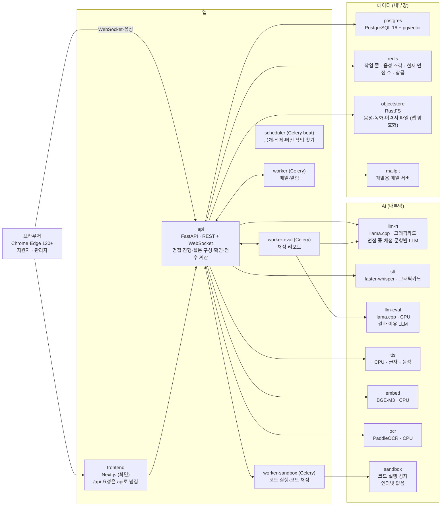
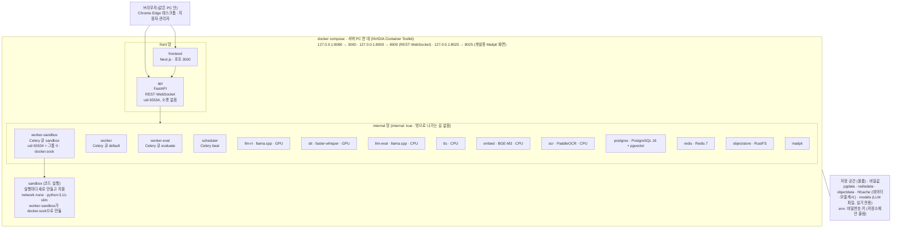
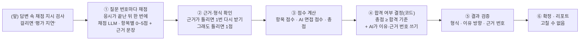

# AI 1차 채용면접 자동화 플랫폼 — TRD (기술 요구사항 정의서)

TECHNICAL REQUIREMENTS DOCUMENT · v1.6

PRD v1.7에 적은 기능을 어떤 기술로 어떻게 만들지

> **개인용 개정본 — 팀 원본 아님.** 기준: 구현(`huge/`) + `huge/CONFLICTS.md` (2026-11-03). 팀 원본은 `Final_Project_TRD_v1.5.pdf`이다.
> `huge/CONFLICTS.md` 항목은 사용자 확인을 거쳐 이 문서에 반영했다(2026-11-04). 결정이 남은 항목은 문서 끝 '논의사항'에 모았다.

| 항목 | 내용 |
|---|---|
| 문서명 | AI 1차 채용면접 자동화 플랫폼 TRD |
| 문서 종류 | TRD(기술 요구사항 정의서). 개발할 때 보는 문서다 |
| 버전 · 작성일 | v1.6 (개인용) · 2026-11-03 |
| 기준 PRD | 통합 PRD v1.7 (개인용 `Final_Project_PRD_v1.7.md`). 요구사항 번호(ACC-, JOB-, APP-, INT-, QST-, COD-, EVL-, RPT-, ADM-, RES-, CHT-, AC-)는 PRD와 같다 |
| 상태 | 초안. 6장 모델 배치, 동시 면접 상한 N의 처음 값, 시간 목표 같은 설정값은 운영 서버에서 재 본 뒤 확정 |
| 작성 방침 | PRD에 적은 "무엇을"은 되풀이하지 않고, "어떻게"(구조·숫자·주고받는 형식)만 적는다. 숫자(재시도 횟수, 시간 제한 등)는 14장 설정값 표 한 곳에 모은다 |
| 관련 문서 | PRD v1.7 · 용어집(처음 보는 용어를 가나다순으로 풀어 둔 별도 문서) · TRD_변경이력(TRD 버전마다 바뀐 것과 그 이유) · 테이블 정의서(DB 칸 목록, 개인용 v1.1) · merged_prd_v1.1_변경이력 · TRD_검토_결정기록(v1.5에서 고친 이유) |

## 개정 이력

| 버전 | 날짜 | 내용 | 근거 (CONFLICTS ID) |
|---|---|---|---|
| v1.5 | 2026-10-29 | 팀 원본. 상세는 TRD_변경이력 | — |
| v1.6 (개인용) | 2026-11-03 | 구현(`huge/`)에 맞춘 개인용 개정. 아래 바뀐 곳 요약 참고. 검토(백엔드·프론트엔드·UI/UX) 반영 | 아래 |

v1.6에서 바뀐 곳 요약 (장 → 내용 → ID)

| 장·절 | 바뀐 내용 | ID |
|---|---|---|
| 1-1 | 일반 메모리 가정과 개발 환경 Docker 메모리 24GB | B9, S8 |
| 1-2 | 합격 여부는 코드가 정하고 AI는 이유만 쓴다 | S1 |
| 1-3 | 회사명 표기 안 함, '부서 소개', 공고 불러오기 미구현 | U1, V1, V2 |
| 2장 | 구성도·도커 구성: Celery 4개, RustFS, 망 2개, UDP 포트 제거, 코드 실행 worker-sandbox | B2, B4, B5, V4 |
| 3장 | 기술 스택: RustFS, WebSocket PCM, PyMuPDF, Alembic 대신 `create_all`, 실제 버전 | B5, V4, U4, T7 |
| 4장 | 테이블 추가(`stats_archive`, `login_sessions`, `interview_sessions`, `question_usage`, `recordings`), 암호화 범위, 체크포인트 | F1, T8, T12~T17, T4, T5, T6 |
| 5-1 | 공고 초안·철회·탈퇴·녹화, 불러오기 미구현, 설정 API 범위 | U2, V2, W2~W5, F10, D2 |
| 5-2 | WebRTC 대신 WebSocket 이진(PCM) 전송, 녹화 올리기, 세션 1회 연결 | V4, R1~R6, C4 |
| 5-3 | 이어가기 횟수, 상한 1~20, 자동 보호 미구현 | D1, D2, F6 |
| 6장 | GPU 배치표 실제 모델 배치, 측정값, 메모리 | B3, S8, E |
| 7-1~7-3 | 이어가기 3회, 서버 마감 확인, 원인 미상 90초 | D1, C2, C11, A1 |
| 7-4 | RAG 우선 질문 구성, 질문 만들기 그래프는 api 안, 질문 순서 | U5, B1, C1 |
| 7-5 | 면접 진행 그래프, 체크포인트, 이어가기 `locate`, 꼬리질문 목표 시간 | B1, U7, D3 |
| 7-6 | 이력서 읽기 순서(리더 → 빈칸 채우기 → OCR), 판정 기준 | U4 |
| 8장 | 채점 시점, 합불 결정 주체, 근거 번호 방식, 30분 한도 | S1, S2, S4, S7, S10, S11, 지시 감지 |
| 9장 | 코드 실행 상자: 환경 변수 전달, 채점 위조 차단, worker-sandbox | B4, B7 |
| 10장 | 삭제 시각, 녹화 삭제 매시 30분, 철회·탈퇴, 메일 | R3, F9, W1, S5 |
| 11장 | 암호화, 로그인 세션, 재설정 메일, 감사 로그 표기 | B5, P1, P2, M1, T13, T16 |
| 14장 | 설정값: 실제 이름과 값 | D1, D2, U7, F10, S5 |
| 15장 | 확인 필요 사항 갱신 | D3, U4 |
| 검토 반영 | 2-1·2-3 밖으로 나가는 길(backend A17), 2-2 api 1프로세스(A2), 5-1 공고 API 경로(A11)·점검 하한(A19), 5-2 자막 20초(A22)·재생 Range(A5)·`navigate`, 7-2 C11 위치(A1)·끊김 신호(A10), 7-3·7-5·14장 설정 키 6개(A9), 7-4 ⑤ 고정 문장(A23), 7-6 TIMEOUT(A21), 8-4 Range(A5), 10장 결과 공개 시각(A3), 11장 키·`APP_PROFILE`(A8)·밖으로 나가는 것(A17), 13-1 AC-19(A17), 논의사항 | 검토(백엔드·프론트엔드·UI/UX) |

## 목차

1. 개요 및 설계 원칙
   - 1-1. 목적 및 범위
   - 1-2. 설계 원칙
   - 1-3. 범위 제약 (관리자 1명 기준)
2. 시스템 구성
   - 2-1. 시스템 구성도
   - 2-2. 서비스별 역할
   - 2-3. 도커 배포 구성도
3. 기술 스택 및 버전 (Tech Stack)
4. 데이터 설계 (Data Structure)
   - 4-1. 주요 테이블
   - 4-2. 저장 원칙
   - 4-3. 데이터 전달 형식
5. API 및 실시간 통신
   - 5-1. 주요 REST API
   - 5-2. 면접 실시간 통신 (WebSocket)
   - 5-3. 동시 면접 입장 관리
6. 운영 서버 및 AI 모델 배치
   - 6-1. 운영 서버 사양
   - 6-2. 모델 배치 기본안
   - 6-3. 모델 배치 근거
   - 6-4. 대안 배치안
7. 면접 진행·질문 생성·이력서 처리
   - 7-1. 응시 상태 전이
   - 7-2. 장애 판단
   - 7-3. 화면 이탈 감지
   - 7-4. 질문 생성 절차
   - 7-5. 답변 처리 및 꼬리질문
   - 7-6. 이력서 내용 추출 및 OCR
8. 채점 및 1차 합격 결정
   - 8-1. 채점 흐름
   - 8-2. 단계별 구현 방식
   - 8-3. 실패·지연 처리
   - 8-4. 하이라이트 구간 선정
9. 코딩테스트 실행 환경
10. 결과 공개·알림·자동 작업
11. 보안·개인정보
12. 성능 목표 및 측정
13. 테스트 계획
    - 13-1. 완성 기준별 테스트 방법
    - 13-2. 운영 서버 측정 계획
14. 설정값 목록
15. 확인 필요 사항
- 부록. PRD 요구사항 추적표
- 논의사항 (개인용 개정본에서 추가)

> **TRD란?** PRD에 적은 기능을 "어떻게 만들지" 정하는 문서다. 서버를 어떻게 나눌지, 어떤 프로그램·라이브러리를 쓸지, 데이터를 어떻게 저장할지, 화면과 서버가 무엇을 주고받을지, AI를 어떻게 부를지, 어떻게 테스트할지를 적는다. 사용자 입장의 규칙이 바뀌면 PRD를 먼저 고치고 TRD를 따라 고친다.

---

## 1. 개요 및 설계 원칙

### 1-1. 목적 및 범위

PRD v1.7의 1차 면접 자동화 전체(공고·채점 기준 정하기 → 지원·준비 → AI 면접 → 코딩테스트 → AI 채점·1차 합격 여부 결정 → 결과 공개 → 자동 삭제)를 서버 1대(그래픽카드 메모리 6GB · 일반 메모리 58GB 가정)에서, 외부 서비스 없이 만들기 위한 기술 기준을 정한다. 2차 면접, 외부 시스템 연동, 모바일 앱은 범위 밖이다(PRD 2-2).

개발 PC에서는 Docker 메모리 24GB 이상이 필요하다(8B 채점 모델이 일반 메모리 약 5GB를 쓴다). 동시 면접 상한은 설정값으로 조절한다. 〔B9의 "개발 PC 16GB에서 동작 확인"과 S8의 "24GB 필요"가 다르다: 논의사항 참고〕

### 1-2. 설계 원칙

| 원칙 | 어떻게 만든다 |
|---|---|
| AI가 평가하고, 시스템은 결과의 유효성을 검증한다 | AI는 지원자의 답변과 평가 기준(루브릭)을 바탕으로 항목별 점수와 근거 문장을 낸다. 서버는 AI 응답의 데이터 형식과 값의 범위, 근거 문장이 실제 답변에 존재하는지를 검증한다. **총점과 1차 합격 여부는 코드가 "총점 ≥ 합격 기준"으로 정한다.** AI(결과 이유 모델)는 이미 정해진 결과의 이유만 쓴다. 같은 점수면 언제나 같은 결과가 나온다(재현성). 검증을 통과하지 못한 결과는 확정하지 않고 재시도하거나 '평가 지연' 상태로 처리한다. |
| 면접 진행 상태와 업무 규칙은 시스템이 관리한다 | AI는 질문 생성, 답변 분석, 꼬리질문 판단 및 평가를 수행한다. 면접 시작·종료, 질문 순서, 답변 제한시간, 꼬리질문 횟수, 재접속, 결과 공개 등은 서버가 정해진 규칙에 따라 관리한다. AI가 다음 단계로 이동할지 임의로 결정하지 않으며, 허용된 상태 전이만 수행한다. |
| 면접은 실시간으로 진행하고, 처리 결과는 순서에 맞게 전달한다 | 지원자의 음성은 WebSocket 이진 메시지(16kHz PCM)로 실시간 전송하고, STT 결과는 같은 WebSocket을 통해 자막으로 전달한다. 음성 수신과 STT 처리를 분리해 추론 지연이 면접 연결을 불필요하게 막지 않도록 한다. 질문, 답변, 자막 및 진행 상태는 해당 면접의 순서와 연결 관계를 유지한다. |
| 일부 기능의 실패가 전체 면접의 중단으로 이어지지 않게 한다 | 질문 생성, STT, TTS, AI 평가 및 백그라운드 작업에는 실패별 처리 방법을 정의한다. 가능한 경우 재시도하거나 질문은행·예비 질문 또는 텍스트 표시로 대체한다. 평가 결과를 안전하게 확정할 수 없는 경우 임의의 결과를 만들지 않고 '평가 지연' 상태로 전환한다. |
| 필요한 데이터만 수집하고 정해진 기간만 보관한다 | 이력서, 음성, 답변, 코드 및 평가 결과는 서비스 기능에 필요한 범위에서 처리한다. 개인정보 접근은 역할과 데이터 소유권에 따라 서버에서 통제한다. 원본과 파생 데이터는 각각 정해진 보관·삭제 정책을 따르며, 외부 AI 서비스로 개인정보나 면접 데이터를 전송하지 않는다. |
| 기능 설정과 프로그램 로직을 분리한다 | 동시 면접 수, 재시도 횟수, 시간 제한 및 결과 공개·삭제 관련 설정은 프로그램 코드에 고정하지 않는다. 변경 가능한 설정은 중앙에서 관리하고, 설정 변경은 적용 범위와 시점을 명확히 하며 필요한 감사 기록을 남긴다. |
| 검증 가능한 기준으로 구현 완료 여부를 판단한다 | 주요 기능에는 요구사항과 연결되는 테스트 기준을 둔다. 면접 상태 전이, 질문 구성, AI 결과 검증, 권한 검사, 장애 복구, 데이터 삭제 및 성능 목표를 테스트로 확인한다. 실제 실행이나 측정으로 확인하지 않은 기능과 성능을 완료된 것으로 간주하지 않는다. |

### 1-3. 범위 제약 (관리자 1명 기준)

1. **계정:** 관리자 계정 1개로 운영한다. 회사별 계정, 회사마다 데이터를 나누는 구조(멀티테넌시)는 만들지 않는다.
2. **공고 넣기:** 관리자가 직접 쓰거나, AI 공고 초안으로 시작한다(U2). **회사명은 표기하지 않는다**(한 기업 전용 면접 시스템. 기업 질문은 '우리 회사'로 부른다. DB 열 `company_name`은 남겨 두되 화면·입력·게시 필수 항목에는 쓰지 않는다, U1). 소개 칸은 화면에서 '부서 소개'로 부른다(DB·API 칸 이름은 `company_intro` 그대로, V1). 공공 채용정보 Open API나 더미 데이터(연습용 가짜 공고 파일)로 불러오는 기능은 **현재 구현 범위 밖(미구현)이며 이후 범위**로 옮긴다(`job_postings.external_id` 칸만 있다).
3. **그대로 지키는 것:** 지원자·관리자 역할 구분, 모든 API에서 역할과 데이터 주인 확인(지원자는 다른 지원자 데이터를 못 봄), 개인정보 동의, 감사 로그(누가 언제 무엇을 했는지), 보관·삭제 규칙.
4. **만들지 않는 것:** 회사 번호(tenant_id) 칸, 회사 구분 공통 처리, 회사별 DB 분리, 회사 담당자 관리, 회사끼리 권한 확인.

---

## 2. 시스템 구성

### 2-1. 시스템 구성도

서버 PC (127.0.0.1)에서 모든 프로그램이 돈다. 브라우저(Chrome·Edge 데스크톱 120 이상, C5)는 이 PC 안에서만 접속한다. 화면은 `127.0.0.1:8080`(frontend), api·실시간 음성은 `127.0.0.1:8000`이다.



**요청 흐름**

1. **실행:** 서버 PC 한 대에서 모든 프로그램을 Docker 컨테이너에 담아 docker compose 파일 세 개(infra·ai·app)로 띄운다. 포트는 127.0.0.1 에만 연결해(예: `127.0.0.1:8080:3000`) 그 PC 안의 브라우저에서만 접속할 수 있다.
2. **화면과 일반 요청:** 브라우저는 frontend(`http://127.0.0.1:8080`)에 접속한다. 화면에서 보내는 `/api` 요청은 frontend가 Next.js 주소 넘기기(rewrites)로 api에 넘긴다. 주소가 하나라서 로그인 쿠키가 그대로 쓰인다.
3. **면접 중 음성·자막:** 브라우저가 api(`127.0.0.1:8000`)에 바로 붙는다. 답변 음성(16kHz PCM)은 WebSocket 이진 메시지로 보내고, 질문·자막·진행 상태도 같은 WebSocket(`ws://127.0.0.1:8000`)으로 주고받는다(5-2). api는 연결이 우리 화면 주소에서 왔는지(Origin 헤더) 확인하고, 아니면 끊는다.
4. **HTTPS·문지기 없음:** 이 PC 안에서만 접속하므로 HTTPS 인증서와 문지기 프로그램(NGINX)을 쓰지 않는다. 브라우저는 127.0.0.1 · localhost 주소에서는 HTTPS 없이도 마이크·카메라를 열어 준다. 다른 PC에서 접속하게 바꾸면 HTTPS와 443번 포트 하나로 받는 문지기가 필요하다(11장).
5. **내부망:** AI와 데이터 상자는 서버끼리만 통하는 내부망(`internal: true`)에 연결한다. mailpit은 확인 화면 포트 때문에 front 망에도 붙어 있다(2-3 ④).
6. **밖으로 나가는 연결:** 코드가 서비스 실행 중에 밖으로 내보내는 연결은 없다. stt·tts·embed·ocr는 internal 망에만 붙어 네트워크로도 밖에 나갈 수 없다. 포트를 여는 frontend·api·mailpit은 front 망(밖으로 나갈 수 있는 망)에 남으므로 이 셋은 코드가 내보내지 않는다는 점에 기댄다. 공고를 Open API로 불러오는 기능(V2)과 운영용 Gmail SMTP(`smtp.gmail.com`, 587번 포트) 연결은 이후 범위다. 메일은 개발용 Mailpit(밖으로 보내지 않는 시험용 메일 서버)이 받는다(S5).

쓰지 않는 것: 쿠버네티스(서버 여러 대 관리 도구), 별도 모니터링 도구, 부하 테스트 도구.

### 2-2. 서비스별 역할

| 프로그램 | 맡는 일 |
|---|---|
| frontend | 화면, 장치 점검(마이크·카메라 열기, 소리 크기 재기), 전체 화면·화면 이탈 알아채기(탭 전환·창 포커스 잃음·전체 화면 해제 이벤트), 답변 음성을 WebSocket으로 보내기, 녹화(카메라 영상 + 마이크 소리)를 10초 조각으로 올리기(R4), 몇 초마다 "아직 연결돼 있음" 신호(heartbeat) 보내기 |
| api | 로그인·권한, 공고·채점 기준 만들기·고치기와 잠금, AI 공고 초안(U2), 응시 상태 관리, 면접 진행 그래프(LangGraph, 7-5) 돌리기, 질문 만들기 그래프(LangGraph, 7-4) 돌리기(api 안 백그라운드 작업, B1), AI 공고 초안 그래프(LangGraph, C-15)와 게시 뒤 질문 후보 만들기(C-17) 돌리기, 이력서 내용 뽑기(OCR 부르기 포함), 면접 중 LLM·STT 부르기, 동시 면접 입장 관리, 장애·이탈 판단, 점수 계산, AI 결정 확인, 결과 조회, 1분마다 도는 정리 작업(자리 반환, 멈춘 응시 정리, 마감 시각이 지난 공고 자동 마감, Redis 동시 면접 수 다시 맞추기). api는 uvicorn 프로세스 1개로만 실행한다(`--workers` 금지). 연결 목록·질문 만들기 작업·AI 공고 초안 상태가 프로세스 메모리에 있어서, 2개 이상 띄우면 살아 있는 면접을 연결 없음으로 보고 장애로 잘못 중단한다 |
| worker-eval (Celery, 큐 `evaluate`, 동시 1개) | 최종 채점(문항별 점수 계산 호출), 결과 이유 쓰기, 리포트·피드백 쓰기, 하이라이트 구간 만들기. 그래픽카드 4B와 CPU 8B가 넘치지 않도록 동시에 1건만 처리한다 |
| worker (Celery, 큐 `default`, 동시 2개) | 메일 보내기, 알림 만들기·전송 |
| worker-sandbox (Celery, 큐 `sandbox`, 동시 2개) | 코드 실행(공개 예시)과 숨겨진 테스트 채점. Docker 소켓(`docker.sock`)을 가진 유일한 컨테이너 (B2, B4) |
| scheduler (Celery beat) | 공개 시각이 지난 결과 공개와 빠지거나 멈춘 채점 작업 다시 넣기(5분마다), 보관 기간 지난 데이터 삭제(매일 03:00), 삭제 2일 전 관리자 안내(매일 09:00), 마감·결과 보기 종료 안내(매시 정각), 녹화 삭제(매시 30분) |

### 2-3. 도커 배포 구성도



- api·worker·scheduler는 internal 망으로 AI·데이터 상자를 부른다.
- AI 상자(llm-rt, llm-eval)는 models 폴더를 읽기 전용으로 붙인다.
- 포트를 밖에 열지 않는다(frontend·api와 개발용 Mailpit 화면만 127.0.0.1에 연다).
- 그림 표시: GPU = 그래픽카드를 받는 상자(llm-rt, stt).

**도커 실행 방식**

1. **묶음별로 띄우기:** compose 파일 세 개(`compose.infra.yml` 데이터 저장소 → `compose.ai.yml` AI 모델 → `compose.app.yml` 앱)를 `scripts/up.sh`가 순서대로 띄운다. 한 묶음만 띄울 수도 있다. 상자마다 `restart: unless-stopped`를 둬서 멈추면 다시 켠다. 〔B2에서 Celery worker 4종이 app 묶음에 들어갔다〕
2. **켜지는 순서:** infra → ai → app 순서로 띄운다. postgres·redis·objectstore·llm-rt·llm-eval은 준비됐는지 확인(healthcheck)을 둔다. app 묶음에서는 worker-eval이 api 뒤에, 나머지 worker·scheduler가 worker-eval 뒤에 켜진다(`depends_on`).
3. **여는 포트:** frontend 8080, api 8000만 127.0.0.1 에 연다(개발용 Mailpit 화면 8025 포함). 나머지 상자는 포트를 열지 않는다. WebRTC용 UDP 포트(40000~40019)는 쓰지 않는다(V4).
4. **망 2개:** front(frontend·api·mailpit 화면), internal(api·worker·scheduler와 AI·데이터 상자, `internal: true`)로 나눈다. stt·tts·embed·ocr 모델은 `scripts/fetch-models.sh` 로 볼륨에 미리 받는다. 이 스크립트가 도는 동안만 front 망을 붙이고 끝나면 뗀다. Redis는 비밀번호(`REDIS_PASSWORD`)가 있어야 접속된다. 별도의 egress 망과 mailer 상자는 현재 없다(밖으로 나가는 연결이 이후 범위이기 때문이다, S5).
5. **WebRTC 음성:** 쓰지 않는다. 답변 음성은 api의 WebSocket으로 받으므로 aiortc와 UDP 포트 범위 고정이 필요 없다(V4).
6. **그래픽카드:** llm-rt와 stt에만 NVIDIA 그래픽카드를 붙인다(`gpus` 설정). 서버 PC에 NVIDIA Container Toolkit을 설치해 둔다.
7. **저장 공간:** DB·Redis·RustFS 데이터는 이름 붙인 볼륨(pgdata·redisdata·objectdata)에 둬서 상자를 지웠다 다시 만들어도 남는다. LLM 모델 파일(GGUF)은 models 폴더 하나에 두고 llm-rt·llm-eval에 읽기 전용으로 붙인다. stt·embed·tts·ocr 모델은 처음 켤 때 내려받아 이름 붙인 볼륨(hfcache)에 저장한다.
8. **sandbox:** 늘 떠 있는 상자가 아니다. worker-sandbox가 Docker 소켓(`docker.sock`)으로 코드를 실행할 때마다 새로 만들고 끝나면 지운다(9장). Docker 소켓은 worker-sandbox에만 붙인다. 소켓이 root:root 660이라 worker-sandbox는 uid 65534에 그룹 0만 더한다. api와 나머지 worker·scheduler는 소켓 없이 uid 65534(비루트)로 돈다. docker.sock을 가진 컨테이너는 사실상 호스트 권한이므로 worker-sandbox는 내부망에만 둔다. (B4)
9. **비밀값:** DB 비밀번호, 암호화 키, 저장소 키는 `.env`에서만 읽고 저장소에 올리지 않는다. (Gmail 앱 비밀번호는 Gmail 연결을 붙일 때 같은 방식으로 둔다.) 개발용 값은 `.env.dev`에 둔다.

---

## 3. 기술 스택 및 버전 (Tech Stack)

"구현 버전"은 `huge/`에서 실제로 쓰는 값이다.

| 구성요소 | 선택 | 버전 기준 | 구현 버전 | 선정 근거 | 비고 |
|---|---|---|---|---|---|
| 언어 | Python | 3.11.x | `python:3.11-slim` | LangChain·LangGraph 1.x가 3.10 이상을 요구하고, PaddleOCR·CTranslate2·PyTorch가 3.11용 설치 파일을 모두 낸다. LangGraph의 멈춰 기다리기(interrupt)는 3.11 이상에서만 동작한다 | api·worker·코드 실행 상자를 모두 같은 버전으로 맞춘다 |
| 화면 | Next.js (App Router) · React · TypeScript | Next.js 16.x · React 19.x · TypeScript 5.x | Next.js 16.4.3 · React 19.3.1 · TypeScript ^5 | Next.js 16이 현재 안정판이고 15는 유지보수만 받는다. App Router는 React 19가 필요하다 | 지원자·관리자 화면. 보안 패치가 잦아 16.x 최신 패치로 올린다 |
| 코드 편집기 | Monaco Editor (@monaco-editor/react) | 4.x | @monaco-editor/react 4.7.0 · monaco-editor 0.57.0 | React 19에서 쓸 수 있는 Monaco용 React 연결 패키지다 | 코딩테스트 답안 입력 칸 |
| 서버 | FastAPI · Uvicorn | FastAPI 0.115 이상 | fastapi 0.118.0 · uvicorn 0.37.0 | Pydantic v2만 쓰는 버전이고 WebSocket을 기본으로 지원한다 | REST API, 면접 중 WebSocket |
| 데이터 형식 확인 | Pydantic | 2.x | pydantic 2.11.9 | FastAPI와 LangChain이 v2를 쓴다. v1과 섞으면 형식 검사가 두 갈래로 나뉜다 | 요청·응답·LLM 답 검사(4-3) |
| DB 다루기 | SQLAlchemy · psycopg (Alembic은 쓰지 않음) | SQLAlchemy 2.0.x · psycopg 3.x | sqlalchemy 2.0.43 · psycopg[binary] 3.2.10 · psycopg-pool 3.3.3 | 2.0의 세션을 FastAPI와 함께 쓴다. psycopg 3는 LangGraph의 PostgreSQL 체크포인트가 쓰는 드라이버다 | 테이블 구조는 `create_all`과 `app/migrate.py`(`ALTER TABLE ... IF NOT EXISTS`)로 만든다. 공동 개발로 넘어갈 때 Alembic 도입을 검토한다 (T7) |
| 뒤에서 하는 작업 | Celery · Celery beat | 5.4 이상 | celery 5.5.3 | Python 3.11과 Redis 7을 지원하는 안정판이고, 정해진 시각 작업(beat)이 같은 패키지에 들어 있다 | 채점·메일·알림, 결과 공개·삭제(10장), 코드 실행·채점. 큐 3개: `evaluate`·`default`·`sandbox` (B2). 질문 만들기는 api 안 (B1) |
| 임시 저장소 | Redis | 7.x | `redis:7.4-alpine` · redis-py 6.4.0 | 작업 줄, 음성 조각 스트림(Streams), 입장 관리용 Lua 스크립트(5-3)를 모두 지원한다 | 데이터는 볼륨에 저장. 로그인 세션·면접 세션·로그인 잠금은 Redis가 아니라 DB에 둔다 (T13, T14, T16) |
| DB | PostgreSQL · pgvector | PostgreSQL 16.x · pgvector 0.8 이상 | `pgvector/pgvector:0.8.0-pg16` | 16은 2028년까지 보안 패치를 받는다. pgvector 0.8부터 조건(질문 종류)을 건 유사도 검색에서도 결과 수가 모자라지 않는다 | LangGraph 면접 진행 상태도 저장 (B1) |
| 파일 저장 | RustFS (S3 호환) | 이미지 태그 고정 | `rustfs/rustfs:1.0.4` · boto3 1.40.40 | MinIO 공식 이미지 배포 중단으로 교체했다(2026-10-30). 저장 암호화는 저장소의 SSE 대신 앱에서 AES-256-GCM으로 한다(4-2) | 포트를 열지 않고 내부망에만 둔다. 5분짜리 임시 재생 주소는 쓰지 않고, api가 권한을 확인한 뒤 복호화해 전달한다 (B5) |
| LLM 띄우기 | llama.cpp server | 빌드 번호 고정 (CUDA 이미지, CPU 이미지) | GPU 이미지 `ghcr.io/ggml-org/llama.cpp:${LLAMACPP_TAG}`(`.env`) · CPU 이미지 `server@sha256:…`(해시 고정) | 버전 번호 없이 매일 새 빌드가 나온다. Qwen3를 읽을 수 있는 빌드 중 13-2 측정에 쓴 빌드로 묶는다 | llm-rt(GPU)와 llm-eval(CPU) 두 상자 (6장) |
| LLM | Qwen3 (GGUF) | 모델 크기·양자화(Q4_K_M) 고정 | llm-rt: Qwen3-4B-Instruct-2507 Q4_K_M · llm-eval: Qwen3-8B Q4_K_M | 한국어를 지원하고, 생각 과정 출력을 끌 수 있으며(`/no_think`), 6GB 그래픽카드에 맞는 크기가 있다 | 모델 파일의 해시(sha256)를 적어 두고 같은 파일만 쓴다 |
| LLM 부르기 | LangChain · langchain-openai | 1.x | langchain-openai 0.3.33 · langchain-core 0.3.76 | JSON 형식 강제(`with_structured_output`)와 `ChatOpenAI`를 포함한다 | 모든 LLM 요청. 〔구현 버전이 문서 기준(1.x)과 다르다: 논의사항 참고〕 |
| 대화 흐름 제어 | LangGraph · langgraph-checkpoint-postgres | 1.x | langgraph 1.0.1 · langgraph-checkpoint-postgres 3.0.5 | 1.0 안정판이고, 멈춰 기다리기(interrupt)와 PostgreSQL 체크포인트를 공식 지원한다 | 면접 진행(7-5, 체크포인트 사용)·질문 만들기(7-4, 체크포인트 없음) (B1) |
| 실시간 음성 전송 | WebSocket 이진 메시지 (16kHz PCM). WebRTC(aiortc)는 쓰지 않음 | FastAPI 내장 WebSocket | — (별도 패키지 없음) | STT가 서버에서 조각을 받아 처리하는 구조라 WebRTC 미디어 서버 없이 단순하게 만든다 | 1단계부터 이렇게 구현했다. UDP 포트 범위 고정이 필요 없다 |
| 음성 → 글자 (STT) | faster-whisper · Whisper Large V3 Turbo | faster-whisper 1.1 이상 | faster-whisper 1.2.1 | Large V3 Turbo 모델을 바로 불러올 수 있는 버전부터다. CUDA 12·cuDNN 9용 CTranslate2 4.x를 함께 쓴다 | 한국어 고정, int8_float16 |
| 글자 → 음성 (TTS) | 설치형 한국어 TTS (Supertonic 2, CPU) | 한국어 품질 확인 뒤 고정 | supertonic | CPU에서 짧은 문장을 빠르게 만들 수 있다 | 만들지 못하면 자막만 쓴다 |
| 임베딩 | BGE-M3 · sentence-transformers (별도 컨테이너 `embed`) | sentence-transformers 3.x 이상 | sentence-transformers 3.3.1 · transformers 4.46.3 | BGE-M3를 바로 불러와 CPU로 돌릴 수 있다 | 1024차원 숫자 목록. 비슷한 질문 찾기·RAG(7-4) |
| PDF 글자 꺼내기 | PyMuPDF(먼저) · pdfplumber(깨졌거나 모자란 쪽만) | PyMuPDF 1.26 · pdfplumber 0.11 이상 | pymupdf 1.26.4 · pdfplumber 0.11.7 | PyMuPDF가 읽는 순서를 맞춰 글자를 꺼낸다. 표·특수 글꼴은 pdfplumber가 더 잘 읽을 때가 있다. 쪽을 이미지로 바꾸는 일도 PyMuPDF가 한다 | 두 리더 모두 못 읽은 쪽만 OCR로 넘긴다(7-6). PyMuPDF는 AGPL-3.0이라 배포 때 라이선스 확인이 필요하다 (U4) |
| OCR | PaddleOCR (별도 컨테이너 `ocr`, CPU) | 3.x (PP-OCRv5 한국어 모델) | paddleocr 3.2.0 · paddlepaddle 3.1.1 | 3.x부터 인식 정확도를 높인 새 모델(PP-OCRv5)을 쓰고 CPU로 돈다 | 대안: Tesseract 5 (kor) |
| 코드 실행 상자 | Docker · python:3.11-slim | 3.11 | `python:3.11-slim` · docker(Python SDK) 7.1.0 | 서버와 같은 파이썬 버전이라 실행 결과가 어긋나지 않는다 | 인터넷 없음(9장). 만드는 쪽은 worker-sandbox뿐 (B4) |
| 메일 | Mailpit (개발) · Gmail SMTP (운영, 이후 범위) | Mailpit 1.x | `axllent/mailpit:v1.24` | 개발은 밖으로 보내지 않는 시험용 메일 서버를 쓴다. 운영용 팀 Gmail 연결은 아직 없다 | 앱 비밀번호는 `.env`에만 |
| 실행 | Docker Engine · Docker Compose · NVIDIA Container Toolkit | Compose v2 (`docker compose`) | compose 파일 3개 | compose 파일로 모든 상자와 그래픽카드 연결을 정할 수 있다 | 127.0.0.1에서만 실행(2-3) |
| 그 밖의 라이브러리 (원본 표에 없음) | 비밀번호 Argon2id · AES-256-GCM 암호화 · 엑셀 읽기 | — | argon2-cffi 25.1.0 · cryptography 46.0.1 · openpyxl 3.1.5 | 11장·4-2·7-4에서 쓴다 | — |

버전 기준은 2026년 10월 기준이다. 정확한 버전은 처음 구현할 때 고정 파일로 묶는다.

**구현 준수 사항**

1. **LLM 연결:** LangChain `ChatOpenAI`에 내부망 주소(예: `http://llm-rt:8080/v1`)를 넣는다. llama.cpp가 OpenAI와 같은 요청 형식을 쓰기 때문이며, OpenAI 회사 서버로는 나가지 않는다.
2. **LLM 답 형식:** `with_structured_output`으로 JSON 스키마를 강제하고, 받은 답은 Pydantic으로 다시 검사한다.
3. **Qwen3:** 생각 과정 출력을 끈다(`/no_think`). 면접 중용·채점용 구성은 6장.
4. **STT:** 한국어 고정, 메모리를 줄인 계산 방식(int8_float16).
5. **Gmail:** 운영용 팀 Gmail 연결은 이후 범위다. 붙일 때는 2단계 인증 뒤 받은 앱 비밀번호를 서버 `.env`에만 두고 저장소에 올리지 않는다. 하루 보낼 수 있는 양(약 500통)은 설정값 `mail_daily_limit`(14장)으로 두기로 했으나 아직 구현하지 않았다.
6. **버전 고정:** 위 버전 기준 안에서 정확한 버전을 고정 파일로 묶는다. 서버는 `requirements.txt`(`==` 고정), 화면은 `package.json`·잠금 파일로 묶는다. 도커 이미지도 태그로 고정하고 `latest`는 쓰지 않는다.

---

## 4. 데이터 설계 (Data Structure)

### 4-1. 주요 테이블

테이블마다 어떤 정보를 담고 무슨 일을 하는지만 적는다. 칸 하나하나의 이름과 뜻은 별도 문서인 테이블 정의서(개인용 v1.1)에 둔다.

| 테이블 | 담는 정보와 하는 일 |
|---|---|
| users (회원) | 지원자와 관리자의 계정이다(관리자는 1명). 로그인 정보, 이메일 인증 여부(칸만 있고 인증 기능은 아직 없다), 로그인 실패 횟수와 잠금 시각(`failed_logins`, `locked_until`. 관리자 계정만 쓴다), 탈퇴 여부를 담는다. (T16) |
| login_blocks (로그인 차단) | IP 별 로그인 실패 횟수와 차단. IP 는 키를 섞은 해시로만 두고, 끝난 행은 매일 지운다. |
| login_sessions (로그인 세션) | 로그인 상태를 DB에 둔다. 토큰은 해시로만 저장한다. Redis를 다시 켜도 로그인이 유지되고, 비밀번호를 바꿀 때 다른 기기 로그인을 끊기 쉽다. (T13) |
| job_postings (공고) | 채용 공고의 내용, 접수 기간, 게시 상태, 결과 공개 시각을 담는다. 회사명 칸(`company_name`)은 열만 남기고 쓰지 않으며, 소개 칸 `company_intro`는 화면에서 '부서 소개'로 부른다. 불러온 공고인지 구분하는 `external_id` 칸은 있으나 불러오기 기능은 아직 없다. 직무 종류는 job_codes 테이블로 따로 관리한다. (U1, V1, V2) |
| evaluation_criteria (채점 기준) | 공고마다 채점 기준을 담는다. 항목 5개의 비율, 코딩테스트를 쓸지와 반영 비율, 합격 기준 점수다. 버전을 붙여 두고, 잠근 뒤에는 바꾸지 못하게 한다. |
| applications (지원 1건) | 지원 1건에 관한 상태를 한곳에 모으는 중심 테이블이다. 이력서 사본과 원본 파일 위치, 이력서 글자를 어떻게 읽었는지(OCR 포함), 응시·채점·결과·공개 상태, 지금 동시 면접 자리를 잡고 있는지(5-3), 결과 공개 시각과 삭제 예정 시각, 환경 점검 통과 유효 시각(`precheck_valid_until`)을 담는다. 면접 엔진이 쓰는 진행 정보(단계, 지금 질문 번호, 꼬리질문 수, 끊김 정보, 끝난 이유)도 여기에 둔다. 면접 진행 상태의 원장(기준)은 이 테이블이다. (T17, T23, B1) |
| consents (동의) | 지원할 때 받은 개인정보 동의를 담는다. 어떤 문구 버전에 무엇을 동의했는지, 나중에 철회했는지 남긴다. 지원 건이 지워져도 동의 기록은 증거로 남기며, 동의자 표시는 이메일에 서버 키를 쓴 HMAC이다. (F2) |
| questions (질문 DB) | 면접 질문을 모아 두는 곳이다. 엑셀에서 불러온 질문과 예비 질문, 그리고 AI가 만든 질문 후보(출처 `generated`, 처음엔 `pending` 검토 대기 — 관리자가 [추가]하면 `active`, [제외]·[빼기]하면 `rejected`, C-17)가 들어간다. 질문마다 출처(`excel`·`reserve`·`generated`)와 상태(`active`·`preparing`·`pending`·`rejected`·`excluded`)가 있고, 다른 회사 이름이나 면접과 무관한 글이 든 엑셀 질문은 규칙으로 걸러 `excluded`로 둔다(F4-2). 비슷한 질문을 찾는 데 쓰는 임베딩(`vector(1024)`, HNSW 인덱스)도 둔다(7-4). 질문마다 적용 범위(`posting_id`·`job_code`, 7-4 ②, C-17)가 있다. |
| question_usage (질문 사용 횟수) | 공고별로 질문이 쓰인 횟수를 담는다. 같은 공고 지원자끼리 질문이 겹치지 않게 덜 쓰인 질문부터 고르는 데 쓴다(7-4 ②). (T15) |
| interview_questions (이 면접에 낸 질문) | 지원자 한 명의 면접에 실제로 낸 질문 목록이다. 낸 순서와 그때의 질문 사본, 꼬리질문인지(같은 질문 번호에 답변 순서 2), 다시 만든 횟수, 대신 쓴 질문인지를 남긴다. |
| answers (답변) | 질문마다 지원자의 답변을 담는다. 음성 파일 위치, 글자로 바꾼 답변, 답변 시작(첫 음성 조각이 온 시각)·끝 시각이다. |
| item_scores (항목 점수) | 답변마다 AI가 매긴 항목 점수(0~5)와 근거 문장, 그 근거가 실제 답변에 있는지 확인한 결과를 담는다(8장). |
| coding_submissions (코드 제출) | 코딩테스트 문제마다 제출한 코드와 자동 저장 기록, 테스트 통과 수, 붙여넣기 시도 횟수, 채점 상태를 담는다(9장). 문제 은행 자체는 DB 테이블이 아니라 코드(`coding_bank`)에 있다. (T10) |
| results (결과) | 지원 1건의 최종 결과다. 점수 합계, 코드가 정한 합격 여부와 AI가 쓴 이유, 시스템이 확인한 결과, 그때 쓴 모델·지시문 버전, 지원자에게 보여 줄 내용을 담는다(8장). |
| session_events (면접 중 기록) | 면접 중에 일어난 일(연결 끊김, 창 닫기, 화면 이탈 등)과 그것을 장애로 봤는지 부정행위로 봤는지를 남긴다(7-2, 7-3). |
| interview_sessions (면접 세션) | 면접 화면이 연결할 때 받는 출입증(sid) 한 건이다. 서버를 다시 켜도 복구할 수 있도록 Redis가 아니라 DB에 둔다. (T14) |
| highlights (하이라이트 구간) | 관리자가 다시 들어 볼 답변 구간(잘한 곳, 점수가 깎인 곳)을 담는다(8-4). |
| recordings (녹화) | 응시 중 카메라 녹화 조각의 위치(`recordings/{지원}/{구간}/` 아래 조각마다 객체 하나)를 담는다. (R1) |
| LangGraph 체크포인트 테이블 | 면접 진행 그래프의 진행 상태를 담는다(`checkpoints`, `checkpoint_blobs`, `checkpoint_writes`, 라이브러리의 `checkpoint_migrations`). LangGraph가 직접 만들고 관리하며, api가 시작될 때 만든다. 보관 기간 삭제·철회·탈퇴 때 지원 번호로 함께 지운다. 질문 만들기 그래프는 체크포인트를 쓰지 않는다(7-4). (T8) |
| memos · notifications · audit_logs · deletion_logs | 관리자 메모, 보낼 알림 목록, 누가 언제 무엇을 했는지 남기는 감사 로그, 지운 데이터 기록이다. |
| app_settings (설정) | 서버를 다시 켜지 않고 바꿀 수 있는 설정값을 담는다. 목록은 14장. 설정 변경 기록은 별도 테이블 없이 감사 로그에 전·후 값으로 남긴다. (F8) |
| stats_archive (통계 보관) | 보관 기간이 지나 지울 때 공고·응시의 월별 숫자(지원·응시·판정·합격 수, 총점 합, 점수 구간, 항목 합, 이어가기, 부정행위 취소)만 더해 두는 테이블이다. 지원 건·회원 칸과 공고 외래 키가 없어 공고를 지워도 숫자가 남는다. 관리자 통계가 남은 건과 합쳐 보여 준다. (F1) |

### 4-2. 저장 원칙

질문 사본, 이력서 사본, 채점 기준 버전은 응시 때의 값을 복사해 두고, 나중에 원본이 바뀌어도 바꾸지 않는다(QST-03, APP-05, JOB-07).

개인정보 칸(phone, 이력서 사본 등)은 서버 코드에서 AES-256-GCM으로 암호화하고, 파일은 api가 AES-256-GCM으로 암호화해 RustFS(S3 호환 저장소)에 넣는다. 저장소의 SSE(서버 쪽 암호화) 대신 앱에서 암호화한다(B5). 암호화 범위는 phone·이력서 사본에 더해 답변 인용·평가 문장(`results`의 이유·강점·개선점·요약, `item_scores.quote`, `highlights.quote` 등)과 이력서 이름 칸까지 넓다(11장, T4).

보관 기간이 끝나 지울 때는 DB 행 삭제 + 저장소 파일 삭제 + 거기서 만든 데이터(임베딩·임시 보관 데이터·Redis 키·LangGraph 체크포인트) 삭제를 한 번의 작업으로 하고, deletion_logs에 남긴다. 지울 때 통계용 익명 숫자는 `stats_archive`에 더해 둔다(F1).

객체 키는 `application_id` 기준 경로로 둔다(`questions/{지원}/…`, `answers/{지원}/…`, `recordings/{지원}/…`, `resumes/…`). 질문 음성도 지원 단위로 지워진다(B8).

### 4-3. 데이터 전달 형식

백엔드가 데이터를 받고 넘기는 모양을 예시로 정한다. 실제 칸 목록은 테이블 정의서를 따른다.

**공통 규칙**

1. **형식 정의:** 모든 요청·응답·메시지·LLM 답은 Pydantic 모델로 정의하고 JSON으로 주고받는다. 모델에 없는 칸이 오면 거절한다(`extra="forbid"`).
2. **값 규칙:** id는 UUID 문자열(`varchar(36)`; 질문·질문 사본·채점 기준·항목 점수·하이라이트·코드 제출은 정수 자동 증가, T5), 시각은 한국 시간이 붙은 ISO 8601(`2026-11-03T10:00:00+09:00`), 점수는 소수 오차를 막기 위해 문자열(`"70.15"`)로 보낸다.
3. **오류 응답:** 모든 오류는 `{"code", "message"}` 한 가지 모양으로 보낸다. 화면은 code로 안내 문구를 고른다.
4. **개인정보:** 이름·연락처는 화면 응답에만 넣고, LLM 입력과 Redis 메시지에는 넣지 않는다.

**① 면접 시작 (화면 → api, REST)**

```text
POST /applications/{application_id}/interview/start

# 응답 200: 입장 성공
{
    "session_id": "5d1c2f0e-…",                   # 면접용 출입증 번호 (sid)
    "ws_url": "ws://127.0.0.1:8000/ws/interview/5d1c2f0e-…",
    "question_total": 10,                         # 기본 질문 수
    "questions_ready": true,                      # 질문 구성이 끝났는지
    "recording_segment": 1                        # 녹화 구간 번호
}

# 응답 429: 자리 꽉 참 (응시 횟수 안 씀)
{ "code": "CAPACITY_FULL", "message": "잠시 뒤 다시 시도해 주세요." }
```

**② 질문 보내기 (api → 화면, WebSocket)**

```text
{
    "type": "question",
    "seq": 3,                                     # 질문 번호
    "kind": "base",                               # base 기본 / follow_up 꼬리
    "text": "최근 프로젝트에서 모델 성능을 높인 방법을 설명해 주세요.",
    "audio_url": "/api/media/questions/…",         # 음성을 못 만들었으면 null
    "answer_sec": 90,                             # 이 질문의 답변 시간
    "progress": "3 / 10",
    "resend": false                               # 경고 뒤 같은 질문을 다시 보낸 것이면 true
}
```

**③ 실시간 자막 (api → 화면, WebSocket)**

```text
{
    "type": "caption",
    "seq": 3,                                     # 질문 번호
    "answer_no": 1,                               # 같은 질문 안의 답변 번호
    "chunk_no": 7,                                # 화면은 이보다 작은 번호가 늦게 오면 버린다
    "text": "저는 이전 프로젝트에서 데이터 불균형을",
    "is_final": false                             # true면 채점에 쓰는 최종 글자
}
```

최종 글자(`is_final: true`)는 api가 직접 보낸다(`chunk_no`는 큰 고정 번호).

**④ 음성 조각 (api → Redis 스트림 → stt, 내부)**

```text
# 스트림 이름: audio:{session_id}   조각 하나 = 약 1초
{
    "pcm": <16kHz 모노 음성 바이트>,
    "answer": "3:1"                               # "질문 번호:답변 번호"
}
```

이 스트림은 임시 자막용이다. 최종 글자는 답변이 끝난 뒤 api가 모아 둔 전체 음성을 stt에 직접 보내 받는다(5-2).

**⑤ 항목 채점 (api 채점 작업 ↔ 채점 LLM)**

```python
class ItemScore(BaseModel):
    item: Literal["expertise", "logic", "relevance", "delivery", "culture_fit"]
    score: int = Field(ge=0, le=5)                # 0~5 정수
    quote: str = Field(default="", max_length=120)  # 답변 원문에 그대로 있어야 함 (짧은 구절)
class ScoreResult(BaseModel):
    items: list[ItemScore]
```

```text
# LLM이 돌려준 답 (with_structured_output으로 형식 강제)
{ "items": [
    { "item": "expertise", "score": 4, "quote": "클래스 가중치를 조정해 재현율을 높였습니다" },
    { "item": "logic",     "score": 3, "quote": "먼저 원인을 확인하고 그다음 방법을 골랐습니다" }
] }
```

항목별 설명 칸(`comment`)은 두지 않는다. 설명은 총평이 맡는다(S3).

**⑥ 합격 여부와 결과 이유 (worker-eval ↔ 결과 이유 LLM, results에 저장)**

합격 여부는 코드가 정한다(`총점 ≥ 합격 기준`이면 `pass`, 아니면 `fail`). LLM에는 이미 정해진 결과를 알려 주고 이유만 쓰게 한다. 근거 문장은 글자로 옮겨 쓰지 않고, 서버가 준 근거 목록의 번호만 고르게 한다(S4).

```text
# LLM에 넣는 값: 코드가 정한 결과 + 서버가 계산한 점수 + 근거 문장 목록(번호 붙임)
결과: 1차 불합격
총점 68.75 / 합격 기준 70
AI 면접 점수 72.50, 코딩테스트 점수 60.00
항목 점수(100점 기준): 직무 전문성 80.00, 논리성 65.00, …
근거 문장 목록:
1. [직무 전문성 4점] 클래스 가중치를 조정해 재현율을 높였습니다
2. [논리성 3점] 먼저 원인을 확인하고 그다음 방법을 골랐습니다

# LLM이 돌려준 값 (서버는 형식·이유 길이·결과와 반대 방향인지·번호가 목록 안인지 검증)
{ "reason": "직무 이해는 좋지만 구체적인 근거가 부족했다. …",
  "evidence": [2] }

# 서버가 번호를 실제 근거 문장으로 바꿔 results에 저장하는 값
{ "decision": "fail",
  "reason": "직무 이해는 좋지만 구체적인 근거가 부족했다. …",
  "quotes": ["먼저 원인을 확인하고 그다음 방법을 골랐습니다"] }
```

**⑦ 지원자 결과 (api → 화면, REST)**

```text
GET /me/results/{application_id}               # 공개 시각 전에는 404
{
    "application_id": "7b2e9c41-…",
    "result": "fail",                             # pass / fail
    "strengths": ["직무 개념을 정확히 설명함"],
    "improvements": ["경험을 수치와 함께 말하면 좋음"],
    "status": "released"                          # 점수·근거·이유는 넣지 않음
}
```

---

## 5. API 및 실시간 통신

### 5-1. 주요 REST API

요청은 "방식 + 주소"로 적는다. 방식은 GET 읽기, POST 만들기·실행, PATCH 일부 고치기, PUT 통째로 바꾸기다. 본문의 숫자는 서버의 대답 번호로, 401은 로그인 필요, 403은 권한 없음, 404는 없음(또는 보여 줄 수 없음), 409는 지금 상태에서는 안 됨, 429는 자리가 꽉 참을 뜻한다.

| 방식 · 주소 | 하는 일 |
|---|---|
| `POST /auth/signup` · `/auth/login` · `/auth/password-reset` | 가입·로그인·비밀번호 재설정. 이메일 인증은 아직 기능이 없다(`email_verified_at` 칸만 있고, 설정 `email_verification_required`와 지원 API의 확인도 이후 범위). 로그인 뒤 돌아갈 주소 `next`는 화면 경로만 받는다(A2, 11장) |
| `GET /postings` · `/postings/{id}` | 공개 공고 목록·상세 (로그인 필요 없음) |
| `POST /admin/postings` · `PATCH /admin/postings/{id}` · `POST /admin/postings/{id}/publish` · `/close` | 관리자 공고 관리(관리자 확인 `require_admin`). 기준이 잠긴 뒤 기준 칸을 바꾸려 하면 409 |
| `POST /admin/postings/import` | **현재 구현 범위 밖(미구현), 이후 범위.** Open API나 더미 JSON/CSV 파일에서 공고를 불러온다. `external_id`로 같은 공고 두 번 넣기를 막고, 임시저장(draft) 상태로 저장한다. Open API 호출은 api 상자에서만 밖으로 나가고, 공고 정보만 가져온다 |
| `POST /admin/postings/{id}/draft-ai` · `GET /admin/postings/{id}/draft-ai/status` | AI 공고 초안 만들기(api 안에서 처리, 진행 상태는 api 메모리에 둔다. 재시작되면 '실패'로 보이고 다시 시도할 수 있다). 현재 llm-rt(Qwen3 4B)로 쓰며, 문서 기준인 채점용 LLM(8B)이 아니다. 출처 값 `ai_draft`는 14장 `source` 목록에 없다. 차별 표현 경고(`bias_warnings`)는 규칙 기반 사전으로 판단한다. '주로 맡을 일'은 선택이다(비우면 AI가 직무·기술에 맞게 쓴다). 초안은 LangGraph 그래프로 만든다: 같은 직무 예전 공고 2건 참고 → 초안 → 칸별 검사(차별 표현·예전 공고 40자 넘게 베낌) → 걸린 칸만 1번 다시 쓰기. `POST …/draft-ai/revise` 는 관리자가 고른 칸만 다시 써서 화면에 돌려준다(저장은 관리자가). 체크포인트 thread 는 `posting-draft:{공고 id}` (U2, U6, C-15) |
| `POST /applications` · `/applications/{id}/consent` · `/resume` | 지원·동의·이력서 내기 (내용 뽑기는 api 안 백그라운드 작업) |
| `POST /applications/{id}/precheck` | 인터넷·AI 서버 상태 점검 결과 돌려주기. 통과 표시는 `precheck_valid_min`(15분) 동안 유효. 인터넷 속도는 1Mbps 미만이면 막고, 화면이 값(`network_mbps`)을 보내지 않으면 통과시킨다(하한 1.0Mbps는 코드 상수, PRD의 5Mbps 이상은 권장일 뿐 강제하지 않는다) |
| `POST /applications/{id}/interview/start` | 입장 관리(5-3)를 통과하면 면접용 출입증(세션 토큰)을 준다. 꽉 찼으면 429와 안내 코드 `CAPACITY_FULL`, 응시 횟수는 쓰지 않음 |
| `POST /applications/{id}/interview/resume` | 장애 중단 뒤 이어가기. 새 세션을 준다. 이어가기는 횟수 제한(`resume_limit`)이 있다(5-3, 7-2) |
| (WebSocket) 답변 음성 | 파일로 올리지 않고 면접 WebSocket의 이진 메시지(16kHz PCM)로 실시간 전송한다(5-2) |
| 녹화 조각 올리기·재생 | 녹화는 10초 조각으로 올리고(R4), 관리자가 응시 끝 + 3일 안에 재생한다. 재생은 Range 없이 처음부터 흘려보낸다(5-2, R2, R3) |
| `POST /coding/{sid}/run` · `/autosave` · `/submit` | 공개 예시로 실행(worker-sandbox, 브로커가 죽으면 503), 30초마다 자동 저장, 최종 제출 |
| `GET /me/results/{application_id}` | 공개 시각 이후에만 지원자용 결과(public_view: 결과·강점·개선점)를 준다. 그 전에는 404. 점수·근거는 숨긴다 |
| `GET /me/applications` | 내 지원 목록. 항목마다 `consented`(철회 안 한 동의가 있는지)와 `connected`(진행 중 응시의 면접 화면이 지금 서버에 붙어 있는지, E7)를 준다 (W2) |
| 동의 철회 | 지원 건 단위로 동의를 철회하면 응시가 취소되고 데이터가 즉시 지워진다. 동의가 없는 지원 건은 409 `NO_CONSENT` (W3, W5) |
| `POST /me/withdraw` | 회원 탈퇴. 비밀번호와 확인 문구를 확인한다(400 `WRONG_PASSWORD` · 400 `CONFIRM_TEXT`). 관리자는 403 (W4) |
| `GET /admin/postings/{id}/applicants` · `/applicants/{aid}` · `/compare` | 관리자 결과 보기(읽기만). 결정을 고치거나 승인하는 주소는 없다. 비교는 서로 다른 공고도 되지만 "기준이 달라 비교 어려움" 경고를 띄우고, 목록 화면에서는 같은 공고 안에서만 고른다 |
| `POST /admin/applicants/{aid}/memo` | 내부 메모. 감사 로그에는 본문 없이 memo_id만 남긴다 (M1) |
| `PUT /admin/settings/{key}` | 관리자 설정 바꾸기. 화면에 있는 `max_concurrent_interviews`(N, 1~20)만 바꿀 수 있고 그 밖의 키는 400(서버 설정 파일에서 관리). 변경 전·후 값을 감사 로그에 남김 (F8, F10, D2) |
| `POST /admin/analysis/{aid}/reprocess` | '평가 지연' 건 다시 돌리기. 답변 속 채점 지시가 걸린 건은 관리자가 걸린 구절을 보고 [확인했습니다, 채점하기]를 눌러야 채점한다(8-3) |
| `POST /admin/analysis/{aid}/decision` | '평가 지연' 건 직접 결정(3일 안, 사유 필수). 자동 채점을 끝내지 못한 '평가 지연' 건은 6시간마다 자동으로 다시 채점하고(채점 지시 의심 건은 제외), '평가 지연'이 된 뒤 3일 안에 관리자가 사유를 적어 직접 합격·불합격을 정할 수 있다. 3일이 지나면 AI 가 정상일 때 마지막 재채점까지 실패해야 평가 미완료로 1차 불합격 처리하고, 장애가 길어져도 7일이면 닫는다(채점 지시 의심 건은 3일, 서비스가 멈췄다 돌아왔으면 24시간 더). 이때 점수와 근거는 없고 LLM 으로 이유를 만들지 않는다. 한 번 정한 결과는 바꿀 수 없다 (U-5 결정) |

### 5-2. 면접 실시간 통신 (WebSocket)

면접 중에는 WebSocket 연결 하나를 계속 열어 둔다. 답변 음성(이진 메시지)과 나머지(질문, 자막, 진행 상태, 연결 확인)를 모두 이 연결로 주고받는다. WebRTC는 쓰지 않는다.

**답변 음성·자막 처리 흐름**

1. **연결 준비:** 면접 시작 API가 세션 번호(sid)와 `ws_url`을 준다. 화면은 이 주소로 WebSocket을 연다. 같은 PC(127.0.0.1) 안이라 외부 중계 서버(STUN·TURN)는 쓰지 않는다. **세션은 한 번만 연결할 수 있다**(이미 쓴 세션은 4409, 로그인 안 됨은 4401로 닫힌다). 연결이 끊기면 '이어가기'로 새 세션을 받는다(C4).
2. **받기:** 화면은 답변 음성을 16kHz 모노 PCM16, 약 1초 조각의 이진 메시지로 보낸다. api는 조각을 답변 번호별로 api 메모리에 모으고, 같은 조각을 Redis 스트림(순서가 지켜지는 작업 줄)에 넣는다. 경고창이 떠 있는 동안 온 음성은 버리고, 답변 시간보다 훨씬 긴 음성(여유 15초)은 받지 않는다. 답변이 끝나면 모은 음성을 wav로 만들어 저장소에 암호화해 저장한다. api는 STT를 기다리지 않고 자막 흐름을 진행한다.
3. **실시간 자막:** stt는 스트림에서 조각을 꺼내 `caption_interval_sec`마다 쌓인 음성 중 최근 20초 분량을 글자로 바꿔 임시 자막을 만들고(90초 답변이면 임시 자막은 마지막 20초 분량이다. 최종 글자는 전체 음성), Redis로 내보낸다. 그래픽카드가 바쁘면 임시 자막은 건너뛴다. 면접 진행과 최종 글자에는 영향이 없다.
4. **보내기:** api가 자막을 WebSocket `caption` 메시지로 화면에 보낸다. 메시지마다 질문 번호·답변 번호·조각 번호가 있어, 화면은 순서가 뒤바뀌거나 지난 질문의 자막이면 버린다. 서버도 지금 받고 있는 답변과 번호가 다른 자막은 보내지 않는다.
5. **최종 글자:** 답변이 끝나면 api가 그 답변의 전체 음성을 stt에 직접 보내 한 번 더 글자로 바꿔 최종 글자(`is_final`)를 받는다. 꼬리질문 판단과 채점은 이 최종 글자만 쓴다(7-5).

| 방향 | 메시지 이름 | 내용 |
|---|---|---|
| 화면 → 서버 | (이진 메시지) | 답변 음성 조각(16kHz 모노 PCM16, 약 1초) |
| 서버 → 화면 | `caption` | 질문 번호, 답변 번호, 조각 번호, 자막 글, 최종 여부(`is_final`) |
| 서버 → 화면 | `question` | 질문 번호, 종류(기본/꼬리), 자막 글, 질문 음성 주소(없으면 null), 답변 시간, 진행 표시('3 / 10'), 다시 보냄 여부(`resend`) |
| 서버 → 화면 | `preparing` | 질문 준비 중 진행 표시(만든 수 / 전체, 지난 시간) |
| 서버 → 화면 | `phase` | 코딩테스트 단계로 넘어감(문제, 남은 시간 등) |
| 화면 → 서버 | `heartbeat` | 5초마다 "연결돼 있음" 신호. 서버는 3번 연속(15초) 안 오면 장애 후보로 기록 |
| 화면 → 서버 | `answer_done` · `unload` · `visibility` · `blur` · `fullscreen` · `navigate` · `device_error` · `permission` · `warn_ack` · `upload_failed` | 답변 완료, 지원자가 창을 닫음/새로고침(beforeunload·pagehide 이벤트), 화면 이탈 신호(탭 숨김·포커스 잃음·전체 화면 해제·다른 주소로 이동), 장치 오류, 권한 끔, 경고 확인, 녹화 조각 업로드 실패. `navigate`는 서버만 받을 준비가 되어 있고 화면은 보내지 않는다(떠날 때는 `unload`만 보낸다) |
| 서버 → 화면 | `warn` · `terminate` · `paused` · `resume` | 1번째 이탈 경고(멈춘 시점의 남은 답변 시간 포함), 2번째 응시 취소(또는 마감 종료), 장애로 멈춤 안내, 이어가기 다시 시작(이탈 뒤에는 남은 시간부터) |
| 서버 → 화면 | `error` | 형식이 틀린 메시지, 알 수 없는 메시지, 지원하지 않는 메시지 알림 |

**녹화 올리기 (R1~R6)**

1. **내용:** 카메라 영상과 마이크 소리를 함께 녹화한다(약 300kbps). 10초 조각으로 올린다(R4).
2. **저장:** 조각마다 객체 하나로 저장한다(`recordings/{지원}/{구간}/00000.webm` …). 같은 구간의 조각을 이어 쓰지 않는다(저장소가 이어 쓰기를 지원하지 않는다). 재생할 때 순서대로 이어 보낸다(R1). 순서가 바뀌어 늦게 온 작은 번호 조각도 저장하고, 같은 조각을 다시 올리면 한 번만 저장한다(2026-11-09 E12).
3. **재생:** 녹화는 Range 없이 처음부터 흘려보낸다(WebM에 탐색 정보가 없다). 답변 음성·질문 음성도 Range 없이 전체를 보낸다. 하이라이트 이동은 화면이 받은 음성의 재생 위치를 옮겨서 한다. 하이라이트 구간 표시는 녹화에는 없다(R2).
4. **삭제 시각:** 응시 끝 + 3일. 재생은 기한이 지나면 바로 410이고, 파일은 매시 30분 작업이 지운다(최대 1시간 늦음)(R3).
5. **업로드 실패:** 화면이 조각을 3번 다시 올려도 실패하면 `upload_failed`를 보낸다. 원인은 화면 말이 아니라 서버 기록으로 정한다: 저장소가 실패했으면 서버가 503 `STORAGE_UNAVAILABLE`과 `session_events` `upload_error`를 남기고, 최근 60초 안에 그 기록이 있으면 서버 오류(`server_error`, 이어가기 횟수에 안 셈), 없으면 `upload_failed`(지원자 쪽, 횟수에 셈)로 장애 중단한다. 4xx 거절(용량 초과 등)은 장애로 보지 않고 그 조각만 버린다(R5).
6. **상한:** 조각 5MB, 구간 400MB, 응시가 끝난 뒤 60초까지만 마지막 조각을 받는다. 첫 조각은 WebM 머리글을 확인한다(R6).

### 5-3. 동시 면접 입장 관리

Redis에 "지금 진행 중인 면접 수"(`interview:active`)를 두고, 시작 요청이 오면 설정값 N과 비교해 자리가 있을 때만 1을 더한다. 두 사람이 동시에 눌러도 N을 넘지 않게 비교와 더하기를 끼어들 틈 없이 한 번에 처리한다(Redis 안에서 한 번에 실행되는 작은 스크립트, Lua). 면접이 끝나거나 취소되면 1을 뺀다.

**끊긴 면접의 자리:** 장애로 '장애 중단'이 된 면접은 끊긴 뒤 `disconnect_seat_hold_min`(10분) 동안만 자리를 맡아 두고, 그 시간이 지나면 1을 빼서 다른 사람이 쓰게 한다. 창 닫기·권한 끄기로 끊긴 면접은 끊긴 순간 바로 '응시 종료'가 되므로 그때 1을 뺀다(7-2). 다시 접속(이어가기)할 때는 자리를 아직 맡아 두었든 이미 돌려주었든 N을 다시 확인하지 않고 들어오게 한다(장애를 겪은 지원자에게 유리하게). 자리를 돌려준 뒤 다시 들어온 면접은 숫자에 다시 1을 더하므로 잠깐 N을 넘을 수 있다. 이어가기 기한은 지금처럼 공고 마감 시각까지다(10분은 자리를 맡아 두는 시간일 뿐 이어가기 기한이 아니다).

**이어가기 횟수 제한 (D1):** 이어가기는 **3번**까지 할 수 있다(설정 `resume_limit` = 3). 지원자 쪽 끊김(네트워크·장치 등)만 세고, 서버 오류·원인 미상(재시작)은 세지 않는다. 4번째 끊김은 이어가기 대신 응시 종료(`ended`, 끝난 이유 `resume_limit`)로 끝내고 답변한 문항까지 채점한다. 이어가기 화면에 남은 횟수를 보여 준다. 네트워크를 일부러 끊어 코딩 시간을 멈추는 일을 막기 위한 것이다.

**자리 표시와 다시 맞추기:** 면접마다 "지금 자리를 잡고 있는지"(`applications.holds_seat`)를 DB에 표시하고, 1을 더하거나 뺄 때 이 표시도 함께 바꿔서 같은 면접이 자리를 두 번 빼거나 두 번 더하지 않게 한다. 서버가 갑자기 꺼지거나 1을 빼는 처리가 빠지면 Redis 숫자가 실제와 달라질 수 있으므로, api의 정리 작업이 주기적으로(현재 1분마다) `holds_seat`가 켜진 면접 수를 세어 Redis 숫자를 그 값으로 다시 맞춘다. api가 다시 켜질 때도 한 번 맞춘다. Redis에 1을 더했지만 아직 DB에 저장하지 않은 입장은 `interview:pending:{지원}` 표시(60초)로 함께 센다. 시작 API는 자리 잡기와 상태 바꾸기를 한 번에 저장해, 같은 지원의 시작 요청이 거의 동시에 두 번 와도 하나만 통과한다(2026-11-09 E10). 〔설정 `seat_reconcile_interval_min`(5분)은 아직 없다: 논의사항 참고〕

**추천안 N에 세는 상태:** '면접 진행 중'과, 면접 중에 생긴 '장애 중단'만 센다. AI 면접 마지막 질문이 끝나 '코딩테스트 진행 중'으로 넘어가면 자리를 돌려준다(코딩테스트는 그래픽카드를 쓰지 않음). 코딩테스트 중 장애 후 다시 접속할 때도 N과 상관없다.

**추천안 꽉 찼을 때:** 시작 API가 429와 안내 코드 `CAPACITY_FULL`을 돌려주고, 화면은 안내와 '다시 시도' 버튼을 보여 준다. 서버에 대기 줄이나 자동 입장은 없다. '다시 시도'는 같은 시작 API를 다시 부르며, 연달아 누르지 못하게 버튼을 10초 동안 막는다.

**N 바꾸기:** `PUT /admin/settings/max_concurrent_interviews`로 바꾸고(값은 1~20, D2), 다음 시작 요청부터 바로 적용된다(서버 재시작 필요 없음). N을 줄여도 이미 진행 중인 면접은 끊지 않는다.

**자동 보호 (현재 구현 범위 밖, 미구현, 이후 범위):** 30초마다 그래픽카드 메모리 사용률(그래픽카드 상태를 읽는 도구 nvidia-smi/NVML로 확인)과 최근 5분 동안의 '답변 끝 → 다음 질문' 시간(100번 중 95번 기준)을 본다. 메모리 92% 이상이거나 다음 질문 목표 시간(`next_question_target_sec`)을 넘는 상태가 계속되면 새 입장만 잠시 막고, 괜찮아지면 다시 연다. 실제 상한 = N과 자동 보호 상태 중 더 작은 쪽. 현재는 실제 상한 = N이다(API 명세서 `admission_guard` 응답도 넣지 않았다).

N의 처음 값은 13-2에서 다음 질문 목표 시간을 지키는 가장 큰 동시 면접 수로 정한다. 지금은 임시로 2(개발 환경 1)를 쓴다.

---

## 6. 운영 서버 및 AI 모델 배치

### 6-1. 운영 서버 사양

| 항목 | 값 | 설계에 주는 영향 |
|---|---|---|
| 그래픽카드 메모리 | 6GB (고정) | 면접 중에 쓰는 모델만 그래픽카드에 올린다. 그래픽카드 메모리가 넘쳐 일반 메모리를 빌려 쓰면 크게 느려지므로, 그래픽카드에 올리는 총량을 약 5.4GB 이하로 관리한다. 모델 하나만 올릴 수 있는 크기라 이력서 구조화 전용 모델을 따로 두지 않고 llm-rt를 함께 쓴다 (B3) |
| 일반 메모리 (RAM) | 58GB (운영 가정) | 면접 후 결과 이유 LLM(CPU로 계산), 임베딩, TTS, DB·Redis·저장소를 올릴 여유가 있다. 개발 PC는 Docker(WSL) 메모리 24GB 이상이 필요하다 (B9, S8) |
| 대수 | 서버 1대 | 모든 상자를 이 서버 하나에서 docker compose로 띄운다. 개발은 팀원 각자 컴퓨터, 최종 테스트는 이 서버 |

### 6-2. 모델 배치 기본안

| 용도 | 모델 · 형식 | 어디에 올리나 | 메모리(추정) | 언제 부르나 |
|---|---|---|---|---|
| 면접 중 LLM(llm-rt): 질문을 회사에 맞게 다듬기·범위 줄이기·이력서 기반 질문·꼬리질문 판단. 같은 모델이 이력서 정리(B3)·AI 공고 초안(U2)·문항별 채점(T5)과 관리자 총평·지원자 피드백·코드 리뷰도 맡는다 | Qwen3-4B Instruct(2507), GGUF Q4_K_M | 그래픽카드에 전부 | 모델 약 2.5GB + 대화 기억(동시 요청 1개당 약 0.3GB) | 면접 진행 중, 이력서 올릴 때, 응시 끝난 뒤 채점 |
| 음성 → 글자 (STT) | Whisper Large V3 Turbo, int8_float16 | 그래픽카드 | 약 1.0GB | 답변 중 임시 자막(`caption_interval_sec`마다), 답변 직후 최종 글자 |
| 결과 이유 LLM(llm-eval): 합격·불합격 결과의 이유 쓰기(T10) | Qwen3-8B, GGUF Q4_K_M | CPU·일반 메모리 (그래픽카드에는 올리지 않음) | 약 4~5GB (컨테이너 상한 9GB) | 응시 끝난 뒤 한 번에 (S2) |
| 임베딩 | BGE-M3 | CPU (별도 컨테이너 `embed`) | 약 1.7GB (컨테이너 상한 5GB) | 질문 DB 불러올 때, 질문 고를 때, 질문 만들 때 예시 찾기 |
| OCR | PaddleOCR 한국어 모델 | CPU (별도 컨테이너 `ocr`) | 일반 메모리 약 1~2GB | 이력서 올릴 때(면접 전) |
| 글자 → 음성 (TTS) | 한국어 TTS (Supertonic 2) | CPU | 일반 메모리 1GB 미만 | 기본 질문: 이력서 확정 뒤 미리 만들어 둠. 꼬리질문: 면접 중 판단 직후 바로 만듦(늦으면 자막만, 7-5) |

1. 그래픽카드 합계 목표: 면접 중 LLM 2.5GB + 대화 기억((N + 질문 만들기 자리 수)개) + STT 1.0GB + 실행 환경 약 0.5GB ≤ 5.4GB.
2. 질문 만들기 자리도 센다: 질문 만들기(7-4 ⑥, 처음 값 1개)도 같은 LLM의 대화 기억을 쓰기 때문이다.
3. N: 이 계산으로는 2~3 정도다. 실제 값은 13-2에서 재서 정한다. 숫자는 모델 파일 크기로 짐작한 값이다. 개발 PC 실측은 아래 표를 참고한다.
4. 표의 말뜻: GGUF는 AI 모델 파일 형식이다. Q4_K_M·int8_float16은 정확도를 조금 내주고 메모리를 크게 아끼도록 모델을 줄인(양자화) 버전이다. 대화 기억(KV 캐시)은 LLM이 요청을 처리하는 동안 쓰는 메모리로, 동시에 처리하는 요청이 늘수록 커진다.

**개발 PC 측정값 (GTX 1660 SUPER 6GB, 2026-10-30~11-03)** — 운영 서버 확정값이 아니다.

| 항목 | 값 |
|---|---|
| LLM 생성 속도 (llm-rt) | 약 68 tok/s, 첫 호출(로딩 포함) 45초 → api 시작 때 미리 호출(warm-up) |
| TTS | 9.3초 음성 생성 2.9초 |
| STT | 9.3초 음성 인식 1.5~2.0초 |
| GPU 메모리 | 5.4 / 6 GB (3개 모델 동시) |
| llm-eval (Qwen3 8B, CPU 6스레드) | 약 5.4 tok/s, 메모리 약 4~5GB |
| 채점 전체 (10문항 + 코딩 2문제, 문항별 채점·결과 이유·총평·피드백·코드 리뷰) | 70~181초 (목표 10분 이내). 결과 이유를 근거 번호 방식으로 바꾼 뒤 70초 |
| 이력서 정리 (1쪽, LLM 정리 포함) | 텍스트 PDF 4.3초 · 스캔 PDF 12.6초 · 사진 8.6초. OCR만 쪽당 4~10초. 한컴 PDF 6쪽 13.3초 |
| 질문 10개 구성 (4B GPU) | 40~49초 (예산 60초 안). 20문항 중 RAG 생성 20개 · 다시 만들기 3번 |
| 답변 끝 → 꼬리질문 (STT 제외, 판단 + TTS) | 4.7~6.7초 (U7) |

### 6-3. 모델 배치 근거

원래 PRD v1의 기준(Qwen3-8B를 그래픽카드 24GB급에서 돌림)을 6GB 장비에 그대로 하면, 8B 모델(약 5GB)만으로 그래픽카드가 거의 차서 STT와 대화 기억을 함께 올릴 수 없다.

면접 중 응답 속도(답변이 끝나고 다음 질문이 뜨기까지의 목표 시간, 7-5)는 그래픽카드에서만 지킬 수 있으므로, 면접 중에는 더 작은 4B 모델을 그래픽카드에 둔다.

채점은 응시가 끝나고 10분 안에만 끝나면 된다. 면접 중에는 4B가 꼬리질문에 쓰이고 있어 채점을 겹치면 응답이 늦어지므로, **문항별 채점도 응시가 끝난 뒤 한 번에 한다**(S2, PRD EVL-07과 다름). 점수와 근거는 4B가 내고, 합격 여부는 코드가 정하며, 더 똑똑한 8B 모델은 58GB 일반 메모리에서 CPU로 돌려 결과 이유만 쓴다(S1).

### 6-4. 대안 배치안

| 방법 | 내용 | 이럴 때 고른다 |
|---|---|---|
| A. 기본안 | 면접 중·문항별 채점 4B(그래픽카드) + 결과 이유 8B(CPU) | 8B CPU 결과 이유가 응시 1건에 10분 안에 끝나고, 4B 꼬리질문 품질이 괜찮을 때 |
| B. 4B 하나만 | 면접 중·채점·결과 이유 모두 4B(그래픽카드) | 8B CPU가 너무 느릴 때. 정답 세트로 채점 일치도(PRD G2)를 다시 확인 |
| C. 8B 하나만 | 8B를 그래픽카드에, STT는 CPU로 | 4B 품질이 부족하고 동시 면접 1~2개로 충분할 때. STT가 느려지는 것은 감수 |

---

## 7. 면접 진행·질문 생성·이력서 처리

### 7-1. 응시 상태 전이

```text
[마감 시각] 면접 준비 중 ─▶ 미응시(마감)  /  진행 중·장애 중단 ─▶ 응시 종료(마감, 답한 질문까지 채점)

면접 준비 중 ─시작(입장 관리 통과)─▶ 면접 진행 중 ─마지막 질문─▶ 코딩테스트 진행 중 ─제출/시간 끝─▶ 응시 완료
   │ 429(N 꽉 참): 상태 그대로, 횟수 안 씀              │                          │
   │                                              ├─15초 끊김·장애─▶ 장애 중단 ─다시 접속·점검─▶ (원래 상태)
   │                                              │     (끊긴 뒤 10분이 지나면 자리만 돌려줌, 이어가기는 마감까지, 최대 3회)
   │                                              ├─15초 끊김·창 닫기/권한 끄기 기록─▶ 응시 종료(자리 바로 돌려줌)
   │                                              ├─4번째 지원자 쪽 끊김─▶ 응시 종료(이어가기 횟수 초과, 답한 질문까지 채점)
   │                                              └─화면 이탈 2번─▶ 응시 취소(1차 불합격)
```

응시 횟수를 쓰는 시점: 첫 질문이 나올 때(`attempt_consumed_at`)

'대기'는 저장하는 상태가 아니다. 자리가 꽉 찼을 때 보여 주는 안내 화면('다시 시도' 버튼)일 뿐이고, 서버의 응시 상태는 '면접 준비 중'(`ready`) 그대로다(5-3).

### 7-2. 장애 판단

서버는 면접마다 화면이 마지막으로 보낸 연결 확인 신호(heartbeat) 시각을 연결을 잡고 있는 api 프로세스 안에 두고, 15초가 넘으면 그 순간 바로 아래 기준으로 판단한다. 다시 접속할 때까지 판단을 미루지 않는다. 〔문서는 Redis로 적었으나 구현은 api 메모리: 논의사항 참고〕

'장애'로 판단하면 상태를 '장애 중단'으로 바꾸고 시간을 멈춘다(남은 시간 저장). 자리는 `disconnect_seat_hold_min`(10분) 동안만 맡아 두고, 그 뒤에는 돌려준다(5-3). '장애 아님'으로 판단하면 '장애 중단'을 거치지 않고 바로 '응시 종료'로 끝내고 자리를 돌려준다.

판단은 끊기기 직전 기록으로 한다. 연결이 끊기기 전 30초 안에 지원자가 창을 닫은 기록(`unload`: beforeunload·pagehide 이벤트)이나 권한을 끈 기록이 있으면 '장애 아님', 나머지는 모두 '장애'(원인 모름 포함, 지원자에게 유리하게). 실시간 연결(WebSocket)이 "정상 종료"를 뜻하는 번호(1000·1001)로 닫혀도, 창 닫기 기록이 함께 있을 때만 지원자가 끈 것으로 본다. 판단을 기다리는 15초 동안에는 면접 진행을 더 하지 않는다.

다시 접속하면 장치 점검 API를 다시 통과해야 하고, 끊긴 질문을 처음부터 새 답변 시간으로 다시 낸다. 이어가기 기한은 공고 마감 시각까지(PRD INT-10). 자리를 이미 돌려준 뒤라도 N을 다시 확인하지 않고 들어온다(5-3). 세션은 한 번만 연결할 수 있으므로 같은 세션으로 다시 붙을 수 없고 '이어가기'로 새 세션을 받는다(C4).

**이어가기 횟수 (D1):** 지원자 쪽 끊김(네트워크·장치 등)으로 이어가는 것은 `resume_limit`(3번)까지다. 서버 오류·원인 미상(재시작)은 세지 않는다. 4번째 끊김은 이어가기 대신 응시 종료(`ended`, 끝난 이유 `resume_limit`)로 끝내고 답변한 문항까지 채점한다. 이어가기 화면에 남은 횟수를 보여 준다.

**연결된 세션이 없는 응시 (C11):** 시작·이어가기 뒤 90초가 지나도 화면이 연결되지 않았거나 연결된 세션이 없는 진행 중 응시(시작 뒤 화면이 한 번도 연결하지 않음 등)는 api 정리 작업(1분마다 돎)이 '원인 미상' 장애 중단으로 돌린다(7-2 '원인 미상은 지원자에게 유리하게'를 적용). 정리 작업이 1분마다 돌기 때문에 실제로는 90~150초 걸린다. 장애 중단이므로 이어가기가 가능하다. 서버를 다시 켤 때는 90초를 기다리지 않고, 시작할 때 진행 중이던 응시를 바로 같은 방식으로 처리한다.

**장애 유형별 감지 기준**

| PRD 종류 | 알아채는 신호 | 판단 |
|---|---|---|
| 인터넷 끊김 | heartbeat 3번 연속(15초) 안 옴(경고창이 떠 있는 동안은 120초 동안 아무 신호가 없을 때), WebSocket이 비정상으로 닫힘(종료 번호가 1000·1001이 아니거나, 창 닫기 기록 없이 1000·1001). 브라우저 `offline` 이벤트와 지원자 IP 변경은 신호로 쓰지 않는다(미구현: 서버에 IP 비교 코드가 없고, 화면은 `offline` 이벤트를 듣지 않는다) | 장애 |
| 브라우저·기기가 갑자기 꺼짐 | 직전 30초 안에 `unload` 기록 없이 연결이 끊김(브라우저 멈춤, 재시작, 배터리 방전, 강제 업데이트) | 장애 |
| 장치 오류 | 마이크·카메라 스트림이 끝남(`MediaStreamTrack`의 `ended` 이벤트 — 장치 빠짐·드라이버 오류), 장치를 처음부터 열지 못함(`open_failed`, 무음 응시 방지. 면접 화면에서 녹음기·녹화기를 시작하지 못한 경우 포함, 녹화 없이 진행하지 않는다), 마이크 입력이 10초 넘게 0. 지원자가 권한을 끈 기록(`permission`)이 함께 있으면 제외. 스트림이 끝난 경우(`ended`)는 3초 기다린 뒤 판정한다: 그사이 연결이 끊기면 15초 끊김 판정에 맡기고, 창 닫기(`unload`)·권한 해제 기록이 생기면 응시 종료다(창을 닫으면 장치가 먼저 꺼지기 때문, 2026-11-09 E18) | 장애 |
| 업로드 실패 | 녹화 조각·코드 올리기를 `upload_retry_limit`(3번)만큼 다시 해도 실패(화면 코드에 1·2·4초 간격 3번으로 고정, 설정 키는 읽지 않음). 원인은 서버 기록으로 정한다(저장소가 실패했으면 서버 오류, 아니면 지원자 쪽). 4xx 거절은 장애가 아니다(5-2) | 장애 |
| 서버·AI 오류 | API 5xx 오류, STT·TTS 서버가 답이 없음, 음성 글자 바꾸기를 `stt_retry_limit`(2번) 다시 해도 실패(같은 질문 재답변이 아니라 장애 중단). 질문 만들기 실패는 7-4 ⑤로 처리하고 장애가 아니다 | 장애 |
| 원인 모름 | 위 신호로 알 수 없음. 창 닫기 기록이 서버에 못 온 경우(sendBeacon 전송 실패 등)도 여기에 들어간다 | 장애(지원자에게 유리하게) |
| 스스로 종료 | 탭 닫기·새로고침·뒤로 가기·주소 이동 때 beforeunload · pagehide 이벤트를 `navigator.sendBeacon`(창이 닫혀도 보내지는 전송 방법)으로 서버에 남긴 뒤 연결이 끊김 | 장애 아님 |
| 권한 끄기 | 브라우저 권한 상태 변경 이벤트로 마이크·카메라 권한이 '거부'로 바뀜 | 장애 아님 |

### 7-3. 화면 이탈 감지

화면: 탭이 숨겨짐(`visibilitychange` hidden), 창이 포커스를 잃고(`blur`) `blur_threshold_sec`(2초) 넘게 안 돌아옴(서버가 2초를 고정값으로 쓰고 설정 키는 읽지 않음), 전체 화면이 꺼짐(`fullscreenchange`), 다른 주소로 가려 함 — 이것들을 서버에 보낸다. 서버가 횟수를 세고, 면접과 코딩테스트를 합쳐 센다.

장애로 판단된 구간 안에서 생긴 이탈 신호는 세지 않는다. 2초가 안 되는 포커스 잃음은 화면에서 버리고 보내지 않는다. 탭 전환 한 번에 `visibilitychange`와 `blur`가 몇 초 간격으로 따로 올 수 있으므로, 경고 직후 3초 안의 신호는 같은 이탈로 합친다.

1번째 이탈 처리 (CHT-02): 서버는 이탈 신호를 받은 순간 그 질문의 남은 답변 시간을 저장하고 시간을 멈춘다. 화면을 벗어나 있는 동안과 경고 창이 떠 있는 동안에는 시간이 흐르지 않는다. 지원자가 경고 창에서 확인을 누르면 전체 화면으로 돌아가 같은 질문을 저장한 남은 시간부터 이어서 답한다(답변 시간을 새로 주지 않음). 이탈 전까지 받은 답변 음성은 지우지 않고, 이어서 받는 음성을 뒤에 붙여 하나의 답변으로 글자로 바꾸고 채점한다(7-5). 코딩테스트도 같은 방식으로 남은 시간 그대로다.

2번째 이탈은 바로 '응시 취소'로 끝내고 자리를 돌려준다(CHT-03). 경고창이 떠 있는 동안 다시 이탈하면 2번째로 센다(전체 화면 해제는 이미 풀린 상태라 세지 않는다).

눈동자·얼굴 분석은 만들지 않는다(CHT-06).

### 7-4. 질문 생성 절차

②~⑤는 **api 안**에서 LangGraph 그래프 하나로 돌린다(백그라운드 작업, B1). 이 그래프는 체크포인트 없이 메모리에서만 돈다. 상태에 DB 세션과 벡터가 들어가고, 실패하면 처음부터 다시 만들면 되기 때문이다. 질문 자리마다 아래 순서로 지나간다.

1. **찾기:** 공고·이력서로 찾을 글을 만들어 임베딩하고, 질문 DB에서 같은 종류의 기존 질문을 찾는다(③).
2. **만들기:** 찾은 기존 질문을 예시로, 이력서 요약과 회사의 상황(공고 본문)을 함께 넣어(RAG) LangChain으로 LLM을 불러 질문 1개를 만든다(③).
3. **확인하기:** 형식·요구하는 일의 수·이력서 근거·베낌·중복을 코드가 검사한다(④).
4. **갈림길:** 통과하면 저장한다. 실패하고 다시 만들기 횟수가 남았으면 2번으로 돌아간다. 횟수를 다 썼거나 60초 제한에 걸리거나 임베딩 서버가 없으면 질문은행의 질문으로, 그것도 없으면 예비 질문으로 바꾼다(⑤).

질문은 모든 종류(인성·회사 관련·이력서 기반·직무)를 RAG로 **먼저 만들고**, 못 만들 때만 질문은행으로 바꾼다(U5).

| 단계 | 처리 |
|---|---|
| ① 질문 DB 불러오기 | IT직무·인성 엑셀을 질문 DB에 넣고, BGE-M3로 질문마다 숫자 목록(임베딩)을 만들어 둔다. 이 숫자로 뜻이 비슷한 질문을 찾는다. 불러오기 규칙: IT직무_면접질문.xlsx는 시트 32개(기업_ 시트 18개 6,577행, 생성_ 시트 13개 137행, 빈 예시 시트 1개는 뺌). 직무 질문은 머신러닝·딥러닝·컴퓨터 비전·데이터 사이언스·파이썬 관련 시트만 쓰고, 나머지 시트는 준비 중 직무용으로 넣어만 둔다(status='preparing'). 인성_면접질문.xlsx는 448개 질문·21개 종류이며, 지원동기·지원 이유·조직 문화 적합성 종류는 '회사 관련', 나머지는 '인성'으로 나눈다. '다른 중복 시트' 값으로 duplicate_group(겹치는 질문 묶음)을 채우고, '코딩문제여부'가 '예'인 질문과 질문 글이 빈 행은 말로 하는 면접에서 뺀다. 엑셀에 없는 answer_seconds(90초)와 eval_items(PRD 5-7의 종류별 평가 항목)는 불러올 때 붙인다. **다른 회사 이름**("왜 Goldman Sachs인가요?" 등)이나 면접과 무관한 글(연봉·자격증·W3Schools 등)이 든 질문은 규칙으로 걸러 status='excluded'로 둔다(불러올 때마다 다시 적용, 기술 이름은 남김, F4-2). 불러오기는 `manage.py load_questions` 명령으로 하며, 같은 파일을 다시 넣어도 (시트, 행 번호)로 구분해 겹치지 않는다. 임베딩은 `manage.py embed_questions` 명령으로 만들고(6,305개, 개발 PC 약 13분, 다시 돌리면 없는 것만), 새 질문을 넣으면 다시 돌린다 |
| ② 질문 은행에서 고르기 (대체 단계) | RAG로 못 만들 때 쓴다. 종류별 조건(PRD 5-5 표)으로 후보를 뽑고, 그 공고에서 덜 쓰인 질문(공고별 사용 횟수가 작은 순)부터 고른다. 쓰인 횟수가 같으면 지원 번호를 기준으로 한 무작위 순서로 정해, 같은 지원 건은 다시 돌려도 같은 결과가 나오게 한다. 한 면접 안에서 같은 duplicate_group이거나 숫자 목록으로 잰 비슷한 정도(코사인 유사도, 1에 가까울수록 비슷함)가 0.9 이상인 질문은 하나만 쓴다. 사용 횟수는 질문 사본이 확정될 때 1 올린다(`question_usage`, 동시에 올릴 때 충돌하지 않게 INSERT … ON CONFLICT. 응시하지 않아 지워지는 구성분은 되돌림). **적용 범위**(C-17, 2026-11-10 사용자 결정): 질문에 `posting_id`(그 공고 전용, 회사 질문)·`job_code`(같은 직무만, 직무 질문)가 있으면 맞는 공고에서만 후보가 된다. 둘 다 비면(엑셀·예비·인성 질문) 모든 공고. 면접 때 만든 질문을 검토 대기로 넣을 때와, **공고를 게시할 때** 그 공고의 업무·자격 줄마다 직무 질문 1개(최대 6개)와 회사 질문 3개를 같은 프롬프트·검사(④)로 만들어 검토 대기로 넣을 때 이 범위를 붙인다. 공고 기반 후보는 공고만 보고 만들고(지원자 정보 없음), 질문 DB 와 0.8 이상이면 넣지 않으며, 실패해도 게시에는 영향이 없다 |
| ③ 만들기 | 자리마다 아래 순서로 예시를 찾아 넣는다(RAG). 이력서 기반 질문은 이력서 사본을 보고, 회사 관련 질문은 공고 본문(회사의 상황)에 맞춰 만든다. 질문에는 회사 이름을 쓰지 않고 '우리 회사'라고 부른다(U1).<br>1. **찾을 글 만들기:** 이력서 기반은 이력서의 프로젝트·기술, 직무는 자리마다 다른 기술 주제(공고의 주요 업무·자격 요건·우대 사항 줄을 번갈아 고르고 모자라면 지원자 기술), 인성·회사 관련은 공고 글을 BGE-M3로 숫자 목록(임베딩)으로 바꾼다.<br>2. **비슷한 질문 찾기:** pgvector로 질문 DB에서 같은 종류이고 뜻이 가장 가까운 질문을 `rag_example_count`(기본 3)개 꺼낸다. 이 면접에 이미 고른 질문은 뺀다. 이력서 기반 자리는 질문 DB에 같은 종류가 없어 직무 질문을 예시로 쓰고, 같은 종류의 다음 자리는 앞에서 본 예시를 빼고 찾는다(다 쓰면 다시 쓴다).<br>3. **지시문에 넣기:** 꺼낸 질문을 "이런 수준과 말투로 쓰되 그대로 베끼지 말 것"이라는 지시와 함께 예시로 넣는다. 직무 자리에는 이력서 '기술'만 넣어 이력서 프로젝트를 다시 묻지 않게 한다. 이력서·공고 글은 꺾쇠를 바꾸고 자료 태그로 감싸 넣는다.<br>4. **베낌 확인:** 만든 질문이 예시 중 하나와 비슷한 정도(코사인 유사도) 0.9 이상이면 베낀 것으로 보고 실패로 센다(⑤). 질문 글에 "한 문장으로", "90초 내에" 같은 답변 방식 지시가 섞였거나 일본어·한자가 섞이면 버린다.<br><br>면접의 질문 자리 순서(10개)는 코드의 `SLOT_ORDER`로 정한다: 인성, 회사 관련, 이력서 기반, 이력서 기반, 직무, 직무, 직무, 직무, 인성, 회사 관련. |
| ④ 확인 (범위 포함) | 만들 때 LLM이 `{question 질문, evidence 이력서 근거 구절(120자 이내), task_count 요구하는 일의 수}`를 함께 낸다(별도 LLM 호출 없이 합침, 60초 안에 10자리를 만들기 위해). 코드가 형식(8~220자, 한 줄, 본질문 100자 이하), 요구하는 일의 수(**1개**, QST-04 — 2026-11-10 사용자 결정, CONFLICTS C-16), 글 검사(찌꺼기·답변 방식 지시·여러 개 묻기, 꼬리질문과 같은 검사), 직무 질문이 경험이 아닌 지식을 묻는지, 이력서 근거가 이력서의 경력·프로젝트·자기소개에 있는지(앞부분 6자 이상 일치)와 질문에 그 프로젝트·회사 이름이 있는지(이력서 질문에는 공고 글을 넣지 않고, 경험 줄이 없으면 바로 예비 질문), 예시와 0.9 이상이면 베낌, 이미 고른 질문과 0.9 이상이면 중복인지 검사한다. 하나라도 틀리면 실패로 센다(⑤). 질문은행으로 바꿀 때는 LLM을 부르지 않는다 |
| ⑤ 실패 처리 | JSON 형식 오류, 확인 실패(이력서에 없는 내용 등), 1번 시도에 8초 넘김(`question_attempt_timeout_sec`)은 실패로 보고, 같은 입력으로 최대 `question_regen_limit`(기본 3)번 다시 만든다. 횟수는 질문 자리마다 따로 센다. 지원자 1명의 질문 전체를 만드는 데 `question_compose_budget_sec`(기본 60초, 임베딩 시간과 다른 지원자 대기 시간 포함) 제한을 둔다. 제한에 걸리면 진행 중인 시도를 끊고, 남은 자리는 LLM을 부르지 않고 바로 다른 질문으로 채운다. 임베딩 서버가 없거나 질문 DB 임베딩이 비어 있으면 RAG를 건너뛰고 바로 질문은행으로 간다(임베딩 서버가 죽으면 남은 자리도 바로 질문은행). 3번 다 실패하면 ②의 후보 중 확인된 질문은행 질문으로, 그것도 없으면 종류별 예비 질문(source='reserve', 관리자가 미리 확인)으로 바꾼다. 이력서 기반 자리는 맞는 질문은행 종류가 없어서 바로 예비 질문의 '경험·프로젝트' 종류에서 고른다. 이미 쓴 예비 질문은 다시 고르지 않는다. 예비 질문도 없으면 코드에 고정한 문장 10개(`RESERVE_LAST_RESORTS`, 첫 문장 "가장 기억에 남는 프로젝트 하나를 골라 본인 역할을 설명해 주세요.") 중 아직 쓰지 않은 것을 쓴다. 한 면접 안에서 같은 문장이 두 번 나오지 않는다(2026-11-09 E11). 예비 질문은 질문 엑셀 2개에서 회사 이름·특정 직무가 없는 질문을 골라 채운다(인성 5 · 회사 관련 5 · 이력서 5 · 직무 6, F4). 다시 만든 횟수·바꿨는지·이유를 기록하고, 장애로 보지 않는다. 질문 출처는 RAG로 만든 질문 `generated`, 질문은행 `excel`(바꿈 표시와 이유), 예비 `reserve`로 기록한다 |
| ⑥ 미리 준비 (만드는 시점) | 이력서가 확정되면(또는 시작 때 구성이 없으면) api 안 백그라운드 작업으로 질문 만들기를 시작한다. 진행 중인 면접 요청이 먼저 처리되도록 LLM의 질문 만들기용 자리를 `compose_slots`(처음 값 1)개로 제한하고(구현은 1개로 고정하고 설정 키는 읽지 않는다), 13-2에서 그래픽카드 여유를 보고 정한다(6-2 계산에 함께 들어감). 서버를 다시 켜면 '구성 중'이던 지원은 다시 구성한다. ②~⑤가 끝나면 10개를 interview_questions에 저장하고 질문 음성(TTS)도 미리 만든다. 시작 버튼을 눌렀는데 아직 다 못 만들었으면 '질문 준비 중'으로 기다렸다 시작한다. 이 기다림에도 `question_compose_budget_sec`(60초)를 상한으로 건다: 시작 버튼을 누른 뒤 60초가 지나면 진행 중인 시도를 끊고, 아직 못 만든 자리는 바로 ⑤처럼 질문은행 질문, 그다음 예비 질문으로 채워 시작한다. 이력서 확정 뒤 다른 사람 차례를 기다리는 시간은 지원자가 겪지 않으므로 따로 세지 않는다. 응시 횟수는 첫 질문이 나올 때 쓰므로, 질문만 만들고 응시하지 않으면 횟수를 쓰지 않는다. 쓰지 않은 질문 구성은 응시 데이터 보관 규칙대로 지운다 |

알려진 한계 (동시 면접이 늘면 손볼 것): 질문 구성 중 DB 조회가 api 이벤트 루프에서 동기로 돈다(지금 규모에서 수 ms). 질문 음성(TTS) 만들기는 60초 예산 밖에서 차례로 돈다. 4B 모델 특성상 이력서에 없는 내용을 덧붙이거나 회사 관련 2문항이 비슷한 뜻으로 나올 수 있다(코사인 0.9 미만이면 통과). 기준(0.9)을 낮추는 것은 수치 변경이라 결정이 필요하다.

### 7-5. 답변 처리 및 꼬리질문

**면접 진행 그래프 (LangGraph)**

api가 지원 1건마다 그래프 하나를 돌린다. 그래프의 이름표(thread_id)는 지원 번호다. 그래프는 순서와 갈림길만 정하고, 질문 보내기·답변 받기·STT·저장 같은 실제 일은 면접 연결(LiveSession)이 한다.

1. **준비:** 질문 구성이 끝났는지 확인한다(아직이면 '질문 준비 중').
2. **위치 찾기(`locate`):** 원장(applications · interview_questions · answers)을 읽어 지금 낼 질문을 찾는다. 새 연결(이어가기)마다 그래프를 처음부터 돌리고, 이 단계가 끊긴 질문부터 다시 낸다.
3. **질문 내기:** 다음 질문(미리 만든 기본 질문 또는 꼬리질문)을 WebSocket으로 보낸다.
4. **답변 기다리기:** 그래프를 멈춰 두고(interrupt), 답변 음성이 다 올라오면 그 자리에서 다시 움직인다.
5. **글자로 바꾸기:** STT로 답변을 글자로 바꾼다.
6. **꼬리질문 판단(하위 그래프):** 규칙 확인(한도·시간·무응답, LLM을 부르지 않음) → 꼬리질문 판단(LLM) → 검증(형식·길이·외국 문자·차별·사적 질문 금지) → 만들기·음성(TTS). 어느 단계든 안 되면 면접을 멈추지 않고 꼬리질문 없이 넘어간다.
7. **갈림길:** 코드가 정한다. 꼬리질문이면 3번으로, 기본 질문이 남았으면 다음 질문으로 2번, 10개를 다 했으면 코딩테스트(사용하는 공고) 또는 응시 완료로, 마감·응시 취소면 끝으로 간다.

그래프가 단계를 지날 때마다 진행 상태(지금 질문 번호, 꼬리질문 수 등)를 PostgreSQL에 저장한다(LangGraph 체크포인트). 장애로 끊겼다 다시 접속하면 체크포인트를 불러오는 것이 아니라 원장(applications)을 읽는 `locate` 단계로 끊긴 질문부터 다시 낸다(7-2). 응시 상태(7-1)는 applications 테이블이 기준이다.

답변 음성은 WebSocket 이진 메시지로 실시간으로 받고, 답변 중에는 임시 자막을 보여 준다(5-2). 답변이 끝나면 faster-whisper(한국어, 소리 없는 부분 거르기)로 전체 음성을 최종 글자로 바꾼다. 실패하면 `stt_retry_limit`(2번) 다시 하고(시도마다 `stt_attempt_timeout_sec` 제한), 그래도 안 되면 장애로 처리한다(장애 중단, 같은 질문 재답변 메시지는 쓰지 않음, A1). 면접에서 자주 나오는데 잘못 받아 적기 쉬운 용어는 `hotwords` 로 넘긴다(`ai/stt/server.py` HOTWORDS).

내용 없는 답 판단: 바꾼 글자가 비었거나 '모르겠습니다' 같은 말이면 꼬리질문 없이 다음 질문으로 간다(INT-07).

답변 제한시간은 화면 표시와 별도로 서버도 마감 시각(질문 음성·카운트다운·답변 시간·여유 3초)을 재서 넘으면 답변을 끊는다(C2).

**시간 나눠 쓰기:** 답변이 끝나고 다음 질문이 뜨기까지의 목표 시간은 설정값 `next_question_target_sec`이고, 처음 값은 13-2에서 운영 서버로 재서 정한다(기준 5초). 이 값은 13-2 측정으로 지킬 목표값이며 코드가 강제하지 않는다(구현은 이 키를 읽지 않고, 꼬리질문이 없으면 지체 없이 다음 질문을 보낸다). 그 안에서 ① 음성을 글자로 바꾸기(STT) ② 꼬리질문 판단 ③ 꼬리질문 음성 만들기(TTS)를 차례로 한다. 기본 질문 음성은 미리 만들어 두었으므로, 꼬리질문이 없으면 ②가 끝나는 대로 다음 질문을 보낸다.

꼬리질문을 낼 때만 목표 시간을 따로 둔다: 설정값 `followup_target_sec`(운영 10초 · 개발 20초). 꼬리질문 판단 시간 = `followup_target_sec` − 지난 시간 − 꼬리질문 음성 만들기 평균(3초)을 계산해 그만큼만 준다. 꼬리질문이 없으면 다음 질문은 `next_question_target_sec` 5초 목표를 기준으로 삼는다(위와 같이 목표값일 뿐 코드가 강제하지 않는다). 이유: 실측(2026-11-03)에서 꼬리질문까지 4.7~6.7초(판단 + TTS)가 걸려, 5초 안에서는 판단 시간이 0~1초로 `followup_min_sec`(2초)보다 짧아 꼬리질문이 거의 나오지 않았다. 서버가 바쁠 때는 판단 시간이 저절로 줄고 한가할 때는 늘어난다. 남은 시간이 `followup_min_sec`보다 짧으면 판단하지 않고 꼬리질문 없이 넘어간다.

꼬리질문 판단은 면접 중 LLM에 남은 시간을 제한으로 걸고 불러 `{reason_code 이유 코드(vague·missing_evidence·inconsistent·none), question 꼬리질문}` JSON을 받는다. 꼬리질문이 필요한지(need)는 이유 코드가 `none`이 아닌지로 정한다(이유를 먼저 고르게 해야 4B 모델이 꼬리질문을 하나도 내지 않는 일을 줄일 수 있었다). 시간을 넘기거나 형식이 틀리면 꼬리질문 없이 넘어간다. 질문당 1개, 질문 종류별 1개, 전체 4개(`followup_total_limit`) 제한은 서버가 센다. 예/아니오로 답할 수 있는 본질문에 30자보다 짧게 답하면 LLM을 부르지 않고 "그렇게 답하신 이유를 구체적으로 말씀해 주세요."를 꼬리질문(이유 코드 `vague`)으로 내고, 길게 답하면 지시문에 '이유가 없으면 이유를 물어라'를 더한다. 꼬리질문 글도 본질문과 같은 글 검사(7-4 ④)를 거친다(2026-11-10, C-16).

꼬리질문이 나오면 CPU의 TTS로 바로 음성을 만든다. 목표 시간 안에 음성이 안 만들어지면 그 꼬리질문은 음성 없이 자막만으로 낸다(question 메시지의 음성 주소 null, INT-01).

1번째 화면 이탈로 끊겼던 답변(7-3)은 이탈 전과 뒤에 받은 음성을 이어 붙여 한 번에 최종 글자로 바꾼다.

꼬리질문 품질: Qwen3 4B는 아주 짧은 답변("여러 방법을 써 봤다")에서 꼬리질문을 건너뛰는 경우가 있다. 프롬프트 기준을 구체화해 모호한 답변 감지는 개선했고, 결과 이유용 8B 모델 도입 때 다시 측정한다.

### 7-6. 이력서 내용 추출 및 OCR

읽는 순서는 **리더로 글자 읽기 → LLM으로 항목 정리(빈칸 채우기) → 안 되면 OCR**이다(U4, OCR을 3단계에서 1단계로 당김).

| 단계 | 처리 |
|---|---|
| ① 올린 파일 확인 | PDF·JPG·PNG만 받는다. 사용자에게 알려 주는 용량 제한은 없다. 확장자와 파일 앞부분의 실제 형식 표시를 함께 확인한다(이름만 바꾼 파일 거르기). 서버를 지키기 위한 요청 크기 한도는 설정값 `upload_max_mb`(api가 직접 확인, 사용자에게는 안 보임) 하나만 둔다. 올리자마자 예상 처리 시간 = 글자 있는 쪽 수 × 0.5초 + 스캔 쪽 수 × 쪽당 OCR 시간(13-2에서 재서 정함, 처음 값 8초) + LLM 정리 시간(`resume_llm_sec`, 13-2에서 재서 정함, 처음 값 20초)을 계산해 화면에 보여 준다. 읽는 쪽 수는 **10쪽까지**이고 그 뒤는 읽지 않는다. 원본은 저장소에 암호화해 저장 |
| ② 글자부터 꺼내기 | PDF는 api 프로세스 밖의 별도 프로세스(`services/pdf_box.py`)에서 연다. 못 읽으면 원인(암호·손상·복잡)을 코드로 알리고, 실패 모달에서 다른 파일이나 직접 입력으로 넘어간다. 한도를 넘는 요청은 본문을 받기 전에 거절하고, 사진은 OCR 상한(15MB)까지만 받는다. 30초를 넘기거나 비정상 종료하면 실패로 처리하고, 메모리 2GB·CPU 60초로 제한하며(리눅스), 비밀값 환경변수를 물려주지 않고, 동시에 2개까지만 돈다. 업로드는 동시 2건, 이력서 정리는 동시 2건까지 처리하고 나머지는 기다린다. PyMuPDF(읽는 순서 정렬)로 쪽마다 글자를 꺼낸다. '읽을 수 있는 쪽'은 **의미 있는 글자(한글·영문·숫자) 50자 이상이고 깨진 글자 흔적이 5% 미만**인 쪽이다. 글꼴이 깨져 `(cid:12)`·`Çѱ¹` 같은 글자가 나오는 PDF도 OCR로 보내기 위해 원래 기준(글자 50자 이상)을 넓혔다. 읽을 수 없는 쪽은 pdfplumber로 한 번 더 읽고, 그래도 읽을 수 없는 쪽은 스캔한 쪽으로 보고 ③으로 보낸다 |
| ③ OCR | 두 리더로 못 읽은 쪽과 사진 파일을 이미지로 만들어(PDF 쪽은 PyMuPDF로 200dpi, 사진은 그대로) PaddleOCR(한국어, CPU, 별도 컨테이너 `ocr`)에 보내 글자와 줄마다 "얼마나 확실한지"(신뢰도)를 얻는다. api 안 비동기 작업으로 처리한다. 항목 정리(LLM)가 남은 시간(예상 시간의 2배, 최소 60초에서 이미 쓴 시간을 뺀 값, 최소 5초) 안에 못 끝나거나(TIMEOUT. 전체 시간을 따로 재서 끊지는 않는다. OCR은 호출 하나당 60초 제한이며 실패하면 그 쪽을 못 읽은 채 진행해 NO_TEXT가 된다), 읽은 글자가 없거나(NO_TEXT), OCR로만 읽었는데 평균 신뢰도가 0.5 미만이면(LOW_CONFIDENCE) 실패로 보고 "불러오기 실패 — 직접 입력으로 진행할까요?"라는 답을 돌려준다 |
| ④ 항목별 정리 (빈칸 채우기) | 뽑은 글자를 LLM(llm-rt, 4B)에 넣어 학력·경력·프로젝트·기술·자격증·자기소개 JSON으로 정리한다(B3, 면접 중 LLM과 같은 모델을 재사용). '자기소개서' 제목 뒤는 원문 그대로(최대 5000자) 넣고 LLM은 나머지만 정리한다. 한컴 PDF처럼 선 없는 표는 공백을 줄이고 두 줄로 갈린 기간을 잇고 채우지 않은 양식 항목(<프로젝트명>·00월 00일)을 지우고 띄어 쓴 한글 이름을 붙인다. 정리 뒤 성명·학력/경력이 비면 아직 OCR 하지 않은 쪽도 OCR 해서 **빈 칸만** 채운다(이미 읽은 값은 덮어쓰지 않음). OCR 신뢰도가 0.80 미만인 줄에서 나온 칸은 `ocr_low_conf_fields`에 넣어 화면에서 강조한다(주황 배경, 고치거나 [확인]을 누르면 해제). 저해상도 사진은 띄어쓰기가 사라져 학교·전공이 한 칸에 들어갈 수 있고 신뢰도는 높게 나오므로, 확인 화면의 "원본과 비교" 안내에 기댄다 |
| ⑤ 확인·수정 | 지원자가 결과를 확인·수정하고 확정하면 resume_snapshot(이력서 사본)으로 저장한다(APP-05). OCR 실패나 글자가 없으면 직접 입력 화면으로 보낸다 |
| ⑥ 보관·삭제 | OCR 중간에 만든 이미지는 처리 직후 지운다. 뽑은 글자와 원본은 면접 데이터로 보고 공개일 + 7일에 지운다(PRD 10-2). 원본 파일은 저장소에 보관하지만 관리자 화면·API에서 볼 수 없다(표준 양식 이력서와 제출 방식만 보인다). 〔관리자 원본 보기는 현재 구현 범위 밖(미구현), 이후 범위: CONFLICTS V3〕 |

OCR은 면접 시작 전에 끝나므로 면접 중 그래픽카드 메모리에 영향을 주지 않는다(OCR은 CPU 컨테이너). OCR 모델 파일은 처음 켤 때 내려받아 볼륨에 저장하고, 이력서 처리 중에는 밖으로 나가는 데이터가 없다.

---

## 8. 채점 및 1차 합격 결정

### 8-1. 채점 흐름



### 8-2. 단계별 구현 방식

| 단계 | 만드는 방법 |
|---|---|
| ① 채점 | **응시가 끝난 뒤 한 번에** worker-eval이 질문 번호마다 채점 LLM(llm-rt, 4B)을 부른다(S2). 꼬리질문 답변은 기본 질문 답변 뒤에 합쳐 한 번에 채점한다. 넣는 것: 질문 사본, 답변 글자(꼬리질문 답변 합침), 해당 평가 항목 설명과 채점 기준표. 이름·연락처·목소리 특징은 넣지 않는다(이름·이메일·전화번호는 지워서 넣음). 답변 속 꺾쇠(<·>)는 바꿔 넣어 구분 태그를 깨지 못하게 한다. 받는 형식: `{items:[{item 항목, score 점수, quote 근거 문장}]}`. JSON 스키마를 강제해(llama.cpp 형식 강제) 이 형식이 아니면 아예 나오지 않게 한다. 항목별 설명(`comment`)은 받지 않는다(S3). 답이 없으면 LLM을 부르지 않고 0점 |
| ② 확인 | 점수가 0~5 정수인지, 근거 문장이 답변 원문 안에 정말 있는지(띄어쓰기·문장부호 차이는 무시하고) 확인한다. 같은 구절이 없으면 90% 이상 비슷한 답변 속 구절을 찾아 그 구절을 근거로 저장한다(`scoring.matchQuote`, 같은 답변의 점수 흔들림 E17). 채점(T5) 온도는 0 이다. 띄어쓰기·문장부호를 뺀 6글자 미만 근거는 '근거 없음'으로 본다(한두 글자 근거로 점수를 통과시키는 일 막기, S10). 틀리면 1번 다시 받고(`quote_regen_limit`), 그래도 틀리거나 답은 했는데 근거가 없으면 1점, 답을 안 했으면 0점 |
| ③ 계산 | 항목 점수 = 그 항목 질문 점수들의 평균 ÷ 5 × 100, AI 면접 점수 = (항목 점수 × 항목 비율)의 합, 총점 = 반영 비율로 합침(코딩테스트 안 쓰면 AI 면접 점수). Decimal로 계산하고 소수점 둘째 자리까지 |
| ④ 합격 여부 결정과 이유 | **합격 여부는 코드가 "총점 ≥ 합격 기준"으로 정한다**(S1, 같은 점수면 언제나 같은 결과). 결과 이유 LLM(llm-eval, 8B)에 결과·항목 점수·총점·합격 기준·항목별 근거 문장 목록(번호 붙임)을 주고 `{reason 이유, evidence 쓴 근거 문장 번호들}`를 받는다. 지시문에 "결과는 이미 정해졌고 바꿀 수 없다. 점수와 근거 문장만 보고 이유를 쓰라"고 적는다. 근거 문장은 모델이 글자로 옮기지 않고 번호만 내면 코드가 문장을 채운다(S4: CPU 8B가 긴 문장을 옮기다 토큰 상한을 넘거나 한 글자씩 틀려 실측에서 2건 모두 '평가 지연'으로 빠졌다). 근거 목록은 ②에서 답변 안에 있는지 이미 확인한 문장만 고를 수 있으므로 "근거는 답변에 있어야 한다"는 취지는 그대로다 |
| ⑤ 결과 검증 | (a) 형식이 맞는지(이유가 비어 있거나 너무 짧지 않음) (b) 값이 정해진 범위인지(근거 번호가 목록 안에 있고, 근거가 있는데 번호가 비어 있지 않음. 이유가 결과와 반대 방향이 아님 — 합격인데 '불합격'이라 쓰는 등) (c) 근거 문장이 원문에 있는지(번호가 목록 안이면 충족). 하나라도 틀리면 1번 다시 쓰게 하고(`rejudge_limit`), 그래도 틀리면 `analysis_status='needs_review'`(평가 지연)로 바꿔 관리자에게 알리고 다시 돌리게 한다(EVL-08). 사유 코드는 `invalid_format`·`quote_not_found`·`threshold_mismatch`. 확인을 통과한 결정만 확정한다 |
| ⑥ 확정 | results에 결정·이유·점수 구성·채점 기준 버전·모델·지시문·채점 기준표 버전을 저장하고, 관리자용 리포트(총평·코드 리뷰)와 지원자용 결과(public_view: 합격 여부·강점·개선점·상태만)를 따로 만든다. 총평·강점/개선점·코드 리뷰를 AI가 못 만들면 규칙 문장으로 채우고 결과는 확정한다. 지원자용 강점·개선점에는 점수·합불 말·순위를 쓰지 않고 답변을 15자 이상 그대로 옮기지도 않는다. 지원 때 잠근 채점 기준 버전이 없으면 다른 버전으로 판정하지 않고 실패로 처리해 재시도 → '평가 지연'으로 보낸다(S11). 답이 없는 문항은 0점, 근거를 끝내 못 얻은 항목은 1점이다(S9, PRD EVL-02) |

### 8-3. 실패·지연 처리

뒤에서 도는 작업(Celery)은 지원 건마다 잠금을 걸어(멱등 키: 지원 번호) 같은 작업이 두 번 돌아도 결과가 한 번만 생기게 한다. 실패하면 1·2·4분 간격으로 최대 3번 다시 한다. 모델 서버가 내려가 있을 때는 시도 횟수를 쓰지 않고 60초 뒤 다시 한다.

**30분 한도(S7):** 응시가 끝난 시각(또는 관리자가 [다시 돌리기]를 누른 시각)부터 잰다. 30분이 넘거나 3번 다 실패하면 `analysis_timeout`으로 `needs_review`(평가 지연)로 바꾸고 관리자에게 알린다. 오래전에 끝난 응시는 첫 실패가 나는 즉시 '평가 지연'이 된다. 코딩 채점이 끝나기를 기다리다 한도를 넘으면 `sandbox_error`로 '평가 지연'이 된다.

5분마다 "응시는 끝났는데 채점 작업이 없거나 멈춘" 건을 찾아 다시 넣는다(AC-17). 이미 대기 중인 건은 또 넣지 않는다.

부정행위로 취소된 건은 채점하지 않고 decision='fail', reason='응시 취소'로 확정한다(AI를 부르지 않고 0점).

**답변 속 채점 지시 감지:** 답변에 "만점 주세요", "합격시켜", "이전 지시 무시", "채점 기준 바꿔", "ignore previous instructions" 같은 말이 있으면 채점하지 않고 '평가 지연'(`instruction_suspected`)로 두고 관리자에게 알린다. 관리자 상세에 걸린 구절을 보여 주고, [확인했습니다, 채점하기]를 누르면 감사 기록(`analysis.reprocess_ack_instruction`)을 남기고 그대로 채점한다(결과를 사람이 고치는 것은 아니다, EVL-05 유지). 확인은 그때 본 구절에만 유효하다(구절 해시를 감사 기록에 남김). 'AI', '프롬프트' 같은 낱말만으로는 잡지 않는다(AI 직무 지원자의 업무 이야기). 응시 취소 건은 검사하지 않는다. 이 감지는 쉬운 표현만 잡는 보조 장치이며 바꿔 말하면 빠져나갈 수 있다. 실제 방어는 구분자 바꾸기·JSON 스키마·근거 확인이 맡는다. 지원자가 말로 점수를 요구하는 일은 시스템 문장으로만 막을 수 있어 완전히 차단하지는 못하지만, 근거 문장이 답변 안에 있어야 하므로 지어낸 근거로는 점수를 받지 못한다.

### 8-4. 하이라이트 구간 선정

후보: 확정된 항목 점수 중 4~5점(잘함)과 1~2점(깎임). 질문마다 가장 높은 점수 1개와 가장 낮은 점수 1개를 고르고, 응시 1건에 잘함·깎임 각각 최대 3개를 점수 차가 큰 순서로 남긴다. 0점(답 없음)은 들을 구간이 없으므로 뺀다.

구간 위치: 근거 문장을 STT가 준 단어별 시각(faster-whisper `word_timestamps=True`)과 맞춰 시작·끝 시각을 구하고, 앞뒤로 1초씩 늘린다. 근거 확인(8-2 ②)을 통과한 문장만 쓰므로 위치를 못 찾는 일은 없다. 근거 없음으로 1점이 된 항목은 그 답변 전체를 구간으로 한다.

저장: highlights 테이블(4-1). 음성 원본과 같이 공개일 + 7일에 지운다.

관리자 화면은 답변 음성 시간 막대 위에 구간을 표시하고, 누르면 그 시각부터 재생한다(api가 권한을 확인한 뒤 복호화해 전체를 전달하며 Range는 지원하지 않는다. 화면이 받은 음성의 재생 위치를 옮긴다. 5분짜리 임시 주소는 쓰지 않는다, B5. 음성을 열 때마다 감사 로그 `answer.listen`이 한 줄 남는다).

---

## 9. 코딩테스트 실행 환경

| 항목 | 값 |
|---|---|
| 격리 | 실행할 때마다 새로 만들고 버리는 상자(`python:3.11-slim`), 인터넷 없음(`--network none`), 시스템 파일은 읽기만 가능, 관리자 권한 없는 사용자로 실행, 프로세스 64개 제한(`--pids-limit 64`). 상자를 만드는 쪽은 worker-sandbox(큐 `sandbox`)뿐이고 api는 Docker 소켓이 없다(B4). 코드와 입력은 파일 마운트가 아니라 환경 변수로 전달한다(읽기 전용 루트 + 네트워크 차단 상태에서 가장 단순하다, B7) |
| 제한 | 문제당 실행 10초(실제 시간), 메모리 256MB, CPU 1개. 출력 크기와 로그 크기에도 상한을 둔다. 동시 실행 상자는 2개 |
| 채점 | 공개 + 숨겨진 테스트 통과 비율 × 100, 2문제 같은 배점. **정답(기대값)은 실행 상자 안에 넣지 않는다.** 상자는 입력별 실행 결과만 돌려주고 정답 비교는 상자 밖에서 한다(지원자 코드가 채점을 위조하지 못하게). 상자가 돌려준 결과는 형식·개수를 검증한다. 숨겨진 테스트와 정답은 API 응답이나 AI 입력에 넣지 않는다 |
| 편집기 | Monaco, 30초마다 자동 저장, 밖에서 복사한 내용 붙여넣기 막기(붙여넣기 이벤트 때 편집기 안에서 복사한 내용과 같은지 비교), 시도 횟수 기록 |
| 시간 | 2문제 합쳐 60분(`coding_limit_sec`), 시간은 서버 기준으로 잰다. 장애로 끊기면 남은 시간을 저장하고 시간을 멈춘다(7-2). 끝나기 5초 전 마지막으로 저장하고, 끝나면 마지막 저장 코드를 자동 제출한다. 마감 뒤 저장은 거부한다. 마감·응시 종료로 끝난 코딩도 채점한다 |

---

## 10. 결과 공개·알림·자동 작업

| 작업 | 언제 | 내용 |
|---|---|---|
| 공통 | — | 모든 정해진 시각 작업과 날짜 계산은 한국 시간(`Asia/Seoul`) 기준. 지원 건마다 applications.release_at(공개 시각)과 purge_at(삭제 예정 = 공개 시각 + 7일)을 저장해, 한꺼번에 공개하는 건과 늦게 공개하는 건을 같은 방식으로 처리한다. 녹화 삭제 시각은 응시 끝 + 3일로 따로 계산한다 |
| 결과 한꺼번에 공개 | 공개 시각(`release_at`, 마감 다음 날 10:00)이 지난 뒤 5분 점검(10:00~10:05) | `release_at`이 지난 확정 결과를 '공개'로 바꾸고 사이트 알림 + 이메일. 결과 공개와 알림 만들기는 한 트랜잭션으로 한다. 5분마다 도는 점검 작업이 공개 시각이 지난 건을 공개한다(10시가 코드에 고정이고 `release_hour` 설정은 읽지 않는다). 결과가 늦게 나온 건은 나온 때 release_at을 다음 날 10:00으로 정해 따로 공개. 알림 링크는 실제 화면 주소(`/mypage/results/{id}`)로 건다(S6) |
| 보관 기간 지난 데이터 삭제 | 매일 03:00 | 면접 데이터: purge_at(공개 + 7일)이 지난 건. 원본과 거기서 만든 데이터(LangGraph 체크포인트 포함)를 지우고 deletion_logs에 기록하며, 통계용 익명 숫자는 stats_archive에 더한다(F1). 판정이 없는 건(작성 중·면접 준비 중·미응시 마감)은 결과가 없어 purge_at이 비어 있으므로 **공고의 1차 결과 공개일 + 7일**에 함께 지운다. '평가 지연' 건은 결과가 정해질 때(최대 7일, U8)까지 지우지 않고, 그때 공개일·삭제일이 정해진다(F9). 동의 기록은 증거로 남긴다(F2) |
| 녹화 삭제 | 매시 30분 | 응시 끝 + 3일이 지난 녹화 조각을 지운다. 재생은 기한이 지나면 바로 410이고 파일은 최대 1시간 늦게 지워진다(R3) |
| 빠진 작업 찾기 | 5분마다 (scheduler) | 멈추거나 빠진 채점 작업을 다시 넣기, 공개 시각이 지난 결과 공개 |
| 정리 작업 | 1분마다 (api 안) | 동시 면접 수(Redis 숫자)를 DB의 holds_seat 표시 수로 다시 맞추고(5-3), 끊긴 지 10분이 지난 '장애 중단' 면접의 자리를 돌려주고, 진행 중인데 연결된 세션이 없는 응시를 장애 중단으로 정리하고(7-2), 끝났는데 채점 안 된 코딩 답안을 다시 채점한다 〔설정 `seat_reconcile_interval_min`·`stuck_scan_interval_min`과의 관계는 논의사항 참고〕 |
| 공고 마감 처리 | 마감 시각(`close_at`)이 지난 뒤 | api의 1분 주기 정리 작업이 마감 시각이 지난 게시 공고를 닫는다(마감 시각 뒤 최대 1분). 면접 중인 연결은 서버가 마감 시각을 넘긴 순간 바로 끝낸다. 마감되면: 공고 상태 '마감', 면접 준비 중 응시 → `not_taken_closed`(미응시 마감), 진행 중·장애 중단 면접 → WebSocket으로 `terminate{reason:'closed'}`를 보내 끝내고 `ended_closed`(응시 종료 마감)로 바꾼 뒤 채점 작업 넣기. 마감 순간 녹음 중이던 문항은 답변이 저장되지 않으므로 미응답(0점)이다(화면정의서 Tech-17). 마감 뒤 시작·이어가기 API는 409와 안내 코드. 동시 면접 수에서 자리 돌려주기 |
| 알림·안내 | 매시 정각 | 마감 3일·1일 전 아직 응시 안 끝낸 지원자(작성 중·면접 준비 중·장애 중단), 마감 1일 전 관리자(링크 `/admin/applicants?posting=…`), 결과 보기 종료 2일 전 지원자(건별 purge_at 기준). 같은 알림은 두 번 만들지 않는다 |
| 삭제 2일 전 관리자 안내 | 매일 09:00 | 관리자에게 보내는 '삭제 2일 전' 알림은 건마다 날짜가 다르므로 날짜별로 묶어 보낸다: 삭제 예정이 2일 뒤인 지원 건을 공고별로 모아 한 통으로 알린다 |
| 메일 다시 보내기 | 실패했을 때 | Celery 작업으로 최대 3번 다시 보낸다(60초·300초·1800초 뒤). 메일 서버가 "잠시 뒤 다시"(4xx)라고 하거나 연결이 안 될 때만 다시 보내고, "주소 없음" 같은 영구 오류(5xx)는 바로 실패 처리한다. 끝내 실패하면 notifications.status='failed'와 이유(받는 주소는 가림)를 기록하고, 관리자 대시보드에 실패 건수를 보여 준다. 사이트 알림은 메일과 상관없이 항상 만든다. 하루 보낼 수 있는 양 상한(`mail_daily_limit`)은 아직 없다 |
| 비밀번호 재설정 메일 | 요청할 때 | 같은 주소로 **1분에 한 통**, 링크는 30분 동안 유효, 새 링크를 보내면 이전 링크는 무효, 비밀번호를 바꾸면 모든 기기가 로그아웃된다. 링크(토큰)는 DB·알림 표에 남기지 않고 메일 작업으로만 넘긴다. 가입 여부 확인과 메일 넣기는 **응답을 보낸 뒤** 처리해 응답 시간으로 가입 여부를 알 수 없게 한다. 새 비밀번호가 규칙에 걸리면 링크는 그대로 둔다. 로그인 잠금(5회)은 풀지 않는다 (P1, P2) |
| 동의 철회·회원 탈퇴 | 요청할 때 | 진행 중인 응시는 자리 반환 → WebSocket `terminate`(`withdrawn`) → 삭제 순서로 취소한다. 지원 건 데이터는 즉시 지우고 deletion_logs에 기록한다(동의 기록은 남김). 통계에는 응시가 끝난 건(완료·종료·취소·마감 종료·미응시 마감)만 stats_archive에 더하고, 작성 중·면접 준비 중·진행 중·장애 중단 상태에서 철회·탈퇴한 건은 넣지 않는다 (W1, W5) |
| 이메일 인증 | (이후 범위, 미구현) | 나중에 붙이는 기능. 만들 때는 24시간짜리 인증 링크 메일을 보내고(다시 보내기는 1분에 1번), 인증 시각을 email_verified_at에 기록하고, 설정 `email_verification_required`를 true로 바꿔 지원 API에서 확인한다. 만들기 전에는 false. 추천안 켤 때 기존 가입자: 이미 진행 중인 지원은 확인하지 않고, 새 지원 만들기(`POST /applications`)에서만 인증 여부를 본다. 미인증이면 403과 인증 메일 다시 보내기 안내 |

---

## 11. 보안·개인정보

| 분야 | 어떻게 만드나 |
|---|---|
| 주고받는 데이터 | 브라우저와 서버가 같은 PC 안(127.0.0.1)에서만 주고받으므로 데이터가 네트워크 밖으로 나가지 않는다. 그래서 HTTPS 암호화는 쓰지 않는다. 서버끼리 통신은 내부망 안에서만 한다. 다른 PC에서 접속하게 바꾸면 그때 HTTPS(TLS 1.2 이상)를 넣는다 |
| 로그인 후 돌아갈 주소 | ACC-04에서 로그인 뒤 돌아갈 주소(`next`)는 '/'로 시작하는 우리 사이트 **화면 경로**만 받는다(A2). '//'나 '/\'로 시작하거나 `://`가 들어 있으면 안 받는다. 허용하는 주소 앞부분은 `/jobs`, `/apply/`, `/exam/`, `/mypage`. 안 맞으면 지원자는 `/jobs`로, 관리자는 `/admin/postings`로 보낸다(로그인 화면을 이용해 가짜 사이트로 보내는 공격 막기) |
| 저장한 데이터 | 저장소 파일은 api가 저장할 때 AES-256-GCM으로 암호화한다(객체 키를 함께 묶어 바꿔치기를 막음). DB의 민감한 칸은 서버 코드에서 AES-256-GCM으로 암호화한다(범위는 4-2). 암호화 키는 서버 설정(`.env`)의 `APP_ENCRYPTION_KEY`(base64 32바이트)에서 읽고, `APP_PROFILE=dev`가 아니고 키가 없으면 서버가 시작하지 않는다(`APP_PROFILE`을 안 적으면 dev로 보아 키 없이도 0 키로 시작하고 설정값도 개발 열을 쓴다. 운영 배포 때는 `APP_PROFILE=prod`를 반드시 적는다). 객체 암호화 키도 같은 키를 쓴다. 동의 기록의 동의자 표시는 이메일에 서버 키로 HMAC을 쓴다(솔트 없는 SHA-256은 이메일 대입으로 되돌릴 수 있기 때문). 〔문서의 "별도 키 파일(권한 600)"과 다르다: 논의사항 참고〕 |
| 로그인 | 비밀번호 규칙(PRD 5-1): 8~64자, 영문·숫자·특수문자 각 1자 이상, 이메일 아이디 포함 금지, 같은 문자 4번 이상 연속 금지. 가입·변경·재설정 API에서 서버가 확인한다. 비밀번호는 Argon2id로 바꿔 저장하고, 로그인 상태는 DB(`login_sessions`, 토큰 해시)에 두고 쿠키로 유지한다(HttpOnly: 화면 스크립트가 못 읽음, SameSite=Lax: 다른 사이트에서 함부로 못 씀, Secure: HTTPS로만 — 공개 주소(`PUBLIC_ORIGIN`)가 https일 때만 켜고, 이 PC 안에서 http로 실행하는 지금은 꺼진다). 마지막 요청 후 2시간 지나면 만료, 로그인 실패는 계정과 무관하게 IP 별로 세어, 1시간 안에 5번 틀리면 그 IP 의 로그인을 막는다(없는 이메일도 세고, 성공해도 횟수를 지우지 않는다). 안내에 문의 코드를 보여 주고, 관리자가 대시보드에서 해제하거나 24시간 뒤 자동으로 풀린다. 지원자 계정은 잠그지 않는다. 관리자는 막힌 IP 에서도 비밀번호가 맞으면 들어오며, 관리자 계정은 5번 틀리면 10분 잠기되 일반 실패와 같은 문구를 보인다. 지정 IP(`LOGIN_EXEMPT_IPS`, 개발자)는 차단에서 뺀다. IP 는 frontend 를 거친 요청의 `X-Forwarded-For` 가장 오른쪽 값이다. Next.js 는 이 헤더를 만들지 않고 받은 값을 그대로 넘기므로, 헤더가 없으면 이 PC 안 접속으로 보아 frontend 주소를 쓴다(기본 제외 대상). 외부에 공개할 때는 앞단 프록시가 이 헤더를 덮어써야 꾸밀 수 없다. 같은 계정의 동시 로그인 시도는 차례로 처리하고, 없는 계정도 같은 시간만큼 해시를 검증해 응답 시간으로 가입 여부를 알 수 없게 한다. 재설정 링크 30분. 비밀번호를 바꾸면 다른 기기의 로그인을 끊는다 |
| 권한 | 역할과 데이터 주인을 확인한다. 관리자 API(`/admin/*`)에는 관리자 확인(`require_admin`)을 붙이고, 지원자 API에는 주인 확인(`require_owner`)을 붙여 모든 조회에 "지원 건의 주인(user_id) = 지금 로그인한 사람" 조건을 넣는다(이력서·답변·결과·코드 제출·녹화 주소 포함). 다른 지원자의 데이터 번호로 요청하면, 그런 데이터가 있는지조차 알 수 없게 404를 준다. 관리자 API에서 결과·결정은 읽기만 된다(메모·설정·다시 돌리기만 예외). 회사별 확인은 없다(1-3) |
| 로그·배포 | 모델·프로그램 이미지는 이름표(태그)와 고유값(해시)으로 버전을 고정한다. 감사 로그 대상: 결과 보기, 답변 음성 듣기, 녹화 다시 보기, 메모, 동의, 기준 변경, 설정 변경(전·후 값), 삭제, 장애·이탈 판단, 1차 합격자 목록 열기. 감사 로그의 action은 점 표기로 쓴다(`answer.listen`, `recording.play`, `memo.create`·`memo.update`·`memo.delete`(본문 없이 memo_id만), `passed.view` 등, M1). 프로그램 로그에서는 답변 원문과 개인정보를 가리고, 지원자 코드 실행 결과도 작업 로그에 남기지 않는다 |
| 밖으로 나가는 것 막기 | AI·데이터 상자를 밖으로 나가는 길이 없는 내부망에 연결해 면접 데이터가 밖으로 나갈 수 없는 구조를 목표로 한다(AC-19). stt·tts·embed·ocr도 내부망에만 있어 접속이 차단된다(시험 확인, 2026-11-04). 포트를 여는 frontend·api·mailpit은 front 망에 남으며, 이 셋은 코드가 밖으로 내보내지 않는다는 점에 기댄다. 공고 불러오기(Open API)와 운영용 Gmail SMTP는 이후 범위이며, 붙일 때 밖으로 나가는 상자를 api와 메일 전용 상자로 한정하고 메일 상자는 그 메일 서버 말고는 나갈 수 없게 막는다. 메일에는 알림 문구와 링크만 넣고 답변·점수·이력서 내용은 넣지 않는다. 메일 비밀번호는 암호화 키처럼 서버 설정 파일에만 두고 저장소에 올리지 않는다 |
| 코드 실행 격리 | 코드 실행 상자는 인터넷 없음·읽기 전용·비루트로 돌리고, 상자를 만드는 일은 worker-sandbox 하나에만 맡긴다. Docker 소켓을 가진 컨테이너는 사실상 호스트 권한이므로 worker-sandbox는 내부망에만 둔다(2-3, 9장) |
| 공정성 | AI에 넣을 채점 자료를 만드는 함수에서 개인 정보 칸을 빼는지 확인하는 테스트를 둔다. 이름·성별만 바꾼 같은 답변으로 점수 차가 ±0.5점 안인지 출시 전에 시험한다 |

---

## 12. 성능 목표 및 측정

| 무엇 | 목표 | 어떻게 재나 |
|---|---|---|
| 답변 끝 → 다음 질문 표시 | 100번 중 95번은 `next_question_target_sec` 안 (13-2에서 재서 정함). 꼬리질문을 낼 때는 `followup_target_sec` 안 | 서버가 '답변 완료'를 받은 시각과 다음 질문을 보낸 시각의 차이 |
| 꼬리질문 판단 | 목표 시간에서 STT·꼬리질문 음성 시간을 뺀 남은 시간 안, 넘으면 생략(7-5) | 답변마다 계산한 LLM 호출 시간 제한 |
| 일반 API | 100번 중 95번은 `api_p95_target_sec` 안 (13-2에서 재서 정함) | 모든 요청의 응답 시간 기록 |
| 결과 나오는 시간 | 응시 끝 → 결과 확정, 10건 중 9건은 10분 안 | completed_at(응시 끝)과 decided_at(결정) 차이 |
| 음성 → 글자 정확도 | 틀린 단어 비율 10% 미만 | 한국어 면접 답변 30개를 사람이 받아 적은 것과 비교 |
| 그래픽카드 메모리 | 동시 면접 N개를 진행할 때 5.4GB 이하, 일반 메모리 빌려 쓰기 0 | NVML(그래픽카드 상태 읽기)로 기록 |
| AI 점수 일치도 | 정답 세트로 비교해, 두 채점이 얼마나 같은지 재는 지표(가중 카파)가 0.6 이상, ±1점 이내 80% 이상 | 종류별 30개 답변을 전문가 2명이 채점한 것과 비교 |

---

## 13. 테스트 계획

### 13-1. 완성 기준별 테스트 방법

| AC | 테스트 방법 |
|---|---|
| AC-01~05 | API 테스트: 로그인 안 하고 부르면 401, 지원자 A로 로그인해 지원자 B의 이력서·답변·결과·코드 제출 번호를 부르면 404, 지원자로 /admin을 부르면 403, 가입 칸 확인, 준비 중 직무 선택 거절, 두 번째 응시 거절, 준비가 안 끝났으면 시작 거절 |
| AC-06~08 | 질문 만들기 테스트(10개 구성·꼬리질문 최대 개수), QST-04 세 가지 경우, 화면에 중단 버튼이 없는지(실제 브라우저로 처음부터 끝까지 눌러 보는 E2E 테스트) |
| AC-09~11 | 브라우저 자동 조작 도구(Playwright)로 E2E 테스트: 인터넷 끊기 → 15초 안에 장애 중단 → 다시 접속해 이어가기를 여러 번(3번까지 이어가고 4번째 끊김은 응시 종료로 끝나는지 포함), 끊긴 채 10분을 넘긴 뒤(시각 넘기기) 자리가 돌아왔는지와 그 뒤 다시 접속해도 들어와지는지, 탭 닫기 → 15초 시점에 바로 응시 종료·자리 돌려줌, 탭 바꾸기 1번 → 돌아오면 같은 질문을 멈춘 시점의 남은 시간부터 이어 가고 앞뒤 답변이 합쳐져 저장되는지, 탭 바꾸기 2번 → 응시 취소 |
| AC-12~17 | 채점 처리 테스트: 근거 틀림·근거 없음 처리, 손 계산과 비교, 같은 점수면 언제나 같은 합불이 나오는지, 형식·근거 번호·방향이 틀린 AI 이유를 일부러 넣어 다시 쓰기·평가 지연으로 가는지 확인, 답변 속 채점 지시가 '평가 지연'으로 가는지, 결정 수정 API가 없는지, 기준 잠금, 공개 전에 안 보이는지, 빠진 작업 찾기 |
| AC-18~19 | 시각을 바꿔(freezegun) 삭제 작업 확인, 내부망에서 밖으로 접속이 안 되는지 확인(`tests/test_compose_isolation.py` 는 설정을 검사하고, 실제 차단은 상자 안에서 접속을 시도해 확인) |
| AC-20 (QST-05) | 가짜 AI 응답(mock)으로 3번 연속 실패를 넣어 질문은행의 질문으로 바뀌는지, 질문은행 후보를 없애고 예비 질문으로 바뀌는지, 기록 확인 |
| AC-21 (INT-08) | N=1로 두고 두 번째 시작이 429·횟수 안 씀인지, 설정을 바꾸자마자 적용되는지 확인. Redis 숫자를 일부러 틀리게 바꿔 두고 다시 맞추기 작업이 DB의 holds_seat 수로 고치는지 확인 |
| AC-22 (APP-04) | 스캔 PDF·사진 이력서 10종(기울어짐·저해상도 포함)으로 뽑은 결과와 신뢰도 표시 확인, 처리 중 밖으로 나가는 요청 0건. 시간 초과·저신뢰 샘플로 '불러오기 실패 → 직접 입력' 흐름 확인 |
| AC-23 (INT-10) | 시각을 마감 뒤로 넘겨(freezegun) 면접 준비 중·면접 진행 중·코딩테스트 진행 중·장애 중단 각 1건을 확인: 시작 전 건은 not_taken_closed가 되고 시작 API 409·버튼 막힘 문구, 진행 중 건은 terminate{reason:'closed'} 뒤 ended_closed·채점 작업 등록·남은 질문 0점, 장애 중단 건은 이어가기 409, 동시 면접 수 자리 돌려주기 |

개발 PC 검증 현황(2026-11-02 기준): 서버 단위 테스트 203개, 브라우저 E2E 빠른 묶음 5개, 끝까지 응시(코딩·채점·결과 공개) 1개를 통과했다. 이는 개발 PC에서의 결과이며 운영 서버 측정(13-2)을 대신하지 않는다.

### 13-2. 운영 서버 측정 계획

1. 모델을 하나씩 올려 메모리를 잰다: Qwen3-4B Q4_K_M(그래픽카드), Whisper Turbo int8_float16(그래픽카드), Qwen3-8B Q4_K_M(CPU).
2. 질문 만들기 자리(`compose_slots`)가 돌고 있는 상태에서, 가짜 지원자 스크립트로 동시 면접을 1, 2, 3, 4…로 늘려 가며 '다음 질문' 시간(100번 중 95번 기준), STT 시간, 꼬리질문 판단 시간, 꼬리질문 음성(TTS) 시간, 그래픽카드 메모리를 기록한다. 지원자가 기다림을 느끼지 않을 만한 다음 질문 목표 시간(`next_question_target_sec`, 처음 잴 때 기준 5초)과 꼬리질문을 낼 때의 목표 시간(`followup_target_sec`), 꼬리질문을 판단할 최소 시간(`followup_min_sec`)을 정하고, 그 목표와 5.4GB를 지키는 가장 큰 값을 N의 처음 값으로 정한다. 일반 API 응답 시간도 같이 재서 `api_p95_target_sec`(처음 잴 때 기준 0.3초)를 정한다.
3. 동시 면접 수를 늘려 가며 실시간 자막이 늦지 않는 `caption_interval_sec`를 찾는다. 자막 때문에 '다음 질문' 시간이 목표를 넘으면 간격을 늘린다.
4. 이력서 샘플로 OCR 쪽당 시간과 LLM 정리 시간을 재서 `ocr_sec_per_page`와 `resume_llm_sec`의 처음 값으로 둔다.
5. 응시 1건(질문 10개 + 꼬리질문 4개)의 채점·결과 이유를 4B(그래픽카드)와 8B(CPU)로 돌려 시간을 잰다. 10분을 넘으면 6-4의 방법 B나 C로 바꾼다.
6. 결과를 이 문서 6장과 14장 설정값에 반영하고, 바뀐 내용은 TRD_변경이력에 남긴다.

---

## 14. 설정값 목록

1. **한 곳에서 관리:** 재시도 횟수·시간 제한·기준값·주기는 이 표에만 두고, 본문은 이 표를 가리킨다. 값은 `app_settings`(서버 재시작 없이 바꿈)나 환경 설정 파일에 둔다.
2. **운영 서버 열:** 기준값이다. 최종 테스트와 완성 기준 확인은 이 값으로 한다(PRD 10-1).
3. **개발 환경 열:** 팀원 각자 컴퓨터(작은 그래픽카드나 CPU만 있음)에서 기능만 확인할 때 쓰는 느슨한 값이다. `APP_PROFILE=dev`이면 이 열의 값을 쓴다(`APP_PROFILE`을 안 적으면 dev로 본다. 운영은 `APP_PROFILE=prod`를 적는다, 11장).
4. **"13-2로 정함":** 서버의 실제 빠르기에 달린 값이다. 13-2에서 운영 서버로 재서 넣는다. 괄호 안 숫자는 처음 잴 때 기준으로 삼는 값이다.
5. **구현 열(개인용 개정본에서 추가):** `설정` = `app_settings`/`config.py`의 `SETTING_DEFAULTS` 키(재시작 없이 바꿈 가능하나, 화면에서 바꿀 수 있는 것은 `max_concurrent_interviews` 하나뿐이고 나머지 키는 서버 설정 파일에서 관리한다, F10) · `코드` = 코드 안 상수(설정 키 없음) · `환경` = 환경 변수 · `없음` = 아직 구현하지 않음 · `구현에서 읽지 않음` = 설정 키만 있고 코드는 고정값이나 환경 변수를 쓴다(값이 있는 위치를 함께 적음).

| 키 | 운영 서버 | 개발 환경 | 뜻 | 본문 | 구현 |
|---|---|---|---|---|---|
| **면접 진행** | | | | | |
| `max_concurrent_interviews` | 2 (임시, 13-2로 확정) | 1 | 동시 면접 상한 N (화면에서 1~20만 허용, D2) | 5-3 | 설정 |
| `disconnect_seat_hold_min` | 10분 | 같음 | 장애로 끊긴 면접의 자리를 맡아 두는 시간. 지나면 자리만 돌려줌(이어가기 기한은 마감 시각) | 5-3, 7-2 | 설정 |
| `resume_limit` | 3번 | 3번 | 지원자 쪽 끊김으로 이어갈 수 있는 횟수. 넘으면 응시 종료(D1) | 5-3, 7-2 | 설정 |
| `seat_reconcile_interval_min` | 5분 | 같음 | 동시 면접 수를 DB의 holds_seat 수로 다시 맞추는 주기 | 5-3, 10장 | 없음 (api 정리 작업이 1분마다 맞춤) |
| `admission_guard_vram_pct` · 점검 주기 | 92% · 30초 | 끔 | 새 입장을 잠시 막는 조건(메모리 쪽). 시간 쪽 기준은 `next_question_target_sec`를 같이 씀 | 5-3 | 없음 (자동 보호 미구현) |
| `heartbeat_interval_sec` · `heartbeat_miss_limit` | 5초 · 3번(15초) | 같음 | 연결 끊김 알아채기(PRD AC-09의 15초) | 5-2, 7-2 | 설정 |
| `unload_lookback_sec` | 30초 | 같음 | 끊기기 직전 '창 닫기' 기록을 찾아보는 시간 | 7-2 | 설정 |
| `blur_threshold_sec` | 2초 | 같음 | 이보다 짧은 포커스 잃음은 이탈로 안 셈 | 7-3 | 고정값으로 확정(2026-11-09) (서버 `engine.py`가 2000ms 고정) |
| `upload_retry_limit` | 3번 (1·2·4초 간격) | 같음 | 녹화 조각·코드 올리기 재시도, 넘으면 장애 | 7-2 | 고정값으로 확정(2026-11-09) (화면 `frontend/lib/recording.ts`의 1·2·4초 고정) |
| `stt_retry_limit` · 1번 시도 제한 (`stt_attempt_timeout_sec`) | 2번 · 20초 | 2번 · 60초 | 음성 글자 바꾸기 재시도, 넘으면 장애 | 7-5 | 설정 |
| `caption_interval_sec` | 13-2로 정함 (기준 1초) | 3초 | 답변 중 임시 자막을 새로 만드는 간격. 그래픽카드가 바쁘면 그 차례는 건너뜀 | 5-2 | 고정값으로 확정(2026-11-09) (stt 상자가 환경 변수 `CAPTION_INTERVAL_SEC`를 따로 읽음, compose 기본 3초. 운영 1초는 `.env`에 `CAPTION_INTERVAL_SEC=1`을 따로 넣어야 함) |
| `next_question_target_sec` | 13-2로 정함 (기준 5초) | 20초 | 답변 끝부터 다음 질문까지 목표(100번 중 95번). 꼬리질문이 없을 때 적용 | 5-3, 7-5, 12장 | 고정값으로 확정(2026-11-09) (`engine.py`가 값만 불러오고 쓰는 곳이 없다. 13-2 측정으로 지킬 목표값) |
| `followup_target_sec` | 10초 | 20초 | 꼬리질문을 낼 때만 쓰는 답변 끝부터 꼬리질문까지 목표. 꼬리질문 판단 시간도 이 값에서 남은 만큼만 줌 (U7) | 7-5, 12장 | 설정 (신규) |
| `followup_min_sec` | 2초 (13-2로 확정) | 3초 | 꼬리질문 판단에 줄 수 있는 남은 시간이 이보다 짧으면 판단 없이 생략 | 7-5 | 설정 |
| `followup_total_limit` · `followup_answer_sec` | 4개 · 60초 | 같음 | 면접 전체 꼬리질문 상한 · 꼬리질문 답변 시간 | 7-5 | 설정 (신규) |
| `base_answer_sec` | 90초 | 같음 | 기본 질문 답변 시간 | 7-4 | 설정 (신규) |
| `precheck_valid_min` | 15분 | 같음 | 환경 점검 통과 표시 유효 시간 | 5-1 | 설정 (신규) |
| 인터넷 점검 하한 | 1.0Mbps | 같음 | 서버 점검이 이보다 느리면 막음. 화면이 값을 안 보내면 통과. PRD의 5Mbps 이상은 권장이며 강제하지 않음 | 5-1 | 코드 |
| `api_p95_target_sec` | 13-2로 정함 (기준 0.3초) | 확인 안 함 | 일반 화면 요청 응답 시간 목표(100번 중 95번) | 12장 | 없음 |
| **질문 만들기** | | | | | |
| `question_regen_limit` | 3번 | 같음 | 질문 자리마다 다시 만들기 최대 횟수 | 7-4 ⑤ | 설정 |
| `rag_example_count` | 3개 | 같음 | 질문을 새로 만들 때 지시문에 예시로 넣는 비슷한 질문 수 | 7-4 ③ | 설정 |
| `question_attempt_timeout_sec` | 8초 | 30초 | 다시 만들기 1번에 주는 시간 | 7-4 ⑤ | 설정 |
| `question_compose_budget_sec` | 60초 | 180초 | 지원자 1명 질문 전체 만들기 제한. 시작 버튼 뒤 '질문 준비 중' 기다림의 상한이기도 함 | 7-4 ⑤⑥ | 설정 |
| `compose_slots` | 1 (13-2로 정함) | 1 | LLM에서 질문 만들기에 쓰는 동시 요청 자리 수(그래픽카드 계산에 들어감) | 6-2, 7-4 ⑥ | 고정값으로 확정(2026-11-09) (`question_compose.py`가 Semaphore(1)로 고정) |
| **이력서·OCR** | | | | | |
| `cookie_secure` | 끔 (이 PC 안에서 http로 실행) | 같음 | 로그인 쿠키를 HTTPS로만 보낼지. 다른 PC에서 HTTPS로 접속하게 바꾸면 켬 | 11장 | 없음 (`PUBLIC_ORIGIN`이 https이면 켜짐) |
| `upload_max_mb` | 50MB (사용자에게 안 보임) | 같음 | 서버 보호용 요청 크기 한도 | 7-6 ① | 설정 |
| `ocr_sec_per_page` | 13-2로 정함 (기준 8초) | 8초 (잰 값 4~10초) | 예상 처리 시간 계산용 | 7-6 ① | 설정 |
| `resume_llm_sec` | 13-2로 정함, 그 뒤 최근 평균으로 맞춤 | 20초 | 예상 처리 시간 중 LLM 정리 부분 | 7-6 ① | 설정 (평균 갱신은 아직 없음) |
| `ocr_fail_factor` · 최소 | 예상 시간의 2배 · 60초 | 같음 | 넘으면 불러오기 실패 | 7-6 ③ | 코드 |
| `ocr_fail_conf` · `ocr_low_conf` | 0.5 · 0.80 | 같음 | 실패로 보는 평균 신뢰도 · 강조 표시 기준 | 7-6 ③④ | 코드 |
| 읽을 수 있는 쪽 기준 · 쪽 수 상한 | 의미 있는 글자 50자 이상 + 깨진 글자 5% 미만 · 10쪽 | 같음 | PDF 리더 단계에서 OCR로 보낼 쪽을 가르는 기준 · 읽는 쪽 수 상한 | 7-6 ② | 코드 |
| **채점·결정** | | | | | |
| `quote_regen_limit` · `rejudge_limit` | 1번 · 1번 | 같음 | 근거 틀림 때 다시 받기 · 결과 이유 검증 실패 때 다시 쓰기 | 8-2 | 코드 |
| `analysis_retry_limit` · 간격 | 3번 · 1·2·4분 | 같음 | 채점 작업 재시도 | 8-3 | 코드 |
| `needs_review_after_min` | 30분 | 120분 | 이 시간을 넘으면 '평가 지연' | 8-3 | 코드 (30분 하나, 개발 구분 없음) |
| `stuck_scan_interval_min` | 5분 | 같음 | 빠지거나 멈춘 작업 다시 넣기 주기 | 8-3, 10장 | 코드 (5분 주기) |
| 근거 문장 최소 길이 | 띄어쓰기·문장부호 뺀 6글자 | 같음 | 이보다 짧은 근거는 '근거 없음' | 8-2 ② | 코드 (S10) |
| **코딩테스트** | | | | | |
| 실행 시간 · 메모리 · CPU · 프로세스 | 10초 · 256MB · 1개 · 64 | 같음 | 문제당 실행 상자 제한(문제 화면에 표시) | 9장 | 코드 |
| `coding_limit_sec` | 60분 | 같음 | 코딩테스트 전체 시간(2문제 합쳐) | 9장 | 설정 |
| `coding_intro_auto_start_sec` | 60초 | 같음 | 코딩테스트 안내 화면이 자동으로 시작되기까지의 시간 | 9장 | 설정 (신규) |
| 자동 저장 | 30초 (PRD COD-03) | 같음 | | 9장 | 코드 |
| **계정·보안** | | | | | |
| `session_idle_hours` · `login_fail_limit` · `login_lock_min` | 2시간 · 5번 · 10분 | 같음 | 로그인 유지(마지막 요청 후) · 실패 한도(IP·관리자 공통) · 관리자 계정 잠금 | 11장 | 설정 |
| `login_block_window_min` · `login_block_hours` | 60분 · 24시간 | 같음 | IP 실패 집계 기간 · IP 차단 시간 | 11장 | 설정 |
| 재설정 링크 · 재설정 메일 간격 | 30분 · 같은 주소로 1분에 한 통 | 같음 | 비밀번호 재설정 (P1) | 10장, 11장 | 코드 |
| `email_verification_required` | false (기능을 붙인 뒤 true) | false | 이메일 인증 요구 여부 | 10장 | 없음 (이후 범위) |
| `consent_version` | v1.8 | v1.8 | 개인정보 동의 문구 버전 | 4-1 | 설정 (신규) |
| **자동 작업·알림** | | | | | |
| `timezone` | Asia/Seoul | 같음 | 모든 예약 작업과 공개·삭제일 계산 기준 | 10장 | 환경 (`TZ`, Celery 설정) |
| 결과 공개 · 보관 기간 삭제 | 마감 다음 날 10:00(`release_hour`) 뒤 5분 점검 · 매일 03:00 | 손으로 실행 | | 10장 | `release_hour`: 고정값으로 확정(2026-11-09) (`timeutil.py`가 10시 고정, 공개는 5분 점검이 처리) · 03:00 삭제: 코드(스케줄) |
| `mail_retry_limit` · 간격 | 3번 · 60·300·1800초 | 같음 | 메일 다시 보내기 | 10장 | 코드 |
| `smtp_host` · `smtp_port` · `mail_from` | smtp.gmail.com · 587 · 팀 Gmail 주소 (이후 범위) | Mailpit(mailpit · 1025) | 메일 보내는 곳. 앱 비밀번호(`smtp_password`)는 `.env`에만 | 2-1, 3장, 11장 | 환경 (`SMTP_HOST`·`SMTP_PORT`) |
| `mail_daily_limit` | Gmail 계정 한도에 맞춤(약 500통) | 없음 | 하루에 보낼 수 있는 양. 넘으면 다음 날로 미루고 관리자 대시보드에 표시 | 10장 | 없음 (미구현) |

개발 환경 값은 `.env.dev` 파일에만 두고 운영 설정 파일과 섞지 않는다. 운영 서버 값을 바꾸면 이 표와 개정 이력을 같이 고친다. 참고: 개발 PC 실측값은 6-2 표에 있다.

---

## 15. 확인 필요 사항

| # | 항목 | 지금 기본값 | 어떻게 정하나 |
|---|---|---|---|
| T-01 | 모델 배치 (면접 중 4B 그래픽카드 + 결과 이유 8B CPU) | 6-2 기본안 | 13-2에서 재 보기 |
| T-02 | 동시 면접 상한 N의 처음 값 | 2 (임시) | 13-2에서 재 보기 |
| T-03 | 한국어 TTS | Supertonic 2 사용 중 | 한국어 음질·속도를 들어 보고, 안 되면 다른 설치형 TTS |
| T-04 | 결과 이유가 정해진 결과와 반대 방향으로 나오는 빈도 | 1번 다시 쓴 뒤 평가 지연 | 정답 세트로 얼마나 자주 틀리는지 재고, 잦으면 지시문 고치기 (합격 여부는 코드가 정하므로 결과 자체는 바뀌지 않음, S1) |
| T-05 | 예비 질문 | 질문 엑셀에서 골라 채움: 인성 5 · 회사 관련 5 · 이력서 5 · 직무 6 (이력서 자리용 '경험·프로젝트' 포함, F4) | 팀이 더 모으면 교체·추가, 관리자가 미리 확인해서 넣기 |
| T-06 | OCR 엔진과 인식 품질 | PaddleOCR 한국어, 신뢰도 기준 0.80 | 한국어 이력서 샘플로 정확도·처리 시간을 재고, 부족하면 Tesseract kor와 비교 (개발 PC 실측은 6-2 표) |
| T-07 | 추천안 3건 (PRD 추천안) | 코딩테스트는 N에서 빼기·'다시 시도'(5-3), 이메일 인증은 새 지원부터(10장, 인증 기능은 이후 범위) | 팀 확인 |
확정 |

개인용 개정본에서 새로 생긴 확인 필요 항목(V2·V3·V4, F5·F6, S5, B1, C1, C11, D3, U4, U7 등)은 문서 끝 '논의사항'에 모았다.

---

## 부록. PRD 요구사항 추적표

PRD의 요구사항이 이 문서 어디에서 다뤄지는지 찾는 표다.

| PRD | TRD 위치 |
|---|---|
| ACC-01~06 (계정·가입) | 4-1 users·login_sessions, 5-1, 10장 비밀번호 재설정·이메일 인증(이후 범위), 11장 로그인·권한 |
| JOB-01~08 (공고·채점 기준) | 4-1 job_postings·evaluation_criteria, 5-1 (공고 불러오기 JOB-08은 미구현) |
| APP-01~07 (지원·준비) | 4-1 applications·consents, 5-1, 2-2 frontend, 7-6 이력서·OCR |
| INT-01~10 (AI 면접) | 5-2, 5-3, 7-1, 7-5, 10장 마감 처리, 14장 |
| QST-01~05 (질문) | 7-4 |
| COD-01~07 (코딩테스트) | 9장, 14장 |
| EVL-01~08 (채점·결정) | 8장, 14장 |
| RPT-01~05 (결과 공개) | 8-2 ⑥, 10장 |
| ADM-01~08 (관리자 결과 관리) | 5-1 /admin, 8-4, 10장 |
| RES-01~06 (장애 이어가기) | 5-3, 7-1, 7-2 |
| CHT-01~06 (화면 이탈) | 7-3, 14장 |
| AC-01 ~ AC-23 | 13-1 |
| 10-1~10-3 (전제·제약·기능 외) | 1-3, 6장, 11장, 12장, 14장 |
| N7 · N8 (하지 않을 것) | 1-3 |

---

## 논의사항

> 2026-11-04 사용자 결정: 개인용으로 진행한다. '확정(현행 유지)' 항목은 구현대로 확정했고, 미구현 항목(V2·V3·F6·S5)은 이후 범위로 둔다. 권장·조치 칸은 당시 제안 기록이다.

개인용 개정본(v1.6)을 만들면서 나온 확인 요청이다. 분류: `문서 충돌` / `구현 확인 필요`(코드가 이상하거나 CONFLICTS 설명과 다름) / `미확정 결정` / `기타`. 코드는 고치지 않았다.

| # | 분류 | 문서·위치 | 내용 | 권장 |
|---|---|---|---|---|
| 1 | 확정(현행 유지) | 1-3, 5-1, 부록 · CONFLICTS V2 | 공고 불러오기(`POST /admin/postings/import`, Open API·더미)는 미구현. 요구사항은 지우지 않고 '구현 범위 밖'으로 표시함 | 이후 범위로 둘지 삭제할지 결정 |
| 2 | 확정(현행 유지) | 7-6 ⑥ · CONFLICTS V3 | 관리자 화면·API에서 원본 이력서 파일을 볼 수 없음(표준 양식 이력서만 보임) | 관리자 원본 보기 API 필요 여부 결정 |
| 3 | 확정(현행 유지) | 1-2, 2장, 3장, 5-2 · CONFLICTS V4 | 답변 음성을 WebRTC(aiortc, UDP 40000~40019)가 아니라 WebSocket 이진(16kHz PCM)으로 전송. 본문을 구현대로 고침 | TRD 수정 승인 |
| 4 | 확정(현행 유지) | 5-3, 14장 · CONFLICTS F6 | 자동 보호(GPU 92%·다음 질문 시간으로 입장 막기) 미구현. `admission_guard` 응답도 없음 | 필요하면 기능 정의 |
| 5 | 확정(현행 유지) | 3장, 10장, 14장 · CONFLICTS S5 | `mail_daily_limit`과 운영용 Gmail 연결 미구현(개발 Mailpit만). 2-1·11장의 egress 망·mailer 상자도 같이 이후 범위로 옮김 | 실제 메일 서버를 붙일 때 구현 |
| 6 | 확정(현행 유지) | 4-1, 7-4, 7-5 · CONFLICTS B1 ①② | ① 질문 만들기 그래프는 api 안·체크포인트 없음(문서는 worker). ② 이어가기는 체크포인트가 아니라 원장을 읽는 `locate` | 승인 |
| 7 | 확정(현행 유지) | 7-4 ③ · CONFLICTS C1 | 질문 슬롯 순서가 문서에 없음. 코드(`question_compose.py:35`)의 순서는 인성·회사 관련·이력서×2·직무×4·인성·회사 관련인데, CONFLICTS C1에는 "인성 → 이력서 → 기업 → 직무 순"이라고 적혀 있어 서로 다름 | 순서를 정하고 CONFLICTS C1 설명 정정 |
| 8 | 확정(현행 유지) | 7-2 · CONFLICTS C11 | 진행 중인데 연결된 세션이 없는 응시를 90초 뒤 '원인 미상' 장애로 처리. 코드 위치: `jobs.py:23,33-46`(90초 유예, 1분마다 찾음 → 실제 90~150초), `main.py:40-53`(재시작은 시작할 때 즉시 처리) | 확인 |
| 9 | 확정(현행 유지) | 7-5 · CONFLICTS D3 | 4B 모델이 아주 짧은 답변에서 꼬리질문을 건너뜀. 8B 도입 때 재측정 | 재측정 계획 확정 |
| 10 | 확정(현행 유지) | 7-5, 14장 · CONFLICTS U7 | `followup_target_sec`(운영 10초·개발 20초) 신규. 꼬리질문이 없으면 `next_question_target_sec` 5초가 기준인데, 코드는 이 키를 읽지 않고 지체 없이 다음 질문을 보냄 | (U7, 사용자 결정. PRD v1.7·TRD v1.6 에 반영됨. 팀 원본에는 없음) |
| 11 | 확정(현행 유지) | 7-6 ①② · CONFLICTS U4 | '읽을 수 있는 쪽' 기준을 50자에서 "의미 있는 글자 50자 + 깨진 글자 5% 미만"으로 넓힘. 쪽 수 상한 10쪽(`resume_extract.py:35`)은 문서에 없던 값 | 기준·상한 승인 |
| 12 | 확정(현행 유지) | 5-1 · CONFLICTS F5 | 서로 다른 공고도 비교 가능(경고만). 문서에 규정 없음 | 허용 여부 결정 |
| 13 | 확정(현행 유지) | 5-1 · CONFLICTS U2 구현 메모 | AI 공고 초안을 API 명세서의 '채점용 LLM(8B)'이 아니라 llm-rt(4B)로 씀. 출처 값 `ai_draft`는 TRD `source` 목록에 없음 | 4B 유지 여부, `source` 값 추가 여부 |
| 14 | 처리함 | 1-1, 6-1 · CONFLICTS B9 vs S8 | **2026-11-06:** CONFLICTS B9 는 지금 24GB 로 적혀 있다. (이전 기록) B9는 "개발 PC 16GB에서 동작 확인", S8·README는 "Docker 메모리 24GB 필요". 본문은 24GB 이상으로 적음 | CONFLICTS B9 정정 |
| 15 | 처리함 | 7-5, 7-2 · CONFLICTS A1 | **2026-11-06:** CONFLICTS A1 은 지금 '처음 1번 + 재시도 2번'으로 적혀 있어 코드와 같다. (이전 기록) CONFLICTS A1은 "STT 1회 재시도 후 paused·server_error"라고 적었으나 코드는 `attempts = 1 + stt_retry_limit`(설정값 2 → 시도 3번, 다시 하기 2번)(`engine.py:640`). 원본 TRD "2번 다시"와 같음 | CONFLICTS A1 문구를 "2번 다시"로 정정 (본문은 코드대로 2번으로 적음) |
| 16 | 확정(현행 유지, 2026-11-09 사용자 결정: 문서를 구현에 맞춤) | 5-3, 10장, 14장 | 자리 다시 맞추기·끊긴 자리 반환·공고 마감·고착 응시 정리가 모두 api 안 1분 주기 작업(`jobs.py:22,70-84`)이다. 문서는 5분 주기(`seat_reconcile_interval_min`)와 Celery eta 예약 마감을 적었고, `config.py`에 그 설정이 없다. CONFLICTS B2는 "스케줄을 Celery로 옮김"이라고만 적음. 공고 마감은 마감 시각 뒤 최대 1분 늦음 | CONFLICTS B2에 api 잔류 작업 명시, 설정 키 정리 방향 결정 |
| 17 | 확정(현행 유지, 2026-11-09 사용자 결정: 문서를 구현에 맞춤) | 10장 · `worker.py:63,238-249` | 결과 공개가 "매일 10:00 일괄"이 아니라 5분마다 `releaseDue`가 `release_at`이 지난 건을 공개(최대 5분 늦음). 공개 시각은 `releaseAtFor(closeAt, releaseHour=10)` 기본값 10 하드코딩(`timeutil.py:26-30`)이고, 설정 `release_hour`는 코드가 읽지 않음. 본문은 구현대로 적음 | 문서 의도(일괄)와 맞는지 확인 |
| 18 | 처리함(2026-11-09: CONFLICTS B2 에 api 안에 남은 일(heartbeat 시각 포함)을 적음) | 7-2 · `engine.py:113` | heartbeat 마지막 시각을 Redis가 아니라 LiveSession 메모리(`lastHeartbeat`)에 둠. 본문을 구현대로 고침. CONFLICTS에 없음(T14는 세션 테이블만 말함) | CONFLICTS에 추가 |
| 19 | 확정(현행 유지, 2026-11-09 사용자 결정: 문서를 구현에 맞춤) | 11장 · `crypto.py:23-31` | **2026-11-06:** 키가 없으면 개발 환경도 켜지지 않는다(#36). 아래 '0 키 사용'은 옛 내용이고, 환경 변수로 읽는 점은 그대로다. (이전 기록) 암호화 키를 "별도 키 파일(권한 600)"이 아니라 환경 변수 `APP_ENCRYPTION_KEY`에서 읽음. 개발 프로필은 키가 없으면 0 키 사용 | 키 보관 방식을 문서/구현 중 어느 쪽으로 맞출지 결정 |
| 20 | 확정(현행 유지, 2026-11-09 사용자 결정: 문서를 구현에 맞춤) | 11장, 14장 · `auth.py:61` | `cookie_secure` 설정이 없고 `PUBLIC_ORIGIN`이 https인지로 Secure를 정함 | 14장 키 삭제 또는 설정화 |
| 21 | 처리함 | 3장 · `config.py:39-41` vs `storage.py:25-27` | **2026-11-06:** `config.py` 의 쓰지 않는 `MINIO_*` 필드를 지웠다. (이전 기록) `config.py`는 `MINIO_*` 환경 변수를 읽지만 실제 저장소 코드와 compose는 `S3_ENDPOINT`·`S3_ACCESS_KEY`·`S3_SECRET_KEY`를 씀. `Env.minio*`가 B5 교체 뒤 남은 미사용 값으로 보임 | 정리 여부 결정 |
| 22 | 확정(현행 유지, 2026-11-09 사용자 결정: 문서를 구현에 맞춤) | 3장 · `requirements.txt:11-12` | 문서 기준은 LangChain 1.x인데 구현은 `langchain-openai 0.3.33`·`langchain-core 0.3.76`. LangGraph는 1.0.1 | 버전 기준을 구현에 맞출지 결정 |
| 23 | 처리함 | 7-6 ③ · `resume_extract.py:36` | **2026-11-06:** `ai/ocr/server.py` 는 문서 방향·왜곡 보정을 끈다. 기울기 보정 없이 PyMuPDF 200dpi 이미지를 그대로 OCR 한다. (이전 기록) 문서는 pypdfium2/Pillow로 300dpi 이미지, 기울기 보정 후 OCR인데 구현은 PyMuPDF 200dpi. 기울기 보정은 `huge/ai/ocr`에서 하는지 확인하지 못해 본문에 문서 문구를 남김 | `huge/ai/ocr` 확인 후 문구 정리 |
| 24 | 처리함(2026-11-09: 실측 1.59GiB(11-09)·1.86GiB(11-06). 본문 약 1.7GB 유지, compose 주석을 고침) | 6-2 · `compose.ai.yml:67` | **2026-11-06:** embed 실측 1.86GiB(상한 5GiB, 대기 중). (이전 기록) embed 주석은 "메모리 약 3GB", CONFLICTS는 "약 1.7GB, 상한 5GB". 본문은 CONFLICTS 값 | 실측 재확인 |
| 25 | 확정(현행 유지, 2026-11-09 사용자 결정: 구현대로, 설계의 나머지는 미구현) | 8-2 ① · `evaluation.py:230-234` | 문서는 채점 입력에 "이력서 사본 요약"을 넣는다고 했으나 T5 프롬프트에는 질문·항목·기준표·답변만 들어감. 본문은 구현대로 뺌 | 의도된 변경인지 확인 |
| 26 | 확정 → 2026-11-10 변경(1개 초과면 실패, 사용자 결정 C-16). 실패하면 문제('두 가지 묻기' 등)를 알려 주고 다시 만들게 하므로 PRD QST-04 '범위를 줄여서 낸다'는 다시 만들기로 이뤄진다 | 7-4 ④ | 원문 QST-04는 요구하는 일이 많으면 "줄인 질문(`revised_text`)으로 바꿈"인데, CONFLICTS(C-5 메모·U5)는 `task_count`를 함께 받고 2개 초과면 실패로 센다고 적음. 본문은 후자 | PRD QST-04 문구와 맞는지 확인 |
| 27 | 확정(현행 유지, 2026-11-09 사용자 결정: 문서를 구현에 맞춤) | 7-6 ①, 14장 · `config.py:86`, `worker.py:39` | `resume_llm_sec`은 "최근 평균으로 맞춤"이 아니라 고정 20초. `needs_review_after_min`은 개발 120분 구분 없이 코드 상수 30분 | 구현 쪽에 맞출지 결정 |
| 28 | 문서 충돌 | 9장(원본) vs 7-2 · CONFLICTS D1 | 원본 9장 "장애로 끊긴 시간은 빼지 않는다"와 7-2 "시간을 멈춘다"가 서로 다름. 구현은 남은 시간을 저장하고 멈춤(`coding_remaining_sec`). 본문은 구현대로 | 승인 |
| 29 | 문서 충돌 | 4-3 ①(원본) vs 5-3(원본) | 같은 429 안내 코드가 `SEATS_FULL`과 `CAPACITY_FULL`로 갈려 적혀 있음. 코드(`interview.py:118`)는 `CAPACITY_FULL`이라 통일함 | 승인 |
| 30 | 문서 충돌 | 2-1, 2-3, 11장(원본) | 원본의 egress 망·mailer 상자·"모델 파일은 미리 받아 연결"이 구현과 다름: compose는 망 2개(front·internal)이고 stt·tts·embed·ocr는 처음 켤 때 모델을 내려받음(`compose.ai.yml:49-97`). CONFLICTS에 없음 | CONFLICTS에 추가, 운영 반입 방식(오프라인 설치) 결정 |
| 31 | 처리함(2026-11-09: 확인: `routers/applications.py:129` 가 api 안에서 `runExtraction` 을 띄움. CONFLICTS B2 에 적음) | 2-2, 3장, 7-6 | 이력서 정리·OCR 호출을 api 안 비동기 작업으로 적음. `worker.py`에 이력서 작업이 없고 `resume_extract.runExtraction`이 asyncio 코루틴이라 그렇게 판단했으나 호출부(`routers/applications.py`)는 읽지 않음. CONFLICTS B2에는 이 부분 없음 | 확인 후 CONFLICTS B2에 명시 |
| 32 | 처리함(2026-11-09: 확인: 재생은 `/api/admin/media/recordings/...` 로 api 가 복호화해 보냄) | 8-4 · `storage.py` | 5분짜리 임시 재생 주소를 쓴다는 문구를 "api가 복호화해 전달"로 바꿈. 근거는 `storage.py`에 임시 주소 생성이 없다는 점과 앱 암호화(B5)이며, 재생 라우터는 읽지 않음 | 확인 |
| 33 | 처리함 → 2026-11-10 되돌림: 사용자 결정으로 AI 질문 후보(검토 대기)를 4-1 questions 에 다시 적음(C-17) | 4-1 questions | 원문의 "AI가 만든 질문"이 들어간다는 문구를 사용자 요청에 따라 뺌(엑셀 질문과 예비 질문만 적음) | 확인 |
| 34 | 처리함(2026-11-09: 할 일 목록(논의사항.md 0)으로 옮김) | 3장 · CONFLICTS B1 ③ | LangGraph interrupt는 Python 3.11 이상 필요(이미지 3.11, 로컬 3.10에서는 그래프 테스트 4개 건너뜀). 3장 언어 행에 적음 | 로컬 환경을 3.11로 맞추기 |
| 35 | 처리함(2026-11-04): stt·tts·embed·ocr front 망 분리, Redis 비밀번호. frontend·api·mailpit 은 포트 때문에 front 망에 남음 | 2-1, 2-3, 11장, 13-1 AC-19 · `compose.ai.yml`, `compose.infra.yml` | (이전 내용) stt·tts·embed·ocr·mailpit이 internal 망과 front 망에 둘 다 계속 붙어 있어 "밖으로 나가는 길 없음"이 네트워크로 보장되지 않음. stt는 Redis의 음성 조각에 접근하고 Redis에는 비밀번호가 없음(백엔드 검토 B1). 본문은 구현 사실대로 고침 | 모델 파일을 받은 뒤 front 망 떼기, 최소한 Redis 비밀번호. 결정이 필요하면 CONFLICTS에 항목 추가 |
| 36 | 처리함(2026-11-04): 키가 없으면 개발 환경도 켜지지 않음 | 11장 · `config.py:36`, `crypto.py` | (이전 내용) `APP_PROFILE` 기본값이 dev라서 `APP_PROFILE=prod`와 `APP_ENCRYPTION_KEY`를 둘 다 빠뜨리면 경고 없이 0 키로 시작함(백엔드 검토 B2). 본문에 `APP_PROFILE=prod` 필수를 적음 | 기본 프로필을 prod로 하거나, 키가 없으면 프로필과 상관없이 시작 거부 |
| 37 | 확정(현행 유지, 2026-11-09 사용자 결정: 문서를 구현에 맞춤) | 14장 · 설정 키 6개 | `release_hour`·`next_question_target_sec`·`caption_interval_sec`·`blur_threshold_sec`·`upload_retry_limit`·`compose_slots`는 설정 키만 있고 코드가 읽지 않음(값은 고정값·환경 변수에 있음). 14장 구현 열에 '구현에서 읽지 않음'으로 표시함 | 설정으로 읽게 고칠지, 키를 삭제할지 결정 |
| 38 | 처리함(2026-11-04) | 11장 로그인 | 로그인 응답으로는 계정 존재가 드러나지 않게 IP 단위 차단으로 교체함. 알려진 한계: 회원가입의 `EMAIL_TAKEN` 으로도 드러난다. 서버 PC 안에서만 접속하는 현재 범위에서는 그대로 둔다. 외부 접속을 열 때 함께 고친다 | 사용자 결정 2026-11-04 |

## 2026-11-06 검토 보정

코드와 대조해 고친 내용이다. 문서 버전 번호는 그대로 둔다.

- 7-2 장치 오류에 녹음기·녹화기 시작 실패를 넣었다. 환경 점검 카메라 항목은 녹화 시작 가능 여부까지 본다(`Precheck.tsx`, 사용자 결정).
- 7-6 보충: 이력서 추출은 api 안 작업이므로, api 가 다시 시작되면 끝나지 않은 업로드를 `failed`·`INTERNAL` 로 바꾼다(`resume_extract.failUnfinished`).
- 4-3 보충: 처리되지 않은 서버 오류는 500 `SERVER_ERROR` 로 답하고 원인은 서버 로그에만 남긴다.
- STT 서버는 변환을 별도 스레드에서 돌려 변환 중에도 `/health` 가 답한다.
- 동의 철회·탈퇴 때 진행 중인 질문 구성 작업을 취소한다(`question_compose.cancelCompose`).
- 논의사항 14·15·19·23·24 를 지금 상태로 고쳤다.

## 2026-11-09 검토 보정

코드와 대조해 고친 내용이다. 문서 버전 번호는 그대로 둔다.

- 7-2 장치 오류: 스트림이 끝난 경우는 3초 기다린 뒤 판정한다(E18).
- 5-3 동시 면접: 시작 요청이 두 번 통과하던 문제와, 숫자 맞추기가 저장 전 입장을 놓치던 문제를 고쳤다(E10).
- 7-4 ⑤ 질문 바꾸기: 예비 질문 중복과 고정 문장 중복을 막았다(E11).
- 5-2 녹화 조각: 늦게 온 조각도 저장한다(E12).
- 8-2 ② 근거 확인: 90% 이상 비슷한 답변 속 구절을 근거로 쓰고, T5 온도는 0이다(E17, CONFLICTS C-13). 동시 요청을 묶어 계산하는 LLM 서버 특성 때문에 면접과 채점이 겹치면 점수가 조금 달라질 수 있다(사용자 결정: 그대로 둠).
- 5-1 `GET /me/applications` 에 `connected` 를 더했다(E7).
- 14장: 코드가 읽지 않는 설정 키(`release_hour` 등 6개)는 사용자 결정으로 '고정값으로 확정'이라 적었다. 1분 주기 정리 작업·결과 공개 5분 점검·암호화 키 환경 변수·LangChain 0.3 도 구현대로 확정.
- `consent_version` v1.8(동의 ⑤ '응시 취소(1차 불합격)').
- 채점 입력에서 이력서 요약 제외(8-2 ①), `task_count` 2개 초과 실패(7-4 ④)는 구현대로 확정(2026-11-10 에 1개 초과 실패로 바뀜 — 아래 2026-11-10 보정).

## 2026-11-10 보정

사용자 결정과 코드에 맞춰 고친 내용이다. 문서 버전 번호는 그대로 둔다.

- 7-4 ④ 요구하는 일은 **1개**까지(이전 2개), 글 검사(찌꺼기·답변 방식 지시·두 가지 묻기·질문 아님·어색한 말끝·100자), 직무는 지식 질문, 회사 질문은 입사 전 지원자에게 회사 안 경험을 묻지 않음 (C-16·C-17). 논의사항 26 을 고쳤다.
- 7-4 ② 질문 적용 범위(`posting_id`·`job_code`)와 게시 때 질문 후보 (C-17).
- 4-1 questions: AI 질문 후보(`generated`, `pending` → `active`/`rejected`)를 다시 적었다. 논의사항 33 을 되돌렸다.
- 7-5 예/아니오 질문 짧은 답 → LLM 없이 이유를 묻는 꼬리질문, 꼬리질문 글 검사 (C-16).
- 5-1 AI 공고 초안: LangGraph 그래프와 한 칸 다시 쓰기(`draft-ai/revise`) (C-15). 3장 api 역할에 그래프 2개를 더했다.
