# AI 1차 채용면접 자동화 플랫폼 — 기술 아키텍처

v1.2 | 2026-11-03 | 팀 AIIT | 상태: **개인용 개정본 — 팀 원본 아님, 기준: 구현(`huge/`) + `huge/CONFLICTS.md` (2026-11-03)** (원본: v1.1)

| 버전 | 변경 내용 |
|---|---|
| v1.0 | 최초 작성 |
| v1.1 | 팀 검토 반영. ① 판정 검증은 TRD 8-2⑤를 따라 형식·값 범위·근거만 확인(ADR-06 변경) ② STT 최종 실패는 TRD 7-2대로 장애 처리 ③ 시나리오 기획서·플로우차트 08v 개정 반영(접속 범위 등 해소된 충돌 정리) ④ 장 번호 참조 수정 ⑤ worker→브라우저 직접 응답 화살표를 api 경유로 수정 ⑥ 임시 자막 반환 경로(Redis Pub/Sub)·메일 전달 경로(Celery `mail` 큐) 추가 ⑦ 이름을 API 명세서에 맞춤(`attempt_status`, `/interview/{sid}/events`, `/draft-ai/status`) |
| v1.2 (개인용, 2026-11-03) | 구현(`huge/`)과 `huge/CONFLICTS.md` 에 맞춘 개정. ① 컨테이너 구성을 compose 파일 3묶음(infra·ai·app) 실제대로 고침: MinIO → RustFS(B5), `embed`·`ocr`·`llm-eval` 추가, `mailer`·egress 망 삭제, worker 를 `worker-eval`·`worker`·`worker-sandbox`·`scheduler` 로 나눔 ② Celery 큐 이름을 `evaluate`·`default`·`sandbox` 로 정정하고, 이력서 정리·공고 초안·질문 구성·질문 음성 미리 만들기는 api 안 백그라운드 작업으로 정정(B2) ③ 코드 실행은 `worker-sandbox` 만 docker.sock 을 가지며 입력은 환경 변수로 전달(B4·B7) ④ 답변 음성은 WebSocket 이진 16kHz PCM, WebRTC·UDP 포트 없음(V4, ADR-03 대체안 채택) ⑤ 질문 구성 그래프는 api 안·체크포인트 없음, 면접 진행 그래프는 PostgreSQL 체크포인트(B1) ⑥ 1차 합불은 코드가 총점 ≥ 기준으로 정하고 AI(T10, CPU 8B)는 이유만 씀(S1), 채점은 응시 후 일괄(S2), 선채점 삭제 ⑦ 로그인 세션·면접 세션을 Redis 가 아니라 테이블로(T13·T14) ⑧ 질문 구성: RAG 생성 우선 → 질문은행 → 예비(U5), 꼬리질문 `followup_target_sec`(U7), 이력서 OCR 1단계(U4), 회사명 표기 안 함(U1) ⑨ 이어가기 3회(D1), 미연결 90초 장애(C11), 업로드 실패 원인 판정(R5), 동의 철회·탈퇴(W5), 녹화 매시 30분 삭제(R3), Range 없음(R2) ⑩ 자동 보호·공고 불러오기·하루 메일 상한은 미구현으로 표시(F6·V2·S5) ⑪ 다른 문서 버전 참조 갱신(PRD v1.7·TRD v1.6 등), 끝에 '논의사항' 추가 ⑫ 검토(백엔드·프론트엔드·UI/UX) 반영: 미연결 90초·자리 재맞춤·공고 마감은 api 안 1분 작업, 결과 공개는 5분 점검, 답변 음성·녹화 모두 Range 없음, heartbeat 는 api 메모리, 암호화 키는 환경 변수(`APP_ENCRYPTION_KEY`), stt·tts·embed·ocr 는 front 망에 계속 연결, api 는 uvicorn 1프로세스, 경고 중 장애 한도 15초 → 120초, 세션 연장 조건 |
| v1.3 (개인용, 2026-11-10) | 2026-11-06·11-09·11-10 검토 보정을 반영했다(자세한 것은 문서 끝 보정 절): 코드 대조로 고친 곳(E7~E18), 논의사항 정리, AI 질문 품질·질문 적용 범위·질문 후보·AI 공고 초안 그래프(CONFLICTS C-13~C-17) |

## 0. 문서 안내

### 0-1. 이 문서가 하는 일

시스템을 어떤 덩어리(컨테이너·컴포넌트)로 나누고, 덩어리끼리 어떻게 통신하며, 왜 그렇게 나눴는지를 그림과 결정 기록(ADR)으로 정한다.

| 문서 | 다루는 것 | 이 문서와의 관계 |
|---|---|---|
| PRD | 무엇을 해야 하는가 (사용자 관점) | 아키텍처 드라이버(2장)의 출처 |
| TRD | 무엇을 어떤 값으로 만드는가 (스택·테이블·API·설정값) | 값과 세부 규격은 TRD를 가리키고 여기서 반복하지 않는다 |
| 화면정의서 | 화면 배치와 상호작용 | 프론트엔드 컴포넌트(5-1)의 출처 |
| **기술 아키텍처 (이 문서)** | 구조, 경계, 흐름, 배치, 결정 이유, 기술 리스크 | 구현 착수 전 팀이 같은 그림을 보게 한다 |

### 0-2. 기준 문서와 충돌 시 우선순위

| 순위 | 문서 | 버전 |
|---|---|---|
| 1 | TRD | v1.7 (개인용 개정본, PRD v1.8 기준) |
| 2 | 화면정의서 | v0.8 (개인용 개정본) |
| 3 | PRD | v1.8 (개인용 개정본) |
| 4 | 시나리오 기획서 | v1.2 (개인용 개정본, PRD v1.8 · TRD v1.7 기준) |
| 5 | 서비스 플로우차트 | 10v (개인용 개정본, PRD v1.8 · TRD v1.7 기준) |
| 참고 | API 명세서 | v1.3 (개인용 개정본, TRD v1.7 기준). 경로·필드 이름은 이 명세서를 따른다 |

- 충돌이 나면 위 순위를 따른다. 남아 있는 충돌과 처리 결과는 모두 14장에 기록했다.
- 이 문서는 구현(`huge/`)이 사실의 기준이다. 문서끼리 다르거나 구현과 다른 점은 `huge/CONFLICTS.md` 와 문서 끝 '논의사항'에 있다.

### 0-3. 표기

- 도면은 C4 모델(시스템 컨텍스트 → 컨테이너 → 컴포넌트) 순서로 상세해진다.
- `ADR-nn`은 12장의 아키텍처 결정 기록, `R-nn`은 13장의 리스크, `[TRD 요청]`은 주담당이 TRD에 반영해야 할 항목이다.

---

## 1. 시스템 개요

기업이 정한 평가 기준으로 AI가 1차 면접을 진행·채점하고 1차 합격·불합격까지 판정하는 온프레미스 플랫폼이다. 서버 PC 한 대(GPU 6GB · RAM 58GB)에 모든 구성요소를 docker compose로 띄우고, 외부 AI API를 쓰지 않는다. 개발 PC(RAM 16GB)에서도 동작을 확인했고 동시 면접 상한은 설정값으로 조절한다(B9). Docker 메모리는 24GB가 필요하다(S8).

```
공고·평가 기준 → 지원·동의·이력서(리더 → 정리 → 필요 시 OCR) → 환경 점검 → AI 면접(10문항 + 꼬리질문 ≤4)
  → [코딩테스트 사용 공고] 코딩테스트 → AI 채점 · 코드가 총점 ≥ 기준으로 1차 판정 · AI 결과 이유 · 시스템 검증 → 마감 다음 날 10:00 공개 → 7일 뒤 삭제
```

---

## 2. 아키텍처 드라이버

구조를 결정한 요구사항만 추렸다. 전체 목록은 PRD·TRD를 따른다.

### 2-1. 핵심 기능 드라이버

| ID | 드라이버 | 출처 | 구조에 준 영향 |
|---|---|---|---|
| F-1 | 실시간 음성 면접(TTS 질문 → 음성 답변 → 실시간 자막 → 꼬리질문) | INT-01~07 | 음성 수신과 STT 분리, 상태 머신(LangGraph) 도입 |
| F-2 | 지원자별 질문 10개 자동 구성(RAG 생성 우선 + 재생성 3회 + 질문은행 + 예비 질문, U5) | QST-01~05 | api 안 백그라운드 질문 구성 그래프, pgvector, `embed` |
| F-3 | AI 채점 + 코드 판정(총점 ≥ 기준) + AI 결과 이유 + 시스템 검증 | EVL-01~08 | 결과 이유 LLM 분리(CPU 8B), 검증 계층, 멱등 작업 |
| F-4 | 장애 이어가기 · 화면 이탈 판정 | RES · CHT | heartbeat·이벤트 수집, 체크포인트 |
| F-5 | 코딩테스트 격리 실행 | COD-01~07 | 1회용 sandbox 컨테이너 |
| F-6 | 스캔 이력서 OCR | APP-04 | CPU OCR 컨테이너(`ocr`, PaddleOCR 한국어). 1단계에 포함(U4) |
| F-7 | AI 공고 자동 작성(질문에 답하면 초안 생성, 코딩테스트 사용 여부 포함) | JOB-02, 프로젝트 추가 요구 | llm-rt(4B) 재사용, api 안 백그라운드 작업. 1단계에 포함(U2) |
| F-8 | 정해진 시각 공개 · 보관 만료 삭제 | RPT-02, 10-2 | 스케줄러, 삭제 일괄 작업 |

### 2-2. 품질 속성 시나리오

| ID | 품질 | 시나리오 | 목표 | 대응 전술 |
|---|---|---|---|---|
| Q-1 | 성능 | 답변 완료 → 다음 질문 표시 | p95 `next_question_target_sec`(기준 5초). 꼬리질문을 낼 때만 `followup_target_sec`(운영 10초·개발 20초, U7) (PRD v1.8·TRD v1.7 에 반영됨. 팀 원본에는 없음) | 면접 중 LLM·STT는 GPU, 기본 질문 TTS 미리 생성, 꼬리질문 판단 시간 = 목표 − 지난 시간 − TTS 평균(3초) |
| Q-2 | 성능 | 응시 완료 → 결과 확정 | p90 10분 | 응시가 끝난 뒤 한 번에 채점(S2, 실측 70~181초). 면접 중 GPU 4B 는 꼬리질문에 쓰기 때문에 선채점(EVL-07)은 하지 않는다 |
| Q-3 | 용량 | 동시 면접 N건 | GPU 5.4GB 이하 | Redis 원자적 입장 관리(상한 1~20, D2). 자동 보호는 미구현 |
| Q-4 | 가용성 | 네트워크 단절 | 15초 안에 '장애 중단', 재접속 시 이어가기 | heartbeat, LangGraph 체크포인트(PostgreSQL) |
| Q-5 | 신뢰성 | 채점 작업 유실·중복 | 누락 0건, 결과 1개 | 멱등 키, 5분 주기 누락 점검 |
| Q-6 | 보안 | 면접 데이터 외부 전송 | 0건 | `internal: true` 망. 메일은 worker(`default` 큐)가 개발용 Mailpit 으로 보냄(별도 mailer 없음). stt·tts·embed·ocr 도 내부망에만 있음. 포트를 여는 frontend·api·mailpit 만 `huge-front` 망에 남음(4-1) |
| Q-7 | 보안 | 다른 지원자 데이터 접근 | 불가(존재도 숨김) | `require_owner`, 404 |
| Q-8 | 변경 용이성 | 재시도·시간·N 조정 | 재시작 없이 반영 | `app_settings` 중앙 설정 |

### 2-3. 제약

| 제약 | 내용 |
|---|---|
| 장비 | 서버 1대, GPU VRAM 6GB, RAM 58GB, NVIDIA Container Toolkit. 개발 PC는 RAM 16GB에서 동작 확인(B9), Docker 메모리 24GB 필요(S8, `.wslconfig`) |
| 배포 | docker compose 단일 호스트(infra·ai·app 3묶음). **접속은 서버 PC 안(127.0.0.1)에서만** (TRD 2-1, ADR-01) |
| 데이터 | AI 추론·저장은 온프레미스. 외부로 나가는 것은 알림 메일(운영 Gmail SMTP, 개발 Mailpit)뿐. 공고 Open API 조회(공고 불러오기)는 미구현(V2) |
| 브라우저 | 데스크톱 Chrome·Edge 120 이상(C5. 버전 목록을 실시간으로 받을 수 없어 '최신 2개 버전' 대신 고정) |
| 일정 | 개발 완료 2026년 11월 중순 |
| 범위 | 관리자 1명, 멀티테넌시 없음(N8) |

---

## 3. 시스템 컨텍스트 뷰 (C4 Level 1)

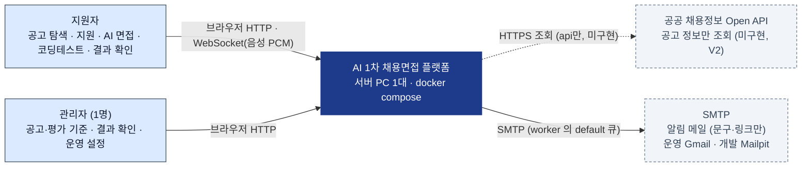

- 면접 데이터(이력서·음성·답변·점수)는 플랫폼 밖으로 나가지 않는다. 메일에는 알림 문구와 링크만 넣는다.

---

## 4. 컨테이너 뷰 (C4 Level 2)

### 4-1. 컨테이너 구성도

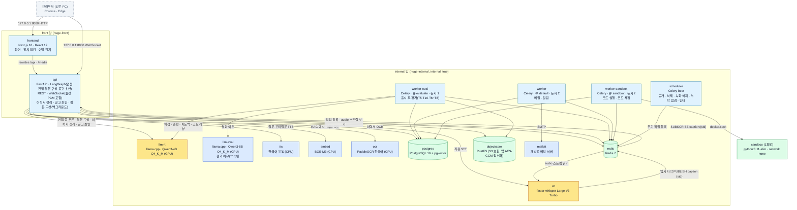

- compose 파일은 3묶음이다. infra(`compose.infra.yml`): postgres(pgvector)·redis·objectstore(RustFS)·mailpit / ai(`compose.ai.yml`): llm-rt·llm-eval·stt·tts·ocr·embed / app(`compose.app.yml`): api·worker-eval·worker·worker-sandbox·scheduler·frontend. 먼저 infra, 그다음 ai, 마지막에 app 을 띄운다(`scripts/up.sh`).
- 네트워크는 두 개다. `huge-internal`(internal: true)에는 모든 컨테이너가 붙고, `huge-front`에는 frontend·api·mailpit(확인 화면 `127.0.0.1:8025`)이 붙는다. stt·tts·embed·ocr 모델은 `scripts/fetch-models.sh` 가 도는 동안만 front 망을 붙여 볼륨에 받는다. Redis 는 비밀번호(`REDIS_PASSWORD`)가 있어야 접속된다. 원본의 egress 망과 `mailer` 컨테이너는 없다. 메일은 worker 의 `default` 큐가 보낸다.
- 브라우저에 열리는 포트는 `127.0.0.1`의 8080(frontend)·8000(api, WebSocket)뿐이다(개발용 메일 확인 8025 제외). 원본의 UDP 40000~40019(WebRTC)는 없다(V4). RustFS·DB·AI 컨테이너는 포트를 열지 않는다.
- 서비스 이름은 `objectstore`(RustFS 1.0.4)다. 원본의 `minio`는 공식 이미지 배포 중단(R-07)으로 2026-10-30 RustFS 로 바꿨다(B5).

### 4-2. 컨테이너 책임과 경계

| 컨테이너 | 책임 | 하지 않는 일 | GPU |
|---|---|---|---|
| frontend | 화면 렌더링, 장치 점검, 전체 화면·이탈 신호 수집, heartbeat, 녹화 조각 업로드 | 업무 판단(점수·상태 전이) | - |
| api | 인증·권한, 공고·지원 API, 입장 관리, **면접 진행 그래프**(체크포인트), **질문 구성 그래프**(체크포인트 없음, B1), 이력서 읽기·정리·OCR 호출, AI 공고 초안, 질문 음성 미리 만들기, 실시간 통신(WebSocket), 장애·이탈 판정, 점수 계산(조회용). 비루트(uid 65534), docker.sock 없음(B4) | 채점·메일·코드 실행(Celery 로 보냄) | - |
| worker-eval | 큐 `evaluate`(동시 1): 응시 후 평가 — 답변 속 채점 지시 검사, T5 채점, 점수·판정(코드), T10 결과 이유, T6~T8 리포트, 하이라이트 | 실시간 통신 | - |
| worker | 큐 `default`(동시 2): 메일·알림·비밀번호 재설정 메일 | 실시간 통신 | - |
| worker-sandbox | 큐 `sandbox`(동시 2): 코드 [실행]·제출 채점. **docker.sock 을 가진 유일한 컨테이너**(B4) | 외부 망 접속 | - |
| scheduler | Celery beat. 정해진 시각에 작업 등록·실행(5분 점검·결과 공개, 매시 안내, 매시 30분 녹화 삭제, 03:00 보관 삭제, 09:00 삭제 안내) | 모델 호출 | - |
| llm-rt | 면접 중 LLM(꼬리질문 판단, 질문 구성)과 이력서 정리(B3), AI 공고 초안, 답변 채점(T5)·총평·피드백·코드 리뷰(T6~T8) | 결과 이유(T10) | ● |
| stt | 실시간 임시 자막, 최종 전사(word timestamps 포함) | - | ● |
| llm-eval | 1차 결과 이유 작성(T10)만 | 면접 중 실시간 응답, 채점 | CPU |
| tts · embed · ocr | 질문 음성 / 질문 임베딩·RAG 예시 찾기·베낌 확인 / 이력서 OCR | - | CPU |
| postgres | 업무 데이터 원장, pgvector, LangGraph 체크포인트(면접 진행 그래프·공고 초안 그래프), 로그인 세션(T13), 면접 세션(T14) | - | - |
| redis | Celery 브로커·결과 저장, 음성 조각 스트림, 임시 자막 Pub/Sub, 입장 카운터, 짧은 상태(평가 잠금 등). heartbeat 시각은 Redis 가 아니라 api 프로세스 메모리 | 원장(영구 데이터) | - |
| objectstore (RustFS) | 이력서 원본, 답변 음성, 녹화 조각, 질문 음성. 앱이 AES-256-GCM 으로 암호화해 넣음(B5) | 브라우저 직접 노출 | - |
| mailpit | 개발용 메일 서버(운영은 외부 SMTP) | - | - |
| sandbox | 제출 코드 1회 실행 | 네트워크 | - |

### 4-3. 통신 방식 정리

| 구간 | 방식 | 동기/비동기 | 근거 |
|---|---|---|---|
| 브라우저 ↔ frontend ↔ api | HTTP REST (Next.js rewrites, 같은 출처 쿠키) | 동기 | TRD 2-1 |
| 브라우저 ↔ api (면접) | WebSocket: 질문·자막·상태·heartbeat·신호 | 양방향 | TRD 5-2 |
| 브라우저 → api (답변 음성) | WebSocket 이진 메시지(16kHz mono PCM16, 약 1초 조각). WebRTC·UDP 포트 없음 | 실시간 | ADR-03 (대체안 채택) |
| 브라우저 → api (카메라 녹화) | REST `POST /interview/{sid}/recording`, MediaRecorder 10초 WebM 조각(카메라 영상 + 마이크 소리, 약 300kbps). 조각마다 객체 하나로 저장(R1, R4) | 비동기 | ADR-04 |
| 브라우저 → api (창 닫기 기록) | REST `POST /interview/{sid}/events` (`sendBeacon`) | 단방향 | 6-4 |
| 브라우저 ↔ api (뒤에서 끝나는 작업) | 브라우저가 상태 API를 폴링하고, api가 DB·Celery 결과를 읽어 돌려준다. worker는 브라우저와 직접 통신하지 않는다 | 폴링 | 6-1, 6-7 |
| api → stt (음성 조각) | Redis Streams `audio:{session_id}` | 비동기 | TRD 5-2 |
| stt → api (임시 자막) | Redis Pub/Sub `caption:{session_id}`. 놓쳐도 되는 값이라 저장하지 않는다. api는 면접 세션이 열려 있는 동안만 구독한다 | 비동기 | 이 문서에서 정함 |
| worker → 메일 서버 | Celery `default` 큐가 SMTP 로 보낸다(운영 외부 SMTP, 개발 Mailpit). 재시도 60·300·1800초 | 비동기 | TRD 10장 |
| api → llm-rt · stt(최종) · tts · embed · ocr | 내부 HTTP (OpenAI 호환 / 서비스 API), 시간 제한 필수 | 동기 | TRD 7-5 |
| api · scheduler → worker-eval · worker · worker-sandbox | Celery 작업 (Redis 브로커). 큐 `evaluate`(평가)·`default`(메일)·`sandbox`(코드 실행·채점), 멱등 키. 메일은 별도 mailer 없이 worker 의 `default` 큐가 보낸다 | 비동기 | TRD 8-3 |
| worker-sandbox → sandbox | Docker Engine API (docker.sock). 코드·입력은 환경 변수로 전달(파일 마운트 없음, B7) | 동기 | TRD 9 |
| 브라우저 ← 미디어 | api의 `/media/*`가 권한 확인 후 RustFS에서 읽어 전달. 답변 음성·녹화·질문 음성 모두 Range 없이 전체를 보냄(R2). 하이라이트 이동은 화면이 받은 음성의 재생 위치를 옮겨서 한다 | 동기 | ADR-05 |

---

## 5. 컴포넌트 뷰 (C4 Level 3)

### 5-1. frontend

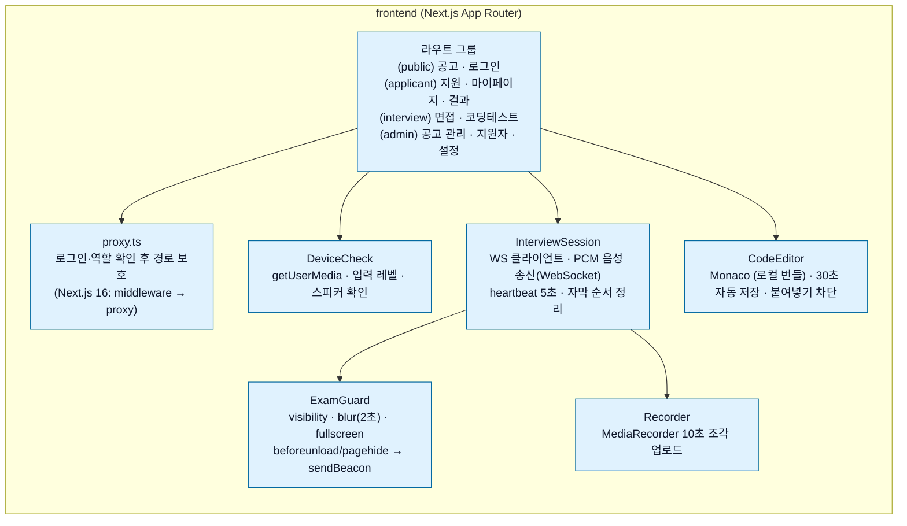

- Monaco는 `@monaco-editor/react` 기본값이 CDN에서 불러오므로 `loader.config({ monaco })`로 로컬 번들을 쓴다. 실행 중 외부 리소스 요청은 0건이어야 한다(AC-19).
- 서버 상태(질문 번호, 남은 시간, 이탈 횟수)의 기준은 서버다. 화면은 받은 값만 표시한다.

### 5-2. api

```mermaid
flowchart TB
    classDef c fill:#E0F2FE,stroke:#0369A1,color:#0F172A
    classDef core fill:#FEF3C7,stroke:#B45309,color:#0F172A
    subgraph api["api (FastAPI)"]
        auth["auth<br/>세션 쿠키 · Argon2id · 잠금 · require_admin/require_owner"]:::c
        posting["posting<br/>공고 CRUD · 게시 · 잠금 · 초안 요청 (import 미구현, V2)"]:::c
        application["application<br/>지원 · 동의 · 이력서 업로드(리더 · 정리 · OCR) · 확정 · 질문 구성(백그라운드)"]:::c
        admission["admission<br/>Redis Lua 입장 · holds_seat (자동 보호 미구현, F6)"]:::core
        rtc["음성 수신 (WebSocket)<br/>이진 PCM 1초 조각 → Redis Stream · RustFS(조각마다 객체)"]:::c
        ws["ws hub<br/>question · caption · warn · terminate · paused · resume"]:::c
        graph["interview graph (LangGraph)<br/>prepare → locate → ask → wait(interrupt) → transcribe → followup 하위 그래프 → advance/finish"]:::core
        integrity["integrity<br/>heartbeat 감시 · 장애 판정 · 이탈 집계"]:::core
        scoring["scoring<br/>Decimal 점수 계산 · 판정 검증 규칙"]:::core
        media["media<br/>/media/* 권한 확인 후 스트리밍"]:::c
        result["result<br/>지원자 public_view · 관리자 리포트(읽기 전용)"]:::c
        settings["settings<br/>app_settings 조회·변경 · 감사 로그"]:::c
    end
    admission --> graph
    rtc --> graph
    ws --> graph
    integrity --> graph
    graph --> scoring
```

- `scoring`은 worker-eval과 공유하는 순수 함수 모듈(`domain/scoring.py`)로 둔다. api는 조회용, worker-eval은 확정용으로 같은 코드를 쓴다.
- 상태 전이는 `applications.attempt_status`가 원장이고, LangGraph 체크포인트는 그래프를 이어 가는 데만 쓴다(TRD 7-5). 이어가기는 체크포인트가 아니라 원장을 읽는 `locate` 노드가 끊긴 질문부터 다시 낸다.
- '평가 지연' 건은 5분 점검(`huge.sweep`)이 6시간마다 재채점하고 3일 뒤 재채점까지 실패하면(늦어도 7일) 평가 미완료 불합격으로 닫는다(U-5 결정, CONFLICTS U8).

### 5-3. worker

Celery 큐는 3개(`evaluate`·`default`·`sandbox`)이고 worker 컨테이너도 큐마다 하나다(B2).

| 컴포넌트 (Celery 작업 이름) | 큐 | 돌리는 컨테이너 | 모델 |
|---|---|---|---|
| 응시 후 평가 (`huge.evaluate`: 채점 지시 검사 → T5 → 점수·판정 → T10 → T6~T8) | `evaluate` | worker-eval (동시 1) | llm-rt, llm-eval |
| 메일·알림 (`huge.sendMail`, `huge.sendResetMail`) | `default` | worker (동시 2) | - |
| 코드 [실행] (`huge.sandboxRun`), 코드 채점 (`huge.gradeCoding`) | `sandbox` | worker-sandbox (동시 2) | - |
| 점검·공개·안내·삭제 (`huge.sweep` 5분, `huge.reminders` 매시, `huge.purge` 03:00, `huge.purgeNotice` 09:00, `huge.purgeRecordings` 매시 30분) | (beat 가 등록) | scheduler | - |

- 아래 작업은 Celery 가 아니라 **api 안 asyncio 백그라운드 작업**이다(B2): 이력서 읽기·정리·OCR, AI 공고 초안(진행 상태는 api 메모리), 질문 구성 그래프, 질문 음성 미리 만들기, 면접 중 연결 감시.
- 원본의 작업 줄 이름(`ocr`, `eval_hi`, `compose`, `eval_lo`, `mail`, `ops`)과 선채점(prescore) 작업은 구현에 없다.
- 평가 작업에 멱등 키(지원 번호 + 단계)와 Redis 잠금을 붙이고, 재시도 1·2·4분 3회 뒤 `needs_review`로 넘긴다(TRD 8-3).

---

## 6. 런타임 뷰 (주요 흐름)

### 6-1. 지원 → 이력서 → 질문 미리 구성

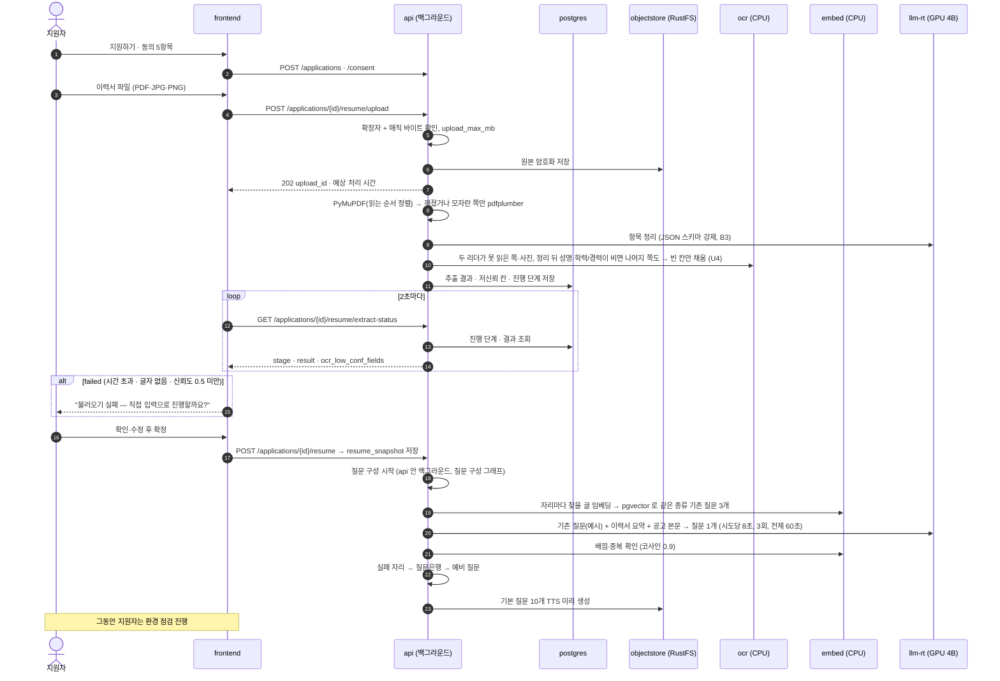

### 6-2. 면접 시작과 입장 관리

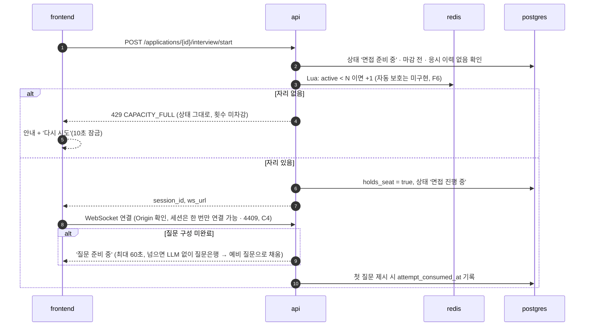

### 6-3. 질문 1개 처리 루프 (면접 진행 그래프)

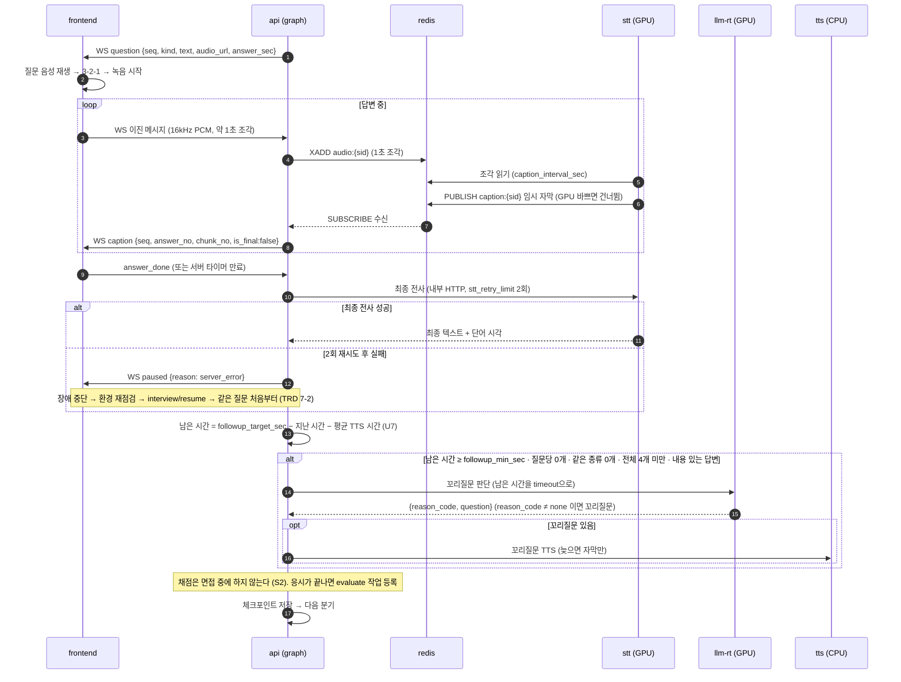

### 6-4. 장애와 화면 이탈

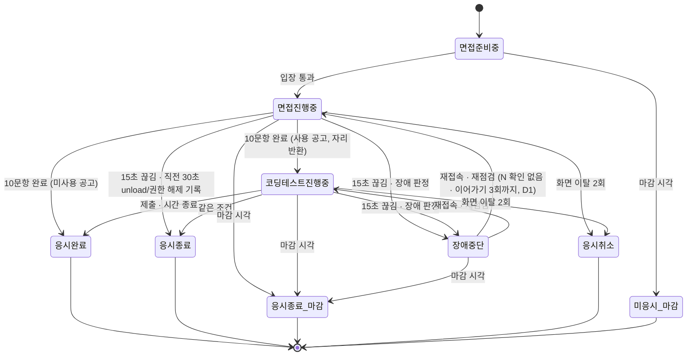

판정 위치와 시점은 아래 원칙을 따른다.

| 상황 | 판정 주체 | 시점 | 처리 |
|---|---|---|---|
| heartbeat 15초 누락 | api `integrity` | 15초가 되는 순간 즉시 | 직전 30초 `unload`·`permission` 기록 → 응시 종료(OV-07). 없으면 장애 중단, 남은 시간 저장, 자리 10분 보유 |
| 1회 화면 이탈 | api `integrity` | 신호 수신 즉시 | 남은 시간 저장·타이머 정지 → 경고 → 확인 시 남은 시간부터 재개, 앞뒤 음성을 이어 붙임 |
| 2회 화면 이탈 | api `integrity` | 즉시 | `terminate{reason}` → 응시 취소, 자리 반환 |
| 마감 시각 | api 정리 작업(1분마다). 접속 중이면 연결 감시(`watchdog`)가 마감 시각에 즉시 | 마감 정각(정리 작업은 최대 1분 늦음) | `terminate{reason:'closed'}` → 응시 종료(마감), 채점 등록 |
| STT 최종 실패 (2회 재시도 후) | api `graph` | 실패 즉시 | 연결이 살아 있어도 장애 중단(`paused`, `server_error`). 남은 시간 저장, 자리 10분 보유. 재점검 후 `interview/resume`으로 같은 질문을 처음부터 (TRD 7-2·7-5, A1) |
| 진행 중인데 연결된 세션이 없음 (서버 재시작 · 시작 후 화면이 한 번도 연결되지 않음) | api (고착 응시 정리, 1분마다 도는 작업 `jobs.py`) | 시작·이어가기 뒤 90초가 지난 점검 때(실제 90~150초). 서버를 다시 켤 때는 시작하면서 즉시(`main.py`) | '원인 미상 장애'로 장애 중단 처리 → 이어가기 가능. TRD 7-2 '원인 미상은 지원자에게 유리하게'를 적용 |
| 녹화 조각 업로드 3회 실패 (`upload_failed`) | api | 신호 수신 즉시 | 원인은 화면 말이 아니라 서버 기록으로 정한다. 저장소가 실패해 최근 60초 안에 `session_events` `upload_error` 가 있으면 `server_error`(이어가기 횟수에 안 셈), 없으면 `upload_failed`(지원자 쪽, 횟수에 셈). 4xx 거절은 장애가 아니고 그 조각만 버림 (R5) |
| 이어가기 4번째 끊김 | api | 판정 즉시 | 지원자 쪽 끊김(네트워크·장치 등)만 `resume_limit`(3회)에 센다. 서버 오류·원인 미상(재시작)은 세지 않는다. 4번째 끊김은 이어가기 대신 응시 종료(`ended`, end_detail `resume_limit`) → 답한 문항까지 채점 (D1) |
| 진행 중 동의 철회·탈퇴 | api | 요청 즉시 | 자리 반환 → WebSocket `terminate`(`withdrawn`) → 데이터 삭제 순서 (W5) |

구현 시 꼭 지킬 것:
- **이탈 경고 중 수신 음성은 버린다.** 경고 모달이 떠 있는 동안 WebSocket으로 들어온 조각은 스트림에 넣지 않는다(이어 붙인 답변이 오염되지 않게). 화면도 경고 중에는 오디오 트랙을 끈다(`track.enabled = false`).
- **이탈 경고 중에는 heartbeat 누락 한도를 15초에서 120초로 늘린다.** 숨겨진 탭에서는 브라우저가 타이머를 늦출 수 있다. 판정을 멈추는 것이 아니라 경고 상태인 세션은 120초 동안 신호가 없을 때 장애로 본다. WebSocket 비정상 종료와 `unload`는 그대로 판정한다(R-05).
- 창 닫기 기록은 `sendBeacon`으로 `POST /interview/{sid}/events`에 보낸다(API 명세서). WebSocket은 창이 닫히는 순간 메시지를 보장하지 않는다. `sendBeacon`에 문자열을 넣으면 `text/plain`으로 가서 FastAPI 본문 파싱이 실패하므로, 화면은 `Blob([json], {type: 'application/json'})`으로 보낸다. `[TRD 요청]` 5-1에 경로 추가.

### 6-5. 채점 · AI 1차 판정 · 검증

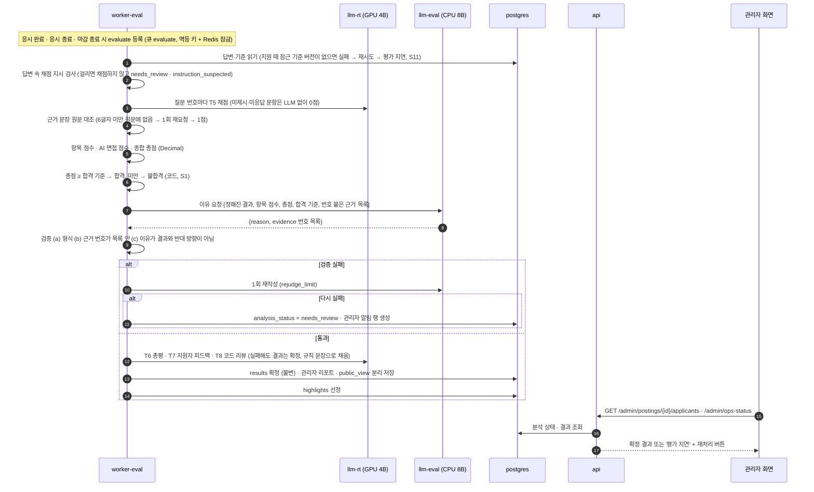

- **합격 여부는 코드가 '총점 ≥ 합격 기준'으로 정한다.** AI(T10)는 정해진 결과의 이유만 쓰고 결과를 바꾸지 못한다. 같은 점수면 언제나 같은 결과가 나온다(S1). 이유 검증은 형식·근거 번호·결과와의 방향 세 가지다. 원본(TRD 1-2·8-2⑤, ADR-06)은 AI 가 합불을 정한다고 적었으나 구현은 이렇게 바꿨다. (S1, 사용자 결정. 팀 원본 PRD v1.6·TRD v1.5 에는 옛 문구)
- 점수와 결정이 어긋나는 경우는 생기지 않으므로 R-09의 어긋남 빈도 측정(TRD T-04)은 합불이 아니라 이유 문장 검증에만 해당한다.
- 부정행위로 취소된 응시는 LLM을 부르지 않고 `fail / 응시 취소`로 확정한다.
- 채점은 응시가 끝난 뒤 한 번에 한다. 면접 중 GPU 4B 는 꼬리질문에 쓰고 있어 겹치면 응답이 늦어지기 때문이다(S2). 30분 한도는 응시가 끝난 시각(또는 [다시 돌리기]를 누른 시각)부터 재며, 넘으면 `analysis_timeout` 으로 '평가 지연'이 된다(S7).

### 6-6. 코딩테스트

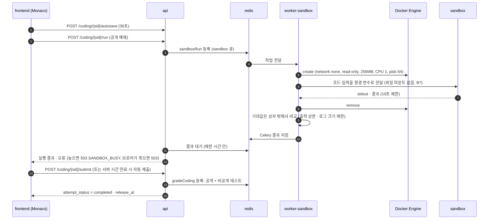

- worker-sandbox도 컨테이너이므로 bind mount 경로는 **호스트 기준**으로 해석된다. 코드 파일을 컨테이너 안 경로로 마운트하면 sandbox에서 보이지 않는다. 그래서 구현은 코드·입력을 **환경 변수**로 넘긴다(읽기 전용 루트 + 네트워크 차단 상태에서 가장 단순, B7). 기대값은 상자 안에 넣지 않고 상자 밖에서 비교해 채점 위조를 막는다.
- 인프라 오류(이미지 없음, Docker 오류)는 오답이 아니다. 재시도 3회 후 `needs_review`로 넘긴다.
- docker.sock 을 가진 컨테이너는 사실상 호스트 권한이라 worker-sandbox 는 내부망에만 둔다. 소켓이 root:root 660 이라 worker-sandbox 는 uid 65534 + 그룹 0 으로 돈다. api 는 소켓 없이 uid 65534 다(B4).

### 6-7. AI 공고 자동 작성

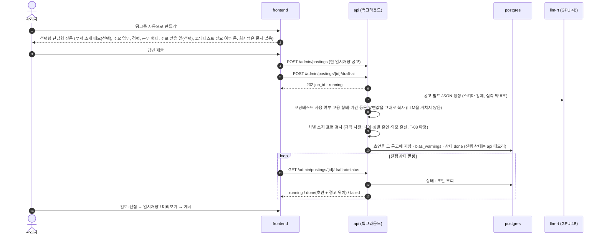

- 초안은 항상 '임시저장' 상태로 만든다. 게시는 관리자가 직접 누른다.
- 평가 기준 값(코딩테스트 사용 여부 등)은 관리자의 답변을 규칙으로 채운다. LLM은 공고 문장만 쓴다.
- 1단계에 포함했다(U2). API 명세서는 '채점용 LLM'을 쓰라고 하나 1단계에는 8B 가 없어 llm-rt(4B)를 쓴다. api 가 재시작되면 진행 중이던 초안은 '실패'로 보이고 [다시 시도]할 수 있다. 출처 값 `ai_draft` 는 TRD `source` 목록에 없다. (구현 메모, CONFLICTS U2)
- 화면을 떠나도 초안 작성은 계속되고 결과는 그 공고에 채워진다(API 명세서 4장). `[TRD 요청]` 5-1에 `GET /admin/postings/{id}/draft-ai/status` 추가.

### 6-8. 결과 공개 · 보관 만료 삭제

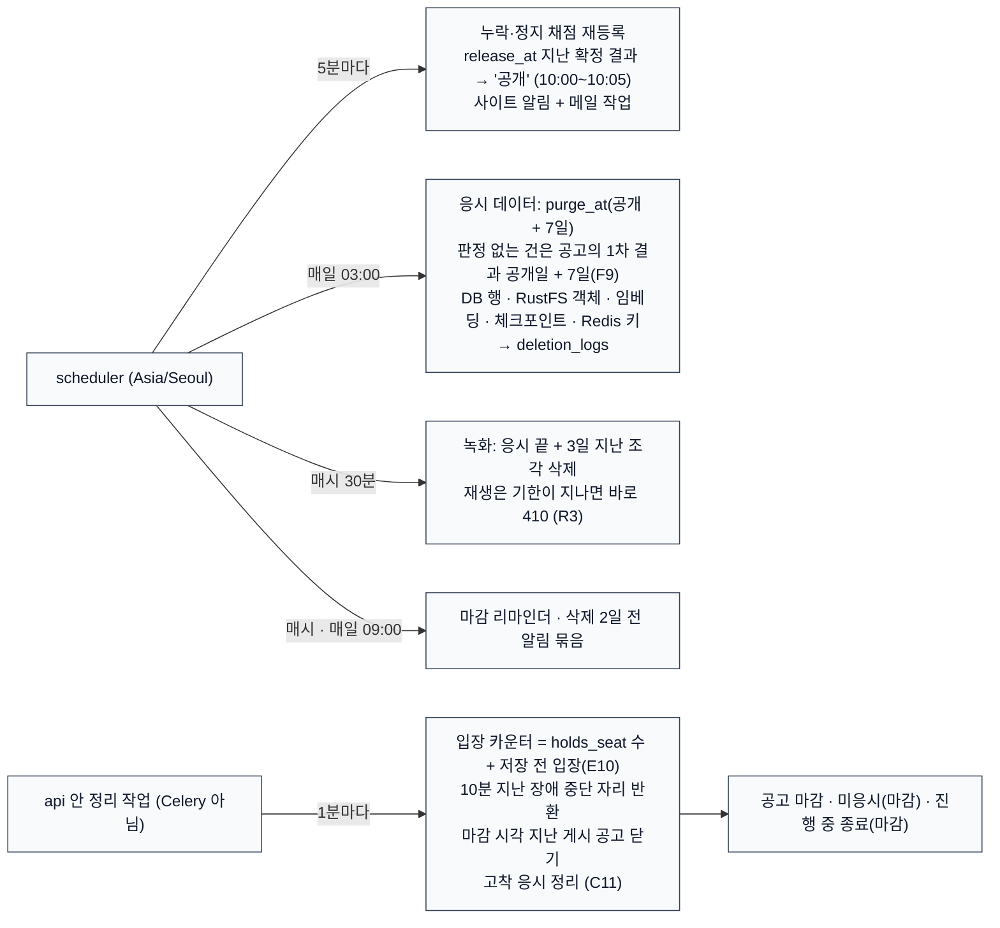

- 결과가 공개 시각에 늦은 건은 확정되는 순간 `release_at`을 다음 날 10:00으로 정해 같은 작업이 처리한다.

---

## 7. 배포 뷰

### 7-1. 단일 호스트 배치

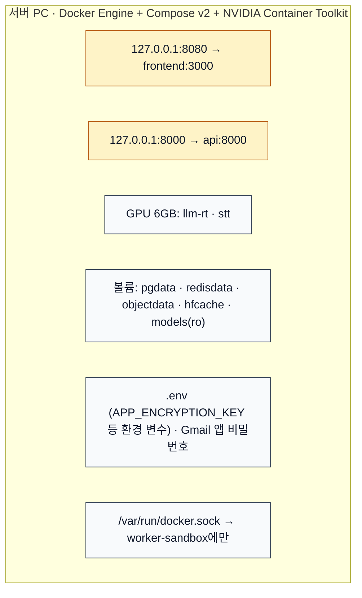

| 항목 | 기준 |
|---|---|
| 기동 | compose 3묶음을 순서대로: infra(`compose.infra.yml`) → ai(`compose.ai.yml`) → app(`compose.app.yml`). `sh scripts/up.sh`(네트워크 생성 → infra → ai → app). postgres·redis·objectstore healthcheck 통과 후 api·worker-eval·worker·worker-sandbox·scheduler. 한 묶음만: `sh scripts/up.sh app` |
| 재시작 | 모든 컨테이너 `restart: unless-stopped` |
| api 프로세스 | uvicorn 프로세스 1개로만 실행한다(`--workers` 금지). 연결 목록·질문 구성 작업·AI 초안 상태가 프로세스 메모리에 있고, 고착 응시 정리가 이 목록으로 "연결 없음"을 판단하기 때문이다 |
| 이미지 | 태그와 다이제스트로 고정, `latest` 금지. 모델 파일은 sha256 기록 |
| 환경 분리 | `APP_PROFILE=dev` 이면 설정값의 개발 환경 열을 쓴다(Mailpit, N=1, 느슨한 시간 제한). 비밀값은 `.env` |
| 초기 적재 | `python -m app.manage init`(관리자 계정), `load_questions`(질문 엑셀 → questions), `embed_questions`(질문 임베딩, 처음 약 13분, 다시 돌리면 없는 것만), `sample_posting`(선택) |

### 7-2. 외부 접속 확장안 (현재 범위 밖)

지금은 지원자가 응시 장소에 마련된 서버 PC에서 응시한다(시나리오 기획서 개정판, TRD 1-3). 나중에 지원자가 자기 PC에서 접속하게 바꾸려면 아래가 필요하다. 이번 범위에서는 만들지 않고, 바꿀 지점만 남긴다(ADR-01).

| 바뀌는 곳 | 필요한 것 | 이유 |
|---|---|---|
| 진입점 | HTTPS 리버스 프록시 1개(443), TLS 1.2+ | 브라우저는 localhost가 아니면 HTTPS에서만 마이크·카메라를 연다 |
| WebRTC | 해당 없음. 구현이 처음부터 WebSocket 음성(V4)이라 STUN·TURN(coturn)이 필요 없다 | 원본은 NAT 너머 지원자가 고정 UDP 범위로 붙지 못하는 문제를 걱정했다 |
| 쿠키 | `cookie_secure = true` (HTTPS 에서는 Secure 쿠키) | HTTPS 전용 |
| 포트 | 8080·8000 직접 노출 제거, 프록시만 노출 | 공격 면 축소 |
| 대체 | ADR-03 대체안(WebSocket 음성)을 이미 쓰므로 443 하나로 해결된다 | 확장 비용이 가장 작다 |

---

## 8. 데이터 뷰

### 8-1. 저장소별 책임

| 저장소 | 담는 것 | 수명 |
|---|---|---|
| PostgreSQL | 원장: 계정, 로그인 세션(`login_sessions`, T13), 면접 세션(`interview_sessions`, T14), 공고, 평가 기준(버전), 지원, 동의, 질문 DB(+임베딩), 출제 질문, 답변 텍스트, 점수, 결과, 이벤트, 알림, 감사·삭제 로그, 설정(변경 기록은 감사 로그, F8), 통계 보관(`stats_archive`, F1), LangGraph 체크포인트(면접 진행 그래프·공고 초안 그래프) | 10-2 보관 규칙 |
| Redis | 휘발성: Celery 작업·결과, `audio:{sid}` 스트림, `caption:{sid}` Pub/Sub 채널, 입장 카운터, heartbeat 시각, 평가 잠금 | 세션 종료 시 삭제. 원장은 항상 DB. 로그인 세션·면접 세션·환경 점검 통과·로그인 실패 잠금은 Redis 가 아니라 DB 칸/테이블(T13·T14·T16·T17) |
| RustFS (S3 호환) | 바이너리: `resumes/` 원본, `answers/` 답변 음성, `recordings/{지원}/{구간}/00000.webm …` 녹화 조각(조각마다 객체 하나, R1), `questions/{지원}/…` 질문 음성(`application_id` 기준, B8) | 녹화 3일(매시 30분 삭제), 나머지 공개 + 7일 |

### 8-2. 핵심 엔터티 관계

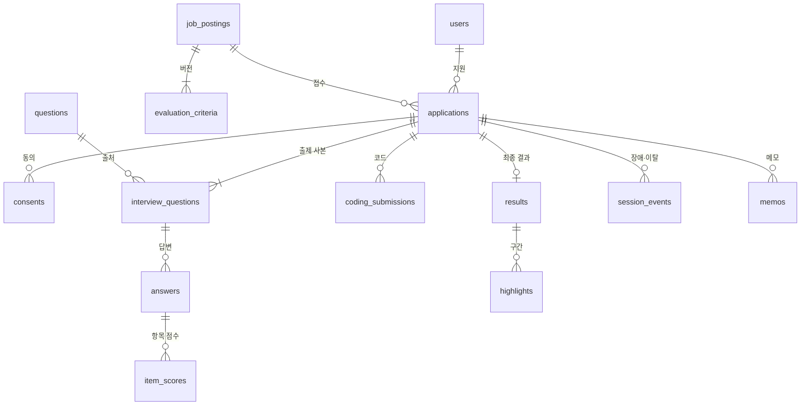

- 칸 정의는 테이블 정의서를 따른다. 여기서는 소유 관계와 삭제 단위만 정한다.
- **삭제 단위는 `applications` 1건**이다. 지원 1건을 지우면 그 아래 행, RustFS 객체, 체크포인트(thread_id = 지원 번호), Redis 키를 한 작업으로 지운다.
- 불변 데이터: `resume_snapshot`, `interview_questions`(사본), `evaluation_criteria`(잠금 후), `results`(확정 후). 앱 레벨에서 UPDATE 경로를 두지 않는다.

### 8-3. 데이터 수명주기

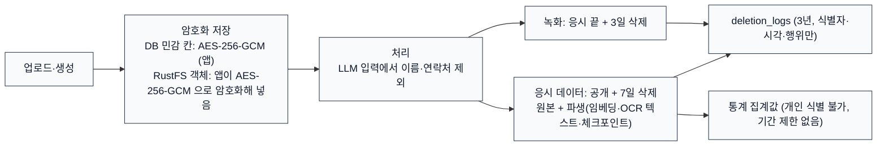

- 객체 저장소는 MinIO 대신 RustFS 를 쓰고(사용자 결정, B5), 서버 쪽 암호화(SSE) 대신 **앱이 객체를 올리기 전에 AES-256-GCM 으로 암호화**한다. 객체 키를 인증 데이터(AAD)로 묶어 객체 바꿔치기를 막는다. 키는 DB 민감 칸과 같은 키로, 환경 변수 `APP_ENCRYPTION_KEY`(base64 32바이트, `.env` 를 compose `env_file` 로 전달)다. 파일로 읽지 않는다.
- DB 민감 칸은 `_enc` 이름이 아니라 `text` 칸에 Base64(nonce+암호문+태그)로 저장한다(T3). 확인 도구 `python -m app.devtools` 는 서버 안에서 푼다.

---

## 9. AI 모델 배치 뷰

### 9-1. 배치와 GPU 예산

| 모델 | 컨테이너 | 위치 | 메모리(추정) | 쓰는 때 |
|---|---|---|---|---|
| Qwen3-4B Instruct Q4_K_M | llm-rt | GPU | 2.5GB + KV 0.3GB × (N + compose_slots) | 면접 중(꼬리질문), 질문 구성, 이력서 정리(B3), 공고 초안, 답변 채점·총평·피드백·코드 리뷰 |
| Whisper Large V3 Turbo int8_float16 | stt | GPU | 약 1.0GB | 자막, 최종 전사 |
| Qwen3-8B Q4_K_M | llm-eval | CPU / RAM | 실측 약 4~5GB (컨테이너 상한 9GB) | 1차 결과 이유 작성(T10)만 |
| BGE-M3 | embed | CPU | 실측 약 1.7GB (상한 5GB) | 질문 적재·검색·RAG·베낌 확인 |
| PaddleOCR PP-OCRv5 (한국어) | ocr | CPU | 1~2GB (미측정) | 이력서 OCR (별도 컨테이너, U4) |
| 한국어 TTS (Supertonic 2) | tts | CPU | 1GB 미만 | 질문 음성 |

GPU 합계: 2.5 + 0.3 × (N + 1) + 1.0 + 0.5 ≤ 5.4GB → **N ≈ 2~3** (추정, TRD 13-2에서 확정). 개발 PC 실측 GPU 메모리는 5.4 / 6GB다(CONFLICTS E). 실제 compose 의 llm-rt 는 `--parallel 2`, 문맥 8192(슬롯당 4096)다.

### 9-2. LLM 호출 공통 규칙

- LangChain `ChatOpenAI`에 내부 주소(`http://llm-rt:8080/v1`, `http://llm-eval:8080/v1`)를 넣는다. 외부로 나가지 않는다.
- 모든 호출: JSON 스키마 강제(`with_structured_output` / llama.cpp grammar) → Pydantic 재검증 → 업무 검증 순서. Qwen3는 `/no_think`.
- 모든 호출에 시간 제한을 건다. 면접 중 호출은 남은 예산을 timeout으로 쓴다.
- 질문 구성은 api 안 세마포어(`compose_slots`, 1)로 한 번에 한 지원자만 llm-rt 를 쓰게 해 면접 요청이 먼저 처리되게 한다. 면접 중에는 채점을 겹치지 않는다(S2).

### 9-3. 8B CPU 사용처

원본은 llm-eval 하나를 이력서 정리·공고 초안·선채점·최종 판정이 함께 쓴다고 보고 Celery 줄 우선순위(`eval_hi`)로 경합을 풀려 했다. 구현에서는 이력서 정리와 공고 초안이 llm-rt(4B)로 옮겨 가(B3) llm-eval 은 **결과 이유(T10)만** 맡으므로 이 경합이 없다. `worker-eval`(동시 1)이 평가를 한 건씩 돌려 CPU 8B 를 넘치게 쓰지 않는다. CPU 8B는 수백 토큰 생성에 수십 초가 걸릴 수 있으므로(약 5.4 tok/s) 화면은 항상 진행 표시를 하고 결과를 폴링한다(R-02).

---

## 10. 보안 아키텍처

| 계층 | 통제 |
|---|---|
| 네트워크 | 127.0.0.1 바인딩, DB·Redis·객체 저장소·LLM 서버는 `internal: true` 망(huge-internal)에만 둔다. stt·tts·embed·ocr 도 같다. front 망(huge-front)에는 포트를 여는 frontend·api·mailpit 만 있고, 이 셋은 코드가 밖으로 내보내지 않는다는 점에 기댄다. 비밀번호 재설정·알림 메일은 worker 의 SMTP 접속뿐이다 |
| 인증 | 세션 쿠키(HttpOnly, SameSite=Lax, HTTPS 에서는 Secure), Argon2id, 같은 IP 5회 실패 시 차단(관리자 해제 또는 24시간, 관리자 계정만 10분 잠금), 2시간 만료(인증이 필요한 요청과 WebSocket 연결 때마다 연장. 녹화 조각 업로드·코딩 자동 저장도 요청이라 면접 중 연장되고, heartbeat 만으로는 연장되지 않음). 비밀번호를 바꾸면 다른 로그인이 끊긴다 |
| 인가 | `/admin/*`는 `require_admin`, 지원자 API는 `require_owner`(모든 조회에 소유자 조건). 남의 데이터 요청은 404. 미디어도 같은 검사(ADR-05) |
| 실시간 | WebSocket Origin 확인, 면접 세션 토큰(sid)과 로그인 사용자 일치 확인 |
| 입력 | Pydantic `extra="forbid"`, 업로드는 확장자 + 매직 바이트 + `upload_max_mb`, 로그인 복귀 경로 `next`는 같은 사이트의 화면 경로만 허용(`safeNext`, A2) |
| 저장 | DB 민감 칸 AES-256-GCM, 객체(RustFS)는 앱이 AES-256-GCM 으로 암호화해 저장(B5). 키는 환경 변수 `APP_ENCRYPTION_KEY`(DB 칸·객체 공통) |
| 실행 격리 | sandbox: network none, read-only, 비루트, 256MB, CPU 1, pids 64, 10초. 기대값은 상자 밖에서 비교, 입력은 환경 변수(B7) |
| 로그·감사 | 앱 로그에서 답변 원문·개인정보 마스킹. 감사 로그: 결과 열람, 녹화 재생, 메모, 동의, 기준·설정 변경, 삭제, 장애·이탈 판정 |
| LLM 입력 | 채점 자료 생성 함수에서 이름·연락처·음성 특징 제외, 테스트로 고정 |

- docker.sock을 가진 컨테이너는 사실상 호스트 관리자 권한이다. 구현은 `worker-sandbox`만 소켓을 가지며(uid 65534 + 그룹 0) 내부망에만 둔다. api는 소켓 없이 비루트로 돈다. sandbox 생성 코드는 고정 이미지·고정 옵션만 쓰도록 한 곳(`sandbox_runner`)에 모은다(R-06, B4).

---

## 11. 횡단 관심사

| 관심사 | 방식 |
|---|---|
| 설정 | `app_settings`(재시작 없이 반영) + `.env`(비밀값·접속 정보). 변경은 감사 로그. 목록은 TRD 14장 |
| 시간 | 모든 계산 Asia/Seoul, ISO 8601 +09:00. 면접·코딩 타이머의 기준은 서버 |
| 오류 응답 | `{"code","message"}` 단일 형식. 동시 면접 초과는 `CAPACITY_FULL`로 통일(화면정의서 §12 #27) |
| 숫자 | 점수는 Decimal, 전송은 문자열(`"70.15"`) |
| 멱등성 | Celery 작업: 지원 번호 + 단계. 입장: `holds_seat`으로 이중 증감 방지 |
| 관측 | 별도 모니터링 도구 없음. 구조화 로그 + 성능 지표(다음 질문 시간, API 응답, 결과 산출 시간, NVML GPU 메모리)를 DB에 기록해 관리자 대시보드에 표시 |
| 테스트 | SDD/TDD. 도메인 규칙(점수·검증·상태 전이·입장)은 순수 함수 단위 테스트, API 통합 테스트, Playwright E2E(장애·이탈), freezegun(공개·삭제·마감) |

---

## 12. 아키텍처 결정 기록 (ADR)

| ID | 결정 | 상태 | 대안 | 결정 이유 / 결과 |
|---|---|---|---|---|
| ADR-01 | 서버 PC 안(127.0.0.1)에서만 접속, HTTPS·프록시 없음. 외부 접속은 확장안(7-2)으로만 둔다 | 채택 (TRD 우선, 팀 확인 2026-10-29) | 인터넷 접속 + HTTPS + TURN | 일정과 인프라 부담. 시나리오 기획서 개정판도 '응시 장소의 서버 PC에서 응시'로 맞춰졌다. PRD 10-3의 '인터넷 접속·HTTPS'는 PRD 개정 대상 |
| ADR-02 | 면접 중 LLM 4B는 GPU, 8B는 CPU로 분리. **구현에서 8B(CPU)는 1차 결과 이유(T10)만 맡고, 이력서 정리·공고 초안·채점·총평은 4B(GPU)가 맡는다(B3, S2)** | 채택 (TRD 6장) | 4B 하나 / 8B 하나 | 6GB에서 GPU 한 장에는 모델 하나만 올릴 수 있다. 채점 전체 실측 70~181초라 10분 안이다. 10분을 넘으면 TRD 6-4 B·C로 바꾼다 |
| ADR-03 | 답변 음성은 WebRTC(aiortc). **1주차 PoC 실패 시 WebSocket 1초 PCM 조각 전송으로 바꾼다** → **구현은 처음부터 대체안(WebSocket 이진 16kHz PCM)을 썼다. WebRTC·UDP 포트 없음 (V4, 2026-10-30 사용자 결정)** | 대체안 채택 (구현) | 처음부터 WebSocket | 뒤쪽(Redis 스트림 → STT)은 그대로다. STT 가 서버에서 조각을 받아 처리하는 구조라 WebRTC 미디어 서버 없이 단순화했다 |
| ADR-04 | 카메라 녹화는 MediaRecorder 10초 WebM 조각을 REST로 올린다. 3회 실패는 '업로드 실패 = 장애'로 본다 | 채택 (팀 확인 2026-10-29) | WebRTC 영상 트랙 | 녹화는 실시간일 필요가 없고, 서버 영상 디코딩 부담이 없다. 경로는 API 명세서의 `POST /interview/{sid}/recording`. `[TRD 요청]` 5-1에 경로 추가 |
| ADR-05 | 브라우저가 쓰는 파일(질문 음성, 하이라이트, 녹화)은 api `/media/*`가 권한 확인 후 RustFS에서 읽어 전달한다(**답변 음성·녹화·질문 음성 모두 Range 없이 처음부터 전체를 보냄** — 답변 음성은 `Response` 로 전체 전송이고, 녹화(MediaRecorder WebM)는 탐색 정보가 없어 건너뛰기가 안 된다, R2. 하이라이트 구간 이동은 화면이 받은 음성의 재생 위치를 옮겨서 한다). frontend rewrites에 `/media/*`를 추가한다 | 제안 | MinIO 사전 서명 URL | MinIO 포트를 열지 않으므로 사전 서명 URL은 브라우저가 닿지 않는다. 권한 검사와 감사 로그를 한 곳에 둘 수 있다. `[TRD 요청]` 8-4 '5분짜리 임시 주소' 문구 수정. `[API 명세서 요청]` `GET /admin/applicants/{aid}/media`가 MinIO 주소 대신 파일을 직접 흘려보내도록 수정 |
| ADR-06 | AI 판정 검증은 형식·값 범위·근거 원문 일치 세 가지만 한다. 서버는 '총점 ≥ 합격 기준' 규칙으로 다시 판정하지 않는다. 검증 실패는 1회 재판정 → 평가 지연. **→ 구현에서 대체됨(S1): 코드가 '총점 ≥ 합격 기준'으로 합불을 정하고 AI(T10)는 이유만 쓴다. 검증은 형식·근거 번호·결과와의 방향이다. (S1, 사용자 결정. 팀 원본 PRD v1.6·TRD v1.5 에는 옛 문구)** | 채택 (TRD 1-2·8-2⑤, 팀 확인 2026-10-29) → 구현에서 대체 | 화면정의서 v0.4 D-06 (기준 일치까지 검증) | 최우선 문서인 TRD와 개정된 시나리오·08v·API 명세서에 맞춘다. 결과: 총점과 어긋난 판정이 확정될 수 있다(R-09). 화면정의서 D-06과 PRD AC-13은 개정 대상 |
| ADR-07 | 면접 진행은 api 안의 LangGraph(PostgreSQL 체크포인트, thread_id = 지원 번호), 질문 구성도 LangGraph이나 **구현은 worker가 아니라 api 안에서 돌고 체크포인트가 없다**(B1 ①). 상태 원장은 `applications`이고 이어가기는 `locate` 노드가 원장을 읽어 한다(B1 ②). AI 공고 초안도 api 안 LangGraph이며 체크포인트 thread 는 `posting-draft:{공고 id}`(한 칸 다시 쓰기에 이어 씀, 2026-11-10, C-15) | 채택 (TRD 7-4, 7-5) | 전부 worker / 직접 구현 상태 머신 | interrupt·체크포인트로 이어가기 구현이 단순해진다. 그래프는 이어가기 수단일 뿐 원장이 아니다 |
| ADR-08 | 동시 면접 상한은 Redis Lua + DB `holds_seat` 재동기화. 대기열 없음 | 채택 (TRD 5-3) | 대기열·자동 입장 | 단순함. '대기'는 저장 상태가 아니다 |
| ADR-09 | 코드 실행은 `worker-sandbox`(큐 sandbox)가 docker.sock으로 1회용 컨테이너를 만든다(B4). api는 소켓이 없다. 코드·입력은 put_archive/stdin 대신 **환경 변수**로 넣는다(B7) | 채택 (TRD 9장 + 보완) | 상시 실행 sandbox / gVisor | 구현이 가장 작다. bind mount 경로 문제를 피한다 |
| ADR-11 | 객체 저장소는 MinIO 대신 RustFS(S3 호환)를 쓰고, 파일은 서버 쪽 암호화(SSE) 대신 앱이 AES-256-GCM 으로 암호화해 넣는다(B5) | 채택 (구현, 사용자 결정 2026-10-30) | MinIO + SSE | MinIO 공식 이미지 배포 중단(R-07). SSE 는 KMS 설정이 필요해 앱 암호화가 단순하다 |
| ADR-10 | AI 공고 초안: 평가 기준 값(코딩테스트 사용 여부 등)은 관리자 답변을 규칙으로 채우고, LLM은 문장만 쓴다. 결과는 항상 임시저장 | 제안 | LLM이 기준까지 제안 | 평가 기준은 관리자가 정한다는 원칙(1-3 ②)을 지킨다 |

---

## 13. 기술 리스크와 검증 계획

| ID | 리스크 | 영향 | 대응 | 검증 시점 |
|---|---|---|---|---|
| R-01 | aiortc(aioice)가 UDP 포트 범위 고정을 공식 지원하지 않는다. Docker 브리지에서 후보 주소를 127.0.0.1로 바꿔야 한다 | 면접 음성 불통 | **해소:** 구현이 처음부터 ADR-03 대체안(WebSocket PCM)이라 해당 없음(V4) | 해소 |
| R-02 | 8B CPU 생성 속도(약 5.4 tok/s). 결과 이유(T10)를 8B가 쓴다 | 체감 지연, 결과 10분 초과 | 실측 채점 전체 70~181초(E). 이력서 정리·초안은 이미 4B로 옮겼다(B3). T10은 근거 번호만 내게 해 토큰을 줄였다(S4) | 해소(실측) |
| R-03 | GPU 6GB 예산. 4B + KV + STT가 넘치면 공유 메모리로 넘어가 크게 느려진다 | 다음 질문 지연 | NVML 기록, N 실측(개발 PC 5.4 / 6GB). 자동 보호(92%)는 미구현 | 2주차 |
| R-04 | 한국어 TTS(Supertonic) 품질·속도 미확인 | 질문 전달 품질 | 청취 평가. 실패 시 다른 설치형 TTS, 최악은 자막만(INT-01 허용) | 1주차 |
| R-05 | 숨겨진 탭·최소화 창에서 브라우저가 타이머·네트워크를 늦춰 heartbeat가 밀릴 수 있다 | 이탈이 장애로 잘못 판정 | 경고 중에는 장애 판정 한도를 15초에서 120초로 늘림(6-4). heartbeat는 WebSocket 수신 시각 기준 | E2E |
| R-06 | docker.sock 노출 | 호스트 권한 탈취 경로 | worker만 마운트, 고정 이미지·옵션, worker는 외부 망 없음 | 코드 리뷰 |
| R-07 | MinIO 무료판 이미지 업데이트 중단 | 보안 패치 없음 | **해소:** RustFS 로 교체(B5). 내부망 전용, 포트 비노출, 태그 고정 | 상시 |
| R-08 | Gmail 하루 발송 한도(약 500통) | 결과 공개일 알림 지연 | `mail_daily_limit` 초과 시 다음 날로 미루고 대시보드 표시. 사이트 알림은 항상 생성. **하루 메일 상한은 미구현**이다(개발용 Mailpit만 씀. 실제 메일 서버를 붙일 때 추가) | 운영 |
| R-09 | AI 판정이 총점·합격 기준과 어긋난 채 확정될 수 있다(ADR-06) | 설명하기 어려운 합불 | **해소:** 합불을 코드가 총점 ≥ 기준으로 정하므로 어긋남이 생기지 않는다(S1). 이유 문장이 결과와 반대 방향이면 재작성한다 | 해소 |
| R-10 | 연결이 정상인데 STT가 실패해도 장애 중단 → 재점검 → 이어가기를 거친다(TRD 7-2, A1). 서버 오류라 이어가기 횟수(3회)에는 세지 않는다 | 지원자 체감 저하 | STT 재시도 2회 안에 끝나게 시간 제한(`stt_attempt_timeout_sec`)을 둔다. 실패 빈도를 기록해 잦으면 처리 방식을 재검토한다 | E2E |
| R-11 | Next.js `proxy.ts`가 `/api` 경로에 걸리면 요청 본문이 기본 약 10MB로 잘린다(버전별 설정 이름 확인 필요) | 50MB 한도의 이력서 업로드 실패 | `proxy.ts` matcher에서 `/api`·`/media`를 빼거나 본문 크기 설정을 올린다 | 1주차 |
| R-12 | 같은 PC에서 `localhost:8080`으로 접속하면 쿠키·Origin이 `127.0.0.1`과 달라 WebSocket 접속이 거부된다 | 면접 입장 실패 | 접속 주소를 `127.0.0.1`로 고정 안내하고, `localhost`로 들어오면 리다이렉트 | 1주차 |

---

## 14. 문서 간 충돌 처리 기록

### 14-1. 남아 있는 충돌과 결정 (2026-10-29 기준)

| # | 주제 | 문서별 내용 | 이 문서의 결정 | 고쳐야 할 문서 |
|---|---|---|---|---|
| 1 | 판정 검증 | TRD 8-2⑤·시나리오·08v·API 명세서: 형식·범위·근거만 / 화면정의서 v0.4 D-06·PRD EVL-05·AC-13: 기준 일치까지 | TRD (ADR-06, 팀 확인). **구현에서 대체됨: 코드가 총점 ≥ 기준으로 합불을 정하고 AI는 이유만 쓴다(S1)** | PRD EVL-05·AC-13, TRD 8-2 (화면정의서는 v0.5에서 반영) |
| 2 | 신규 지원 알림 | TRD 10장·화면정의서 D-10: 없음 / PRD ADM-08·08v 08-B·시나리오 8-2·API 명세서 `new_application`: 있음 | 없음 (TRD·화면정의서, 팀 확인) | 08v, 시나리오 8-2, API 명세서 9장, PRD ADM-08 |
| 3 | STT 최종 실패 | TRD 7-2·7-5: 장애 중단 / API 명세서(원본)는 `stt_retry` 메시지로 같은 질문 재답변, PRD INT-04·화면정의서 D-02(OV-04)·08v: 같은 화면에서 재답변 | TRD (팀 확인, R-10). 구현도 TRD를 따른다: 재시도 후 `paused`·server_error (A1) | 09v(개인용 개정본에서 반영), API 명세서(A1), PRD INT-04 (화면정의서는 v0.5에서 반영) |
| 4 | 미디어 재생 | TRD 8-4·API 명세서 `/admin/applicants/{aid}/media`: MinIO 5분 임시 주소 / TRD 2-3: MinIO 포트 비노출 | api `/media/*` 경유 (ADR-05) | TRD 8-4, API 명세서 10장 |
| 5 | 동시 면접 초과 코드 | TRD 4-3: `SEATS_FULL` / TRD 5-3·화면정의서·API 명세서: `CAPACITY_FULL` | `CAPACITY_FULL` | TRD 4-3 |
| 6 | 1회 이탈 후 재개 | PRD v1.3 CHT-02: 답변 시간 새로 부여 / TRD 7-3·화면정의서 D-08·08v·API 명세서: 남은 시간부터 | 남은 시간부터 | PRD CHT-02 |
| 7 | 접속 범위 | PRD 10-3: 인터넷 접속·HTTPS / TRD·시나리오 개정판: 서버 PC 안에서만 | TRD (ADR-01) | PRD 10-3 |
| 8 | 음성 전송 | TRD: WebRTC / 지난 검토 추천: WebSocket | WebRTC + 대체안 (ADR-03). **구현은 WebSocket 이진 PCM(V4)** | TRD 5-2 (수정 또는 승인 필요) |
| 9 | 녹화 업로드 | PRD INT-05: 녹화 3일 / TRD: 경로 없음 / API 명세서: `POST /interview/{sid}/recording` | API 명세서 경로 (ADR-04) | TRD 5-1 |

### 14-2. 해소된 충돌

시나리오 기획서 개정판과 플로우차트 08v가 PRD v1.3·TRD v1.5에 맞춰지면서 아래는 더 이상 충돌이 아니다: 시나리오의 '집에서 응시', 플로우차트의 '대기' 저장 상태·PDF만 10MB·마감 후 24시간 재개·재접속 시 장애 판정·기업 담당자/운영자 구분.

### 14-3. 문서별 반영 요청

> 팀 원본 기준의 기록이다. 개인용으로 진행하므로(2026-11-04) 따로 요청하지 않는다.

**TRD (주담당)**
1. 5-1에 추가: `POST /interview/{sid}/events`(sendBeacon), `POST /interview/{sid}/recording`, `GET /admin/postings/{id}/draft-ai/status`, `/media/*`
2. 8-4 하이라이트 재생: MinIO 임시 주소 → api `/media/*` 경유 (ADR-05)
3. 4-3 예시 `SEATS_FULL` → `CAPACITY_FULL`
4. 9장에 '코드는 put_archive/stdin으로 전달' 추가 (ADR-09)
5. 3장 Monaco '로컬 번들(`loader.config`)', Next.js 16 `proxy.ts` 표기
6. 이탈 경고 중 음성 폐기·heartbeat 판정 제외 규칙 (6-4)
7. 임시 자막 반환(`caption:{sid}` Pub/Sub) 구성 (4-3). (원본에 있던 mailer 컨테이너·`mail` 큐는 구현에서 worker 의 `default` 큐로 바뀜, B2)

**API 명세서**
1. `GET /admin/applicants/{aid}/media`를 파일 직접 전달(`Range` 지원)로 수정, `question.audio_url`의 `/media/*` 처리 경로 명시 (ADR-05) (원본 팀 문서 기준. 구현은 Range 없음, R2)
2. 9장 알림 `kind`에서 `new_application` 삭제
3. 기준 문서를 화면정의서 v0.4로 갱신
4. `sendBeacon` 본문을 `application/json` Blob으로 보내도록 명시 (6-4)

**화면정의서** — v0.5에서 반영 완료 (D-06·D-02 변경, OV-04 삭제, T-26, S-R03 판정 문구, §12 #9·#28 삭제)

**플로우차트 08v · 시나리오 기획서**
1. 신규 지원 알림 삭제 (08v 08-B, 시나리오 8-2)
2. 08v 05 도면 STT 최종 실패를 TRD대로 장애 처리로 변경, 미정의 표의 'PRD를 따름' 수정

**PRD (다음 개정)**
1. EVL-05·AC-13 판정 검증, ADM-08 신규 지원 알림, INT-04 STT 실패, CHT-02 이탈 재개, 10-3 접속 범위

---

## 논의사항

> 2026-11-04 사용자 결정: 개인용으로 진행한다. '확정(현행 유지)' 항목은 구현대로 확정했고, 미구현 항목(V2·V3·F6·S5)은 이후 범위로 둔다. 권장·조치 칸은 당시 제안 기록이다.

"분류"는 `문서 충돌` / `구현 확인 필요` / `미확정 결정` / `기타`. 코드 줄 번호는 2026-11-03 시점이다.

| # | 분류 | 문서·위치 | 내용 | 권장 |
|---|---|---|---|---|
| 1 | 확정(현행 유지) | 4-1, 5-2, ADR-07 (B1 ①②) | 질문 구성 그래프는 api 안·체크포인트 없음(TRD 7-4는 worker). 이어가기는 체크포인트가 아니라 `locate`가 원장(applications)을 읽음. | 구현대로 TRD 7-4·7-5 개정 승인 |
| 2 | 확정(현행 유지) | 6-4 표 (C11) | 진행 중인데 연결된 세션이 없는 응시를 90초 뒤 '원인 미상 장애'로 중단하는 동작은 이대로 확정했다. 코드 위치는 `jobs.py:23,33-46`(90초 유예, 1분마다 점검이라 실제 90~150초), `main.py:40-53`(재시작은 즉시)로 확인했다. | 사용자 확인 |
| 3 | 처리함(2026-11-09: TRD 6-2 는 이미 코드대로임. CONFLICTS E 에 모델 배치 줄을 더함) | 4-1, 4-2, 9-1, ADR-02 | 코드는 T5·T6~T8·이력서 정리·공고 초안을 GPU 4B(llm-rt)로, 8B(llm-eval)는 T10만 돌린다 (`services/evaluation.py:4,7`, `services/llm.py:24`, `compose.ai.yml:30`). CONFLICTS에는 이 배치를 직접 적은 항목이 없고(B3·S2·E에 간접), 원본 TRD 6-2는 채점을 CPU 8B로 적는다. 이 문서는 코드대로 적었다. | CONFLICTS에 배치 항목 추가, TRD 6-2·6-3 개정 |
| 4 | 처리함(2026-11-09: compose 확인: TTS 는 CPU, GPU 는 llm-rt·stt. CONFLICTS E 를 고침) | 4-1, 9-1 (TTS) | CONFLICTS 요약은 TTS 를 GPU 로 적었으나 `compose.ai.yml:80-87`의 tts는 GPU 예약이 없는 CPU 서비스다(주석도 "Supertonic 2, CPU"). 이 문서는 TTS를 CPU로 적었다. 실측 "GPU 메모리 5.4/6GB (3개 모델 동시)"의 세 모델도 CONFLICTS에 없다. | TTS 배치 확인 후 통일 |
| 5 | 처리함(2026-11-09: 실측 1.59~1.86GiB. 문서 값 약 1.7GB 유지, compose 주석을 고침) | 9-1 (embed 메모리) | **2026-11-06:** embed 실측 1.86GiB(상한 5GiB, 대기 중). (이전 기록) `compose.ai.yml:67` 주석은 embed "약 3GB", CONFLICTS는 약 1.7GB(상한 5GB), 원본 기술 아키텍처는 2.5GB. 이 문서는 CONFLICTS(실측 1.7GB)를 따랐다. | 실측 후 한 값으로 |
| 6 | 처리함 | 4-2 (설정 잔재) | **2026-11-06:** `config.py` 의 쓰지 않는 `MINIO_*` 필드를 지웠다. (이전 기록) `compose.app.yml:12`·`services/storage.py:25-27`은 `S3_ENDPOINT`·`S3_ACCESS_KEY`·`S3_SECRET_KEY`를 읽지만 `config.py:15-17,41-43`에는 `MINIO_ENDPOINT`·`MINIO_ROOT_USER`·`MINIO_ROOT_PASSWORD` 필드가 남아 있다(MinIO 시절 흔적으로 보이며 이번에 확인한 범위에서 쓰는 곳은 못 찾음). | 쓰는 곳이 없으면 정리 |
| 7 | 확정(현행 유지) | 4-3, 5-1, ADR-03 (V4) | 답변 음성 WebRTC(TRD 5-2)가 구현에서는 WebSocket 이진 PCM이다. TRD 5-2 수정 또는 승인이 필요하다. 이 문서는 구현대로 적었다. | TRD 5-2 개정 |
| 8 | 확정(현행 유지) | 6-5, ADR-06, R-09 (S1) | 합불을 코드가 총점 ≥ 기준으로 정한다 (S1, 사용자 결정. 팀 원본 PRD v1.6·TRD v1.5 에는 옛 문구). | — |
| 9 | 확정(현행 유지) | 2-2, 6-2, 7-1, 13장 (F6·V2·S5) | 자동 보호(admission_guard)·공고 불러오기(Open API)·하루 메일 상한(`mail_daily_limit`)은 미구현이다. 요구사항은 지우지 않고 '미구현'으로 표시해 이후 범위로 옮겼다. 운영 메일(Gmail SMTP) 연결도 개발 Mailpit 만 확인했다. | 범위 결정 |
| 10 | 처리함 | 6-3, 6-4 (A1) | **2026-11-06:** CONFLICTS A1 은 지금 '처음 1번 + 재시도 2번'으로 적혀 있어 코드와 같다. (이전 기록) CONFLICTS A1은 "1회 재시도 후"라고 적었으나 코드는 최초 1회 + `stt_retry_limit` 2회 재시도 = 최대 3번 시도한다 (`interview/engine.py:640`, `config.py:71`). 이 문서의 "2회 재시도"는 코드와 같다. | CONFLICTS A1 설명 수정 또는 설정값 결정 |
| 11 | 문서 충돌 | 6-4, 14-1 (A2) | `next`(로그인 후 이동)는 화면 경로만 허용하는 것으로 10장에 적었다. API 명세서 문구 정리가 필요하다. | API 명세서 문구 정리 |
| 12 | 확정(현행 유지) | Q-1 (U7) | `followup_target_sec`(운영 10초·개발 20초)은 사용자 결정이다 (PRD v1.8·TRD v1.7 에 반영됨. 팀 원본에는 없음). | — |
| 13 | 처리함(2026-11-09: C1 은 이미 코드 순서. 동기 DB·TTS 순차는 CONFLICTS '남은 것'에 있음(E4 측정 때 함께)) | 6-1 (질문 구성) | 질문 구성 중 DB 조회가 api 이벤트 루프에서 동기로 돈다(지금 규모 수 ms). 질문 음성(TTS) 미리 만들기는 60초 예산 밖에서 차례로 돈다. 동시 면접이 늘면 손볼 것이다. 또 CONFLICTS C1은 슬롯 순서를 "인성 → 이력서 → 기업 → 직무"라 적었으나 코드는 인성 → 기업 → 이력서 ×2 → 직무 ×4 → 인성 → 기업이다 (`services/question_compose.py:35`). | 순서는 C1 평가 지연으로 유지, CONFLICTS 설명 수정 |
| 14 | 처리함(2026-11-09: 할 일 없음) | 14장 | 옛 충돌 표(14-1)의 일부 문서 이름(08v)은 개인용 09v로 갱신되었다. 14-3의 반영 요청은 원본 팀 문서 기준 설명이라 그대로 남겼다. | — |
| 15 | 처리함(2026-11-04) | 4-1, 10장 네트워크 | (이전 내용) stt·tts·embed·ocr 가 internal·front 망에 계속 붙어 있고 Redis 에는 비밀번호가 없다. 침해되면 음성 조각이 밖으로 나가거나 작업 큐에 접근할 수 있다. 모델을 받은 뒤 front 망을 떼거나 Redis 비밀번호를 거는 안이 있다. | 개선 제안: 결정 필요 |
| 16 | 처리함 | 7-1, 10장 (APP_PROFILE) | **2026-11-06:** `APP_ENCRYPTION_KEY` 가 없으면 프로필과 상관없이 켜지지 않는다. (이전 기록) `APP_PROFILE` 기본값이 dev 라 `.env` 에 `APP_PROFILE=prod` 와 `APP_ENCRYPTION_KEY` 를 모두 빠뜨리면 경고 없이 0 키로 시작한다(`config.py:36`, `crypto.py:24-27`). 운영 배포에 `APP_PROFILE=prod` 가 필수다. | 개선 제안: 기본값을 prod 로 하거나 키 없으면 시작 거부 |
| 17 | 확정(알려진 한계, 2026-11-09): api 는 1프로세스로 띄운다. CONFLICTS B2 에 적음. E4 부하 측정 때 함께 봄 | 6-4 (heartbeat) | 연결 목록·heartbeat 시각이 api 프로세스 메모리라 api 를 2프로세스 이상으로 띄우면 살아 있는 면접을 장애로 잘못 중단한다. 또 동기 DB 호출이 이벤트 루프에서 돌아(`engine.py`) 동시 면접 상한을 크게 올리면 heartbeat 처리가 늦어질 수 있다(추정). | 13-2 측정에 부하 시험 포함 제안 |
| 18 | 확정(현행 유지, 2026-11-09 사용자 결정: 문서를 구현에 맞춤) | 6-8 | `release_hour` 설정은 코드가 읽지 않고 공개 시각 10:00 이 고정이다(`timeutil.py:26-30`). scheduler 가 꺼진 시간대의 매시 안내는 보충하지 않는다. | TRD 14장과 함께 정리 |

## 2026-11-06 검토 보정

코드와 대조해 고친 내용이다. 이 내용은 v1.3 에 들어 있다.

- 삭제 단위 설명의 MinIO 를 RustFS 로 고쳤다.
- 논의사항 5·10·16 을 지금 상태로 고쳤다.

## 2026-11-09 검토 보정

코드와 대조해 고친 내용이다. 이 내용은 v1.3 에 들어 있다.

- 1분 정리 작업의 입장 카운터는 `holds_seat` 수에 저장 전 입장(`interview:pending:*`)을 더해 맞춘다. 시작 API 는 자리 잡기와 상태 바꾸기를 한 번에 저장한다(E10).
- 채점(T5) 온도 0, 근거 90% 일치 허용(E17, CONFLICTS C-13). 실시간 면접과 채점이 같은 GPU 모델(llm-rt)을 쓰므로 동시에 돌면 점수가 조금 달라질 수 있다(사용자 결정: 그대로 둠).
- 남은 논의사항을 사용자 결정으로 정리했다: 원본 설계 중 구현에 없는 부분(Gateway·anchor 검증·skip_cause 저장 등)은 구현대로 확정하고 설계는 미구현으로 남긴다.

## 2026-11-10 보정

사용자 결정과 코드에 맞춰 고친 내용이다. 이 내용은 v1.3 에 들어 있다.

- api 의 LangGraph 그래프에 AI 공고 초안 그래프를 더했다(체크포인트 thread `posting-draft:{공고 id}`, ADR-07, C-15). 게시 뒤 질문 후보 만들기도 api 안 백그라운드 작업이다(C-17).
