# AI 1차 채용면접 자동화 플랫폼 — 테이블 정의서

테이블 관계도(ERD)와 테이블별 칸·자료형·키

| 항목 | 내용 |
|---|---|
| 문서 버전 | **v1.1** (개인용 개정본 — 팀 원본 아님, 기준: 구현(`huge/`) + `huge/CONFLICTS.md` (2026-11-03)) |
| 기준 문서 | API 명세서 v1.2 (값 이름·응답 칸), TRD v1.6 (4-1 주요 테이블, 4-3 데이터 전달 형식) |
| DB | PostgreSQL 16 + pgvector. 테이블은 서버가 시작할 때 `create_all`로 만들고, 이미 있는 표에 칸을 더하는 일은 `app/migrate.py`가 한다(Alembic은 아직 쓰지 않는다) |
| 작성일 | 2026-11-03 |
| 읽는 법 | 키: PK 기본 키, FK 외래 키(다른 테이블을 가리킴), UQ 중복 불가. NULL: Y면 비워 둘 수 있음. 칸 이름과 상태 값은 API 명세서와 같은 영어 이름을 쓴다. 기본값은 앱 코드가 넣는 값이며 DB 기본값(server default)은 따로 없다 |

## 개정 이력

| 버전 | 작성일 | 내용 |
|---|---|---|
| v1.0 (원본) | 2026-10-29 | 최초 작성(PDF, 버전 표기 없음). 테이블 25개 |
| v1.1 (개인용) | 2026-11-03 | 구현(`models.py`)에 맞춘 개정. 아래 세부. 검토(백엔드·프론트엔드·UI/UX) 반영: 재생 위치 설명(4-23)·STT 재시도(4-21)·`is_empty`(4-21)·알림 종류 `purge_notice`(4-25)·답변 음성 감사 로그(4-26)·Redis `audio:{sid}`·`caption:active`(5장) |

v1.1 세부 변경(괄호는 `huge/CONFLICTS.md` ID)

- **공통 규칙:** id 는 `varchar(36)` 문자열 uuid 와 정수 자동 증가(T5) · 암호화 칸은 `_enc`·`bytea` 가 아니라 이름 그대로 `text`에 Base64(T3), 암호화 범위 넓힘(T4) · `jsonb` → `json`(T6) · Alembic → `create_all` + `migrate.py`(T7) · LangGraph 체크포인트 테이블은 api 시작 때 생성, 삭제 때 함께 지움(T8, B1) · 상태 칸 CHECK 23개를 `models.CHECK_VALUES`로 둠(T1).
- **지운 테이블:** `coding_problems`(T10, 문제는 코드 `services/coding_bank.py`) · `app_setting_history`(T11, F8: 감사 로그가 대신함). 이름이 바뀐 `user_resumes` → `saved_resumes`(T9).
- **새 테이블:** `login_sessions`(T13) · `interview_sessions`(T14) · `question_usage`(T15) · `stats_archive`(T12, F1).
- **지운 칸:** users `age_14_plus`·`terms_agreed_at`·`privacy_agreed_at`·`password_change_required`(T18, `agreements`·`must_change_password`로 바뀜) · consents `user_id`(T24) · applications `applicant_id`·`criteria_id`·`result_status`·`analysis_attempts`·`resume_confirmed_at`·`coding_deadline_at`·`exit_count`·`needs_review_reason`·`resume_snapshot_enc`·`resume_edited_fields`·`ended_at`(T20·T21) · evaluation_criteria `rubric_version`(T25) · resume_uploads `purpose`·`ocr_confidence`·`ocr_low_conf_fields`·`created_at`(T31) · questions `use_count`·`created_at`(T15·T29) · interview_questions `parent_id`·`text_snapshot`·`category`·`answer_seconds`·`tts_key`·`replaced`·`generation_attempts`·`question_id`(T26) · answers `answer_no_count`·`stt_retries`·`stt_retry_sent`(T27) · session_events `kind`·`reason`·`phase`·`duration_sec`(T30) · audit_logs `target_type`·`target_id`(T33) · coding_submissions `problem_id`·`submitted_at`(T36) · user_resumes `method`·`upload_id`(T9).
- **새 칸:** users `failed_logins`·`locked_until`(T16) · applications `user_id`·`criteria_version`·`away_count`·`review_reason`·`edited_fields`·`resume_snapshot`·`completed_at`·`precheck_valid_until`(T17)·`phase`·`current_seq`·`followup_count`·`interrupted_at`·`interruption_reason`·`interruption_judged`·`end_detail`·`questions_status`·`interview_started_at`·`submitted_at`·`resume_name`·`resume_upload_id`·`coding_remaining_sec`(T20~T23) · evaluation_criteria `locked`(T25) · saved_resumes `name`(T9) · resume_uploads `content_type`·`started_at`(T31) · questions `kind`·`status`·`row_no`(T29) · interview_questions `qtype`·`answer_order`·`source`·`substitute_reason`·`audio_sec`·`followup_reason`·`source_question_id` 등(T26) · answers `application_id`·`words`·`audio_sec`·`stt_elapsed_sec`·`end_reason`(T27) · session_events `type`·`detail`·`session_id`(T30) · audit_logs `target`·`detail`(T33) · coding_submissions `problem_key`·`final`·`grade_status`(T36) · notifications `hidden_at`(T37) · item_scores `application_id`(T38).
- **값 이름:** `job_codes.status` `open`(T2) · `questions.source` `excel`(T2) · `questions.status` 추가 값 `excluded` 등(T2, F4-2) · `session_events.judged` `cheating`·`info`(T2) · 감사 로그 action 점 표기(M1, T33).
- **키·인덱스:** `UNIQUE (source, external_id)` · `UNIQUE (application_id, applicant_id)` · `needs_review` 부분 인덱스 · 질문 `(source, category)` 인덱스는 실제에 없어 지움. 실제의 `UNIQUE (sheet, row_no)`·`UNIQUE (application_id, seq, kind, answer_order)` 추가.
- **Redis 키:** 실제 쓰는 키로 바꿈(5장). 로그인 실패(T16)·세션(T13)·환경 점검(T17)·면접 세션(T14)은 DB 로 옮겨져 지움. 비밀번호 재설정 보조 키(P1)·채점 잠금 키 추가.
- **원본 오기:** 원본 users 아래 "Redis에 둔다(6장)"는 5장이 맞아 바로잡음.

## 1. 공통 규칙

1. 값 이름: 상태 칸의 값은 API 명세서의 값과 글자까지 같게 쓰고, 정해진 값만 들어가도록 CHECK 제약을 건다. 값 목록은 `models.CHECK_VALUES`(23개)이고 새 표는 `create_all`이, 이미 있는 PostgreSQL 표는 `migrate.addChecks`가 건다. 기존 행이 목록과 어긋나면 그 제약만 건너뛰고 경고한다. 값을 더하거나 바꿀 때는 코드와 두 문서를 함께 고친다. (T1)
2. id: 대부분 `varchar(36)`(uuid 를 글자로 쓴 값, 앱이 만든다. DB 기본값 없음)을 쓴다. 기록이 계속 쌓이거나 구현에서 정수로 만든 테이블은 `integer` 자동 증가(PostgreSQL `serial`)를 쓴다: evaluation_criteria · posting_revisions · session_events · deletion_logs · stats_archive · coding_submissions · questions · interview_questions · item_scores · highlights · audit_logs. (T5)
3. 시각: 모두 timestamptz 로 저장하고, 화면과 정해진 시각 작업은 한국 시간(Asia/Seoul)으로 계산한다.
4. 점수: 계산한 점수는 numeric(5,2) 로 저장해 소수 오차가 없게 한다(예: 70.15). API에는 문자열로 내보낸다.
5. 암호화 칸: 서버 코드에서 AES-256-GCM으로 암호화한 값을 `text`에 Base64(nonce 12바이트 + 암호문 + 태그)로 넣는다. 이름에 `_enc` 를 붙이지 않으므로 암호화 칸은 이 문서의 "설명"에 **(암호화)** 로 표시한다. 확인 도구는 `python -m app.devtools`. (T3)
   암호화 칸: users.phone · saved_resumes.resume·name · resume_uploads.result · applications.resume_snapshot·resume_name · answers.transcript·words · results.ai_reason·ai_reason_quotes·strengths·improvements·summary·public_view · item_scores.quote · highlights.quote. 답변 인용·평가 문장도 개인정보로 보고 함께 암호화한다. (T4)
6. 지울 때: 지원 건을 지우면 그 아래 행(면접 질문·답변·세션·점수·결과·기록·녹화·알림·메모·이력서 파일 처리·코딩 제출)도 함께 지운다( ON DELETE CASCADE ). 동의(consents)는 증거로 남기고 연결만 끊는다( ON DELETE SET NULL ). 지운 일은 deletion_logs에 남긴다. `applications.posting_id` 에는 ON DELETE 규칙이 없다.
7. 탈퇴: users 행을 바로 지운다. 그래서 같은 이메일로 다시 가입할 수 있다.
8. LangGraph 체크포인트: checkpoints · checkpoint_blobs · checkpoint_writes (라이브러리 자체 이력 `checkpoint_migrations` 포함) 테이블은 LangGraph(`AsyncPostgresSaver.setup()`)가 api 시작 때 만들고 관리한다. thread_id는 지원 건 id이고, 보관 기간 삭제·동의 철회·탈퇴 때 같은 트랜잭션에서 함께 지운다(지운 수는 deletion_logs `checkpoints`). 그래프 상태에는 번호·시각·사유만 넣고 답변·이력서 글은 넣지 않는다. 개발용 SQLite·테스트에서는 메모리 저장소를 쓴다. 질문 구성 그래프는 api 안에서 돌고 체크포인트가 없다. 이어가기는 체크포인트가 아니라 `applications`(원장)를 읽어 정한다. (T8, B1)
9. JSON 칸: `jsonb` 가 아니라 `json` 을 쓴다. jsonb 전용 검색·인덱스는 쓰지 않는다. 배열 칸(원본 `text[]`)도 `json` 이다. (T6)
10. 구조 변경: Alembic 이 아니라 `create_all` + `app/migrate.py`(`ALTER TABLE … IF NOT EXISTS`, 여러 번 돌려도 안전)로 한다. pgvector 를 못 만들어도 서비스는 뜨고 RAG 만 꺼진다. (T7)

## 2. 테이블 관계도 (ERD)

실제 외래 키(FK) 기준이다. 키 칸만 그렸다. `||`는 1, `o{`는 여러 개(0개 이상), `o|`는 0 또는 1이다.
`job_codes`·`audit_logs`·`deletion_logs`·`stats_archive`는 FK 가 없다(로그·집계는 지워진 행을 가리키지 않게 하고, `job_postings.job_code`는 글자만 맞춘다).

```mermaid
erDiagram
    users ||--o{ login_sessions : "user_id CASCADE"
    users ||--o| saved_resumes : "user_id CASCADE"
    users ||--o{ resume_uploads : "user_id CASCADE"
    users ||--o{ applications : "user_id CASCADE"
    users ||--o{ interview_sessions : "user_id CASCADE"
    users ||--o{ notifications : "user_id CASCADE"
    users ||--o{ memos : "author_id"
    users |o--o{ app_settings : "updated_by SET NULL"

    job_postings ||--o{ applications : "posting_id"
    job_postings ||--o{ posting_revisions : "posting_id CASCADE"
    job_postings ||--o{ evaluation_criteria : "posting_id CASCADE"
    job_postings ||--o{ question_usage : "posting_id CASCADE"
    questions ||--o{ question_usage : "question_id CASCADE"
    questions |o--o{ interview_questions : "source_question_id"

    applications |o--o{ resume_uploads : "application_id CASCADE"
    applications |o--o{ consents : "application_id SET NULL"
    applications ||--o{ interview_sessions : "CASCADE"
    applications ||--o{ recordings : "CASCADE"
    applications ||--o{ session_events : "CASCADE"
    applications ||--o{ coding_submissions : "CASCADE"
    applications ||--o{ interview_questions : "CASCADE"
    applications ||--o{ answers : "CASCADE"
    applications ||--o{ item_scores : "CASCADE"
    applications ||--o{ highlights : "CASCADE"
    applications ||--o{ memos : "CASCADE"
    applications |o--o{ notifications : "CASCADE"
    applications ||--o| results : "application_id CASCADE"
    evaluation_criteria ||--o{ results : "criteria_id"

    interview_questions ||--o| answers : "interview_question_id CASCADE"
    interview_questions ||--o{ item_scores : "CASCADE"
    interview_questions ||--o{ highlights : "CASCADE"

    users {
        string id PK
        string email UK
    }
    login_sessions {
        string token_hash PK
        string user_id FK
    }
    saved_resumes {
        string user_id PK, FK
    }
    resume_uploads {
        string id PK
        string user_id FK
        string application_id FK
    }
    job_codes {
        string code PK
    }
    job_postings {
        string id PK
        string job_code
    }
    posting_revisions {
        int id PK
        string posting_id FK
    }
    evaluation_criteria {
        int id PK
        string posting_id FK
    }
    applications {
        string id PK
        string user_id FK
        string posting_id FK
    }
    consents {
        string id PK
        string application_id FK
    }
    interview_sessions {
        string id PK
        string application_id FK
        string user_id FK
    }
    recordings {
        string id PK
        string application_id FK
    }
    session_events {
        int id PK
        string application_id FK
    }
    results {
        string id PK
        string application_id FK, UK
        int criteria_id FK
    }
    deletion_logs {
        int id PK
    }
    stats_archive {
        int id PK
        string posting_id
    }
    coding_submissions {
        int id PK
        string application_id FK
    }
    questions {
        int id PK
    }
    question_usage {
        string posting_id PK, FK
        int question_id PK, FK
    }
    interview_questions {
        int id PK
        string application_id FK
        int source_question_id FK
    }
    answers {
        string id PK
        string application_id FK
        int interview_question_id FK, UK
    }
    item_scores {
        int id PK
        string application_id FK
        int interview_question_id FK
    }
    highlights {
        int id PK
        string application_id FK
        int interview_question_id FK
    }
    memos {
        string id PK
        string application_id FK
        string author_id FK
    }
    notifications {
        string id PK
        string user_id FK
        string application_id FK
    }
    audit_logs {
        int id PK
        string actor_id
    }
    app_settings {
        string key PK
        string updated_by FK
    }
```

묶음: 회원·관리(users·login_sessions·saved_resumes·resume_uploads·consents·memos·notifications·audit_logs·app_settings) · 공고·코딩(job_codes·job_postings·posting_revisions·evaluation_criteria·coding_submissions) · 지원 건(applications·interview_sessions·recordings·session_events·results·deletion_logs·stats_archive) · 질문·답변(questions·question_usage·interview_questions·answers·item_scores·highlights).
LangGraph 체크포인트 테이블은 FK 가 없고 `thread_id`(= 지원 건 id)로만 이어진다.

## 3. 테이블 목록

| # | 묶음 | 테이블 | 하는 일 |
|---|---|---|---|
| 1 | 회원·관리 | users  (회원) | 지원자와 관리자 계정. 탈퇴하면 행을 바로 지운다(같은 이메일로 다시 가입 가능) |
| 2 | 회원·관리 | login_sessions  (로그인 세션) | 로그인한 기기마다 한 줄(토큰은 해시로 저장). 마지막 요청 뒤 일정 시간 유지 |
| 3 | 회원·관리 | saved_resumes  (등록 이력서) | 마이페이지에 등록해 두는 이력서 1개. 지원할 때 불러와 쓴다 |
| 4 | 회원·관리 | resume_uploads  (이력서 파일 처리) | 올린 이력서 파일과 내용 뽑기(OCR 포함) 진행 상태. 지원용·등록용 모두 |
| 5 | 공고·코딩 | job_codes  (직무) | 직무 종류. 지금은 AI_AX만 지원을 받는다 |
| 6 | 공고·코딩 | job_postings  (공고) | 채용 공고 내용, 접수 기간, 게시 상태 |
| 7 | 공고·코딩 | posting_revisions  (공고 수정 기록) | 게시 뒤 바뀐 칸마다 남기는 기록. 지원자에게 "수정 사항"으로 보여 준다 |
| 8 | 공고·코딩 | evaluation_criteria  (채점 기준) | 공고별 채점 기준. 첫 응시가 시작되면 잠그고 바꾸지 않는다 |
| 9 | 지원 건 | applications  (지원 1건) | 지원 1건의 상태를 모으는 중심 테이블(면접 진행 상태의 원장) |
| 10 | 회원·관리 | consents  (동의) | 지원할 때 받은 필수 동의 5개와 철회 기록. 지원·회원이 지워져도 증거로 남긴다 |
| 11 | 지원 건 | interview_sessions  (면접 세션) | 면접 화면이 접속한 구간마다 한 줄. 서버가 다시 켜져도 이어가기를 판단할 수 있게 DB 에 둔다 |
| 12 | 지원 건 | recordings  (녹화) | 카메라 영상과 마이크 소리 녹화. 접속 구간(시작 1, 이어가기마다 +1)마다 한 줄 |
| 13 | 지원 건 | session_events  (면접 중 기록) | 연결 끊김·화면 이탈·창 닫기 등 면접 중 일어난 일과 판단 |
| 14 | 지원 건 | results  (결과) | 지원 1건의 최종 점수와 AI 결정. 확정 뒤 수정 불가 |
| 15 | 지원 건 | deletion_logs  (삭제 기록) | 보관 기간·탈퇴·동의 철회로 지운 기록(지운 내용은 남기지 않음) |
| 16 | 지원 건 | stats_archive  (통계 보관) | 보관 기간이 지나 지운 건의 익명 월별 집계. 지원 건·회원을 가리키는 칸 없음 |
| 17 | 공고·코딩 | coding_submissions  (코드 제출) | 지원 건의 문제마다 저장·제출한 코드와 채점 결과 |
| 18 | 질문·답변 | questions  (질문 DB) | 엑셀에서 불러온 질문, AI가 만든 질문, 예비 질문 |
| 19 | 질문·답변 | question_usage  (공고별 질문 사용 횟수) | 같은 공고의 지원자끼리 질문이 겹치지 않게 질문마다 쓴 횟수를 센다 |
| 20 | 질문·답변 | interview_questions  (면접 질문) | 지원자 한 명의 면접에 실제로 낸 질문 목록 |
| 21 | 질문·답변 | answers  (답변) | 질문 하나에 대한 답변. 이탈 전후로 나뉜 음성도 한 답변으로 합친다 |
| 22 | 질문·답변 | item_scores  (항목 점수) | 질문 번호마다 AI가 매긴 항목 점수(꼬리질문 답변 합쳐 채점) |
| 23 | 질문·답변 | highlights  (하이라이트) | 관리자가 다시 들어 볼 답변 구간(종류마다 최대 3개) |
| 24 | 회원·관리 | memos  (관리자 메모) | 지원자에 대한 관리자 내부 메모(1~2000자). 지원자 응답에는 넣지 않는다 |
| 25 | 회원·관리 | notifications  (알림) | 사이트 알림(머리글 🔔)과 같은 내용의 메일 발송 상태 |
| 26 | 회원·관리 | audit_logs  (감사 로그) | 누가 언제 무엇을 했는지(내용은 남기지 않음). 설정 변경의 전·후 값도 여기에 남긴다 |
| 27 | 회원·관리 | app_settings  (설정) | 서버를 다시 켜지 않고 바꾸는 설정값(목록은 TRD 14장) |

코딩 문제 은행(원본 `coding_problems`)은 테이블이 아니다. 문제와 숨겨진 테스트는 코드(`services/coding_bank.py`)에 있고 제출 행은 `problem_key`로 가리킨다. (T10)
설정 변경 기록(원본 `app_setting_history`)은 테이블 대신 감사 로그가 맡는다. (T11, F8)

## 4. 테이블별 정의

### 4-1. users (회원)

지원자와 관리자 계정. 탈퇴하면 행을 바로 지운다(같은 이메일로 다시 가입 가능)

| 칸 | 자료형 | 키 | NULL | 기본값 | 설명 |
|---|---|---|---|---|---|
| id | varchar(36) | PK | N | uuid(앱) | |
| role | varchar(16) | | N | 'applicant' | applicant 지원자 · admin 관리자(설치할 때 1개 만듦). CHECK |
| email | varchar(254) | UQ | N | | 로그인 아이디. 바꿀 수 없음 |
| password_hash | varchar(255) | | N | | Argon2id로 바꾼 비밀번호 |
| name | varchar(100) | | N | | |
| phone | text | | Y | | 휴대전화 (암호화) |
| agreements | json | | N | {} | 가입 동의: 만 14세 이상(age_14_plus)·이용약관(terms)·개인정보 처리방침(privacy) 동의 값과 동의 시각(agreed_at) |
| must_change_password | boolean | | N | false | 관리자 초기 비밀번호면 true. 바꾸면 false (API 응답 이름은 password_change_required) |
| failed_logins | integer | | N | 0 | 관리자 계정의 로그인 연속 실패 횟수. 잠기면 0으로 돌림. 지원자는 쓰지 않음(IP 단위는 login_blocks) |
| locked_until | timestamptz | | Y | | 관리자 계정의 로그인 잠금이 풀리는 시각 |
| email_verified_at | timestamptz | | Y | | 이메일 인증 시각(나중에 붙이는 기능, 현재 구현 범위 밖) |
| created_at | timestamptz | | N | now | |
| updated_at | timestamptz | | N | now | |

로그인 실패 횟수와 잠금은 Redis가 아니라 이 테이블에 둔다. 없는 이메일은 행이 없어도 같은 시간만큼 해시 검증을 해서 응답 시간으로 가입 여부를 알 수 없게 한다. (T16)
`email` 에 인덱스가 있다. (T18)

### 4-2. login_sessions (로그인 세션)

로그인한 기기마다 한 줄. 쿠키 값은 해시로만 저장한다. (T13)

| 칸 | 자료형 | 키 | NULL | 기본값 | 설명 |
|---|---|---|---|---|---|
| token_hash | varchar(64) | PK | N | | 쿠키 값의 SHA-256 |
| user_id | varchar(36) | FK | N | | → users.id (ON DELETE CASCADE), 인덱스 |
| expires_at | timestamptz | | N | | 만료 시각. 요청할 때마다 `session_idle_hours` 설정만큼 늘림 |
| created_at | timestamptz | | N | now | |

비밀번호를 바꾸거나 재설정하면 다른 기기의 행을 지운다(재설정은 모든 기기). Redis 가 재시작해도 로그인이 유지된다.

### 4-2-1. login_blocks (로그인 차단)

IP 별 로그인 실패. IP 원문은 두지 않는다. 차단도 집계 기간도 끝난 행은 매일 지운다. 관계 없음.

| 칸 | 타입 | 키 | NULL | 기본값 | 설명 |
|---|---|---|---|---|---|
| ip_hash | varchar(64) | PK | N | | 키를 섞은 IP 해시(HMAC-SHA256) |
| fail_count | integer | | N | 0 | 집계 기간 안의 실패 횟수 |
| window_started_at | timestamptz | | N | now | 집계 시작 시각 |
| code | varchar(6) | index | Y | | 문의 코드. 차단될 때 만든다 |
| blocked_at | timestamptz | | Y | | 차단 시각 |
| blocked_until | timestamptz | | Y | | 자동 해제 시각. 미래면 차단 중 |

### 4-3. saved_resumes (등록 이력서)

마이페이지에 등록해 두는 이력서 1개. 지원할 때 불러와 쓴다 (원본 이름 `user_resumes`, T9)

| 칸 | 자료형 | 키 | NULL | 기본값 | 설명 |
|---|---|---|---|---|---|
| user_id | varchar(36) | PK, FK | N | | → users.id (ON DELETE CASCADE, 한 사람에 1개) |
| resume | text | | N | | 이력서 객체(JSON: education·career·projects·skills·certificates·cover_letter) (암호화) |
| name | text | | Y | | 이력서 파일 이름 등 표시 이름 (암호화) |
| updated_at | timestamptz | | N | now | |

### 4-4. resume_uploads (이력서 파일 처리)

올린 이력서 파일과 내용 뽑기(OCR 포함) 진행 상태. 지원용·등록용 모두

| 칸 | 자료형 | 키 | NULL | 기본값 | 설명 |
|---|---|---|---|---|---|
| id | varchar(36) | PK | N | uuid(앱) | |
| user_id | varchar(36) | FK | N | | → users.id (ON DELETE CASCADE), 인덱스 |
| application_id | varchar(36) | FK | Y | | 지원용이면 → applications.id (ON DELETE CASCADE). 확정한 파일은 그 지원의 가장 최근 done 행 |
| file_key | varchar(255) | | N | | 저장소(RustFS) 원본 위치. 취소하면 파일을 지움 |
| file_name | varchar(255) | | N | | |
| content_type | varchar(64) | | N | | 올린 파일 형식 |
| stage | varchar(16) | | N | 'uploaded' | uploaded · checking · ocr · structuring · done · failed · cancelled. CHECK |
| method | varchar(16) | | Y | | 끝나면: text · ocr · mixed |
| pages_text | integer | | N | 0 | 글자 있는 쪽 수 |
| pages_scanned | integer | | N | 0 | 스캔 쪽 수 |
| estimated_seconds | integer | | N | 0 | 예상 처리 시간 |
| result | text | | Y | | 뽑은 이력서 객체 (암호화). OCR 신뢰도·낮은 신뢰 칸 정보는 이 안의 `_ocr` 에 들어 있다 |
| fail_reason | varchar(32) | | Y | | TIMEOUT · NO_TEXT · LOW_CONFIDENCE · INTERNAL |
| started_at | timestamptz | | N | now | 올린 시각 |
| finished_at | timestamptz | | Y | | |

원본의 `purpose`(지원용·등록용), `ocr_confidence`, `ocr_low_conf_fields` 칸은 없다. (T31)

### 4-5. job_codes (직무)

직무 종류. 지금은 AI_AX만 지원을 받는다

| 칸 | 자료형 | 키 | NULL | 기본값 | 설명 |
|---|---|---|---|---|---|
| code | varchar(32) | PK | N | | 예: 'AI_AX' |
| name | varchar(100) | | N | | 직무 이름 |
| status | varchar(16) | | N | 'preparing' | open 지원 가능 · preparing 준비 중. CHECK (원본 값 이름 active → open, T2) |
| sort_order | integer | | N | 0 | 목록에 보이는 순서 |

### 4-6. job_postings (공고)

채용 공고 내용, 접수 기간, 게시 상태

| 칸 | 자료형 | 키 | NULL | 기본값 | 설명 |
|---|---|---|---|---|---|
| id | varchar(36) | PK | N | uuid(앱) | |
| status | varchar(16) | | N | 'draft' | draft 임시저장 · published 게시 · closed 마감. CHECK |
| source | varchar(16) | | N | 'manual' | manual 직접 작성 · open_api · dummy · ai_draft. CHECK |
| title | varchar(200) | | N | '' | |
| job_code | varchar(32) | | N | 'AI_AX' | 직무 코드. job_codes.code 와 같은 글자(FK 는 걸지 않음) |
| company_name | varchar(200) | | N | '' | 화면에 표시하지 않는다(한 기업 전용, U1). 칸만 남김 |
| external_id | varchar(100) | | Y | | 불러온 공고의 원래 번호. 공고 불러오기는 현재 구현 범위 밖(미구현, V2) |
| company_intro | text | | N | '' | 화면 이름은 '부서 소개'(V1) |
| duties | text | | N | '' | 주요 업무 |
| requirements | text | | N | '' | 자격 요건 |
| preferred | text | | N | '' | 우대 사항 |
| employment_type | varchar(32) | | N | 'full_time' | full_time · contract · intern |
| location | varchar(200) | | N | '' | 근무지 |
| headcount | integer | | N | 1 | 모집 인원 |
| open_at | timestamptz | | Y | | 접수 시작 (게시할 때는 필수) |
| close_at | timestamptz | | Y | | 접수 마감 (게시할 때는 필수) |
| release_at | timestamptz | | Y | | 결과 한꺼번에 공개 시각 |
| contact_email | varchar(254) | | N | '' | 문의 이메일. 기본값은 관리자 이메일(결과 화면에도 표시) |
| published_at | timestamptz | | Y | | 게시한 시각 |
| closed_at | timestamptz | | Y | | 마감된 시각 |
| created_at | timestamptz | | N | now | |
| updated_at | timestamptz | | N | now | |

원본의 `UNIQUE (source, external_id)` 는 실제에 없다(공고 불러오기가 없어서). (T34)
AI 초안 만들기 진행 상태와 차별 표현 경고는 api 프로세스 메모리에 둔다(서버가 다시 켜지면 '실패'로 보이고 다시 시도한다).

### 4-7. posting_revisions (공고 수정 기록)

게시 뒤 바뀐 칸마다 남기는 기록. 지원자에게 "수정 사항"으로 보여 준다

| 칸 | 자료형 | 키 | NULL | 기본값 | 설명 |
|---|---|---|---|---|---|
| id | integer | PK | N | 자동 증가 | |
| posting_id | varchar(36) | FK | N | | → job_postings.id (ON DELETE CASCADE), 인덱스 |
| revised_at | timestamptz | | N | now | |
| field | varchar(64) | | N | | 바뀐 칸 이름. 예: location |
| before | text | | N | '' | 바뀌기 전 값 |
| after | text | | N | '' | 바뀐 뒤 값 |
| summary | varchar(300) | | N | '' | 지원자에게 보여 줄 한 줄. 예: 근무지: 서울 강남구 → 서울 서초구 |

### 4-8. evaluation_criteria (채점 기준)

공고별 채점 기준. 첫 응시가 시작되면 잠그고 바꾸지 않는다

| 칸 | 자료형 | 키 | NULL | 기본값 | 설명 |
|---|---|---|---|---|---|
| id | integer | PK | N | 자동 증가 | |
| posting_id | varchar(36) | FK | N | | → job_postings.id (ON DELETE CASCADE), 인덱스 |
| version | integer | | N | 1 | 채점 기준 버전 |
| locked | boolean | | N | false | 잠겼는지 |
| locked_at | timestamptz | | Y | | 잠근 시각(첫 응시 시작). 값이 있으면 기준 수정 409 |
| weights | json | | N | | {"expertise":30, "logic":25, "relevance":20, "delivery":10, "culture_fit":15}. 5 단위, 항목마다 5 이상, 합계 100 |
| coding_enabled | boolean | | N | false | 코딩테스트 사용(공고마다 관리자가 켠다) |
| coding_ratio | integer | | N | 30 | 코딩테스트 반영 비율(%), 10 단위 |
| pass_score | integer | | N | 70 | 합격 기준 점수(0~100 정수) |

UNIQUE (posting_id, version)
고정 채점 기준표 버전(`rubric_version`)은 이 테이블에 없고 `results` 에만 기록한다. (T25)

### 4-9. applications (지원 1건)

지원 1건의 상태를 모으는 중심 테이블. 면접·이어가기의 상태 원장이며 LangGraph 는 이 표를 읽어 이어간다.

| 칸 | 자료형 | 키 | NULL | 기본값 | 설명 |
|---|---|---|---|---|---|
| id | varchar(36) | PK | N | uuid(앱) | |
| user_id | varchar(36) | FK | N | | → users.id (ON DELETE CASCADE), 인덱스 (원본 이름 applicant_id) |
| posting_id | varchar(36) | FK | N | | → job_postings.id, 인덱스 |
| attempt_status | varchar(24) | | N | 'drafting' | 응시 상태: drafting 작성 중 · ready 면접 준비 중(화면 표기, U3) · interviewing 면접 진행 중 · coding 코딩테스트 진행 중 · interrupted 장애 중단 · completed 응시 완료 · ended 응시 종료 · ended_closed 응시 종료(마감) · cancelled 응시 취소 · not_taken_closed 미응시(마감). CHECK |
| analysis_status | varchar(16) | | N | 'pending' | 분석 상태: pending · running · decided 확정 · needs_review 평가 지연. CHECK |
| review_reason | varchar(24) | | Y | | threshold_mismatch · invalid_format · quote_not_found · analysis_timeout · sandbox_error · instruction_suspected (답변에 채점 지시가 있음, 새 값) (원본 이름 needs_review_reason) |
| needs_review_since | timestamptz | | Y | | 평가 지연이 된 시각(3일 기한의 기준). 사유를 넣을 때 앱이 채우고 사유를 지우면 함께 지움. 재채점으로 늘어나지 않음 |
| release_status | varchar(16) | | N | 'scheduled' | 공개 상태: scheduled · delayed 다음 날 10:00 공개 · released · purged 삭제 후. CHECK |
| criteria_version | integer | | Y | | 지원할 때 잠근 채점 기준 버전(evaluation_criteria.version). 없으면 판정하지 않고 '평가 지연' |
| resume_method | varchar(16) | | Y | | 이력서를 낸 방법: upload · manual · saved 등록본. CHECK |
| resume_snapshot | text | | Y | | 확정한 이력서 사본(JSON) (암호화). 확정 뒤 수정 불가 |
| resume_name | text | | Y | | 이력서 표시 이름 (암호화) |
| resume_upload_id | varchar(36) | | Y | | 쓴 이력서 파일 처리 행의 id(FK 는 걸지 않음) |
| edited_fields | json | | N | [] | 지원자가 고친 칸(관리자 이력서 탭에 표시) |
| questions_status | varchar(16) | | N | 'none' | 질문 구성 상태: none · composing · ready · failed. CHECK |
| precheck_valid_until | timestamptz | | Y | | 환경 점검 통과가 유효한 시각(시작·이어가기 API 가 확인) |
| holds_seat | boolean | | N | false | 지금 동시 면접 자리를 잡고 있는지(TRD 5-3) |
| seat_released_at | timestamptz | | Y | | 끊긴 뒤 자리를 돌려준 시각 |
| attempt_consumed_at | timestamptz | | Y | | 응시 횟수를 쓴 시각(첫 질문이 나갈 때) |
| phase | varchar(16) | | N | 'interview' | 지금 단계: interview · coding. CHECK |
| current_seq | integer | | N | 1 | 지금 질문 번호 |
| followup_count | integer | | N | 0 | 낸 꼬리질문 수 |
| away_count | integer | | N | 0 | 화면 이탈 횟수(면접·코딩 합침, 2번이면 cancelled) (원본 이름 exit_count) |
| interrupted_at | timestamptz | | Y | | 장애 중단된 시각 |
| interruption_reason | varchar(32) | | Y | | 장애 중단 사유 |
| interruption_judged | varchar(16) | | Y | | fault 장애 · not_fault 장애 아님 |
| end_detail | varchar(32) | | Y | | 응시가 끝난 세부 사유(예: exit_twice, resume_limit) |
| interview_started_at | timestamptz | | Y | | 면접을 시작한 시각 |
| coding_started_at | timestamptz | | Y | | 코딩테스트 시작 |
| coding_remaining_sec | integer | | Y | | 코딩테스트 남은 초(서버 기준, 끊기면 멈춘다). 원본의 끝 시각(coding_deadline_at)은 없음 |
| completed_at | timestamptz | | Y | | 응시가 끝난 시각 (원본 이름 ended_at) |
| submitted_at | timestamptz | | Y | | 이력서 제출 시각 |
| release_at | timestamptz | | Y | | 이 건의 결과 공개 시각, 인덱스 |
| purge_at | timestamptz | | Y | | 삭제 예정 시각(공개 + 7일). 결과 열람 끝 시각과 같음. 판정 없는 건은 공고의 1차 결과 공개일 + 7일(F9). 인덱스 |
| created_at | timestamptz | | N | now | 지원한 시각 |
| updated_at | timestamptz | | N | now | |

원본의 `result_status`(합불은 `results` 에만 둠), `analysis_attempts`, `resume_confirmed_at` 칸은 없다. 지원 때 쓴 기준은 `criteria_id` 가 아니라 `criteria_version` 으로 가리킨다. (T21)
원본의 `UNIQUE (posting_id, applicant_id)` 와 `needs_review` 부분 인덱스는 실제에 없다. 같은 공고 중복 지원은 사용자 단위 잠금으로 막는다. 〔확인 필요: 논의사항 1〕
INDEX (release_at), (purge_at): 매일 공개·삭제 작업용

### 4-10. consents (동의)

지원할 때 받은 필수 동의 5개와 철회 기록. 지원·회원이 지워져도 증거로 남긴다

| 칸 | 자료형 | 키 | NULL | 기본값 | 설명 |
|---|---|---|---|---|---|
| id | varchar(36) | PK | N | uuid(앱) | |
| application_id | varchar(36) | FK | Y | | → applications.id (ON DELETE SET NULL), 인덱스. 지원이 지워지면 NULL |
| subject_hash | varchar(64) | | Y | | 동의한 사람 표시: 이메일을 서버 키로 HMAC-SHA-256 한 값. 지운 뒤에도 누가 동의·철회했는지 맞춰 볼 수 있고, 이메일 목록을 대입해 되돌릴 수 없다 |
| consent_version | varchar(16) | | N | | 동의 문구 버전. 예: v1.7 |
| items | json | | N | | data_collection · ai_decision · share_with_admin · retention · exam_rules 각 true |
| agreed_at | timestamptz | | N | now | |
| withdrawn_at | timestamptz | | Y | | 철회 시각 |

원본의 `user_id` 칸은 없다(회원과의 연결은 `subject_hash` 로만 맞춰 본다). (T24, F2)
보관 기간은 팀 확정 필요(개인정보 처리방침에 적는 기간). 3년 뒤 삭제 작업은 아직 없다.

### 4-11. interview_sessions (면접 세션)

면접 화면이 접속한 구간마다 한 줄. (T14)

| 칸 | 자료형 | 키 | NULL | 기본값 | 설명 |
|---|---|---|---|---|---|
| id | varchar(36) | PK | N | uuid(앱) | 면접 세션 id(sid). 세션은 한 번만 연결할 수 있다 |
| application_id | varchar(36) | FK | N | | → applications.id (ON DELETE CASCADE), 인덱스 |
| user_id | varchar(36) | FK | N | | → users.id (ON DELETE CASCADE) |
| recording_segment | integer | | N | 1 | 이 접속 구간의 녹화 구간 번호 |
| created_at | timestamptz | | N | now | |
| ended_at | timestamptz | | Y | | 끊기거나 끝난 시각 |

### 4-12. recordings (녹화)

카메라 영상과 마이크 소리 녹화. 접속 구간(시작 1, 이어가기마다 +1)마다 한 줄. 평가에는 쓰지 않는다(부정행위 확인용).

| 칸 | 자료형 | 키 | NULL | 기본값 | 설명 |
|---|---|---|---|---|---|
| id | varchar(36) | PK | N | uuid(앱) | |
| application_id | varchar(36) | FK | N | | → applications.id (ON DELETE CASCADE), 인덱스 |
| segment_no | integer | | N | | 접속 구간 번호 |
| file_key | varchar(255) | | N | | 저장소 위치(접두어). 10초 조각을 `00000.webm` … 처럼 chunk_no 순서 객체 하나씩 두고 재생할 때 순서대로 이어 보낸다 (R1) |
| last_chunk_no | integer | | N | -1 | 마지막으로 받은 조각 번호(빠진 조각 확인용) |
| size_bytes | bigint | | N | 0 | |
| started_at | timestamptz | | N | now | |
| last_chunk_at | timestamptz | | Y | | |
| expires_at | timestamptz | | N | | 응시 끝 + 3일, 인덱스. 지나면 재생은 바로 410, 파일은 매시 30분 작업이 지움 (R3) |

UNIQUE (application_id, segment_no)

### 4-13. session_events (면접 중 기록)

연결 끊김·화면 이탈·창 닫기 등 면접 중 일어난 일과 판단

| 칸 | 자료형 | 키 | NULL | 기본값 | 설명 |
|---|---|---|---|---|---|
| id | integer | PK | N | 자동 증가 | |
| application_id | varchar(36) | FK | N | | → applications.id (ON DELETE CASCADE), 인덱스 |
| session_id | varchar(36) | | Y | | 일어난 면접 세션 id (interview_sessions.id, FK 는 걸지 않음) |
| type | varchar(32) | | N | | 일의 종류(연결 끊김·화면 이탈·창 닫기·글자 변환 실패·업로드 실패 등). 값 목록은 코드가 정함 |
| detail | text | | Y | | 원래 신호와 사유 |
| judged | varchar(16) | | Y | | fault 장애 · not_fault 장애 아님 · cheating 부정행위로 셈 · info 참고 기록 |
| seq | integer | | Y | | 그때의 질문 번호 |
| at | timestamptz | | N | now | 일어난 시각 |

원본의 `kind`·`reason`·`phase`·`duration_sec` 대신 `type`·`detail`·`session_id` 를 쓴다. (T30) 저장소 오류로 조각을 못 받았을 때 서버가 `upload_error` 를 남기고, 최근 60초 안에 이 기록이 있으면 업로드 실패를 서버 쪽 장애로 본다(R5).

### 4-14. results (결과)

지원 1건의 최종 점수와 AI 결정. 확정 뒤 수정 불가. 합격 여부는 코드가 `총점 ≥ 합격 기준`으로 정하고 AI 는 이유만 쓴다(S1).

| 칸 | 자료형 | 키 | NULL | 기본값 | 설명 |
|---|---|---|---|---|---|
| id | varchar(36) | PK | N | uuid(앱) | |
| application_id | varchar(36) | FK, UQ | N | | → applications.id (ON DELETE CASCADE, 지원 1건에 결과 1개) |
| criteria_id | integer | FK | N | | → evaluation_criteria.id, 그때 쓴 기준 |
| item_points | json | | N | {} | 항목 점수(0~100). 예: {"expertise":"80.00", …} |
| interview_score | numeric(5,2) | | N | | AI 면접 점수 |
| coding_score | numeric(5,2) | | Y | | 코딩테스트 점수, 안 쓰면 비움 |
| total_score | numeric(5,2) | | N | | 총점 |
| pass_score | numeric(5,2) | | N | | 그때의 합격 기준 |
| ai_decision | varchar(4) | | N | | pass · fail. CHECK |
| ai_reason | text | | N | | AI가 쓴 이유 2~3문장 (암호화) |
| ai_reason_quotes | text | | N | [] | 이유의 근거 문장들 (암호화 JSON) |
| strengths | text | | N | [] | 강점, 최대 3개 (암호화 JSON) |
| improvements | text | | N | [] | 개선점, 최대 3개 (암호화 JSON) |
| summary | text | | Y | | 관리자 리포트 요약 (암호화) |
| decision_check | varchar(12) | | N | 'ok' | ok 통과 · rejudged 다시 판정해 통과 · manual 관리자 직접 결정 · incomplete 평가 미완료 불합격. manual·incomplete 는 점수 칸이 0 이지만 화면·통계에 쓰지 않는다. CHECK |
| model_version | varchar(80) | | N | | 쓴 모델 버전 |
| prompt_version | varchar(80) | | N | | 쓴 지시문 버전 |
| rubric_version | varchar(80) | | N | | 쓴 채점 기준표 버전 |
| public_view | text | | N | | 지원자에게 보여 줄 것만: result · strengths · improvements · status_reason · ai_generated (암호화 JSON) |
| decided_at | timestamptz | | N | now | 확정 시각 |

### 4-15. deletion_logs (삭제 기록)

보관 기간·탈퇴·동의 철회로 지운 기록(지운 내용은 남기지 않음)

| 칸 | 자료형 | 키 | NULL | 기본값 | 설명 |
|---|---|---|---|---|---|
| id | integer | PK | N | 자동 증가 | |
| application_id | varchar(36) | | Y | | 지운 지원 건 id(행이 지워지므로 FK 없음) |
| user_id | varchar(36) | | Y | | 탈퇴로 지웠으면 그 회원 id(FK 없음) |
| cause | varchar(12) | | N | | retention 보관 기간 · withdraw 탈퇴 · consent 동의 철회. CHECK |
| scope | varchar(16) | | N | | recording 녹화 · interview_data 면접 데이터 · account 계정. CHECK |
| deleted_items | json | | N | {} | DB 행 수(db_rows), 저장소 파일 수(files), Redis 키 수(redis_keys), 체크포인트 수(checkpoints) |
| deleted_at | timestamptz | | N | now | |

### 4-16. stats_archive (통계 보관)

보관 기간이 지나 지운 지원 건의 익명 월별 집계. 관리자 통계(`/admin/stats`)가 남은 건과 합쳐 보여 준다. 지원 건·회원을 가리키는 칸이 없고, 공고를 지워도 숫자가 남도록 공고 FK 도 걸지 않는다. (T12, F1)

| 칸 | 자료형 | 키 | NULL | 기본값 | 설명 |
|---|---|---|---|---|---|
| id | integer | PK | N | 자동 증가 | |
| posting_id | varchar(36) | | N | | 공고 id (FK 없음), 인덱스 |
| posting_title | varchar(200) | | N | '' | 공고 제목 |
| month | varchar(7) | | N | '' | 응시 끝난 달(KST) YYYY-MM, 응시하지 않은 건은 '' |
| applications | integer | | N | 0 | 지원 수 |
| taken | integer | | N | 0 | 응시 수 |
| decided | integer | | N | 0 | 판정 수 |
| passed | integer | | N | 0 | 합격 수 |
| total_sum | numeric(12,2) | | N | 0 | 총점 합 |
| score_bins | json | | N | [] | 10점 구간 10칸 |
| item_sums | json | | N | {} | {항목: [합계 문자열, 개수]} |
| resumed | integer | | N | 0 | 이어가기 수 |
| cheating_cancelled | integer | | N | 0 | 부정행위(화면 이탈 2번)로 취소된 수 |
| updated_at | timestamptz | | N | now | |

UNIQUE (posting_id, month)
보관 기간 삭제뿐 아니라 동의 철회·탈퇴로 지울 때도 응시가 끝난 건(완료·종료·취소·마감 종료·미응시 마감)만 더한다. 작성 중·준비 중·진행 중·장애 중단 건은 넣지 않는다. (W1)

### 4-17. coding_submissions (코드 제출)

지원 건의 문제마다 저장·제출한 코드와 채점 결과. 문제와 숨겨진 테스트는 DB 가 아니라 코드(`services/coding_bank.py`)에 있다. (T10, T36)

| 칸 | 자료형 | 키 | NULL | 기본값 | 설명 |
|---|---|---|---|---|---|
| id | integer | PK | N | 자동 증가 | |
| application_id | varchar(36) | FK | N | | → applications.id (ON DELETE CASCADE), 인덱스 |
| problem_no | integer | | N | | 1 · 2 |
| problem_key | varchar(32) | | N | | 코드의 문제 은행 키 (원본 problem_id) |
| code | text | | N | '' | 마지막 저장 코드 |
| saved_at | timestamptz | | Y | | 마지막 자동 저장(30초마다) |
| paste_blocked | integer | | N | 0 | 막은 외부 붙여넣기 시도 수(누적) |
| final | boolean | | N | false | 제출 확정(시간 끝이면 서버가 자동 제출) (원본 submitted_at 대신) |
| passed | integer | | Y | | 통과한 테스트 수 |
| total | integer | | Y | | 전체 테스트 수 |
| grade_status | varchar(24) | | Y | | 채점 결과 상태. 인프라 오류(infra_error)는 오답이 아니라 다시 채점 대상 |
| feedback | text | | Y | | AI 코드 피드백(점수에 반영 안 함) |

UNIQUE (application_id, problem_no)

### 4-18. questions (질문 DB)

엑셀에서 불러온 질문과 예비 질문

| 칸 | 자료형 | 키 | NULL | 기본값 | 설명 |
|---|---|---|---|---|---|
| id | integer | PK | N | 자동 증가 | |
| source | varchar(16) | | N | | excel 엑셀 · reserve 예비 (원본 값 db → excel) |
| kind | varchar(16) | | N | | 질문 종류: job 직무 · personality 인성 · company 회사 · resume 이력서·경험. CHECK, 인덱스 (원본 칸 이름 category) |
| category | varchar(64) | | N | '' | 엑셀의 분류 |
| text | text | | N | | 질문 글 |
| sheet | varchar(64) | | Y | | 엑셀 원래 시트 이름 |
| row_no | integer | | Y | | 엑셀 행 번호 |
| duplicate_group | varchar(128) | | Y | | 겹치는 질문 묶음 표시 |
| status | varchar(16) | | N | 'active' | active · excluded(거름, F4-2) 등. CHECK |
| answer_seconds | integer | | N | 90 | 답변 시간 |
| eval_items | json | | N | [] | 이 질문으로 보는 평가 항목(배열) |
| embedding | vector(1024) | | Y | | BGE-M3 임베딩. pgvector 가 있을 때만 `migrate.py` 가 더한다 |

UNIQUE (sheet, row_no)
INDEX HNSW (embedding vector_cosine_ops): 비슷한 질문 찾기·RAG
원본의 `use_count`(→ `question_usage`), `created_at`, `INDEX (source, category)` 는 실제에 없다. (T15, T29)

### 4-19. question_usage (공고별 질문 사용 횟수)

같은 공고의 지원자끼리 질문이 겹치지 않게 질문마다 쓴 횟수를 센다. (T15)

| 칸 | 자료형 | 키 | NULL | 기본값 | 설명 |
|---|---|---|---|---|---|
| posting_id | varchar(36) | PK, FK | N | | → job_postings.id (ON DELETE CASCADE) |
| question_id | integer | PK, FK | N | | → questions.id (ON DELETE CASCADE) |
| use_count | integer | | N | 0 | 이 공고에서 쓴 횟수. 동시에 올려도 충돌하지 않게 `INSERT … ON CONFLICT` 로 센다 |

### 4-20. interview_questions (면접 질문)

지원자 한 명의 면접에 실제로 낸 질문 목록

| 칸 | 자료형 | 키 | NULL | 기본값 | 설명 |
|---|---|---|---|---|---|
| id | integer | PK | N | 자동 증가 | |
| application_id | varchar(36) | FK | N | | → applications.id (ON DELETE CASCADE), 인덱스 |
| seq | integer | | N | | 질문 번호(1~10) |
| kind | varchar(16) | | N | 'base' | base 기본 · follow_up 꼬리. CHECK |
| answer_order | integer | | N | 1 | 1 기본 질문 · 2 꼬리질문. 꼬리질문은 부모 연결(parent_id) 없이 같은 seq 와 answer_order 2 로 가리킨다 |
| qtype | varchar(16) | | N | | 질문 종류: personality · company · job · resume (원본 category) |
| text | text | | N | | 낸 질문 사본(바뀌지 않음) (원본 text_snapshot) |
| source_question_id | integer | FK | Y | | 질문 DB에서 왔으면 → questions.id (원본 question_id) |
| source | varchar(16) | | N | 'excel' | 질문 출처: RAG 로 만든 질문 generated · 질문은행 excel · 예비 reserve |
| regen_count | integer | | N | 0 | 다시 만든 횟수 (원본 generation_attempts) |
| substituted | boolean | | N | false | 대신 쓴 질문(질문은행·예비)인지 (원본 replaced) |
| substitute_reason | varchar(64) | | Y | | 대신 쓴 이유 (원본 replace_reason: timeout · invalid_json · check_failed · budget_over) |
| answer_sec | integer | | N | 90 | 답변 시간 (원본 answer_seconds) |
| eval_items | json | | N | [] | 이 질문으로 보는 평가 항목 |
| audio_key | varchar(255) | | Y | | 질문 음성 저장 위치(지원 건 기준 경로, B8). 못 만들면 비움 (원본 tts_key) |
| audio_sec | float | | Y | | 질문 음성 길이(초) |
| followup_reason | varchar(64) | | Y | | 꼬리질문을 낸 이유 |
| asked_at | timestamptz | | Y | | 질문을 낸 시각 |

UNIQUE (application_id, seq, kind, answer_order)

### 4-21. answers (답변)

질문 하나에 대한 답변. 이탈 전후로 나뉜 음성도 한 답변으로 합친다

| 칸 | 자료형 | 키 | NULL | 기본값 | 설명 |
|---|---|---|---|---|---|
| id | varchar(36) | PK | N | uuid(앱) | |
| application_id | varchar(36) | FK | N | | → applications.id (ON DELETE CASCADE), 인덱스 |
| interview_question_id | integer | FK, UQ | N | | → interview_questions.id (ON DELETE CASCADE, 질문 1개에 답변 1개) |
| transcript | text | | Y | | 최종 글자(is_final) (암호화) |
| words | text | | Y | | 단어별 시각 등 글자 변환 상세 (암호화 JSON) |
| audio_key | varchar(255) | | Y | | 저장소 답변 음성 위치 |
| audio_sec | float | | Y | | 답변 음성 길이(초) |
| stt_elapsed_sec | float | | Y | | 글자 변환에 걸린 시간(초) |
| started_at | timestamptz | | Y | | 첫 음성 조각이 온 시각 |
| ended_at | timestamptz | | Y | | 답변 끝 |
| end_reason | varchar(16) | | Y | | done 끝냄 · timeout 시간 끝. CHECK |
| is_empty | boolean | | N | false | 무음이거나 내용 없는 짧은 답('모르겠습니다' 등: 공백·부호를 뺀 글자가 4자 미만이거나, 그런 말이 들어간 20자 미만의 답). 시간 초과는 `end_reason`에 따로 남는다 |

답변 음성은 공개 + 7일에 지운다.
글자 변환(STT) 재시도는 `stt_retry_limit`(2)번이다. 처음 시도까지 최대 3번 시도하고 그래도 실패하면 장애 중단이다(A1). 그래서 원본의 `answer_no_count`·`stt_retries`·`stt_retry_sent` 칸은 없다. (T27)

### 4-22. item_scores (항목 점수)

질문 번호마다 AI가 매긴 항목 점수(꼬리질문 답변 합쳐 채점)

| 칸 | 자료형 | 키 | NULL | 기본값 | 설명 |
|---|---|---|---|---|---|
| id | integer | PK | N | 자동 증가 | |
| application_id | varchar(36) | FK | N | | → applications.id (ON DELETE CASCADE), 인덱스 |
| interview_question_id | integer | FK | N | | 기본 질문 행 → interview_questions.id (ON DELETE CASCADE) |
| eval_item | varchar(12) | | N | | expertise · logic · relevance · delivery · culture_fit. CHECK |
| score | integer | | N | | 0~5 |
| quote | text | | Y | | 근거 문장 (암호화) |
| quote_verified | boolean | | N | false | 근거가 답변 원문에 있음 |
| regenerated | boolean | | N | false | 근거가 틀려 다시 받았음 |
| scored_at | timestamptz | | N | now | |

UNIQUE (interview_question_id, eval_item)

### 4-23. highlights (하이라이트)

관리자가 다시 들어 볼 답변 구간(종류마다 최대 3개)

| 칸 | 자료형 | 키 | NULL | 기본값 | 설명 |
|---|---|---|---|---|---|
| id | integer | PK | N | 자동 증가 | |
| application_id | varchar(36) | FK | N | | → applications.id (ON DELETE CASCADE), 인덱스 |
| interview_question_id | integer | FK | N | | → interview_questions.id (ON DELETE CASCADE) |
| kind | varchar(8) | | N | | good 잘함(4~5점) · deducted 깎임(1~2점). CHECK |
| eval_item | varchar(12) | | N | | 평가 항목. CHECK(item_scores 와 같은 목록) |
| start_ms | integer | | N | | 답변 음성 안의 구간 시작(재생 위치. 화면이 받은 음성의 재생 위치를 옮긴다. 답변 음성도 Range 없이 전체를 보낸다) |
| end_ms | integer | | N | | 구간 끝 |
| quote | text | | N | | 그 구간의 문장 (암호화) |

녹화에는 하이라이트가 없다. 녹화·답변 음성·질문 음성 모두 Range 없이 전체를 보낸다(녹화는 처음부터 흘려보냄, R2).

### 4-24. memos (관리자 메모)

지원자에 대한 관리자 내부 메모(1~2000자). 지원자 응답에는 넣지 않는다

| 칸 | 자료형 | 키 | NULL | 기본값 | 설명 |
|---|---|---|---|---|---|
| id | varchar(36) | PK | N | uuid(앱) | |
| application_id | varchar(36) | FK | N | | → applications.id (ON DELETE CASCADE), 인덱스 |
| author_id | varchar(36) | FK | N | | → users.id (관리자) |
| body | varchar(2000) | | N | | |
| created_at | timestamptz | | N | now | |
| updated_at | timestamptz | | Y | | 고친 시각, 안 고쳤으면 비움 |

### 4-25. notifications (알림)

사이트 알림(머리글 🔔)과 같은 내용의 메일 발송 상태

| 칸 | 자료형 | 키 | NULL | 기본값 | 설명 |
|---|---|---|---|---|---|
| id | varchar(36) | PK | N | uuid(앱) | |
| user_id | varchar(36) | FK | N | | 받는 사람 → users.id (ON DELETE CASCADE), 인덱스 |
| application_id | varchar(36) | FK | Y | | 관련 지원 건 → applications.id (ON DELETE CASCADE) |
| kind | varchar(20) | | N | | 지원자: result_released · deadline_reminder · result_expiring / 관리자: posting_closing · purge_notice(삭제 안내) · needs_review |
| title | varchar(200) | | N | | 알림 문구 |
| link | varchar(300) | | Y | | 누르면 갈 화면 주소 |
| read_at | timestamptz | | Y | | 읽은 시각 |
| hidden_at | timestamptz | | Y | | 🔔 목록에서 지운 시각. 줄은 남겨 메일 발송 기록(운영 현황)을 지키고 숨기기만 한다 (T37) |
| email_status | varchar(10) | | N | 'pending' | pending · sent · deferred 하루 한도로 미룸(하루 메일 상한은 현재 구현 범위 밖, S5) · failed · skipped. CHECK |
| email_retry_count | integer | | N | 0 | 메일 다시 보낸 횟수(최대 3) |
| email_fail_reason | varchar(200) | | Y | | 예: 550 no such user (받는 주소는 가려 남김) |
| email_sent_at | timestamptz | | Y | | |
| created_at | timestamptz | | N | now | 인덱스 |

메일이 실패해도 사이트 알림 행은 그대로 남는다. 비밀번호 재설정 메일의 링크(토큰)는 이 표에 남기지 않는다(P1).
원본의 `INDEX (user_id, created_at DESC)` 대신 `user_id`, `created_at` 인덱스가 따로 있다.

### 4-26. audit_logs (감사 로그)

누가 언제 무엇을 했는지(내용은 남기지 않음). 설정을 바꿀 때의 전·후 값도 여기에 남긴다. (F8)

| 칸 | 자료형 | 키 | NULL | 기본값 | 설명 |
|---|---|---|---|---|---|
| id | integer | PK | N | 자동 증가 | |
| actor_id | varchar(36) | | Y | | 한 사람의 users.id, 자동 작업이면 비움(FK 는 걸지 않음) |
| action | varchar(64) | | N | | 대상.동작 점 표기. 예: answer.listen · recording.play · memo.create · memo.update · memo.delete · passed.view · password.reset · analysis.reprocess_ack_instruction (M1) |
| target | varchar(128) | | Y | | 대상 id (원본 target_type·target_id 대신) |
| detail | json | | N | {} | 덧붙이는 정보. 설정 변경이면 전·후 값. 메모는 본문 없이 memo_id 만 |
| at | timestamptz | | N | now | |

답변 음성을 열 때마다 감사 로그 `answer.listen`이 한 줄 남는다(답변 음성도 Range 없이 전체를 보내므로 이어지는 요청을 합치는 규칙은 없다, R2).

### 4-27. app_settings (설정)

서버를 다시 켜지 않고 바꾸는 설정값(목록은 TRD 14장). 화면에서는 `max_concurrent_interviews`(1~20)만 바꿀 수 있고 다른 키는 서버 설정 파일에서 관리한다(D2, F10).

| 칸 | 자료형 | 키 | NULL | 기본값 | 설명 |
|---|---|---|---|---|---|
| key | varchar(64) | PK | N | | 예: 'max_concurrent_interviews' |
| value | json | | N | | 설정값. {"v": 값} 모양 |
| updated_by | varchar(36) | FK | Y | | → users.id (ON DELETE SET NULL) |
| updated_at | timestamptz | | N | now | |

행이 없으면 프로필 기본값을 쓴다. 설정 복사본을 Redis에 두지 않고 DB 를 직접 읽는다. 설정 변경 기록 테이블(원본 `app_setting_history`)은 없고 감사 로그가 대신한다. (T11, F8)

## 5. DB 밖에 두는 임시 값 (Redis)

짧게 쓰고 버리는 값은 테이블을 만들지 않고 Redis에 둔다. 토큰은 원래 값이 아니라 해시로 키를 만든다. Redis 는 Celery 의 작업 대기열(broker)과 결과 보관(`result_expires` 600초)에도 쓴다.

| 키 | 담는 것 | 쓰는 방법 | 유효 시간 |
|---|---|---|---|
| pw_reset:{토큰 해시} | 비밀번호 재설정 토큰(값은 회원 id) | 사용하면 바로 지움(한 번만) | 30분 |
| pw_reset_user:{회원 id} | 그 회원의 가장 최근 재설정 토큰 해시 | 새 링크를 보내면 이전 링크를 지우는 데 씀 | 30분 |
| pw_reset_wait:{이메일 해시} | 재설정 메일 보낸 표시 | 같은 주소로 1분에 한 통만 | 60초 |
| interview:active | 지금 진행 중인 면접 수 | Lua로 N과 비교해 1 올림(TRD 5-3). `holds_seat` 로 주기적으로 다시 맞춤 | 없음 |
| eval:lock:{지원 id} | 채점 작업 잠금 | 같은 건을 두 번 채점하지 않음 | 40분 |
| eval:since:{지원 id} | [다시 돌리기]를 누른 시각 | 평가 30분 한도를 이 시각부터 잼 | 24시간 |
| eval:queued:{지원 id} | 다시 넣어 둔 채점 작업이 기다리는 중 | 5분 점검이 같은 건을 또 넣지 않게 | 대기 시간 + 2분 |
| grade:queued:{지원 id} | 코딩 숨겨진 테스트 채점을 넣었다는 표시 | 5분 안에 같은 건을 다시 넣지 않음 | 5분 |
| grade:lock:{지원 id} | 코딩 채점 작업 잠금 | 같은 건을 두 번 채점하지 않음 | 10분 |
| audio:{sid} | 답변 음성 조각 스트림(Redis Stream, 필드 `pcm`·`answer`=`{seq}:{answer_no}`). 브라우저는 WebSocket 이진 메시지(16kHz PCM)로 보내고(V4) 서버가 이 스트림에 넣는다 | stt가 읽어 임시 자막을 만든다 | 세션이 끝나면 지움 (`interview/engine.py`) |
| caption:active | 지금 자막을 받는 세션 id 모음(Set) | api가 넣고 빼며 stt가 읽는다 | 세션이 끝나면 뺌 |

실시간 자막은 Pub/Sub 채널 `caption:{sid}`로 stt에서 api로 전달한다. 채널이라 Redis에 키가 남지 않고 저장도 하지 않는다.

위 지원 id 키 5개(`eval:*`, `grade:*`)는 보관 기간 삭제·철회·탈퇴 때 함께 지운다(deletion_logs `redis_keys`).

원본에는 있었지만 Redis 에 두지 않는 값

| 원본 키 | 지금 |
|---|---|
| login_fail:{email 해시} | `login_blocks`(IP 단위), 관리자 계정은 `users.failed_logins`·`locked_until` (T16) |
| session:{쿠키 값} | `login_sessions` 테이블 (T13) |
| precheck:{application_id} | `applications.precheck_valid_until` (T17) |
| interview:session:{sid} | `interview_sessions` 테이블 (T14) |
| draft_ai:{job_id} | api 프로세스 메모리 |
| settings:{key} | 사용하지 않음(DB `app_settings` 직접 읽기) |
| email_verify:{토큰 해시} | 이메일 인증은 현재 구현 범위 밖(미구현). 이후 범위로 옮김 |
| mail:daily:{날짜} | 하루 메일 상한(`mail_daily_limit`)은 현재 구현 범위 밖(미구현, S5). 이후 범위로 옮김 |

## 논의사항

> 2026-11-04 사용자 결정: 개인용으로 진행한다. '확정(현행 유지)' 항목은 구현대로 확정했고, 미구현 항목(V2·V3·F6·S5)은 이후 범위로 둔다. 권장·조치 칸은 당시 제안 기록이다.

| # | 분류 | 문서·위치 | 내용 | 권장 |
|---|---|---|---|---|
| 1 | 구현 확인 필요 | 4-9 applications · `models.py:113-150` | 원본의 `UNIQUE (posting_id, applicant_id)`(공고마다 한 사람 1건)가 모델에 없다. 중복 지원은 사용자 단위 잠금으로만 막는다(CONFLICTS C-3). DB 제약이 없어 잠금이 뚫리면 같은 공고에 두 행이 생길 수 있다 | DB 제약 추가를 검토하거나, 지금 방식을 팀과 확정 |
| 2 | 구현 확인 필요 | 4-9 questions_status · `models.py:127` / `models.py:477` | 칸 주석은 `none·composing·ready` 3값, CHECK 는 `failed` 를 더한 4값. 이 문서는 CHECK(4값) 를 따름 | 주석을 고칠지 확인(코드는 고치지 않음) |
| 3 | 문서 충돌 | CONFLICTS T23 / `models.py:136` | CONFLICTS 는 `interruption_at` 으로 적었으나 실제 칸은 `interrupted_at` | CONFLICTS 정정. 이 문서는 `interrupted_at` |
| 4 | 구현 확인 필요 | 4-6 job_postings.job_code · `models.py:57` | 원본은 `job_codes.code` FK 였으나 모델은 FK 없는 글자 칸 | FK 를 걸지, 이대로 확정할지 결정 |
| 5 | 구현 확인 필요 | 4-26 audit_logs.actor_id · `models.py:369` / 4-9 resume_upload_id · `models.py:126` / 4-13 session_id · `models.py:298` | 원본 또는 의미상 FK 인 칸이 FK 없이 글자만 저장한다(`actor_id`·`resume_upload_id`·`session_id`). 사용자 삭제 뒤 기록을 남기려는 뜻으로 보이나 CONFLICTS 에 근거 없음 | 의도 확인 후 문서에 이유 명시 |
| 6 | 구현 확인 필요 | 4-10 consents.subject_hash · `models.py:170`, `migrate.py:57-61` | 원본은 NOT NULL, 모델은 NULL 허용. 보정 작업은 지원 건과 연결된 행만 채워 연결이 이미 끊긴 행은 비어 있을 수 있음 | NOT NULL 로 바꿀지 확인 |
| 7 | 확정(2026-11-04) | 4-8 evaluation_criteria.coding_enabled · `models.py:89` | 기본값 false 로 확정. 공고마다 관리자가 켠다(CLAUDE.md 3.3) | — |
| 8 | 확정(현행 유지) | 공통 규칙 8 | 질문 구성 그래프의 api 안 실행·체크포인트 없음, 이어가기가 원장 기준 | B1 결정 뒤 반영 |
| 9 | 문서 충돌 | CONFLICTS T5 / `models.py:296,334,368` | CONFLICTS T5 는 로그만 bigserial 이라는 원본과의 차이를 `varchar(36)` 위주로 적었지만, 로그 테이블도 실제는 `integer`(serial) 이다(`bigint` 는 `recordings.size_bytes` 만). 이 문서는 serial integer 로 적음 | CONFLICTS T5 설명 보완 |
| 10 | 확인 완료 | 5장 Redis `audio:{sid}` | 코드 확인: `interview/engine.py:289` xadd, `:182` delete 로 실제 사용 중 → 5장에 반영 | — |
| 11 | 확인 완료 | 4-4 resume_uploads.result `_ocr` (T31) | 코드 확인: `services/resume_extract.py:393` 에서 `result={…, "_ocr": meta}` 로 저장 → CONFLICTS 설명과 일치 | — |
| 12 | 구현 확인 필요 | 4-13 session_events.type · 4-26 audit_logs.action | `type` 값 목록과 설정 변경 감사 action 이름은 CONFLICTS·models 에 정해진 목록이 없어 이 문서에 고정하지 않음. 감사 action 은 확인한 예만 적음 | 코드의 실제 목록을 뽑아 부록으로 둘지 결정 |
| 13 | 기타 | 원본 4-1 users 아래 문장 | 원본이 Redis 장을 "6장"으로 적었으나 실제는 5장(바로잡음). 이 칸 자체도 이제 Redis 가 아니라 DB 를 가리킴 | — |
| 14 | 확정(현행 유지) | 4-1 email_verified_at · 5장 | 이메일 인증, 하루 메일 상한, 공고 불러오기(`external_id`, V2)는 요구사항을 지우지 않고 현재 구현 범위 밖(미구현)으로 표시 | 범위 결정 |
