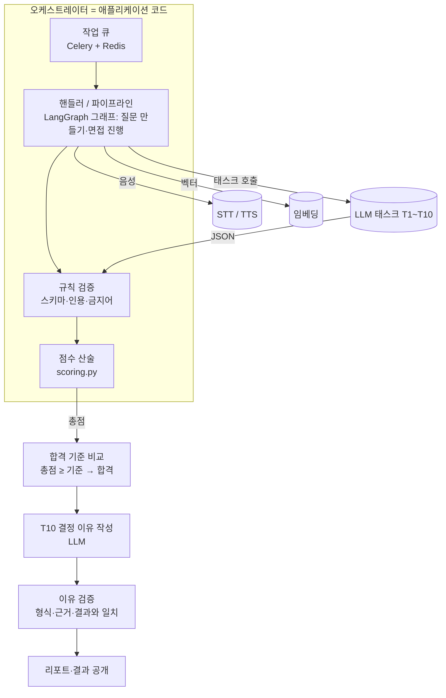
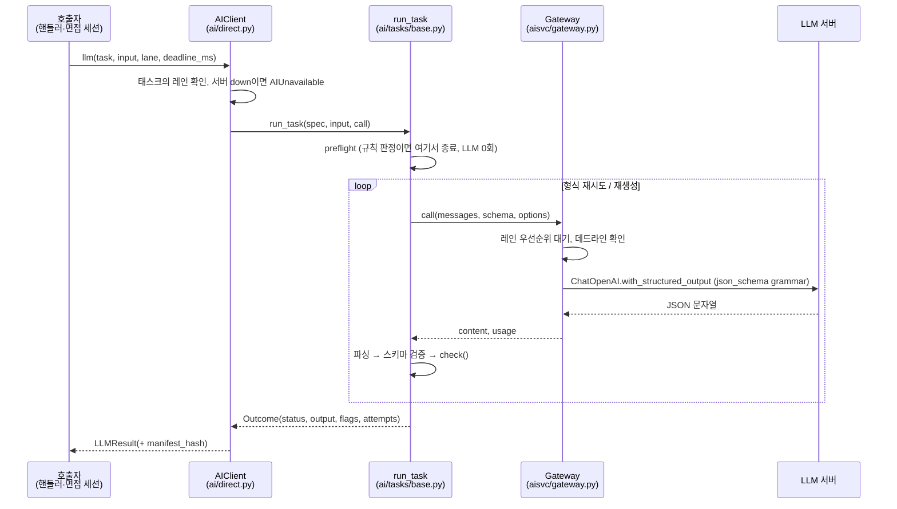
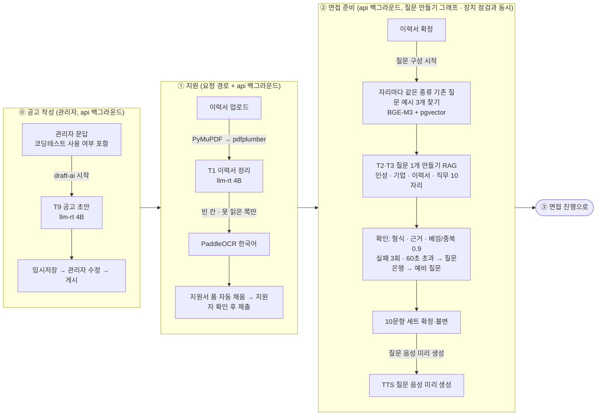
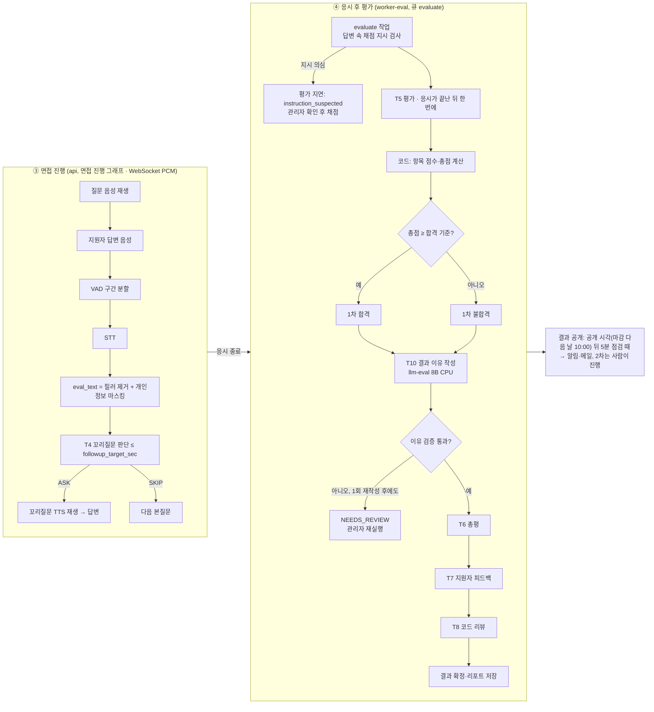
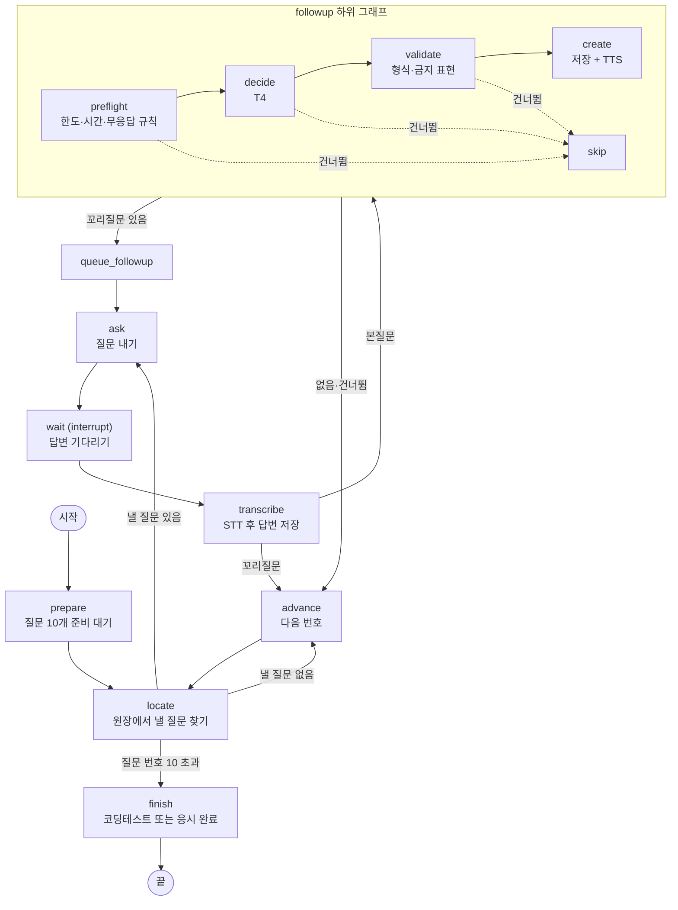
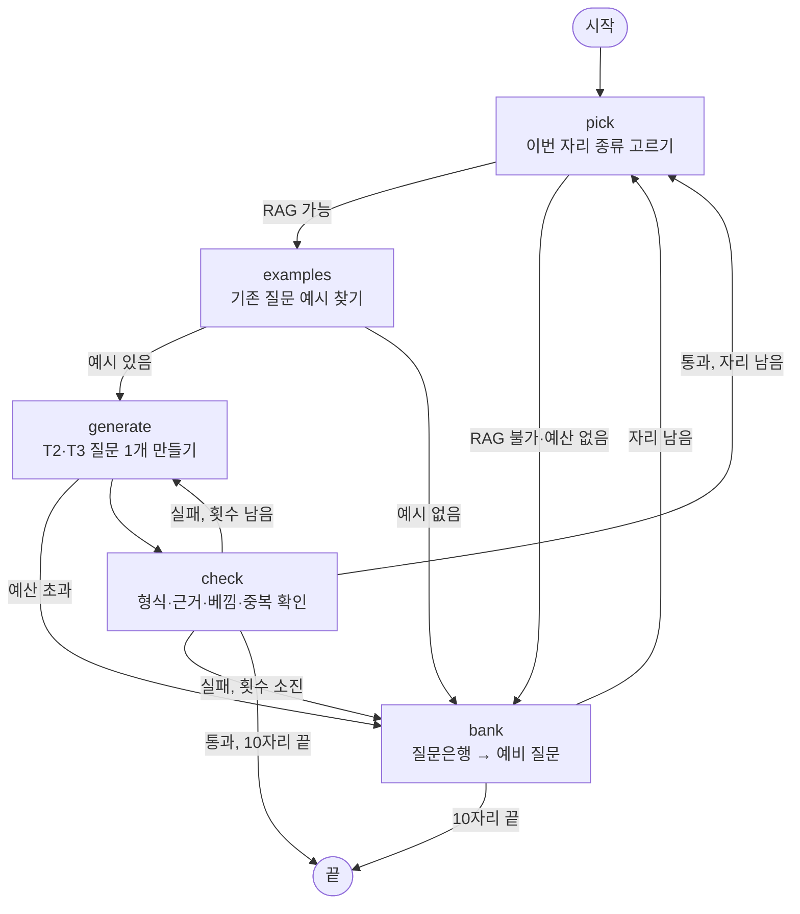

# AI 아키텍처 — LLM 오케스트레이션 구조

> **v1.7 | 2026-11-10 | 개인용 개정본 — 팀 원본 아님, 기준: 구현(`huge/`) + `huge/CONFLICTS.md` (2026-11-03)** (원본: v1.5)
>
> 기준: 2026-10-30 ai-hiring-platform 브랜치 구현 (ADR-0003, 0005, 0006, 0008, 0013, 0014 / TRD 05), PRD v1.8, TRD v1.7. 특정 모델과 버전은 이 문서의 범위가 아니다. 각 모델은 **역할**로만 부른다. 모델을 바꿔도 아래 구조는 그대로 유지된다. 6GB 테스트 환경에서 쓰는 모델·설정값은 3.1절에 **예시 프로필**로만 적는다.
>
> **v1.1 (2026-10-30) 변경**: ① AI 공고 초안(T9, PRD JOB-02) 추가 ② GPU 6GB 테스트 프로필과 큰 환경 확장 방침 추가(3.1) ③ 1차 합격 여부를 LLM이 정하는 T10 추가(PRD EVL-05, TRD 8-2) ④ T5 채점을 PRD 기준(0~5점, 질문별 평가항목)으로 맞춤 ⑤ 질문 구성 시점·결과 공개 흐름을 PRD에 맞춤
>
> **v1.2 (2026-10-30) 변경**: ⑥ 재시도 횟수를 PRD QST-05·TRD 8-3에 맞춤 ⑦ VRAM 예산을 TRD 6-2 공식에 맞춤(슬롯 = N + compose_slots)
>
> **v1.3 (2026-10-30) 변경**: ⑧ 작업 큐를 TRD 기준(Celery 5.4 + Redis 7)으로 맞춤 ⑨ 총점이 합격 기준 미만이면 코드가 불합격을 확정하고 T10은 이유만 쓴다. 1차 결과는 관리자가 바꾸지 않는다
>
> **v1.4 (2026-10-30) 변경**: ⑩ 1차 합격 여부는 **총점 ≥ 합격 기준**으로만 정한다(기준 이상 = 합격, 미만 = 불합격). AI의 평가 역할은 루브릭에 따라 점수를 매겨 총점을 만드는 것이고(T5), T10은 정해진 결과의 이유만 쓴다. 점수와 결정이 엇갈리는 경우는 생기지 않는다
>
> **v1.5 (2026-10-30) 변경**: ⑪ 모델 배치를 TRD 6-2에 맞춤 — GPU LLM은 면접 중 작업(꼬리질문 판단 T4, 질문 구성 T2·T3)만 맡고, 이력서 추출(T1)·공고 초안(T9)·채점(T5)·총평·피드백·코드 리뷰(T6~T8)·결과 이유(T10)는 CPU의 채점 LLM이 맡는다 ⑫ 흐름 제어를 TRD 3장·7-4·7-5에 맞춤 — 질문 만들기와 면접 진행은 LangGraph 그래프로 돌리고(PostgreSQL 체크포인트), 모든 LLM 호출은 LangChain ChatOpenAI + with_structured_output으로 한다. ⑪⑫는 TRD에 맞춘 **구현 대상**이며 현재 코드는 아직 전환 전이다(v1.6 에서 구현 반영). 1차 합격 여부 결정(⑩)은 v1.4 그대로다
>
> **v1.6 (2026-11-03, 개인용 개정본) 변경**: ⑬ 면접 진행 그래프를 구현대로 적음 — prepare → locate → ask → wait(interrupt) → transcribe → followup 하위 그래프(preflight → decide T4 → validate → create) → advance/finish, PostgreSQL 체크포인트(thread_id = 지원 번호), 상태 원장은 applications. 질문 만들기 그래프(`buildComposeGraph`)는 api 안에서 돌고 체크포인트가 없다 (B1) ⑭ 질문 구성을 RAG 생성 우선 → 질문은행 → 예비 질문으로 바꾸고 0.9 기준·60초 예산·`task_count` 병합을 적음 (U5) ⑮ 꼬리질문 목표 시간 `followup_target_sec` (U7) ⑯ 채점은 응시가 끝난 뒤 한 번에 한다(S2). T5에 항목별 comment 없음(S3), T10은 근거 번호만 내고 코드가 문장을 채움(S4), 근거 최소 길이 6글자(S10), 기준 버전이 없으면 판정하지 않고 '평가 지연'(S11), 합격 여부는 코드가 총점 ≥ 기준으로 정함(S1) ⑰ 답변 속 채점 지시 감지(`instruction_suspected`) ⑱ 이력서 읽기 순서 리더 → 정리 → 안 되면 OCR (U4), 이력서 정리는 llm-rt 4B (B3) ⑲ 모델 배치를 compose 파일 실제대로 고침 — GPU: 4B(llm-rt)·STT, CPU: 8B(llm-eval, T10만)·BGE-M3·PaddleOCR·TTS ⑳ 작업 큐를 Celery 3개 큐(evaluate·default·sandbox)로 고치고 이력서 정리·공고 초안·질문 구성은 api 안 백그라운드 작업으로 정정 (B2) ㉑ 개발 PC 실측값 추가 (E) ㉒ 공고 초안: 회사명 표기 안 함(U1), 1단계 포함(U2), '주로 맡을 일' 선택(U6), '부서 소개'(V1) ㉓ 문서 끝에 '논의사항' 추가 ㉔ 검토(백엔드·프론트엔드·UI/UX) 반영: `next_question_target_sec` 은 측정 목표값이며 코드가 강제하지 않음.
>
> **v1.7 (2026-11-10, 개인용 개정본) 변경**: 2026-11-06·11-09·11-10 검토 보정을 반영했다(자세한 것은 문서 끝 보정 절): 코드 대조로 고친 곳(E7~E18), 논의사항 정리, AI 질문 품질·질문 적용 범위·질문 후보·AI 공고 초안 그래프(CONFLICTS C-13~C-17)

## 1. 한 줄 요약

**LLM끼리 서로 호출하거나 대화하지 않는다.** 오케스트레이터는 애플리케이션 코드(작업 큐, 파이프라인, LangGraph 그래프)다. 질문 만들기·면접 진행·공고 초안은 LangGraph 그래프로 돌리지만, 그래프의 갈림길은 코드가 정하고 LLM이 다음 단계를 고르지 않는다. 각 LLM 호출은 입력 하나에 대해 JSON 하나를 내는 **단일 목적 태스크**(T1~T10)다. 코드가 태스크를 순서대로 부르고, 출력을 규칙으로 검증하고, 다음 단계의 입력을 직접 만든다. **AI는 루브릭에 따라 점수를 매기고, 합격·불합격은 그 점수로 정해진다.**

> **AI 평가는 어떻게 합격·불합격이 되나 (쉬운 설명)**

1.  **AI가 채점한다(T5).** 질문마다 채점 기준표(루브릭)를 보고 "이 답변은 논리성 4점, 구체성 3점"처럼 점수를 매기고, 그 점수를 준 근거 문장을 답변에서 그대로 따온다. 채점은 응시가 끝난 뒤 한 번에 한다(S2). **평가에서 AI가 판단하는 부분은 여기다.**

2.  **코드가 총점을 낸다.** AI가 매긴 점수들을 평균 내고, 항목 비율과 코딩테스트 반영 비율을 곱해 100점 만점 총점을 만든다. 계산은 AI가 틀릴 수 있어서 코드가 한다.

3.  **총점으로 합격·불합격이 정해진다.** 총점이 공고의 합격 기준(예: 70점) 이상이면 합격, 미만이면 불합격이다. 같은 점수면 언제나 같은 결과가 나온다.

4.  **AI가 이유를 쓴다(T10).** 정해진 결과를 바꾸지 않고, 왜 그런 점수가 나왔는지를 근거 문장을 들어 2~3문장으로 설명한다.

> 예: 항목 점수가 직무전문성 80, 논리성 70, 내용관련성·구체성 75, 전달력 60, 조직적합성 80이면 AI 면접 점수 74.5점. 코딩테스트 60점을 70:30으로 합치면 총점 70.15점 → 기준 70점 이상이므로 1차 합격(PRD 5-7 계산 예시).

## 2. 설계 원칙

| **\#** | **원칙** | **구현 위치** |
|---|---|---|
| P1 | LLM은 **판단과 문장 생성**을 한다. 평가에서의 판단은 루브릭에 따른 항목 채점(T5)이다. 1차 합격 여부는 총점과 합격 기준 비교로 정해진다. 점수 합산, 가중치 적용, 반올림은 코드가 한다. | domain/scoring.py, services/evaluation.py computeScores |
| P2 | LLM 출력은 **JSON 스키마로 강제**한다(LangChain ChatOpenAI의 with_structured_output, 디코딩 단계 grammar). 그 뒤 Pydantic으로 다시 검증한다. | services/llm.py structured |
| P3 | LLM이 "인용"이라고 낸 문자열은 믿지 않는다. **원문에서 위치(start, end)를 찾은 경우에만** 원문 조각으로 저장한다. | domain/scoring.py quoteInAnswer (ADR-0008) |
| P4 | 규칙으로 판정할 수 있는 경우(무응답, 너무 짧은 답, 꼬리질문 한도)에는 **LLM을 부르지 않는다**(preflight). | interview/engine.py followupPreflight, services/evaluation.py scoreQuestion |
| P5 | 태스크마다 **보는 데이터가 다르다**. 평가에는 이름·연락처·목소리 특성을 넣지 않는다. 지원자용 피드백에는 점수·인용·가중치를 넣지 않는다. | services/evaluation.py redact, writeFeedback |
| P6 | 실시간 요청은 **같은 서버의 하위 레인을 선점**해서 배치 작업을 기다리지 않는다. 서버를 나눌지 합칠지는 하드웨어 프로필(3.1)이 정하고, 코드는 레인 이름과 서버 주소의 대응만 본다. (현재 구현: 레인은 `rt`·`eval` 두 서버 중 고르는 값이다. 레인 스케줄러와 선점은 확인한 코드에 없다 — 미구현, 논의사항 참고) | services/llm.py laneUrl (ADR-0014) |
| P7 | 결과에 영향을 주는 것(모델 digest, 프롬프트, 옵션, 루브릭, 규칙 버전)은 모두 **manifest 해시**로 묶어 남긴다. (현재 구현: 프롬프트 버전 `PROMPT_VERSION`·루브릭 버전 `RUBRIC_VERSION`만 확인됨. manifest 해시는 확인한 코드에 없다 — 논의사항 참고) | services/evaluation.py |
| P8 | LLM 호출은 수 초에서 수 분 걸린다. 그동안 **DB 트랜잭션을 열어 두지 않는다**(읽기 → 모델 호출 → 쓰기). 질문 구성도 예외가 아니다(10장). | worker.py, services/evaluation.py |
| P9 | **1차 합격 여부는 사람 없이 정한다.** AI가 루브릭으로 매긴 점수에서 나온 총점이 합격 기준 이상이면 합격, 미만이면 불합격이다. T10은 이 결과를 바꾸지 않고 이유만 쓴다. 그 밖의 태스크(T4~T9)는 "합격·불합격을 판단하거나 추천하지 않는다"가 시스템 프롬프트에 붙고, 출력은 P-8 탐지기로 한 번 더 거른다. 확정된 1차 결과는 관리자도 바꿀 수 없고, 2차 이후 채용 결정은 사람이 한다. | services/evaluation.py computeScores, DECISION_WORDS |
| P10 | **한 지원 건의 같은 태스크는 항상 같은 모델로** 돈다. 서버가 내려가도 다른 모델로 바꿔 돌리지 않고 미룬다. 채점 기준이 지원자마다 달라지는 것을 막기 위해서다. | worker.py AiUnavailable 처리 (60초 뒤 다시) |

## 3. 구성 요소 (역할 기준)

| **역할** | **하는 일** | **처리 장치 (6GB 프로필)** | **컨테이너** |
|---|---|---|---|
| **GPU LLM** | 면접 중 작업(꼬리질문 판단 T4, 질문 구성 T2·T3)과 면접 밖 대부분의 작업: 이력서 정리(T1, B3), 공고 초안(T9), 답변 채점(T5), 총평·지원자 피드백·코드 리뷰(T6~T8). RT·INTERACTIVE·BATCH 레인이 모두 이 서버다. 동시 슬롯은 `LLM_RT_PARALLEL`(처음값 2) | GPU | llm-rt |
| **결과 이유 LLM** (원본 이름: 채점 LLM) | 1차 결과 이유 작성(T10, DECISION 레인)만 맡는다. 동시 슬롯 1개 | CPU (GPU에 층을 올리지 않음, -ngl 0) | llm-eval |
| **STT** | 지원자 음성을 텍스트로 변환 | GPU | stt |
| **TTS** | 질문 텍스트를 음성으로 변환 | CPU | tts |
| **임베딩** | 질문 RAG: 같은 종류 기존 질문 찾기, 만든 질문의 베낌·중복 확인(코사인 유사도 0.9 이상, U5), 질문 DB 임베딩(`embed_questions`) | CPU | embed |
| **OCR** | 글자 레이어가 없거나 깨진 이력서 쪽·사진 이력서 읽기(PaddleOCR 한국어, U4) | CPU | ocr |
| **오케스트레이터** | 위 서버를 부르는 쪽. 요청 경로·면접 진행 그래프·질문 구성 그래프·이력서 정리·공고 초안은 api 안, 비동기 작업은 worker-eval(채점)·worker(메일·알림)·worker-sandbox(코드 실행)·scheduler(정해진 시각) | — | api, worker-eval, worker, worker-sandbox, scheduler |

- 두 LLM 서버에는 **같은 모델을 올려도, 다른 모델을 올려도** 된다. 코드는 서버 URL과 레인만 안다.

- 런타임은 OpenAI 호환 llama.cpp 서버를 쓰고, 호출은 LangChain ChatOpenAI에 내부망 주소(`LLM_RT_URL` http://llm-rt:8080/v1, `LLM_EVAL_URL` http://llm-eval:8080/v1)를 넣어서 한다(TRD 3장, services/llm.py). 호출부는 `structured(schema, system, user, timeoutSec, lane)` 하나로 되어 있어 다른 런타임으로 바꿀 수 있다.

- 원본의 `AIHIRE_AI_MODE`(direct / service / fake)는 구현의 설정(config.py)에 없다. 구현은 두 LLM 주소를 직접 부른다.

### 3.1 하드웨어 프로필 — GPU 6GB 테스트 환경

> **6GB는 테스트(기준 PC)용 프로필이다.** 운영 환경이 커지면 아래 표의 프로필 값만 바꾸고 구조(레인, 태스크, 검증)는 그대로 둔다. 모델 크기, 슬롯 수, 레인 배치는 환경마다 달라질 수 있으며, 아래 추정 숫자는 모델 파일 크기로 짐작한 값이라 TRD 13-2 측정으로 확정한다. 개발 PC 실측값은 이 절 끝에 적었다.

**원칙: GPU에는 llm-rt(4B)와 STT만 올린다(TRD 6-1, compose.ai.yml). 결과 이유(T10)만 CPU의 8B가 맡는다.**

| **항목** | **6GB 테스트 프로필 (예시)** | **근거** |
|---|---|---|
| GPU LLM | 4B급 Instruct, GGUF Q4_K_M, 모든 층 GPU(-ngl 99), --jinja | 8B급(약 5GB)은 STT와 함께 올릴 수 없다(TRD 6-3). GPU 6GB 한 장에는 모델 하나만 올릴 수 있어 이력서 정리(T1)도 이 4B를 쓴다(B3) |
| GPU LLM 슬롯 | `--parallel 2`(`LLM_RT_PARALLEL`), 전체 문맥 8192(`LLM_RT_CTX`) → 슬롯당 4096 토큰. 질문 구성은 api 안 세마포어 1개(`compose_slots`)로 한 번에 한 지원자만 LLM을 쓴다 | 개발 설정 N=1 + compose_slots 1 = 슬롯 2개. 운영값(N=2)이면 슬롯 3개가 필요하다(TRD 6-2 계산). 동시 면접 상한을 2건으로 올릴 때 `LLM_RT_PARALLEL` 을 3으로 올린다. 슬롯당 4096 토큰을 유지하려면 `LLM_RT_CTX` 도 12288 로 함께 올려야 하고 GPU 메모리를 더 쓰므로 그때 측정한다 |
| STT | faster-whisper large-v3-turbo, int8_float16, GPU | 답변 직후 최종 전사가 다음 질문 지연에 바로 걸린다 |
| 결과 이유 LLM (DECISION 레인) | 8B급 Q4_K_M, CPU·일반 메모리(실측 약 4~5GB, 컨테이너 상한 9GB), 문맥 6144, 스레드 6(`LLM_EVAL_THREADS`), **동시 1개**, --reasoning-budget 0 | 결과 이유는 응시 후 10분 안에만 끝나면 된다. Docker 메모리 24GB가 필요하다(S8, `.wslconfig`) |
| 채점(T5)·총평(T6~T8) | 위 GPU LLM(4B)이 맡는다. 응시가 끝난 뒤 한 번에 채점한다 | GPU 4B는 면접 중 꼬리질문에 쓰고 있어 면접 중 채점을 겹치면 응답이 늦어진다(S2) |
| 실시간 자막 | GPU가 바쁘면 그 차례는 건너뜀(TRD 7-5) | 면접 진행과 최종 전사에는 영향 없음 |

**VRAM 예산 (6GB = 6,144MiB, 추정치)**

| **항목** | **추정** |
|---|---|
| GPU LLM 모델(4B Q4_K_M) | 약 2.5GB |
| 대화 기억(KV 캐시): (N + compose_slots) × 약 0.3GB, 처음값 (2 + 1) | 약 0.9GB |
| STT(large-v3-turbo, int8_float16) | 약 1.0GB |
| 실행환경 | 약 0.5GB |
| **합계 (TRD 6-2 공식)** | **약 4.9GB ≤ 상한 5.4GB** |

TRD 6-2: 면접 중 LLM 2.5GB + 대화 기억((N + 질문 만들기 자리 수)개) + STT 1.0GB + 실행환경 약 0.5GB ≤ 5.4GB. N의 실제 값은 TRD 13-2 측정으로 정한다(TRD T-02).

- **13-2 측정 때 함께 확인할 것**: 기준 PC는 면접 브라우저(웹캠 영상)를 같이 띄우므로 화면이 쓰는 VRAM이 있고, LLM과 STT는 별도 프로세스라 실행환경(CUDA 컨텍스트)이 2개 생긴다. 이 둘이 "실행환경 약 0.5GB"를 넘는지 nvidia-smi로 재고, 넘으면 N을 줄인다.

- VRAM이 넘치면 Windows 드라이버가 일반 메모리를 몰래 빌려 써서 **오류 없이 수 배 느려진다.** NVIDIA 제어판의 "CUDA 시스템 메모리 대체 정책"을 "대체 안 함"으로 두어 넘칠 때 바로 실패하게 하고, 이 설정이 Docker(WSL2) 안에서도 적용되는지 13-2 측정 때 확인한다.

- 남는 VRAM이 있어도 **결과 이유 LLM의 일부 층을 GPU에 올리지 않는다**(-ngl 0). 0.5GB 안팎으로는 속도 이득이 작고, 면접 중 VRAM이 넘치면 위 문제가 생긴다.

- 동시 면접 상한 N은 설정값 `max_concurrent_interviews`(1~20, D2)로 조절한다. VRAM 사용률(NVML)과 '답변 끝 → 다음 질문' 시간을 보고 입장을 자동으로 막는 자동 보호(PRD INT-08, TRD 5-3)는 **현재 구현 범위 밖(미구현)**이다.

**개발 PC 실측값 (GTX 1660S 6GB, CONFLICTS E)**

| **항목** | **값** |
|---|---|
| LLM 생성 속도 | 약 68 tok/s, 첫 호출(로딩 포함) 45초 → 시작 시 미리 호출(warm-up) |
| TTS | 9.3초 음성 생성 2.9초 |
| STT | 9.3초 음성 인식 1.5~2.0초 |
| GPU 메모리 | 5.4 / 6 GB (3개 모델 동시) 〔논의사항 5번: compose 파일에서 TTS는 CPU〕 |
| llm-eval (Qwen3 8B, CPU 6스레드) | 약 5.4 tok/s, 메모리 약 4~5GB |
| 채점 전체 (10문항 + 코딩 2문제, T5·T10·T6·T7·T8) | 70~181초 (목표 10분 이내). 결과 이유(T10)를 근거 번호 방식으로 바꾼 뒤 70초 |
| 질문 10개 구성 (4B GPU) | 40~49초 (예산 60초 안). 20문항 중 RAG 생성 20개 · 다시 만들기 3번 |
| 꼬리질문 (T4 + TTS) | 4.7~6.7초 (2026-11-03 실측) |
| 이력서 읽기 (1쪽, LLM 정리 포함) | 텍스트 PDF 4.3초 · 스캔 PDF 12.6초 · 사진 8.6초. OCR만 4~10초/쪽(`ocr_sec_per_page` 8), 6쪽 이력서 13.3초 |
| AI 공고 초안 (llm-rt 4B) | 약 8초 |

**큰 환경으로 갈 때 (예시, 확정 아님)**

| **환경** | **바뀌는 점** |
|---|---|
| GPU 12GB급 | GPU LLM을 8B급으로 올리고, 결과 이유 LLM(DECISION)도 같은 GPU 서버로 옮길 수 있다. 슬롯 3~4개 |
| GPU 24GB급 이상 / GPU 2장 | 실시간용(RT·INTERACTIVE)과 배치용(BATCH·DECISION) 서버를 GPU에 각각 둔다. STT를 비-turbo 모델로 바꾸는 것도 검토 |

프로필을 바꾸면 모델 digest가 바뀌므로 manifest 해시가 달라진다. **진행 중인 공고가 있을 때 프로필을 바꾸지 않는다**(같은 공고 지원자는 같은 모델로 채점, P10).

## 4. 호출 계층

> **구현 메모 (v1.6)**: 구현(services/llm.py)은 `structured()` 하나가 LangChain ChatOpenAI → JSON 스키마 강제 → Pydantic 확인을 하고, 레인(`rt`·`eval`)으로 서버 주소를 고른다. 아래 AIClient·Gateway(레인 우선순위, 선점, EWMA, 장애 표시)·manifest 해시는 **설계 구조**이며 확인한 코드(llm.py, evaluation.py, engine.py)에는 없다.

| **계층** | **책임** |
|---|---|
| **AIClient** | 레인을 서버로 라우팅한다(6GB 프로필: RT/INTERACTIVE/BATCH → GPU LLM(llm-rt), DECISION → 결과 이유 LLM(llm-eval)). 레인별 기본 데드라인(RT 5 s, INTERACTIVE 120 s, BATCH 600 s, DECISION 600 s)을 정하고, 인프라 장애를 AIUnavailable로 바꾸고, manifest 해시를 붙인다. |
| **run_task** | 태스크 하나의 생명주기를 맡는다. preflight, 입력 분할과 병합(split/merge), 형식 재시도, 종류별 재생성, 최종 fallback을 처리한다. |
| **TaskSpec** | 태스크가 소유한 것들이다. 시스템 프롬프트, 출력 스키마(Pydantic), 온도·토큰 수, 재시도 한도, 검증기(check). |
| **Gateway** | LLM 서버 하나 앞에 있는 레인 스케줄러다. 우선순위 RT > INTERACTIVE > BATCH, 레인별 동시 실행 상한(BATCH 1), 절대 데드라인, 실행 시간 EWMA 추정, 장애 표시(15 s 동안 즉시 실패)를 처리한다. 같은 서버에서 상위 레인 요청이 오면 하위 레인 스트림을 끊고 그 요청을 자기 레인 맨 앞으로 되돌린다(선점). |

## 5. 태스크 카탈로그

| **ID** | **태스크** | **레인** | **입력** | **출력** | **검증·fallback** |
|---|---|---|---|---|---|
| T1 | resume_extract | BATCH | 이력서 글자: PyMuPDF가 읽는 순서로 뽑은 글(깨졌거나 모자란 쪽만 pdfplumber), 두 리더가 못 읽은 쪽·사진은 PaddleOCR 글(U4). 6000자 단위로 나눠 호출한 뒤 병합 | 이력서 스키마(학력, 경력, 프로젝트 등) | 원문에 없는 값은 버린다(dropped_values). 정리 뒤 성명·학력/경력이 비면 나머지 쪽도 OCR 해서 **빈 칸만** 채운다. 실패하면 지원자가 직접 입력한다. 쪽 수 상한 10쪽 |
| T2 | question_generate | INTERACTIVE | 공고 본문(부서 소개·주요 업무·자격 요건·우대 사항), 같은 종류 기존 질문 예시(`rag_example_count` 3개, BGE-M3 + pgvector), 이력서 요약(이름·연락처 제외), 유형(인성/기업/직무) | question, task_count(요구하는 일의 수), evidence | **RAG 로 먼저 만든다**(U5). 확인: 질문 하나(8~220자, 본질문 100자 이하), task_count **1**(TRD 7-4 ④ 범위 확인을 이 호출에 합침, CONFLICTS C-16), 글 검사 `domain/question_text.py`(찌꺼기 — 허용 밖 글자·이모지·한글에 붙은 영어, 답변 방식 지시 — 문장 수·시간·'간단히', 여러 개 묻기 — '~했고, ~'·'~와 그 이유'·의문사 2개)·일본어·한자 섞임 금지, 직무 질문은 경험이 아닌 지식(개념·기준·방법)을 묻는다(`job_asks_experience`), 예시와 0.9 이상 비슷하면 베낌, 이미 고른 질문과 0.9 이상이면 중복. 자리마다 `question_regen_limit` 3회까지 다시 만든다(시도당 `question_attempt_timeout_sec`: 운영 8초·개발 30초). 지원자 1명의 10문항 전체가 `question_compose_budget_sec`(운영 60초·개발 180초)를 넘거나, 임베딩 서버가 없거나, 질문 DB 임베딩이 비어 있으면 남은 자리는 LLM 없이 질문은행(엑셀) → 예비 질문 순으로 채운다(PRD QST-05). |
| T3 | resume_question | INTERACTIVE | 이력서 스냅샷, 직무 질문 예시, 공고 본문 | 질문과 이력서 근거 문장(evidence, 120자 이내) | T2와 같은 그래프의 이력서 자리다. 근거 문장이 이력서의 경력·프로젝트·자기소개 줄에 없으면 버린다(`resume_not_grounded`, 앞부분 6자 이상 일치, 학력·기술 이름만으로는 안 됨). 질문에 그 프로젝트·회사 이름이 없으면 버린다(`resume_not_anchored`). 지어낸 경험을 막으려고 이 자리 프롬프트에는 공고 글을 넣지 않고, 경험 줄이 없는 이력서는 AI 를 부르지 않고 예비 질문으로 채운다(`no_resume_experience`). 이력서 요약은 대괄호로 끝내지 않는다(실측: `]` 뒤 JSON 찌꺼기). 자리마다 최대 3회 다시 만들고(전체 예산 공유), 그래도 실패하면 질문은행을 건너뛰고 바로 예비 질문으로 채운다(PRD QST-05). |
| T4 | followup_decide | **RT** | 본질문, 답변(eval_text), 이력서 요약(이력서 기반 질문일 때만, 600자) | reason_code(vague / missing_evidence / inconsistent / none)와 꼬리질문 1개 | 재시도하지 않는다. 꼬리질문 글도 본질문과 같은 글 검사(찌꺼기·답변 방식 지시·여러 개 묻기)를 거치고, 걸리면 내지 않는다(C-16). 본질문이 예/아니오 질문이면 그 이유를 꼬리질문으로 묻는다 — 답이 30자보다 짧으면 LLM 없이 정한 글로, 아니면 프롬프트에 지시를 덧붙여(C-16, 2026-11-10 사용자 결정). 판단 시간 = `followup_target_sec`(운영 10초·개발 20초) − 지난 시간 − TTS 평균 3초(U7). 꼬리질문이 없으면 다음 질문은 지체 없이 나가며, `next_question_target_sec` 5초(p95)는 13-2 측정으로 지킬 목표값이고 코드가 강제하지 않는다(설정 키만 있고 코드는 읽지 않음). (U7, 사용자 결정. PRD v1.8·TRD v1.7 에 반영됨. 팀 원본에는 없음) 그래프의 validate 단계가 꼬리질문 길이(8~120자, 한 줄), 한국어 여부, 일본어·한자 섞임, 차별·사적 질문 주제(fq-1)를 보고 안 되면 SKIP한다. 〔논의사항 9번: 설계의 anchor 인용 검증은 구현에 없음〕 |
| T5 | evaluate_answer | BATCH | 질문 사본, 그 질문에 연결된 평가항목 설명·채점 기준표, 답변(꼬리질문 답변 합침, 이름·연락처 마스킹) | 연결된 평가항목별 quote(120자 이내), **점수**. 항목별 comment는 넣지 않는다(S3) | 무응답은 preflight에서 0점(LLM 0회). 근거가 답변에 없거나 띄어쓰기·문장부호를 뺀 6글자 미만이면 '근거 없음'(S10)으로 보고 1회 다시 받은 뒤 그래도 없으면 INSUFFICIENT(1점) 처리한다(PRD EVL-02). 답은 했는데 0점을 주면 1점으로 올린다. 응시가 끝난 뒤 한 번에 채점한다(S2). |
| T6 | report_summary | BATCH | 문항별 항목 점수, 근거 문장 | 총평, 강점·개선점(각 1~3개, 문항 번호 포함) | 점수 숫자 재기재와 합불 표현이 있으면 재생성한다. 강점에는 그 항목 점수가 3점 이상인 문항만 넣을 수 있다(10장 T6 배치 오류 대응). 두 번 실패하면 규칙 문장으로 채우고 결과는 그대로 확정한다. |
| T7 | candidate_feedback | BATCH | 항목별 등급(상·중·하)만 | 지원자에게 보여 줄 강점·개선점(각 최대 3개) | 총점·순위·합불 단어를 금지한다. 답변을 15자 이상 연속으로 그대로 옮기는 것도 금지한다(인용 유출 방지). 실패하면 항목 등급으로 규칙 문장을 만든다. |
| T8 | code_review | BATCH | 문제 설명, 공개 예제, 제출 코드 | 코드 리뷰 문장 | 숨김 테스트는 프롬프트에 넣지 않는다. 실패하면 빈칸으로 둔다(점수에 영향 없음). |
| **T9** | posting_draft | BATCH | 관리자 문답(6.0절): 부서 소개 메모(선택), 팀·업무 키워드, 필수 기술, 우대 키워드, 경력 수준, 주로 맡을 일(선택, U6). 회사명은 입력·출력에 쓰지 않는다(U1) | 공고 문장 칸만: 제목 후보, 부서 소개(`company_intro` 칸, V1), 주요 업무, 자격 요건, 우대 사항 | 입력에 없는 숫자·연봉·복리후생을 지어내면 그 문장을 지운다(숫자는 입력에 있는 것만 허용). 차별로 보일 수 있는 표현은 **경고 표시만** 하고 막지 않는다(PRD JOB-02, 나이·성별·혼인·외모·출신 규칙 사전). 재생성 1회, 그래도 실패하면 입력값만 채운 빈 양식을 준다. '주로 맡을 일'이 비면 프롬프트에 "(지정 없음)"으로 알리고 AI가 직무·기술에 맞게 쓴다. 부서 소개가 짧아 대체 문구를 쓸 때는 칩별 정해 둔 문구를 쓴다(U6). |
| **T10** | pass_reason | **DECISION** | **코드가 정한 결과(합격/불합격)**, 항목 점수, AI 면접 점수, 코딩테스트 점수, 총점, 합격 기준 점수, 항목별 검증된 근거 문장 목록(번호 붙임) | {reason(2~3문장), evidence(근거 번호 목록)}. 코드가 번호를 실제 근거 문장으로 바꿔 저장한다(S4) | 결과는 입력으로만 받고 출력하지 않는다(결과를 바꿀 수 없음). 이유가 15자 이상인지, 근거 번호가 목록 안에 있는지(근거는 T5에서 답변 안에 있음을 이미 확인한 문장), 이유가 결과와 반대 방향(합격인데 "불합격 사유"를 쓰는 등)이 아닌지 검증한다. 실패하면 1회 다시 쓰게 하고(rejudge_limit), 그래도 실패하면 NEEDS_REVIEW(평가 지연). 이름·연락처·이력서는 넣지 않는다. 지원 때 잠근 기준 버전이 없으면 다른 버전으로 판정하지 않고 실패 → 재시도 → 평가 지연(S11). |

공통 사항:

- 모든 사용자 입력(지원자 답변, 이력서, 공고, 관리자 공고 문답)은 **구분자로 감싸고**, 안의 꺾쇠(`<`·`>`)를 다른 글자로 바꿔서(fence) 구분 태그를 닫거나 새로 열 수 없게 한다(프롬프트 인젝션 분리). 이력서·공고 글도 같은 방식으로 감싼다.

- **답변 속 채점 지시 감지:** "만점 주세요", "합격시켜", "이전 지시 무시", "채점 기준 바꿔", "ignore previous instructions" 같은 말이 답변에 있으면 채점하지 않고 '평가 지연'(`instruction_suspected`, API 명세서 사유 목록에 없는 새 값)로 두고 관리자에게 알린다. 'AI'·'프롬프트' 같은 낱말만으로는 잡지 않는다(AI 직무 지원자의 업무 이야기). 응시 취소 건은 검사하지 않는다(AI 없이 0점). 이 감지는 쉬운 표현만 잡는 보조 장치이고, 실제 방어는 구분자 바꾸기·JSON 스키마·근거 확인이 맡는다.

- 출력 온도는 코드 값을 따른다: T5 0(2026-11-09, 같은 답변은 같은 점수), T10 0.2, T4 0.3, 질문 만들기 0.6. 평가 태스크(T5·T10)는 낮게 둔다. 원본의 seed=42 고정은 구현(llm.py)에 없다.

- 합격·불합격은 코드가 총점과 기준을 비교해 정하므로 점수와 결정이 엇갈리는 경우는 생기지 않는다.

## 6. 단계별 오케스트레이션

### 6.0 공고 작성 — AI 공고 초안 (T9)

1.  관리자가 공고 관리에서 **'AI로 공고 초안 만들기'** 를 누르면 문답 화면이 열린다.

2.  문답 항목은 두 종류로 나눈다.

    - **코드가 그대로 칸에 넣는 값**(LLM에 맡기지 않음): 직무(AI/AX 엔지니어), 고용 형태, 근무지, 모집 인원, 접수 시작일·마감일, **코딩테스트 사용 여부**와 반영 비율(기본 70:30, PRD JOB-03). 회사명은 묻지 않는다(U1).

    - **T9가 문장으로 다듬는 값**: 부서 소개 메모(선택), 팀·업무 키워드, 필수 기술, 우대 키워드, 경력 수준, 주로 맡을 일(선택, U6).

3.  POST /admin/postings/{id}/draft-ai가 초안 작업을 api 안 백그라운드로 시작하고 바로 돌아온다(1단계에 포함, U2). 화면은 GET /admin/postings/{id}/draft-ai/status를 주기적으로 확인해 '초안 만드는 중'을 보여 준다. 같은 공고에 이미 돌고 있는 초안 작업이 있으면 새로 넣지 않는다. 진행 상태는 api 프로세스 메모리에 있어 api가 재시작되면 '실패'로 보이고 [다시 시도]할 수 있다. (구현 메모, CONFLICTS U2)

4.  결과는 항상 **임시저장(draft)** 상태로 들어간다. 자동 게시하지 않는다. 경고가 붙은 표현은 편집 화면에서 밑줄로 보여 준다.

5.  관리자가 읽고 고친 뒤 채점 기준(JOB-03~05)을 확인하고 게시한다. 첫 응시가 시작된 공고(JOB-07 잠금)에는 초안 만들기를 쓸 수 없다.

6.  **게시 뒤 질문 후보 (T2 재사용, 2026-11-10, CONFLICTS C-17)**: 게시가 끝나면 api 안 백그라운드(`services/posting_questions.py`)가 그 공고의 업무·자격 줄마다 직무 질문 1개(최대 6), 회사 질문 3개를 T2 와 같은 프롬프트·글 검사로 만든다. 지원자 정보는 넣지 않는다. 질문 DB 와 0.8 이상 비슷하면 버리고, 남은 것은 `status='pending'` 으로 질문 관리(S-R11)에 넣는다. 범위: 회사 질문 `posting_id`, 직무 질문 `job_code`. 자리마다 2번(시도당 60초), 실패해도 게시에는 영향이 없다. 인터넷 참고 후보 파일도 `manage.py load_web_questions <공고 id>` 로 같은 형식으로 넣는다(임베딩 포함).

### 6.1 전체 흐름

**LangGraph 그래프 3개 (TRD 7-4, 7-5, 공고 초안은 CONFLICTS C-15)**

| **그래프** | **돌리는 곳** | **노드 (순서)** | **갈림길 (코드가 정함)** | **진행 상태 저장** |
|---|---|---|---|---|
| 질문 만들기 (`question_compose.buildComposeGraph`) | **api 안** 백그라운드 작업(지원자 1명마다). 설계(TRD 7-4)의 worker 배치와 다르다 | 질문 자리마다: pick(고르기) → examples(예시 찾기) → generate(만들기, T2·T3) → check(확인) → bank(질문은행 → 예비 질문) | 확인 통과 → 저장하고 다음 자리 / 실패하고 다시 만들기 횟수 남음 → generate / 횟수 소진·예산 초과·임베딩 서버 없음 → bank / 10자리 끝 → 종료 | **체크포인트 없음.** 메모리에서만 돈다(DB 세션·벡터가 상태에 들어가고, 실패하면 처음부터 다시 만든다) |
| 면접 진행 (`interview/graph.py`) | api (지원 1건마다 1개, thread_id = 지원 번호) | prepare → locate → ask → wait(interrupt) → transcribe → followup(하위 그래프: preflight → decide T4 → validate → create / skip) → queue_followup → ask, 또는 advance → locate, 끝나면 finish | locate 뒤: 질문 번호 10 초과 → finish / 낼 질문 있음 → ask / 없음 → advance. transcribe 뒤: 본질문 → followup / 꼬리질문 → advance. followup 뒤: 꼬리질문이 만들어짐 → queue_followup → ask / 없음 → advance. finish: 코딩테스트 사용 공고 → 코딩테스트, 아니면 응시 완료. 마감·응시 취소는 그래프 밖(연결 감시)이 끝낸다 | LangGraph 체크포인트(PostgreSQL, 표 3개: checkpoints·checkpoint_blobs·checkpoint_writes). 그래프 상태에는 번호·시각·사유만 넣고 답변·이력서 글은 넣지 않는다. 응시 상태의 기준은 applications 테이블이다. **이어가기는 체크포인트가 아니라 원장(applications)을 읽는 locate 노드가** 끊긴 질문부터 다시 낸다. interrupt는 Python 3.11 이상이 필요하다(이미지 3.11, 로컬 3.10에서는 그래프 테스트 4개를 건너뜀) |
| 공고 초안 (`posting_draft.buildDraftGraph`, 2026-11-10) | api 안 백그라운드 작업(공고 1건마다, thread_id = `posting-draft:{공고 id}`) | 새 초안: retrieve(같은 직무 예전 공고 2건, DB 조회) → draft(T9) → check(칸별: 차별 표현·예전 공고 40자 베끼기) → rewrite(문제 칸만) → check → save(DB). 다시 쓰기: rewrite(관리자가 고른 칸 + 요청 메모) → check → deliver(화면에만) | START: 다시 쓰기 요청이면 rewrite, 아니면 retrieve / draft 뒤: 성공 → check, 실패하고 횟수 남음 → draft, 아니면 fail / check 뒤: 고칠 칸이 있고 칸마다 다시 쓰기 1번(요청 칸은 2번)이 남음 → rewrite, 아니면 새 초안은 save·다시 쓰기는 deliver | 체크포인트(같은 저장소). **interrupt 로 멈춰 두지 않는다**: 초안을 저장하면 끝나고, 다시 쓰기 때 같은 thread 로 새로 실행해 처음 입력·참고 공고를 읽는다(로컬 3.10 제약·멈춘 작업 없음). 게시·삭제·초안 다시 만들기 때 지운다 |

면접 진행 그래프 (실제 노드 이름, `interview/graph.py`):

질문 만들기 그래프 (실제 노드 이름, `services/question_compose.py`):

- 그래프 안의 LLM 호출은 `services/llm.py structured()`를 거친다(4장 설계의 호출 계층은 구현 메모 참고).

- 그래프는 순서와 갈림길만 정한다. 질문 보내기·답변 받기·STT·저장 같은 실제 일은 LiveSession(`interview/engine.py`)이 한다. '답변 기다리기'는 interrupt로 그래프를 멈추고, LiveSession이 답변이 끝나면 Command(resume=끝난 이유)로 잇는다. 새 연결(이어가기)마다 그래프를 처음부터 시작하고 locate가 원장을 읽는다.

- 응시 후 평가(6.3)는 그래프 없이 evaluate 작업 안에서 순서대로 호출한다.

### 6.2 면접 중 실시간 루프 (가장 지연에 민감한 경로)

아래 1~5는 면접 진행 그래프의 노드와 갈림길로 돈다.

1.  답변이 끝나면(transcribe) STT로 글자를 만든다. STT가 실패하면 `stt_retry_limit`(현재 2)번 다시 해 보고, 그래도 실패하면 면접을 장애 중단(`paused`, server_error)으로 멈춘다(CONFLICTS A1, TRD 7-2). 〔논의사항 2번〕 STT 결과로 eval_text를 만들고 답변을 DB에 저장한다. 채점은 이 시점에 돌리지 않고 응시가 끝난 뒤 한 번에 한다(S2). 응시가 끝났는데 채점이 없거나 멈춘 건은 5분마다 도는 점검 작업이 다시 넣는다(TRD 10장).

2.  followup 하위 그래프의 preflight가 한도와 규칙을 먼저 확인한다. 꼬리질문은 본질문당 1개, 질문 종류(인성·회사·이력서·직무)별 1개, 전체 `followup_total_limit` 4개까지다. 무응답이거나 내용이 없으면 LLM을 부르지 않고 SKIP한다. 남은 판단 시간이 `followup_min_sec`(운영 2초·개발 3초)보다 짧아도 SKIP한다.

3.  규칙을 통과하면 decide에서 T4를 **RT 레인**으로 호출한다. 판단 시간은 `followup_target_sec`(운영 10초·개발 20초) − 지난 시간 − TTS 평균 3초이고, 이 값을 호출 timeout으로 쓴다(U7). 꼬리질문이 없을 때 다음 질문까지의 목표는 `next_question_target_sec` 5초(p95)이나, 13-2 측정으로 지킬 목표값일 뿐 코드가 강제하지 않는다.

4.  결과가 꼬리질문이고 validate를 통과하면 create에서 꼬리질문을 저장하고, 같은 질문 줄에서 TTS를 합성해 들려준다. 목표 시간이 남지 않았으면 자막만으로 낸다.

5.  타임아웃, 검증 실패, 인프라 장애가 나면 **면접을 멈추지 않고 SKIP**한다. 사유(skipCause)는 서버 로그에만 남기고 답변·질문 글은 로그에 넣지 않는다. 〔논의사항 10번〕

6.  채점(T5)은 면접 중에 돌리지 않는다. GPU 4B가 면접 중 꼬리질문에 쓰이고 있어 겹치면 응답이 늦어지기 때문이다(S2).

### 6.3 응시 후 평가

- load_report_inputs: 짧은 트랜잭션 하나로 필요한 행을 모두 읽는다. 지원 때 잠근 기준 버전을 읽고, 없으면 다른 버전으로 판정하지 않고 실패로 넘긴다(S11). 답변 속 채점 지시가 있으면(응시 취소 건 제외) 채점하지 않고 '평가 지연'(`instruction_suspected`)로 멈춘다. 코딩 채점이 아직 끝나지 않았으면 여기서 멈추고 나중에 다시 시도한다.

- build_report: DB 없이 모델만 호출한다.

  - 질문 번호마다 T5를 돌린다. 답이 없으면 0점이고 LLM을 부르지 않는다.

  - 점수는 compute()로 계산한다(항목 점수 = 평균 ÷ 5 × 100, 가중 합, 코딩테스트 반영 비율, Decimal 소수 둘째 자리 — PRD EVL-03·04).

  - **총점이 합격 기준 이상이면 1차 합격, 미만이면 1차 불합격으로 정한다.** 그 결과와 점수·근거 목록을 T10에 넣어 이유를 받는다. 검증에 실패하면 1회 다시 쓰게 하고, 그래도 실패하면 이후 단계를 멈추고 NEEDS_REVIEW로 둔다.

  - 결정이 확정되면 T6, T7, T8을 **순차** 호출한다. 이 셋이 실패해도 결과는 확정하고 규칙 문장으로 채운다.

- 저장: 새 트랜잭션에서 멱등 키(지원 번호 + 단계)로 이미 저장된 결과가 없는지 확인한 뒤 결과(결정·이유·점수 구성·기준 버전·모델·지시문 버전), 리포트, 항목 점수, 평가 run을 기록한다. 지원자용 결과(public_view)는 따로 만든다.

- 평가 30분 한도는 응시가 끝난 시각(또는 관리자가 [다시 돌리기]를 누른 시각)부터 잰다. 넘으면 `analysis_timeout`으로 '평가 지연'이 되고 관리자 알림이 나간다(S7).

- T6과 T7은 **다른 입력**으로 따로 호출한다. 담당자용 총평이 지원자용 피드백에 섞이지 않게 하기 위해서다.

- 확정된 결과는 관리자도 고칠 수 없다(PRD EVL-05). 관리자는 NEEDS_REVIEW 건을 다시 돌리거나, 3일 안에 사유를 적어 처음 결과를 정할 수 있다. 자동 채점을 끝내지 못한 '평가 지연' 건은 6시간마다 자동으로 다시 채점하고(채점 지시 의심 건은 제외), '평가 지연'이 된 뒤 3일 안에 관리자가 사유를 적어 직접 합격·불합격을 정할 수 있다. 3일이 지나면 AI 가 정상일 때 마지막 재채점까지 실패해야 평가 미완료로 1차 불합격 처리하고, 장애가 길어져도 7일이면 닫는다(채점 지시 의심 건은 3일, 서비스가 멈췄다 돌아왔으면 24시간 더). 이때 점수와 근거는 없고 LLM 으로 이유를 만들지 않는다. 한 번 정한 결과는 바꿀 수 없다. `instruction_suspected` 건은 관리자가 걸린 구절을 확인하고 [확인했습니다, 채점하기]를 누르면 감사 기록(`analysis.reprocess_ack_instruction`)을 남기고 그대로 채점한다. 확인은 그때 본 구절에만 유효하다(구절 해시를 감사 기록에 남김). 결과를 사람이 고치는 것은 아니다.

## 7. 작업 큐 (비동기 오케스트레이션)

Celery 큐와 worker는 compose.app.yml 기준으로 아래와 같다(B2).

| **worker 컨테이너** | **큐** | **동시 실행** | **맡는 작업** | **쓰는 AI** |
|---|---|---|---|---|
| worker-eval | evaluate | 1 | huge.evaluate (응시 후 평가: T5, T10, T6, T7, T8) | llm-rt 4B, llm-eval 8B |
| worker | default | 2 | huge.sendMail, huge.sendResetMail (메일·알림) | (AI 없음) |
| worker-sandbox | sandbox | 2 | huge.sandboxRun ([실행]), huge.gradeCoding (제출 채점) | (샌드박스, AI 없음) |
| scheduler | (beat) | — | 정해진 시각 작업 등록 | — |

정해진 시각 작업(Celery beat, 한국 시간): 5분마다 채점 누락 재투입·공개 시각이 지난 결과 공개, 매시 정각 마감 3일·1일 전 안내·결과 보기 끝나기 2일 전 안내·마감 1일 전 관리자 안내, 매시 30분 응시 끝 + 3일이 지난 녹화 삭제, 매일 03:00 보관 기간이 지난 면접 데이터 삭제, 매일 09:00 이틀 뒤 삭제될 건 관리자 안내.

- **Celery 5.4 + Redis 7(브로커)** 로 돌린다(TRD 기술 스택). 정해진 시각 작업은 Celery beat가 맡는다.

- 원본의 큐(llm, llm_batch, llm_decision, cpu, runner)와 작업(compose_questions, tts_pregen, extract_resume, draft_posting, pre_evaluate, evaluate_application, grade_coding)은 구현에 없다. 질문 구성·질문 음성 미리 만들기·이력서 정리·AI 공고 초안은 Celery 작업이 아니라 **api 안 asyncio 백그라운드 작업**이다. 면접 중 연결 감시도 api 안에서 돈다(B2).

- 작업은 **DB 커밋 뒤에** 큐에 넣는다. 커밋 전에 넣으면 아직 없는 행을 worker가 읽을 수 있다. 커밋 뒤 큐 넣기 전에 죽어서 빠진 작업은 5분마다 도는 점검 작업이 DB 상태를 보고 다시 넣는다(TRD 10장).

- acks_late로 두어 worker가 죽으면 작업이 다시 나간다. Redis 브로커의 visibility_timeout은 가장 긴 작업(30분)보다 길게(3600초) 잡는다. 짧으면 아직 도는 작업이 한 번 더 나간다. 두 번 돌아도 결과는 멱등 키로 하나만 남는다(TRD 8-3). 같은 지원 건의 평가는 Redis 잠금으로 동시에 한 번만 돈다.

- worker는 작업을 시작하기 전에 해당 LLM 서버 상태를 확인한다. 내려가 있으면 AiUnavailable로 보고 **재시도 횟수를 쓰지 않고** 60초 뒤로 미룬다(Celery 기본 재시도 횟수와 따로 센다). 모델이 응답했는데 결과를 쓸 수 없는 경우(INVALID, TIMEOUT)만 재시도 횟수로 친다.

- Redis가 죽으면 백그라운드 작업 전체가 멈춘다. 서버 1대 구성이라 Redis는 대체 수단 없이 docker 자동 재시작(healthcheck)으로 되살리고, 빠진 작업은 위 5분 점검이 다시 넣는다. 그동안에도 판정은 진행한다.

- 평가 작업은 실패하면 1·2·4분 간격으로 최대 3번 다시 한다. 3번 다 실패하거나 30분을 넘으면 NEEDS_REVIEW(PRD '평가 지연', 관리자 화면 '평가 지연')가 된다(TRD 8-3). 점수 행을 만들지 않고, 관리자가 다시 돌릴 수 있다. 같은 작업이 두 번 돌아도 결과가 하나만 생기도록 멱등 키(지원 번호 + 단계)를 붙인다.

- docker.sock은 worker-sandbox만 가진다. api는 소켓 없이 비루트(uid 65534)로 돈다(B4).

## 8. 품질과 안전 장치 요약

| **위험** | **장치** |
|---|---|
| JSON 깨짐, 필드 누락 | 디코딩 단계 스키마 강제 → Pydantic 검증 → 오류 내용을 붙여 재요청(형식 재시도 기본 2회) |
| 근거 없는 판단, 환각 인용 | 원문 위치 검증(정규화 후 부분 문자열 매칭, 내부 구두점과 숫자는 엄격 비교). 실패하면 재생성 1회 후 근거 부족. 띄어쓰기·문장부호를 뺀 6글자 미만 근거는 '근거 없음'(S10) |
| 과도한 LLM 의존 | preflight 규칙(무응답, 짧은 답, 한도). 결정적 텍스트 규칙마다 버전이 있어 manifest에 포함된다 |
| LLM 산술·비교 오류 | 점수 합산·가중치·반올림과 합격 기준 비교는 코드만 한다 |
| 결과 이유의 근거 부족 | T10은 근거 문장을 옮겨 쓰지 않고 번호만 낸다. 번호는 T5에서 답변 안에 있음을 확인한 근거 목록 안이어야 한다(S4). 실패하면 1회 재작성 → NEEDS_REVIEW |
| 점수와 결정의 엇갈림 | 결과는 총점 ≥ 기준으로만 정하므로 생기지 않는다. T10 이유가 결과와 반대 방향이면 재작성 |
| 프롬프트 인젝션 | 구분자 + 꺾쇠 바꾸기(fence), JSON 스키마, 근거 확인, 답변 속 채점 지시 감지(`instruction_suspected`, 보조 장치). 이력서·공고 글도 같은 방식으로 감쌈 |
| 차별·사적 질문 | 금지 질문 규칙(fq-1). 꼬리질문은 validate 단계에서, 생성 질문은 질문은행 거르기(excluded, F4-2)와 확인 단계에서 거른다 |
| 공고의 차별 표현, 지어낸 조건 | T9 출력에 금지·주의 표현 목록 검사(나이·성별·혼인·외모·출신 규칙 사전, 경고만, 게시는 막지 않음). 입력에 없는 숫자·연봉·복리후생 문장 삭제. 자동 게시 없음 |
| 합불 표현 누출 | T4~T9 시스템 프롬프트 금지 + 출력 P-8 탐지 → 재생성 → 해당 문장 삭제. 합불은 코드가 총점으로 정하고, T10은 이유만 쓴다 |
| 편향 입력 | 평가 입력에서 이름, 연락처, 나이, 성별 자기 언급을 마스킹한다(redact). 이력서는 T5·T10에 넣지 않는다 |
| 정보 유출 | T7에는 점수, 인용, 가중치를 넣지 않는다. 답변을 15자 이상 그대로 옮기면 거부한다. T8에는 숨김 테스트를 넣지 않는다 |
| 재현성 | 같은 점수면 언제나 같은 결과(S1). 평가 결과에 기준 버전·프롬프트 버전·루브릭 버전을 저장한다. 한 지원 건은 한 모델로만 채점(P10) |
| VRAM 초과로 인한 조용한 감속 | 3.1 예산 관리, 시스템 메모리 대체 끄기. NVML 감시로 새 면접 입장 제한(INT-08)은 미구현 |

## 9. 실패 처리

| **상황** | **실시간 경로 (T4)** | **비동기 작업** |
|---|---|---|
| LLM 서버 다운 | SKIP (INFRA), 면접은 계속 | 시도 횟수를 쓰지 않고 연기(다른 모델로 대체하지 않음) |
| 데드라인 초과 | SKIP (TIMEOUT) | 시도 1회 소모 |
| 출력 검증 실패 | SKIP (INVALID) | 형식 재시도·재생성 → 그래도 실패하면 시도 1회 소모 |
| T10 이유 검증 실패 | — | 1회 재작성 → 그래도 실패하면 NEEDS_REVIEW |
| 답변 속 채점 지시 의심 | — | 채점하지 않고 NEEDS_REVIEW(`instruction_suspected`) + 관리자 알림. 관리자가 확인 후 채점 |
| 지원 때 잠근 기준 버전 없음 | — | 다른 버전으로 판정하지 않고 실패 → 재시도 → NEEDS_REVIEW (S11) |
| T9 공고 초안 실패 | — | 입력값만 채운 빈 양식을 돌려주고 관리자가 직접 작성 |
| STT 최종 실패 | 재시도(`stt_retry_limit`) 뒤에도 실패하면 장애 중단(`paused`, server_error). 이어가기 횟수에는 세지 않음 | — |
| 재시도 한도 초과 | — | 평가는 1·2·4분 간격 3번 재시도 후 또는 30분 초과 시 NEEDS_REVIEW(TRD 8-3), 이력서 정리는 실패 시 직접 입력 |
| 상위 레인에 선점됨 | — | 설계 항목이며 구현에서 확인되지 않음(4장 구현 메모) |

## 10. 알려진 한계와 다음 과제

- **채점 구성이 원본과 다르다.** 현재 T5·T6~T8은 GPU 4B가, T10만 CPU 8B가 맡는다. 8B CPU(초당 약 5토큰)는 긴 한국어 문장을 옮겨 쓰다 400토큰을 넘거나 한 글자씩 틀려, T10은 근거 번호만 내게 했다(S4). 응시 1건의 채점·결정은 실측 70~181초로 10분 목표 안이다(E). 면접 중 겹치지 않게 응시가 끝난 뒤 한 번에 채점한다(S2).

- **질문 구성(compose)이 LLM 호출 중 DB 세션을 잡고 있다.** **반드시** 평가처럼 읽기·호출·쓰기로 나눠야 한다(P8). 질문 구성 중 DB 조회가 api 이벤트 루프에서 동기로 돌고(지금 규모 수 ms), 질문 음성(TTS) 만들기는 60초 예산 밖에서 차례로 돈다. 동시 면접이 늘면 손볼 것이다.

- **STT 환각.** 무음 구간에서 짧은 인사말을 지어낸 사례가 있었다. VAD 임계값과 STT 무음 필터를 조정해야 한다.

- **T6 문장 배치 오류.** 항목 점수가 모두 최저일 때 약점 문장을 "강점"에 넣은 사례가 있었다. 5장 T6 검증 규칙(강점은 3점 이상 문항만)으로 막는다.

- **VRAM 예산은 TRD 6-2의 추정치다.** 개발 PC 실측은 5.4/6GB다(3.1절). 화면·브라우저 몫과 프로세스별 실행환경을 포함해 TRD 13-2에서 재고, 5.4GB를 넘으면 N을 줄이거나 KV 캐시 문맥을 줄인다(4096 → 3072).

- **꼬리질문 품질(D3).** Qwen3 4B는 아주 짧은 답변("여러 방법을 써 봤다")에서 꼬리질문을 건너뛰는 경우가 있다. 프롬프트 기준을 구체화해 모호한 답변 감지는 개선되었다. 2단계 8B 평가 모델을 들일 때 다시 측정한다.

- **질문 만들기 한계.** 이력서 근거 구절은 실제 있어도 질문이 이력서에 없는 내용을 덧붙일 수 있다(실측 1건). 회사 관련 2문항이 비슷한 뜻으로 나오는 경우가 있다(코사인 0.9 미만이라 통과). 둘 다 4B 모델 한계로 보이며, 기준은 0.9로 유지한다(2026-11-04 사용자 확인). 

- **답변 속 채점 지시.** 지원자가 **말로** "5점을 주라"고 지시하는 것은 시스템 문장과 감지로만 막는다(완전 차단 불가). 근거 문장이 답변 안에 있어야 하므로 지어낸 근거로는 점수를 못 받지만, 모델 판단 자체를 흔들 수는 있다. 쉬운 표현만 잡고 바꿔 말하면 빠져나갈 수 있다.

- **OCR 한계.** 저해상도 사진은 띄어쓰기가 사라져 "한국대학교컴퓨터공학과학사"처럼 학교·전공이 한 칸에 들어갈 수 있다. 신뢰도는 높게(0.98) 나와 주황 표시가 안 붙으므로 확인 화면의 "원본과 비교" 안내에 기대고 있다.

- **공고 차별 표현 감지 방식**은 규칙 기반 사전으로 확정(사용자 결정 2026-11-04, PRD JOB-02, TRD T-08). 구현은 규칙 기반 사전(나이·성별·혼인·외모·출신, 경고만)으로 판단한다.

## 논의사항

> 2026-11-04 사용자 결정: 개인용으로 진행한다. '확정(현행 유지)' 항목은 구현대로 확정했고, 미구현 항목(V2·V3·F6·S5)은 이후 범위로 둔다. 권장·조치 칸은 당시 제안 기록이다.

"분류"는 `문서 충돌` / `구현 확인 필요` / `미확정 결정` / `기타`. 코드 줄 번호는 2026-11-03 시점이다.

| # | 분류 | 문서·위치 | 내용 | 권장 |
|---|---|---|---|---|
| 1 | 확정(현행 유지) | 6.1 (B1 ①②) | 질문 만들기 그래프는 api 안·체크포인트 없음(TRD 7-4는 worker). 이어가기는 체크포인트가 아니라 locate가 원장을 읽음(TRD 7-5는 체크포인트로 이어 감). | 구현대로 TRD 7-4·7-5 개정 승인 |
| 2 | 처리함 | 6.2 (A1) | **2026-11-06:** CONFLICTS A1 은 지금 '처음 1번 + 재시도 2번'으로 적혀 있어 코드와 같다. (이전 기록) CONFLICTS A1은 "1회 재시도 후"라고 적었으나 코드는 최초 1회 + `stt_retry_limit` 2회 재시도 = 최대 3번 시도한다 (`interview/engine.py:640`, `config.py:71` 값 2, 주석 `engine.py:647` "2번 다시 해도 실패"). 기술 아키텍처 6-3·R-10은 "2회 재시도"라 코드와 같다. | CONFLICTS A1 설명을 "2회 재시도"로 고치거나 설정값을 1로 낮추는 결정 |
| 3 | 처리함(2026-11-09: C1 은 이미 코드 순서로 고쳐져 있음. U5 에 '이력서 자리는 질문은행을 건너뜀'을 적음) | 5장 T2, 6.1 (U5, C1) | CONFLICTS U5는 "모든 종류가 질문은행 → 예비"인데 코드는 이력서 기반 자리에서 질문은행을 건너뛰고 바로 예비 질문으로 간다 (`services/question_compose.py:374`). 원본 설계(QST-05)와는 같다. 또 CONFLICTS C1은 슬롯 순서를 "인성 → 이력서 → 기업 → 직무"라고 하나 코드의 `SLOT_ORDER`는 인성 → 기업 → 이력서 → 이력서 → 직무 4 → 인성 → 기업이다 (`question_compose.py:35`). | CONFLICTS 설명을 코드에 맞춤. 슬롯 순서는 C1 평가 지연으로 유지 |
| 4 | 처리함(2026-11-09: TRD 6-2 는 이미 코드대로임. CONFLICTS E 에 모델 배치 줄을 더함) | 3장, 3.1, 5장 (모델 배치) | 코드는 T5·T6~T8을 GPU 4B(lane `rt`)로 돌리고 8B(`eval`)는 T10뿐이다 (`services/evaluation.py:4,7`, `services/llm.py:24`, `compose.ai.yml:30`). CONFLICTS에 이 배치를 직접 적은 항목은 없고(S2·E에 간접), TRD 6-2는 채점을 CPU 8B로 적는다. 이 문서는 코드대로 적었다. | CONFLICTS에 배치 항목 추가, TRD 6-2·6-3 개정 |
| 5 | 처리함(2026-11-09: compose 확인: GPU 는 llm-rt·stt 2개, TTS 는 CPU. 실측 5,469/6,144MiB. CONFLICTS E 를 '2개 모델'로 고침) | 3장, 3.1 실측 | CONFLICTS 요약은 TTS 를 GPU 로 적었으나 `compose.ai.yml:80-87`의 tts는 GPU 예약이 없는 CPU 서비스다(주석도 "Supertonic 2, CPU"). 실측 "GPU 메모리 5.4/6GB (3개 모델 동시)"의 세 모델이 무엇인지도 CONFLICTS에 없다. 이 문서는 TTS를 CPU로 적었다. | TTS 배치 확인 후 한쪽으로 통일 |
| 6 | 처리함(2026-11-09: 실측 1.59GiB(11-09)·1.86GiB(11-06). 문서 값 약 1.7GB 유지, compose 주석 '약 3GB'를 고침) | 3장 임베딩 | **2026-11-06:** embed 실측 1.86GiB(상한 5GiB, 대기 중). (이전 기록) `compose.ai.yml:67` 주석은 embed 메모리 "약 3GB", CONFLICTS는 약 1.7GB(상한 5GB), 기술 아키텍처 원본은 2.5GB. | 실측 후 한 값으로 |
| 7 | 확정(현행 유지, 2026-11-09 사용자 결정: 구현대로, 설계의 나머지는 미구현) | 2장 P6·P7, 3장, 4장, 5장 공통 | 원본의 AIClient·Gateway(레인 스케줄러·선점)·manifest 해시·seed=42·`AIHIRE_AI_MODE`는 확인한 코드(`services/llm.py` 전체, `services/evaluation.py`, `config.py`)에 없다. 레인은 `rt`·`eval` 두 서버를 고르는 값이다. 이 문서는 설계 구조로 남기고 '구현 메모'를 달았다. | 설계 유지(미구현)로 할지, 단순화한 구현에 맞춰 4장을 줄일지 결정 |
| 8 | 확정(2026-11-04) | 3.1 슬롯 | 지금(N=1)은 `--parallel 2` 그대로 둔다. 동시 면접 상한을 2건으로 올릴 때 `LLM_RT_PARALLEL` 을 3으로 올린다. 슬롯당 4096 토큰을 유지하려면 `LLM_RT_CTX` 도 12288 로 함께 올려야 하고 GPU 메모리를 더 쓰므로 그때 측정한다. 원본의 `-fa on`·KV 캐시 q8_0 옵션은 compose에 없다. | — |
| 9 | 확정(현행 유지, 2026-11-09 사용자 결정: 구현대로, 설계의 나머지는 미구현) | 5장 T4 | 설계는 T4 출력에 ASK/SKIP·anchor 인용과 anchor 원문 검증을 요구하나 코드는 `reason_code`와 `question`만 받고 anchor 검증이 없다 (`interview/engine.py:53-61`). validate는 길이·언어·금지 주제만 본다 (`interview/graph.py:70-81`). | 설계(anchor 검증)를 낮출지, 구현에 anchor 검증을 추가할지 결정 |
| 10 | 확정(현행 유지, 2026-11-09 사용자 결정: 구현대로, 설계의 나머지는 미구현) | 6.2 5번 | 원본은 건너뛴 사유(skip_cause)를 `followup_decisions`에 남긴다고 했으나 코드는 로그 한 줄만 남긴다 (`interview/graph.py:101-104`). 꼬리질문 사유는 `interview_questions.followup_reason`에 들어간다 (`engine.py:719`). | 사유 저장이 필요하면 범위 결정 |
| 11 | 확정(현행 유지) | 10장 (U5) | 중복·베낌 기준은 0.9로 유지한다(2026-11-04 사용자 확인). 이력서 근거 이외 내용을 덧붙이는 문제는 4B 한계로 보인다. | 현행 0.9 유지, 8B 도입 때 재측정 |
| 12 | 확정(현행 유지) | 5장 T1 (U4) | 이력서 쪽 수 상한 10쪽은 문서에 근거가 없다. '읽을 수 있는 쪽' 기준도 TRD의 "글자 50자 이상"에서 "의미 있는 글자 50자 이상 + 깨진 글자 5% 미만"으로 넓혔다. | TRD 7-6에 반영 여부 결정 |
| 13 | 확정(현행 유지) | 5장 T4 (U7), D3 | `followup_target_sec`(운영 10초·개발 20초)은 사용자 결정이다 (PRD v1.8·TRD v1.7 에 반영됨. 팀 원본에는 없음). 꼬리질문 품질(D3)은 8B 도입 때 다시 측정한다. | D3: 8B 도입 때 재측정 |
| 14 | 확정(현행 유지) | 3.1 (F6) | 자동 보호(admission_guard)는 미구현이라 요구사항(INT-08)은 이후 범위로 둔다. | 필요하면 기능 정의 |
| 15 | 처리함(2026-11-09: TRD 논의사항 13(확정, 현행 유지)과 같은 항목. API 명세서의 '채점용 LLM' 문구는 이미 없음. `ai_draft` 는 테이블정의서 4-6 에 있음) | 5장 T9 | API 명세서는 공고 초안에 '채점용 LLM'을 쓰라고 하나 구현은 llm-rt 4B다(실측 8초). 출처 값 `ai_draft`는 TRD `source` 목록에 없다. 진행 상태가 api 메모리에 있어 재시작 시 '실패'로 보인다. | API 명세서·TRD 문구 정리 |
| 16 | 처리함(2026-11-09: 옛 도면 4개를 mermaid 코드 블록으로 바꾸고 이스케이프를 없앰. ④ 공개 문구를 '공개 시각 뒤 5분 점검'으로) | 파일 전체 | 이 파일의 기존 도면(1장, 4장, 6.1)은 원본 변환 때 생긴 이스케이프(`\[`·`\<br/\>`)가 남아 있고 코드 블록이 없다. 새로 그린 두 도면만 mermaid 코드 블록이다. | 원본 도면을 코드 블록으로 정리 |

## 2026-11-06 검토 보정

코드와 대조해 고친 내용이다. 이 내용은 v1.7 에 들어 있다.

- 논의사항 2·6 을 지금 상태로 고쳤다.

## 2026-11-09 검토 보정

코드와 대조해 고친 내용이다. 이 내용은 v1.7 에 들어 있다.

- T5 온도 0, 근거는 답변 속 구절과 90% 이상 비슷하면 그 구절로 받아들인다(E17, CONFLICTS C-13). 같은 답변이라도 실시간 면접 요청과 함께 묶여 계산되면 점수가 조금 달라질 수 있다(실측 65.40 ↔ 66.15, 사용자 결정: 그대로 둠).
- 남은 논의사항을 사용자 결정으로 정리했다: 원본 설계 중 구현에 없는 부분(Gateway·anchor 검증·skip_cause 저장 등)은 구현대로 확정하고 설계는 미구현으로 남긴다.
- 1장·4장·6.1 의 옛 도면 4개를 mermaid 코드 블록으로 정리했다(내용은 그대로, 6.1 ④ 결과 공개만 TRD 10장대로 '공개 시각 뒤 5분 점검').

## 2026-11-10 보정

- T2·T3·T4 글 검사와 예/아니오 꼬리질문 (CONFLICTS C-16): 5장 표에 반영.
- 질문 적용 범위: T2 예시 찾기와 질문은행 대체 후보는 자기 공고(회사)·같은 직무(직무)·공통 질문만 쓴다. 면접 때 만든 질문을 검토 대기로 넣을 때도 같은 범위를 붙인다 (C-17).
- 6.0 ⑥ 게시 뒤 질문 후보 추가 (C-17).
- 실측(llm-rt Qwen3 4B, 지원자 3명 × 질문 DB 있음/없음 × 2반복 = 120자리): AI 가 만든 질문 112(수정 전) → 110(3차), 찌꺼기·답변 방식 지시·지어낸 경험 0건. 남은 한계: 어색한 말투, 예/아니오 질문 몇 개(꼬리질문으로 이유를 물음). 시뮬레이터는 그래프 순서를 따라 다시 짠 것이고 실제 LangGraph 실행은 아니다.
