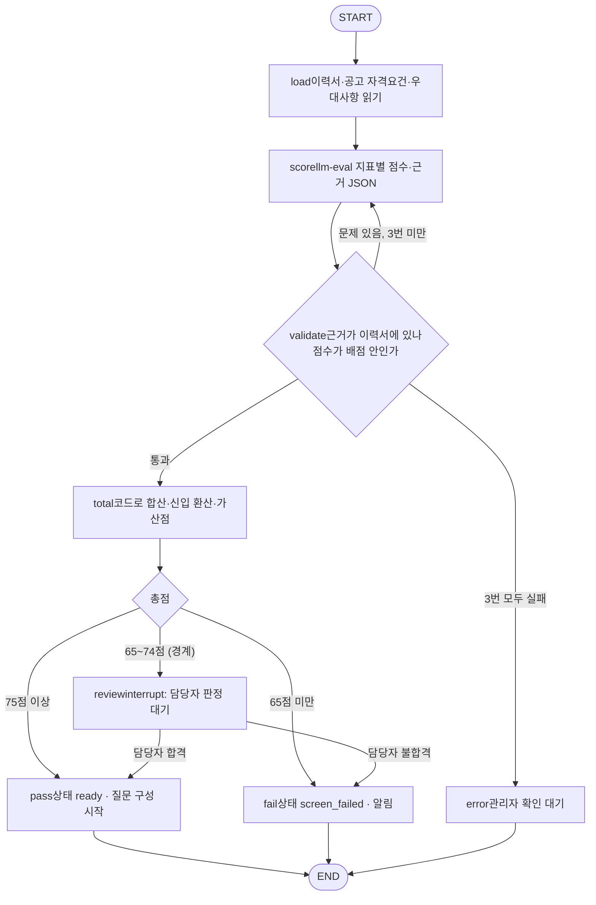

Huge AI 면접 · 회의 결과 정리

# 이력서 서류 평가 도입안

지금은 이력서를 제출하면 바로 면접 질문을 만들고 AI 면접을 볼 수 있습니다. 회의에서 그 사이에 AI 서류 평가를 넣고, 70점 이상인 지원자만 AI 면접을 보게 하자는 안이 나왔습니다. 아래는 그렇게 바꿨을 때의 절차와 바뀌는 지점입니다.

## 회의에서 정한 것

**01**1차 서류 평가를 넣는다. 단점보다 장점이 커서 진행하기로 결정

**02**채용담당자가 아니라 AI가 평가한다

**03**이력서가 평가의 중심. 파일은 거의 PDF로 받는다

**04**평가 지표: 자격증 · 경력 · 프로젝트 · 기술스택 · 학력 · 경험

**05**지표 점수 합계 70점 이상이면 면접 진행, 미만이면 불합격

**06**공고의 우대사항에 해당하면 가산점

## 바뀐 지원 절차

지원자 시스템 (API) AI (평가 워커) 새로 생기는 단계

지원자

### 공고에서 지원하기

지원 건이 만들어집니다. 상태 drafting

지원자

### 개인정보 수집·이용 동의

필수 동의를 해야 다음 단계로 갑니다. 지금과 같습니다.

지원자

### 이력서 업로드 (PDF)

PaddleOCR이 파일을 읽어 학력·경력·프로젝트·자격·기술 칸을 채웁니다. 마이페이지 등록본이나 직접 입력도 그대로 됩니다.

지원자

### 내용 확인·수정 후 제출

제출한 내용이 지원 건에 복사됩니다. 지금은 여기서 바로 면접 질문을 만들기 시작하지만, 바뀐 안에서는 서류 평가부터 합니다.

AI

### 서류 평가새 단계

평가 워커가 Qwen3 8B(llm-eval)에 이력서와 공고 자격요건·우대사항을 주고, 지표별 점수와 근거 문장을 JSON으로 받습니다. 점수 합산과 70점 비교는 코드가 합니다.

총점 ≥ 70 ?지표 점수 합 (신입은 환산) + 우대사항 가산점

합격 · 70점 이상

### 서류 합격 알림

마이페이지 알림과 메일로 면접 안내를 보냅니다.

### 면접 질문 10개 구성

지금 제출 직후 하던 작업을 이 시점으로 옮깁니다. 인성 2 · 회사 2 · 이력서 2 · 직무 4.

### 사전 점검 후 AI 면접

카메라·마이크 점검, 면접, 코딩 테스트, 평가. 지금과 같습니다.

불합격 · 70점 미만

### 면접 입장 막기

면접 질문을 만들지 않고, 면접 시작 버튼 대신 서류 결과를 보여 줍니다.

### 불합격 알림

통보 시점(바로 / 공고 발표일)과 공개 범위(점수·지표별 피드백)는 정해야 합니다.

### 관리자 화면에 기록

지표별 점수와 근거를 남겨 채용담당자가 확인하고 필요하면 재검토할 수 있게 합니다.

## 평가 지표와 배점 (초안)

회의에서는 지표만 정했고 배점은 아직 정하지 않았습니다. 아래 숫자는 논의를 시작하기 위한 예시입니다.

| 지표 | 보는 것 | 배점 |
| --- | --- | --- |
| 프로젝트 내용 | 공고 직무와 관련성, 맡은 역할, 결과가 구체적인지 | 25 |
| 기술스택 | 공고 자격요건에 적힌 기술과 겹치는 정도 | 20 |
| 경력 | 관련 직무 경력 기간과 업무 내용. **신입은 평가하지 않음** | 20 |
| 학력 | 관련 학과 여부, 석사·박사 학위 | 15 |
| 자격증 | 직무 관련 자격증 (정보처리기사, 클라우드·데이터 자격 등) | 10 |
| 경험 | 동아리, 대외활동, 공모전, 교육 과정 | 10 |
| **합계** |  | **100** |
| 우대사항 가산점 | 공고 우대사항에 해당하는 항목마다 가산. 총점은 100점을 넘지 않음 | 최대 +10 |

신입은 경력 20점을 빼고 나머지 80점 만점을 100점으로 환산합니다 (점수 × 100 / 80). 신입이 경력 0점 때문에 구조적으로 떨어지지 않게 하기 위해서입니다.

## 점수 계산 예시

초안 배점으로 지표 점수를 바꿔 보면서 70점 기준이 어느 정도인지 감을 잡아 보세요. 처음 값은 예시 지원자입니다.

[x] 신입 (경력 지표 제외)

프로젝트

기술스택

경력

학력

자격증

경험

우대 가산

0 / 100

## 지원 건 상태 변화

**지금** drafting→ready→interviewing→completed

**바뀐 안 · 합격** drafting→screening→ready→interviewing→completed

**바뀐 안 · 불합격** drafting→screening→screen_failed

**바뀐 안 · 평가 오류 (LLM 시간 초과 등)** drafting→screening→재시도 후 관리자 확인

새 상태 이름은 예시입니다. 지금 상태 목록은 backend/app/domain/status.py에 있습니다.

## LangGraph로 분기 처리하기 (안)

지금 지원 건 상태는 API 코드가 직접 바꾸고, LangGraph는 면접 진행·꼬리질문·질문 구성·공고 초안에만 씁니다. 서류 평가를 그래프 하나로 만들면 위 상태 변화가 그래프의 조건 분기가 됩니다.

add_conditional_edges

validate 뒤 재시도/실패/통과, total 뒤 합격/불합격/경계 분기. 질문 구성 그래프(question_compose.py)의 check → generate / bank 분기와 같은 방식입니다.

interrupt + Postgres checkpointer

경계 점수는 그래프를 멈추고 담당자 판정을 기다렸다가 Command(resume=판정)으로 잇습니다. 면접 그래프의 답변 기다리기(wait)가 이미 이렇게 동작합니다. 체크포인트가 DB에 남아 서버를 재시작해도 이어집니다.

pass 노드

지금 submitResume이 부르는 scheduleCompose를 여기서 부릅니다. 질문 구성 그래프는 손대지 않습니다.

경계 구간 65\~74점

예시 값입니다. 경계 구간을 두면 AI 점수만으로 떨어지는 지원자가 줄어 자동화된 결정 문제에도 대응이 됩니다. 구간을 0으로 두면 70점 단일 기준과 같아집니다.

## 코드에서 바뀌는 곳

routers/applications.py\
submitResume

제출 직후 scheduleCompose를 부르는 대신 서류 평가 작업을 큐에 넣고 상태를 screening으로 바꿉니다.

새 서비스 resume_screening

llm-eval(Qwen3 8B)에 지표별 점수·근거를 JSON 스키마로 받는 함수. worker-eval Celery 작업으로 돌립니다. 합격이면 scheduleCompose를 부릅니다.

새 테이블 resume_screenings

지원 건별 지표 점수, 가산점, 총점, 근거, 판정, 사용한 배점 버전. 근거에는 이력서 내용이 들어가므로 다른 개인정보 칼럼처럼 암호화합니다.

domain/status.py

screening, screen_failed 상태와 허용 전이 추가. 면접 입장(routers/interview.py)은 ready·interrupted만 받으므로 불합격자는 자동으로 막힙니다.

app_settings

합격선 70, 지표별 배점, 가산점 상한을 설정값으로 둬서 관리자가 바꿀 수 있게 합니다.

frontend 지원 현황 · 관리자 화면

지원자: 평가 중 / 합격 / 불합격 표시. 관리자: 지표별 점수와 근거, 재검토 버튼.

## 더 정해야 할 것

**Q1**지표별 배점과 신입 환산 방식. 위 표는 예시입니다.

**Q2**불합격 통보 시점. 제출 직후 바로 알릴지, 공고 발표일에 한꺼번에 알릴지.

**Q3**지원자에게 점수와 지표별 피드백을 보여 줄지, 합격·불합격만 보여 줄지.

**Q4**불합격자가 같은 공고에 이력서를 고쳐 다시 낼 수 있는지. 지금은 공고당 1인 1건입니다.

**Q5**이력서만 볼지, 자기소개서도 평가에 넣을지 (회의에서 이력서 중심으로 결정, 자기소개서는 미정).

**!**사람 검토 없이 AI 점수만으로 불합격시키면 개인정보보호법 제37조의2(자동화된 결정)에 따라 지원자의 거부·설명 요구권을 보장해야 할 수 있습니다. 근거 저장, 설명 제공, 채용담당자 재검토 절차를 함께 두는 것을 권합니다.